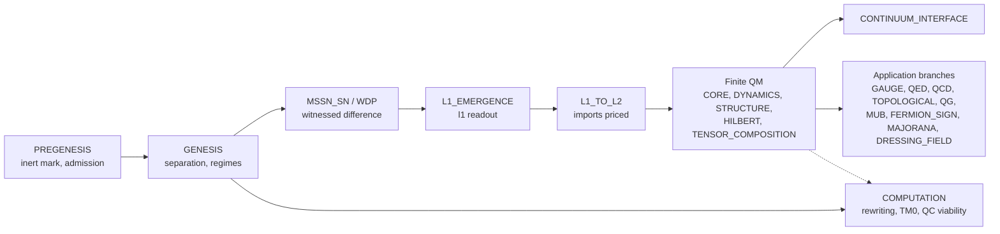

# Theory of Finite Quantum Mechanics

Can quantum mechanics be built from a finite, exact substrate, starting from a single inert mark, and where exactly must continuum or other extra structure be imported? This repository answers that question piece by piece. Its output is a priced map: each step is recorded as derived, conditional on named hypotheses, imported, refuted or open, with the evidence for that label.

The project does not claim to derive quantum mechanics. It records how far finite constructions reach and names every structure that has to be supplied from outside.

> **On the use of AI.** Much of the code, proofs, prose and review in this repository is drafted by AI models and LLM coding agents, directed and reviewed by the maintainer. The disclosure and the [acceptance rule](CONTRIBUTING.md#acceptance-rule) are in [CONTRIBUTING.md](CONTRIBUTING.md).

## What makes this checkable

| Layer | What it does | Where |
|---|---|---|
| Exact arithmetic | Certificates use integers, rationals, Gaussian rationals and explicit algebraic extensions. Floating point may appear in diagnostics but is never accepted as a certificate. | [`code/python/src`](code/python/src), [`code/rust/src`](code/rust/src) |
| Three-language parity | Lean 4 statements are kernel-checked against Mathlib. Rust exact certifiers and independent Python checkers recompute the same finite witnesses. | [`lean4/`](lean4), [`code/rust/`](code/rust), [`code/python/`](code/python) |
| Contract/score companions | Source files carry a `*.contract.score.yaml` companion that records their contract and scoring history. The checker verifies stored bytes, hashes and history. | [`scripts/contract_scores.py`](scripts/contract_scores.py) |
| Derivation DAG validator | Checks node and route schemas, status/route consistency, cycles, incoming routes for proved nodes, and a list of forbidden overclaiming words. | [`dag/validate_derivation_dag.py`](dag/validate_derivation_dag.py) |
| PFP staged protocol | Each target runs through P0 mine operad → P1 derive → P2 host verify → P3 repair → P4 adversarial mutation challenge → P5 record. The model never issues its own acceptance verdict: the host checks the original candidate bytes. | [`dag/pfp/README.md`](dag/pfp/README.md) |
| Narrowest claim | Records carry `AuthorityEffect: None`. Every review result states `supports`, `does_not_support` and `narrowest_claim`, and the DAG keeps the narrowest claim. | `dag/results/*/reviews/*/review_result.json` |

A status label is only as strong as its evidence. Labels are defined in `status_legend` in [`dag/derivation_dag.json`](dag/derivation_dag.json): `PROVED_LEAN`, `PROVED_PROSE`, `COMPUTATIONALLY_CHECKED`, `CONDITIONAL`, `IMPORTED_ASSUMPTION`, `DEFINITION`, `ADMITTED_PRIMITIVE`, `SOURCE_RECORD`, `OPEN` and `REFUTED`.

**Evidence map.** [`docs/evidence/README.md`](docs/evidence/README.md) maps every DAG node to the files that back it, grades the backing from E0 to E4 by rules a reader can recompute, and lists each place where a status says more than its evidence supports. The pages are generated by [`dag/evidence/build_evidence.py`](dag/evidence/build_evidence.py) and checked by `python -I -X utf8 dag/evidence/build_evidence.py --check`.

## Facts (generated)

The table below is produced by [`scripts/build_readme_facts.py`](scripts/build_readme_facts.py). Each value is computed from the file or command in its row. [`dag/test_readme_facts.py`](dag/test_readme_facts.py) fails if the block drifts.

<!-- facts:begin -->
<!-- Generated by scripts/build_readme_facts.py --write. Do not edit by hand. -->

| Fact | Value | Source |
|---|---|---|
| Derivation DAG nodes / routes | 925 / 934 | [`dag/derivation_dag.json`](dag/derivation_dag.json) |
| DAG stages (declared / with nodes) | 36 / 34 | [`dag/derivation_dag.json`](dag/derivation_dag.json) |
| DAG validator | `nodes=925 routes=934 records=977 failures=0 (exit 0)` | `python -I -X utf8 dag/validate_derivation_dag.py --no-files` |
| TFQ records | 977 | [`dag/theory_of_finite_qm.jsonl`](dag/theory_of_finite_qm.jsonl) |
| Derivation papers | 1014 in 36 stage folders | [`dag/derivations`](dag/derivations) |
| Lean references in DAG nodes | 1864 resolve to a file in this checkout, 0 do not (sibling or historical paths), 43 marked `external:` | [`dag/derivation_dag.json`](dag/derivation_dag.json) |
| Rust references in DAG nodes | 320 resolve to a file in this checkout, 628 do not, 2 marked `external:` | [`dag/derivation_dag.json`](dag/derivation_dag.json) |
| PFP prompts / indexed operad collections | 925 / 925 | [`dag/prompts`](dag/prompts), [`dag/operads/index.json`](dag/operads/index.json) |
| PFP stage per prompt | P0_MINE_OPERAD 748, P5_RECORD 177 | [`dag/operads/index.json`](dag/operads/index.json) |
| Nodes with executed review results | 177 nodes, 208 review directories | `dag/results/*/reviews/` |
| Review directories with a supports / does_not_support / narrowest_claim boundary | 176 | `dag/results/*/reviews/*/*.json` |
| P4 mutations rejected, as recorded in review records (`rejected_P4_mutations`, one value per directory) | 47271 | `dag/results/*/reviews/*/*.json` |
| PFP review outcomes on DAG nodes | 177 nodes carry `pfp_review`; scope_effect: consistent 69, caveat_added 18, statement_narrowed 65, status_lowered 25 | [`dag/derivation_dag.json`](dag/derivation_dag.json) |
| Outside-corpus records audited | 266 records from 8 corpora | [`dag/fragments/unified_dag.json`](dag/fragments/unified_dag.json) |
| Of those, claimed `PROVED_LEAN` by their source | 173: kept 86, refuted 2, recorded lower 85 (OPEN 38, IMPORTED_ASSUMPTION 18, COMPUTATIONALLY_CHECKED 14, PROVED_PROSE 8, DEFINITION 5, CONDITIONAL 2) | [`dag/fragments/unified_dag.json`](dag/fragments/unified_dag.json) |
| Tracked `.lean` files | lean4 943, papers 59, code 66, dag 2428, other 10 (the `dag` files are run snapshots) | `git ls-files` |
| Lake libraries / module roots in `lean4/lakefile.lean` | 37 / 889 | [`lean4/lakefile.lean`](lean4/lakefile.lean) |
| Lean toolchain | `leanprover/lean4:v4.35.0` | [`lean4/lean-toolchain`](lean4/lean-toolchain) |
| Mathlib | `v4.35.0` (manifest rev `56a005855ea1`) | [`lean4/lakefile.lean`](lean4/lakefile.lean), [`lean4/lake-manifest.json`](lean4/lake-manifest.json) |
| Axiom receipts / declaration lines audited | 8 files / 396 lines (literal `#print axioms` lines: 1) | `dag/research/*axioms*.txt`, `papers/**/axiom_report*.txt`, `**/evidence/axiom_reports/*.txt` |
| Axioms named in those receipts | propext 218, Quot.sound 165, Classical.choice 119; outside {propext, Classical.choice, Quot.sound}: none | same receipts |
| `sorry` tokens outside comments and strings | lean4 0, papers 0, code 0 | `git ls-files '*.lean'` |
| `admit` used as a tactic | lean4 0, papers 0, code 0 (identifiers named `admit`: 156) | `git ls-files '*.lean'` |
| Python test functions (`def test_`) | 6763 (plus 4049 in `dag/results` snapshots) | `git ls-files '*.py'` |
| Rust test functions (`#[test]`) | 7014 (plus 7995 in `dag/results` snapshots) | `git ls-files '*.rs'` |
| Contract/score companions | combined_files = 8845, all_passed = true | `python -I -X utf8 scripts/contract_scores.py check` |

Counts of test functions and files are inventory counts, not pass results. Status labels are the DAG's own; the legend is in `dag/derivation_dag.json` (`status_legend`).

Nodes by status: PROVED_LEAN 265, OPEN 175, COMPUTATIONALLY_CHECKED 159, DEFINITION 92, SOURCE_RECORD 81, IMPORTED_ASSUMPTION 71, CONDITIONAL 38, PROVED_PROSE 35, REFUTED 6, ADMITTED_PRIMITIVE 3.

Nodes by stage: PREGENESIS 31, GENESIS 89, MSSN_SN 28, WDP 29, L1_EMERGENCE 9, L1_TO_L2 48, FINITE_QM_CORE 33, FINITE_QM_DYNAMICS 22, FINITE_QM_STRUCTURE 44, IMPLEMENTATION 10, DRESSING_FIELD 43, MUTUALLY_UNBIASED_BASES 67, FERMION_SIGN 41, TENSOR_COMPOSITION 7, FINITE_OBSTRUCTION 9, AUTHORIZATION 8, FINITE_HILBERT 8, FINITE_GAUGE 1, FINITE_QED 1, FINITE_QCD 32, FINITE_TOPOLOGICAL 9, FINITE_QG 15, CONTINUUM_INTERFACE 9, IMPLEMENTATION_CORE 41, IMPLEMENTATION_SIBLING 26, ENGINE_CUSTODY 34, MAJORANA 46, COMPUTATION 82, CONSTRUCTOR_THEORY 15, CAUSAL_QFT 14, ADS_CFT 13, LOOP_QUANTUM_GRAVITY 16, GENESIS_TO_HIGHER 12, OBSERVER_PRESHEAF 33.

Nodes named in this README:

| Node | Stage | Status |
|---|---|---|
| `FQ-GAP-BORN-UNIQUENESS-GLEASON` | FINITE_QM_CORE | `CONDITIONAL` |
| `FQ-CONTINUUM-HILBERT-LIFT-CONSTRUCTION` | FINITE_QM_CORE | `PROVED_LEAN` |
| `FQ-GAP-CONTINUUM-HILBERT-LIFT` | FINITE_QM_CORE | `CONDITIONAL` |
| `L1-IMP-HILBERT-INNER-PRODUCT` | L1_TO_L2 | `CONDITIONAL` |
| `L1-IMP-COMPLEX-FIELD` | L1_TO_L2 | `CONDITIONAL` |
| `FQ-GAP-STONE-CONTINUOUS-TIME` | FINITE_QM_DYNAMICS | `CONDITIONAL` |
| `FQ-GAP-U1-CIRCLE` | FINITE_QM_CORE | `CONDITIONAL` |
| `L1-IMP-LINEAR-ISOMETRIC-DYNAMICS` | L1_TO_L2 | `CONDITIONAL` |
| `PGW-ENDOGENOUS-DEMAND-OB1` | GENESIS | `OPEN` |
| `COMP-C4-UNBOUNDED-SUPPLY-IMPORT` | COMPUTATION | `IMPORTED_ASSUMPTION` |
| `COMP-C7-NF-REACH-UNDECIDABLE` | COMPUTATION | `PROVED_LEAN` |
| `QCV-VIABILITY-NEEDS-ALL-REQUIREMENTS` | COMPUTATION | `PROVED_LEAN` |
| `QCV-PHYSICAL-SATISFIABILITY-OPEN` | COMPUTATION | `OPEN` |
| `MUB6-MAX-MUB-SIX-EQUALS-THREE` | MUTUALLY_UNBIASED_BASES | `OPEN` |
| `FSP-MASTER-DICHOTOMY-REFUTED` | FERMION_SIGN | `REFUTED` |
| `TFQ-0084` | FINITE_QG | `OPEN` |
<!-- facts:end -->

## How claims are kept honest

The project lowers its own labels when the evidence is thinner than the label. Recent examples:

- **Outside-corpus audit ([#131](https://github.com/dbccpage/theory_of_finite_quantum_mechanics/pull/131)).** Records from the FSP, MUB(6), Majorana and DFM papers, the Authorization-Incompleteness package and the computation papers were folded into the DAG only after an audit. Each record keeps its `source_claimed_status` next to the audited `status`, with an `audit` note. Many `PROVED_LEAN` claims were recorded lower where the Lean covered only one fixed instance or was missing. The counts are in the facts table, and the records are in [`dag/fragments/unified_dag.json`](dag/fragments/unified_dag.json).
- **FSP "master theorem".** As stated, the claim that every finite system either has a polynomial-time sign-eliminating involution or is an NP-hard sign obstruction fails, because NP-hardness is a property of input families. It is recorded as `FSP-MASTER-DICHOTOMY-REFUTED`. Corpus reconciliation is in [#134](https://github.com/dbccpage/theory_of_finite_quantum_mechanics/pull/134).
- **MUB(6).** The source's quartet-exclusion certificates (Positivstellensatz, SDP gap, Krawczyk cover, CAD and others) are recorded as `OPEN` claims, not results. `MUB6-MAX-MUB-SIX-EQUALS-THREE` stays `OPEN`, as it is in the literature. One source claim, `MUB6-AFFINE-FIBER-THIRD-BASIS`, is `REFUTED` by an explicit product triple.
- **PFP reviews ([#133](https://github.com/dbccpage/theory_of_finite_quantum_mechanics/pull/133)).** The reviews of the staged prompt runs narrow or lower node statements where the kernel-checked Lean is a fixed instance. Folding them into the DAG is pending that PR, and the facts table reports it as pending until then.
- **Split labels.** When a construction is checked but the choice of its inputs is not, the node is split. `FQ-CONTINUUM-HILBERT-LIFT-CONSTRUCTION` is `PROVED_LEAN` with named hypotheses. `FQ-GAP-CONTINUUM-HILBERT-LIFT`, which holds the selection of the scalar field and the ℓ² uniformity, stays `CONDITIONAL`.

## Selected results, with exact scope

The current status of each named node is in the generated table above.

| Result | Scope as recorded | Evidence |
|---|---|---|
| Born rule via effect-additive valuations | Every positive, normalized, effect-additive valuation on rational n×n matrices is E ↦ tr(ρE) for a unique symmetric rational PSD trace-one ρ. **CONDITIONAL**: the matrix carrier and effect additivity are supplied, not derived. | [#113](https://github.com/dbccpage/theory_of_finite_quantum_mechanics/pull/113); [`lean4/BornEffectValuation.lean`](lean4/BornEffectValuation.lean), [`lean4/BornMatrixCarrier.lean`](lean4/BornMatrixCarrier.lean); `dag/results/FQ-GAP-BORN-UNIQUENESS-GLEASON/runs/20261020T205000Z_effect_valuation_lean`; node `FQ-GAP-BORN-UNIQUENESS-GLEASON` |
| Continuum Hilbert lift | Finite exact carriers form a tower whose Hausdorff completion is a Hilbert space, once the scalar field (ℝ or ℂ) and the ℓ² uniformity are supplied. The construction is `PROVED_LEAN`. Selecting those two inputs is **CONDITIONAL**, and ℓ¹ is shown to give a different Cauchy structure. | [#117](https://github.com/dbccpage/theory_of_finite_quantum_mechanics/pull/117), [#122](https://github.com/dbccpage/theory_of_finite_quantum_mechanics/pull/122); [`lean4/HilbertLiftCompletion.lean`](lean4/HilbertLiftCompletion.lean), [`lean4/HilbertLiftRationalUniformity.lean`](lean4/HilbertLiftRationalUniformity.lean); nodes `FQ-CONTINUUM-HILBERT-LIFT-CONSTRUCTION`, `FQ-GAP-CONTINUUM-HILBERT-LIFT` |
| Sector-form inner product | A Hermitian Gram form whose quadratic readout is additive on disjoint sectors and invariant under a transitive group of sector permutations equals the standard form up to a positive scale. Without the symmetry law it is not unique: the counterexample is diag(1,2). **CONDITIONAL** on the two laws. | [#125](https://github.com/dbccpage/theory_of_finite_quantum_mechanics/pull/125); [`lean4/SectorFormUniqueness.lean`](lean4/SectorFormUniqueness.lean); node `L1-IMP-HILBERT-INNER-PRODUCT` |
| Complex-field selection | Among the supplied same-family matrix carriers, the dimension law K_d(n) = n + d binom(n,2) is multiplicative on composites iff d = 2 (for d > 0). The real tag fails by an explicit product-test-invisible witness and the quaternionic tag fails by a dimension count. **CONDITIONAL**: local tomography, the R/C/H carrier restriction and completeness are imported, so this selects among supplied carriers and does not derive the complex field. | [#138](https://github.com/dbccpage/theory_of_finite_quantum_mechanics/pull/138); [`lean4/ComplexFieldSelection.lean`](lean4/ComplexFieldSelection.lean); node `L1-IMP-COMPLEX-FIELD` |
| Operational form of local tomography | Under calibration, a nonzero observation and descent of an admitted operation family, irreducibility of that family forces injectivity of the observation. The existence of such a family is equivalent to local tomography, and test-then-prepare reset filters built under stated closure rules (#147) do not discharge it non-circularly. This re-expresses local tomography; it does not derive it. Node status `IMPORTED_ASSUMPTION`. | [#144](https://github.com/dbccpage/theory_of_finite_quantum_mechanics/pull/144), [#147](https://github.com/dbccpage/theory_of_finite_quantum_mechanics/pull/147); [`lean4/OperationalTomography.lean`](lean4/OperationalTomography.lean), [`lean4/OperationalFilterFamily.lean`](lean4/OperationalFilterFamily.lean); node `FQ-OPERATIONAL-LOCAL-TOMOGRAPHY` |
| Finite exact Wigner dynamics | On the exact carrier Q(i)^n, a ray map preserving the Born transition probability is induced by a Q(i)-linear similarity F^H F = d (d > 0 rational), possibly composed with conjugation, and is reversible, without a continuity hypothesis. The scale is removable iff d is a sum of two rational squares; a scale-3 countermodel is neither unitary nor antiunitary. **CONDITIONAL** on the transition-probability law, which is supplied (`L1-IMP-TRANSITION-PROBABILITY-LAW`, `IMPORTED_ASSUMPTION`). | [#150](https://github.com/dbccpage/theory_of_finite_quantum_mechanics/pull/150); [`lean4/FiniteWignerTheorem.lean`](lean4/FiniteWignerTheorem.lean); node `L1-IMP-LINEAR-ISOMETRIC-DYNAMICS` |
| Quantum-computation self-obstruction | Within an exactly declared finite model, the answer is a threshold condition, not a no-go. Viability holds iff the fresh supply reaches λ/((1−g)κ) and the level overheads stay bounded. The four named requirements are net-efficient repair, fresh supply, bounded overhead and a physical error rate below threshold. Whether a physical system meets them stays `OPEN`. | [#142](https://github.com/dbccpage/theory_of_finite_quantum_mechanics/pull/142); [`lean4/QcSelfObstruction.lean`](lean4/QcSelfObstruction.lean); [`dag/research/quantum_computation_self_obstruction.md`](dag/research/quantum_computation_self_obstruction.md); axiom receipt [`dag/research/quantum_computation_self_obstruction_axioms.txt`](dag/research/quantum_computation_self_obstruction_axioms.txt) |
| Genesis → general-purpose computation | For one fixed rewriting regime built from separated marks, TM0 simulation, halting equivalence and non-computability of normal-form reachability are kernel-checked. Mathlib's computability theory is cited as imported infrastructure. Unbounded supply of fresh marks is a declared import (`COMP-C4-UNBOUNDED-SUPPLY-IMPORT`), and no minimal machine is claimed. | [#143](https://github.com/dbccpage/theory_of_finite_quantum_mechanics/pull/143); [`lean4/GenesisComputation.lean`](lean4/GenesisComputation.lean), [`lean4/GenesisCompTM.lean`](lean4/GenesisCompTM.lean), [`lean4/GenesisCompUniv.lean`](lean4/GenesisCompUniv.lean); [`dag/research/genesis_to_universal_computation.md`](dag/research/genesis_to_universal_computation.md); receipt [`dag/research/genesis_to_universal_computation.axioms.txt`](dag/research/genesis_to_universal_computation.axioms.txt) |
| Lean 4.35.0 migration | Every live Lean package was moved to `leanprover/lean4:v4.35.0` and Mathlib `v4.35.0`, and the replays were re-pinned. | [#137](https://github.com/dbccpage/theory_of_finite_quantum_mechanics/pull/137); [`lean4/lean-toolchain`](lean4/lean-toolchain) |

## Derivation arc



The stage list is `stages` in [`dag/derivation_dag.json`](dag/derivation_dag.json). Implementation and custody stages (`IMPLEMENTATION*`, `ENGINE_CUSTODY`, `AUTHORIZATION`, `FINITE_OBSTRUCTION`) are omitted from the diagram.

## Related repositories

The first stages of the arc above, PREGENESIS, GENESIS and MSSN_SN, are built from results in two earlier public repositories by the same author. The three use different methods and make different kinds of claim.

| Repository | Role | Where the DAG cites it |
|---|---|---|
| [`dbccpage/19L57G1`](https://github.com/dbccpage/19L57G1) (Genesis) | A blind, sealed, finite derivation from an opaque seed. It stops at a tie: the minimum response costs two items in both readings L and F, and the minima are tied. It has 75 Lean modules, 1530 axiom reports and 140 `CL-*` claims. | 90 nodes: 71 in GENESIS, 9 in PREGENESIS, 8 in MSSN_SN, 1 in IMPLEMENTATION and 1 in AUTHORIZATION. 43 Lean references are pinned to commit `85a83ae`. |
| [`dbccpage/H3V7N5QF`](https://github.com/dbccpage/H3V7N5QF) (Genesis-Ongoing) | 25 further blind derivations, each from its own seed, on terms, assertions and a short list of changes: obstruction and answer, fewest changes, counted assertions, two relations, an admission gate, and three operator-targeted climbing rounds. | 16 nodes: 14 in GENESIS, 1 in COMPUTATION and 1 in WDP, by a sibling path and not a pinned commit. |

Two limits apply to this link, and both are recorded in the DAG:

- **The route from GENESIS to WDP is a gap.** Its three routes are `GAP_NO_DERIVATION`, and five bridge obligations (`GEN-WDP-O01` to `O05`) are open in `PG-WDP-GENESIS-BRIDGE-OBLIGATIONS`. Neither repository derives a structure of finite QM. The stages from L1 on carry their own status labels.
- **The Genesis nodes are mostly grade E0 here.** 100 of the 106 nodes that cite these repositories are E0 in the [evidence map](docs/evidence/README.md), which means this checkout holds no counted evidence file for them. Mostly that is because the Lean and code they cite are in the two Genesis repositories. Each repository checks itself with its own local gates, described in its README.

The stage GENESIS_TO_HIGHER asks what a higher-categorical language would need beyond Genesis. It is open steps and named imports, and its three routes from GENESIS and MSSN_SN are also `GAP_NO_DERIVATION`. The read-only inventories of the two repositories are [`research/genesis_foundations/genesis_19L57G1.md`](research/genesis_foundations/genesis_19L57G1.md) and [`research/genesis_foundations/genesis_ongoing.md`](research/genesis_foundations/genesis_ongoing.md).

Counts in this section are from `dag/derivation_dag.json` at commit `8f1f7ca` (2026-10-22) and are not part of the generated facts block.

## Open problems: help wanted

Each item is a DAG node with a staged PFP prompt or a named obligation. The current statuses are in the generated table.

- **Born/Gleason without a supplied carrier**: `FQ-GAP-BORN-UNIQUENESS-GLEASON`. Derive the matrix carrier and effect additivity, or show that they are needed.
- **Scalar-field and ℓ² selection**: `FQ-GAP-CONTINUUM-HILBERT-LIFT`, `L1-IMP-COMPLEX-FIELD`. Nothing in the finite carrier yet selects ℝ or ℂ, or ℓ² over ℓ¹. #138 and #144 attack the field question conditionally.
- **Stone theorem and continuous time**: `FQ-GAP-STONE-CONTINUOUS-TIME`. Over ℚ(i) and larger carriers, whether a one-parameter group exists through a given unitary step is open.
- **The U(1) circle**: `FQ-GAP-U1-CIRCLE`. In ℚ(i), u = (3+4i)/5 has no square root, so no rational one-parameter group passes through it.
- **Wigner-type dynamics**: `L1-IMP-LINEAR-ISOMETRIC-DYNAMICS`. Conditional on the supplied transition-probability law; the dynamics is then a reversible similarity (see the table above). The law itself is not derived.
- **Endogenous unbounded supply** (`TFQ-0504`, node `PGW-ENDOGENOUS-DEMAND-OB1`): an object-language rule that generates the next demand. The computation chain imports this supply (`COMP-C4-UNBOUNDED-SUPPLY-IMPORT`).
- **max MUB(6)**: `MUB6-MAX-MUB-SIX-EQUALS-THREE`. This is open in the literature, and none of the recorded certificates closes it.
- **Regge / Schläfli target**: `TFQ-0084`. State the exact finite gravity shadow (a Regge deficit on a finite simplicial complex) in all three languages. P0 mining is in [#139](https://github.com/dbccpage/theory_of_finite_quantum_mechanics/pull/139).

## Reproduce it

Toolchains: Lean `v4.35.0` via [elan](https://github.com/leanprover/elan), Mathlib `v4.35.0` (pinned in `lean4/lake-manifest.json`), stable Rust with Cargo, and Python ≥ 3.11 with `pytest` and `pyyaml`.

```bash
# DAG: generated files are current, invariants hold, validator passes
python -I -X utf8 dag/sync_unified_dag.py --check
python -I -X utf8 dag/sync_application_branches.py --check
python -I -X utf8 dag/sync_pregenesis_to_wdp.py --check
python -I -X utf8 dag/sync_frontier_branches.py --check
python -I -X utf8 dag/sync_unified_dag.py --invariants
python -I -X utf8 dag/validate_derivation_dag.py --no-files
python -I -X utf8 -m pytest dag/test_*.py

# Contract/score companions and this README's facts block
python -I -X utf8 scripts/contract_scores.py check
python -I -X utf8 scripts/build_readme_facts.py --check

# Python and Rust checkers
python -I -X utf8 -m pytest code/python/tests
cargo test --manifest-path code/rust/Cargo.toml

# Lean (downloads the Mathlib cache; a full build is large)
cd lean4 && lake exe cache get && lake build
lake build QcSelfObstruction    # one library, for example
```

Before changing the DAG, read [`dag/derivation_dag_reading_note.md`](dag/derivation_dag_reading_note.md) and [`dag/PFP_COMPLETION_PLAN.md`](dag/PFP_COMPLETION_PLAN.md). The plan gives the sync order and the checks to run.

## Repository map

| Path | Contents |
|---|---|
| [`dag/`](dag) | The derivation DAG, the TFQ JSONL, generators, the validator and their tests |
| [`dag/derivations/`](dag/derivations) | One Markdown paper per derivation step, by stage |
| [`dag/prompts/`](dag/prompts), [`dag/operads/`](dag/operads), [`dag/pfp/`](dag/pfp) | Staged PFP prompts, per-target operad collections and the protocol tools |
| [`dag/results/`](dag/results) | PFP runs and host reviews with their receipts |
| [`dag/research/`](dag/research), [`dag/fragments/`](dag/fragments) | Research notes, axiom receipts and the fragment files the generators read |
| [`lean4/`](lean4) | The Lake project (Lean 4 + Mathlib) |
| [`code/rust/`](code/rust), [`code/python/`](code/python) | Exact Rust certifiers and independent Python checkers, with tests |
| [`papers/`](papers) | Source corpora (FSP, MUB(6), Majorana, foundations) and their own Lean packages and axiom reports |
| [`scripts/`](scripts) | Repository tools: contract/score companions, master ledger, README facts |
| [`evidence/`](evidence) | Migration receipts and evidence dossiers |
| [`SCORING.md`](SCORING.md) | The scoring rubric |

## Contributing and support

To contribute:

1. Pick an `OPEN` or `CONDITIONAL` node from [`dag/derivation_dag.json`](dag/derivation_dag.json). The open problems above are a starting point.
2. Run its PFP prompt from [`dag/prompts/`](dag/prompts) through the stages in [`dag/pfp/README.md`](dag/pfp/README.md).
3. Submit a pull request with the receipts: Lean axiom output, Rust and Python checker output, contract/score companions for every new source file, and a review record with `supports`, `does_not_support` and `narrowest_claim`. Counterexamples and precise obstructions are welcome results.

Support this research: [Buy Me a Coffee](https://buymeacoffee.com/ooutwire).

## License

Licensed under the Apache License, Version 2.0 (the "License");
you may not use this file except in compliance with the License.
You may obtain a copy of the License at

    http://www.apache.org/licenses/LICENSE-2.0

Unless required by applicable law or agreed to in writing, software
distributed under the License is distributed on an "AS IS" BASIS,
WITHOUT WARRANTIES OR CONDITIONS OF ANY KIND, either express or implied.
See the License for the specific language governing permissions and
limitations under the License.

The scoring evaluator ([`code/python/operations/cicd/code_scoring_evaluator.py`](code/python/operations/cicd/code_scoring_evaluator.py)) is a static triage tool. Source labels, test filenames and proof keywords do not earn engineering grades. Unsupported gates and score tokens remain null, capability is a provisional lower bound, and enforcement refuses incomplete assessments. Reviewed evidence records need separate source-bound validation.
