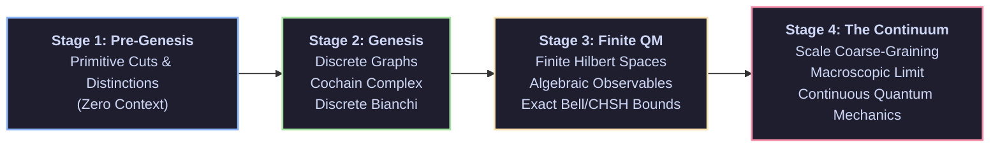

# Theory of Finite Quantum Mechanics

> **From Pre-Genesis to Genesis to the Continuum: A Constructive Mathematical Investigation into the Foundations of Quantum Theory**

---

## Overview

Quantum mechanics is traditionally formulated using the machinery of the continuum: infinite-dimensional Hilbert spaces, continuous Lie groups, smooth differential manifolds, and real or complex scalar fields. 

This repository investigates a foundational question: **Can quantum mechanics be constructed from the ground up on purely finite, discrete substrates—and if so, exactly where do continuous structures become necessary?**

Rather than postulating continuous wavefunctions and differential equations as primitive axioms, this project traces a step-by-step mathematical trajectory from first principles:
1. **Pre-Genesis**: Starting before mathematical structure, examining primitive distinctions, directed cuts, and relational boundaries without assuming spaces, metrics, or physical dynamics.
2. **Genesis**: The emergence of discrete combinatorial carriers, oriented graphs, cochain complexes, and discrete symmetries.
3. **Finite Quantum Mechanics**: Constructing finite Hilbert spaces, operator algebras, anticommutation/commutation relations, and exact measurement statistics using exact arithmetic over rational and algebraic number fields.
4. **The Path to the Continuum**: Investigating coarse-graining, multi-scale projections, and thermodynamic scaling to understand how smooth spacetime geometries, gauge fields, and continuous wave mechanics arise in the macroscopic limit.

---

## Derivation Arc



### 1. Pre-Genesis: Foundational Distinctions
- Starting from bare marks and elementary distinctions prior to geometric assumptions.
- Constructing directed boundaries versus symmetric links.
- Distinguishing combinatorial orientation from symmetric graph invariants.

### 2. Genesis: Discrete Relational Structure
- Building discrete combinatorial complexes and topological cell networks.
- Formulating exact coboundary operators and discrete conservation laws without continuous derivatives.
- Establishing exact combinatorial identities that prevent spurious boundary curvature.

### 3. Finite Quantum Mechanics: Exact Algebraic Realization
- Lifting discrete carrier configurations to finite-dimensional state spaces.
- Constructing canonical operator algebras (anticommutators and commutators) on finite mode lattices.
- Pricing every admitted mathematical structure: separating what is derived combinatorially from what must be supplied (such as complex phases, inner products, and unitary evolution).
- Analyzing non-locality, contextuality, and Bell-CHSH inequalities directly within exact rational and algebraic number fields.

### 4. The Continuum: Limits, Retractions, and Obstructions
- Formulating scale retractions and coarse-graining maps connecting fine-grained discrete states to coarser operational levels.
- Investigating complexity barriers and path-sum sign cancellations in many-body systems.
- Deriving exact criteria under which macroscopic continuous limits are physically and computationally sound.

---

## Architectural Principles

- **Constructive and Exact**: Avoids relying on continuum approximations or floating-point rounding where exact rational, cyclotomic, or algebraic representations can be computed.
- **Explicit Assumptions**: Clearly separates structural inputs that are postulated from theorems that are rigorously derived.
- **Multi-Tier Verification**: Mathematical results are paired with independent verification suites, combining computational evaluators, symbolic algebra, and formal machine-checked proof scripts.

---

## Getting Started

### Prerequisites

- **Python 3.11+** for symbolic evaluation and discrete simulation models.
- **Rust Toolchain** (latest stable) for high-performance algebraic certifiers.
- **Lean 4** for formal interactive theorem verification.

### Running the Verification Pipeline

```bash
# Run the core validation test suite
pytest

# Execute exact algebraic checks
cargo test

# Elaborate formal proofs
lake build
```

## License

Licensed under the Apache License, Version 2.0 (the "License");
you may not use this file except in compliance with the License.
You may obtain a copy of the License at

    http://www.apache.org/licenses/LICENSE-2.0

Unless required by applicable law or agreed to in writing, software
distributed under the License is distributed on an "AS IS" BASIS,
WITHOUT WARRANTIES OR CONDITIONS OF ANY KIND, either express or implied.
See the License for the specific language governing permissions and
limitations under the License.


# Execute exact algebraic checks
cargo test

# Elaborate formal proofs
lake build

The scoring evaluator is a static triage tool: source labels, test filenames,
and proof keywords do not earn engineering grades. Unsupported gates and score
tokens remain null, capability is a provisional lower bound, and enforcement
refuses incomplete assessments. Reviewed evidence records need separate
source-bound validation.
