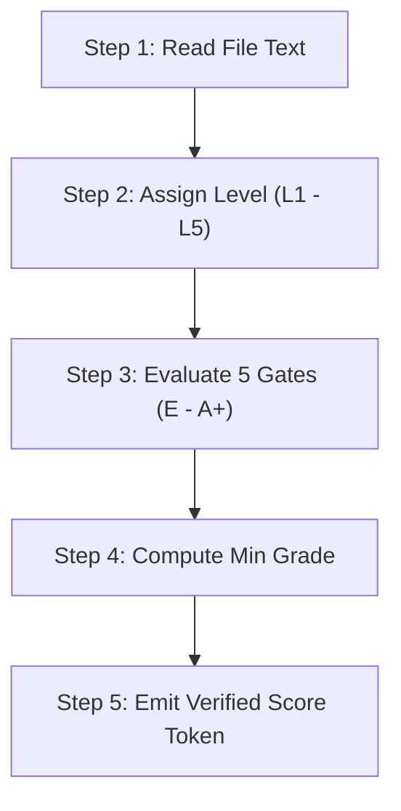

# Code Scoring Rubric: Multi-Language Sovereign Quality & Invariant Gate

**AuthorityEffect:** None.

This document establishes the canonical, fail-closed code evaluation rubric across all software and formal artifacts in this workspace. It extends the core five-gate model to provide language-specific invariants for **SQL**, **Python**, **Rust**, and **Lean 4**.

---

## 1. Overview & Scoring Calculus

Every source file receives exactly one **level** (`L1`–`L5`) and one **grade** (`E`–`A+`). The composite evaluation token is written as:

$$\mathbf{Score} = \mathbf{L}\langle\text{Level}\rangle\langle\text{Grade}\rangle \quad (\text{e.g. } \texttt{L1A}, \texttt{L2C}, \texttt{L3B}, \texttt{L4A}, \texttt{L5A+})$$

### 1.1 The Independence Principle
Level and grade are completely independent axes:
- **Level ($\mathbf{L}$):** Measures the architectural and conceptual sophistication the text actually delivers. A complex domain topic, prestigious theorem title, or verbose comment block does **not** raise the level. Score the concrete code.
- **Grade ($\mathbf{G}$):** Measures the engineering integrity, rigor, and compliance of the implementation against five sovereign gates.

### 1.2 The Fail-Closed Weakest Link Rule
The composite grade is the **mathematical minimum** across the five component gates:

$$\text{Grade} = \min(\text{Gate}_1, \text{Gate}_2, \text{Gate}_3, \text{Gate}_4, \text{Gate}_5)$$

The grade scale is ordered: $\mathbf{E} < \mathbf{D} < \mathbf{C} < \mathbf{B} < \mathbf{A} < \mathbf{A+}$. There are no intermediate marks (`B+`, `A-`, etc.). A single failure on any gate immediately bounds the overall file grade to that failing mark.

---

## 2. Sophistication Levels ($\mathbf{L1}$–$\mathbf{L5}$)

| Level | Author Profile | Delivered Code Characteristics |
|---|---|---|
| **L1** | High School / Script Trainee | Syntax, repetitive boilerplate, simple re-exports, one-line stubs, static constants, or scripts that print or return unvalidated literals. |
| **L2** | Undergraduate CS Student | Standard coursework structure. Straightforward definitions, obvious lemmas, naive classes with getters/setters, basic loops, single assertion tests, and tutorial algorithms. |
| **L3** | Graduate CS Researcher | Research-grade code. Non-trivial domain algorithms, exact arithmetic structures, real proofs or invariant envelopes, and structured domain models past coursework. |
| **L4** | Senior Professional Engineer (5+ Yrs) | Production craft. Intentional API grain, comprehensive edge-case handling, typed failure modes, and tight abstractions. A senior staff reviewer approves with negligible rework. |
| **L5** | Principal Fellow / PhD Mathematician (20+ Yrs) | The design is the mathematics. Proof-carrying or certificate-carrying architectures where abstractions match underlying categorical or relational theorems. Zero fake generality. |

---

## 3. The Five Sovereign Component Gates

### Gate 1: Provenance & Authority
Every file must state its own heritage. A file of unknown origin stops at **E**.

Heritage comprises three mandatory headers in the file text:
1. **Origin:** A resolvable URI, Git commit hash, paper section, EADC coordinate (`EA:FFF.SSS.BBB`), or derivation-DAG node.
2. **Claim:** The specific contract URN, theorem, campaign block, or formal requirement this file discharges.
3. **Authority:** The explicit authority ceiling declared by the file (e.g. `AuthorityEffect: None`).

| Grade | Provenance Invariant |
|---|---|
| **E** | No origin declared. The file does not specify where it comes from. |
| **D** | A campaign name or title is given, but without a resolvable origin or authority ceiling. |
| **C** | A resolvable origin is present, but the specific claim ID or authority effect is absent. |
| **B** | Origin, claim URN, and authority ceiling are all declared and syntactically valid. |
| **A** | Origin resolves to an existing file, commit, or paper section in this repository, with verified claim mapping. |
| **A+** | The **A** record, plus an explicit negative inheritance declaration ("Scope Fence: What this file does NOT claim or inherit"). |

---

### Gate 2: Arithmetic & Numeric Discipline
In foundational and exact verification domains, floating-point numbers (`float`, `f32`, `f64`, `binary64`, `REAL`, `DOUBLE`) introduce nondeterminism, rounding drift, and truncation defects. Exact computation requires integers and rationals.

| Grade | Numeric Invariant |
|---|---|
| **E** | A binary float appears in an internal state, computed result, cryptographic step, or logical branch. |
| **D** | The primary path uses exact numbers, but a float participates in an intermediate conversion, comparison, or threshold check. |
| **C** | Every computed value is an integer or rational. Floats appear only as unparsed external text or non-semantic display strings. |
| **B** | Every numeric value throughout the file, including error diagnostics and test fixtures, is an integer or rational. |
| **A** | The **B** rule, plus the type system or runtime gate explicitly refuses float values at the public boundary. |
| **A+** | The **A** rule, and the scalar type strictly matches the formal mathematical structure (e.g., Gaussian rational $\mathbb{Q}(i)$ or exact cyclotomic field), with proven exclusion of non-admitted extensions. |

---

### Gate 3: Panics, Aborts & Failure Modes
Library and proof paths must return typed domain values or typed errors. They must never terminate the process abruptly.

- **Forbidden Abort Forms:** Rust `panic!`, `unwrap()`, `expect()`, `unreachable!()`, `todo!()`, `unimplemented!()`; Python `assert` in non-test code, bare `raise Exception`; Lean 4 `panic!`, `sorry`, unverified `unsafe`; SQL unhandled division-by-zero or unconstrained rollback.
- **Permitted Exit:** A CLI binary `main()` entrypoint may exit with a non-zero exit code after catching and logging a typed failure.

| Grade | Failure Handling Invariant |
|---|---|
| **E** | An unhandled abort or panic form exists on a path reachable by a caller. |
| **D** | An abort form remains on a code path claimed to be "impossible" (types should prove impossibility instead). |
| **C** | All library, proof, and query paths return typed errors or safe sentinel models (`Result`, `Option`, `Except`). |
| **B** | Every failure mode is a distinct, typed domain error, and the test suite explicitly exercises every error variant. |
| **A** | Each error variant records the exact violated invariant and measured parameters, verified by negative tests. |
| **A+** | The **A** rule, arithmetic overflow/underflow is exhaustively guarded, and the test suite never aborts. |

---

### Gate 4: Test Discipline & Mutation Resistance
A file is only as sound as the independent falsification harness that evaluates it.

- **Unit:** Tests the isolated function, type, or query invariant.
- **Integration:** Tests composition with at least one neighboring module or subsystem.
- **End-to-End (E2E):** Drives the file's claim through the outermost public contract or API boundary.
- **Mutation:** Verifies that synthetic modifications (mutants) that alter semantics while preserving syntax are detected and killed by tests.

| Grade | Test Suite Invariant |
|---|---|
| **E** | Missing either integration coverage or E2E coverage for the file's declared functionality. |
| **D** | Tests exist, but compare outputs against tautologies or values constructed within the test itself. |
| **C** | Integration and E2E suites each lock in at least one real invariant. Required unit tests are present. |
| **B** | Integration, E2E, and unit suites each include negative test cases that must fail when given invalid inputs. |
| **A** | The **B** rule, plus a mutation suite is executed and all non-equivalent mutants are killed. Kill count is recorded. |
| **A+** | 100% of non-equivalent mutants altering claim semantics are killed. The test suite remains minimal and readable. |

---

### Gate 5: Structural & Cognitive Complexity
Code must remain verifiable by both human reviewers and automated linters.

- **Cyclomatic Complexity (McCabe, 1976):** Independent linear execution paths ($M = E - N + 2P$). Industrial ceiling is 10.
- **Cognitive Complexity (SonarSource):** Penalizes nested structures, breaks in linear reasoning, and compound conditions. Quality ceiling is 15.

| Grade | Complexity Invariant (Worst Function in File) |
|---|---|
| **E** | Not measured, OR Cyclomatic Complexity > 50, OR Cognitive Complexity > 40. |
| **D** | Cyclomatic Complexity 21–50, OR Cognitive Complexity 26–40. |
| **C** | Cyclomatic Complexity 16–20, OR Cognitive Complexity 16–25. |
| **B** | Cyclomatic Complexity 11–15, AND Cognitive Complexity $\le$ 15. |
| **A** | Cyclomatic Complexity $\le$ 10, AND Cognitive Complexity $\le$ 15, with maximum nesting depth $\le$ 3. |
| **A+** | The **A** band, with exact pinned measurements and tool version recorded in the file's provenance header. |

---

## 4. Language-Specific Invariants & Deep Fences

### 4.1 SQL Domain Discipline
Relational databases enforce foundational consistency. SQL code must eliminate nondeterminism, partial states, and injection risks.

1. **NULL-Totality Fences:**
   - Nullable columns must be explicitly justified. Default to `NOT NULL`.
   - In expressions and joins, apply defensive `COALESCE` or strict three-valued logic (3VL) guards. Never rely on `col = NULL`.
2. **Deterministic Ordering:**
   - Every query using `LIMIT`, `OFFSET`, or window partitions must include an unambiguous `ORDER BY` clause with a unique tie-breaker (e.g. `ORDER BY created_at DESC, id ASC`).
3. **Referential & Constraint Integrity:**
   - Foreign keys must explicitly specify `ON DELETE` behavior (`RESTRICT`, `CASCADE`, `NO ACTION`).
   - Domain invariants must be enforced via `CHECK` constraints (e.g. `CHECK (denominator > 0)`).
4. **Injection Prohibition:**
   - Parameterized queries only (`$1`, `?`). Zero raw string concatenation or dynamic `EXECUTE format(...)` on unsanitized inputs.
5. **Reversible Schema Migrations:**
   - Every migration must provide paired, tested `up` and `down` scripts that round-trip cleanly without data corruption or orphan records.
6. **Numeric Column Discipline:**
   - Disallow `FLOAT`, `DOUBLE PRECISION`, or `REAL`. Use `BIGINT`, `NUMERIC(precision, scale)`, or paired rational columns `(numer BIGINT, denom BIGINT)`.

---

### 4.2 Python Domain Discipline
Python's dynamic nature requires defensive typing, explicit contract bounds, and fail-closed runtime checks.

1. **Boolean-Subclass Guard:**
   - In Python, `bool` is a subclass of `int` (`isinstance(True, int) is True`). Any contract or validator enforcing integer constraints must explicitly assert:
     ```python
     if isinstance(v, bool) or not isinstance(v, int):
         raise TypeError("Expected exact integer, received boolean or non-integer")
     ```
2. **Zero-Assert Policy:**
   - The `assert` statement is strictly forbidden in library, business, and production runtime paths (`assert` statements are stripped under `python -O`). Use typed domain exceptions inheriting from a common base:
     ```python
     class DomainInvariantError(Exception):
         """Base domain failure."""
     ```
3. **Strict Typing Discipline:**
   - Full `mypy --strict` compliance. No untyped `def`, no implicit `Any`, and explicit container annotations (`list[str]`, `dict[str, int]`).
4. **Immutability of Value Objects:**
   - Domain entities and values must use `@dataclass(frozen=True)` or Pydantic `model_config = ConfigDict(frozen=True)`. Avoid mutable defaults.
5. **Runtime Import & Monkeypatching Cleanliness:**
   - Zero monkeypatching of global modules, `builtins`, or `sys.modules` outside isolated test fixtures.
   - Zero-tolerance for unused imports (`F401`), unused variables (`F841`), or unsorted imports (`I001`).

---

### 4.3 Rust Domain Discipline
Rust provides compile-time safety; runtime invariants must match this rigor with total error handling and affine typing.

1. **Panic Prohibition in Non-Binary Crates:**
   - `#![deny(clippy::unwrap_used, clippy::expect_used, clippy::panic)]` in all library crates.
   - All fallible operations must return `Result<T, E>` with error types deriving `thiserror::Error`.
2. **Bounds Checking:**
   - Direct array/slice indexing `slice[i]` is prohibited in library code. Use `slice.get(i).ok_or(Error::IndexOutOfBounds { ... })?`.
3. **Deterministic Collections:**
   - Disallow `std::collections::HashMap` and `HashSet` in reproducible serialization, state hashing, or derivation workflows where iteration order affects results. Use `BTreeMap` and `BTreeSet`.
4. **Checked Arithmetic:**
   - Bare arithmetic operators (`+`, `-`, `*`) on untrusted or dynamic inputs are forbidden. Use `checked_*`, `saturating_*`, or arbitrary-precision types (`num_bigint::BigInt`, `num_rational::BigRational`).
5. **Unsafe Code Ceiling:**
   - `#![forbid(unsafe_code)]` is mandatory across all standard crates. If unsafe is required for low-level FFI, it must be isolated in a dedicated crate with formal safety proofs and audited invariants.
6. **Smart Constructors & Encapsulation:**
   - Struct fields must be private if they carry invariants. Require `pub fn new(...) -> Result<Self, Error>`. No public unvalidated struct literals.

---

### 4.4 Lean 4 Formal Mechanization Discipline
In formal interactive theorem proving, syntactic presence of a lemma does not constitute verification if axioms are contaminated.

1. **Axiom Purity (`#print axioms`):**
   - Mechanized theorems must evaluate under `#print axioms` to strictly the three core classical foundations:
     - `propext` (Propositional Extensionality)
     - `Classical.choice` (Axiom of Choice)
     - `Quot.sound` (Quotient Soundness)
   - The presence of custom `axiom` declarations, unverified foreign oracles, or `sorry` forces Gate 3 directly to **E**.
2. **Termination & Totality:**
   - Recursive functions must have verified termination proofs (`termination_by`). `partial def` is prohibited in theorem-bearing paths.
3. **Decidable Predicates:**
   - Computational properties must provide `Decidable` instances or verified decision procedures connecting boolean algorithms to formal propositions.
4. **Anti-Toy Mechanization Fence:**
   - A theorem statement must generalize the claimed mathematical structure. Vacuous claims (e.g., proving a property holds for a trivial singleton set while claiming full group classification) cap the Level at **L1** or **L2**.
5. **Constructive Separation:**
   - Maintain structural separation between inductive data definitions, computable operations, and non-computable existence proofs.

---

### 4.5 Automated Tooling Configuration Matrix

To eliminate subjective evaluation, each language maps directly to sovereign command-line linters, compiler restriction flags, and static analyzers:

| Language | Gate 1 (Provenance) | Gate 2 (Arithmetic) | Gate 3 (Panics & Aborts) | Gate 4 (Tests & Mutation) | Gate 5 (Complexity) |
|---|---|---|---|---|---|
| **Python** | Header / URN claim parser | AST float visitor, `bool` guard check | AST non-test `assert` & bare `raise` scanner | `pytest`, `pytest-cov`, `mutmut` | `lizard` ($\text{CCN} \le 10$), `radon` (CCN, MI, Halstead) |
| **Rust** | `cargo-deny`, `cargo-audit` | `-D clippy::float_arithmetic`<br>`-D clippy::arithmetic_side_effects` | `-D clippy::unwrap_used`<br>`-D clippy::panic`<br>`-D clippy::expect_used` | `cargo test`, `cargo-mutants`, `cargo-tarpaulin` | `rust-code-analysis` ($\text{CCN} \le 10$), `cargo-bloat` |
| **Lean 4** | `#print axioms` (no custom axioms), `docBlame` | Kernel `Rat`/`Int`/`Nat` inductive representations | Elimination of `sorryAx` & `partial def` | `#guard_msgs`, negative falsification lemmas | Elaboration heartbeats (`maxHeartbeats`), tactic step length, `lake exe shake` |
| **SQL** | Schema header metadata | Column type linter (`NUMERIC`/`BIGINT` only) | Constraint totality (`CHECK`, `NOT NULL`, foreign keys) | Schema roundtrip replay tests | Query depth, join cardinality, index plan audits |

---

## 5. Scoring Workflow & Assignment Protocol

Follow this 5-step protocol to score any source file:



1. **Read the text:** Inspect the file as it currently exists on disk.
2. **Assign the Level ($\mathbf{L}$):** Determine the sophistication actually delivered by the implementation (L1: boilerplate $\to$ L5: certificate-carrying mathematical architecture).
3. **Evaluate the Five Gates ($\mathbf{G}_1$–$\mathbf{G}_5$):**
   - Gate 1: Provenance & Authority
   - Gate 2: Arithmetic & Numeric Discipline
   - Gate 3: Panics, Aborts & Failure Modes
   - Gate 4: Test Discipline & Mutation Resistance
   - Gate 5: Structural & Cognitive Complexity
4. **Calculate Final Grade ($\mathbf{G}$):** Take $\min(\mathbf{G}_1, \mathbf{G}_2, \mathbf{G}_3, \mathbf{G}_4, \mathbf{G}_5)$.
5. **Format Record & Citing Reason:** Emit the score record table with the token `L<level><grade>` and a single sentence citing the concrete bottleneck gate that bounded the score.

---

## 6. Score Record Schema

Every evaluation must emit a typed machine-readable record conforming to this schema:

```markdown
| Field | Value |
|---|---|
| **Path** | `omega_engine/crates_rs/omega_functional/src/l1_seminorm.rs` |
| **Language** | `Rust` |
| **Level** | `L4` |
| **Gate 1 (Provenance)** | `A` (Origin resolves to QM-122 derivation DAG, AuthorityEffect: None declared) |
| **Gate 2 (Arithmetic)** | `A+` (Exact BigRational quotient presentation; zero floats across library & tests) |
| **Gate 3 (Panics)** | `A` (Zero unwrap/panic in library; typed L1SeminormError with failure variants) |
| **Gate 4 (Tests)** | `B` (E2E, integration, and negative failure mode tests present; mutation suite unrun) |
| **Gate 5 (Complexity)** | `A` (Max Cyclomatic Complexity = 6, Cognitive Complexity = 5 via lizard v1.17) |
| **Grade** | `B` (Bounded by Gate 4: mutation testing not executed) |
| **Composite Score** | `L4B` |
| **Reason** | Grade capped at B because Gate 4 lacks a recorded mutation kill count, despite A-grade arithmetic and zero panics. |
```

---

## 7. Exemplar Scoring Cases

### Case 1: Python Domain Model
- **File:** `omega_engine/domain/models/quotient.py`
- **Characteristics:** Implements exact rational equivalence classes using `fractions.Fraction`. Declares origin, claim, and `AuthorityEffect: None`. Functions are typed under `mypy --strict`. However, one helper function contains an `assert isinstance(x, int)` statement.
- **Scoring Breakdown:**
  - Level: `L4` (production value object design)
  - Gate 1 (Provenance): `A`
  - Gate 2 (Arithmetic): `A` (exact fractions, no floats)
  - Gate 3 (Panics): `E` (assert statement in non-test library code)
  - Gate 4 (Tests): `B`
  - Gate 5 (Complexity): `A`
- **Result:** **`L4E`**. The `assert` statement in library code introduces an abrupt abort path, forcing Gate 3 and the overall file grade to E.

### Case 2: Rust Functional Evaluator
- **File:** `omega_engine/crates_rs/omega_functional/src/l1_seminorm.rs`
- **Characteristics:** Private fields, checked constructors, `BigRational` arithmetic throughout, comprehensive typed error enum `L1SeminormError`, zero `unwrap()` or `panic!`, full E2E and negative failure mode tests, verified McCabe complexity $\le 6$. Mutation testing not yet recorded.
- **Scoring Breakdown:**
  - Level: `L4` (robust certificate evaluator design)
  - Gate 1 (Provenance): `A`
  - Gate 2 (Arithmetic): `A+`
  - Gate 3 (Panics): `A`
  - Gate 4 (Tests): `B` (negative tests pass, mutation unrecorded)
  - Gate 5 (Complexity): `A`
- **Result:** **`L4B`**. Bounded by Gate 4 (Grade B).

### Case 3: Lean 4 Proof File
- **File:** `lean4/quantum_mechanics/HilbertBoundary.lean`
- **Characteristics:** Proves complex structure $J^2 = -I$ from transport axioms. `#print axioms` verifies only `[propext, Classical.choice, Quot.sound]`. Zero `sorry`. Includes negative counterexample lemmas. McCabe tactic splits $\le 8$.
- **Scoring Breakdown:**
  - Level: `L5` (mathematics is the code, proof-carrying categorical representation)
  - Gate 1 (Provenance): `A+` (explicit scope fence of what is not claimed)
  - Gate 2 (Arithmetic): `A+` (Gaussian integers and exact rational coefficients)
  - Gate 3 (Panics): `A+` (zero sorry, decidable instances, exhaustive structural recursion)
  - Gate 4 (Tests): `A` (counterexample lemmas and automated extraction tests pass)
  - Gate 5 (Complexity): `A` (measured tactic complexity $\le 8$)
- **Result:** **`L5A`**.

### Case 4: SQL Migration Script
- **File:** `migrations/20261017_create_governance_receipts.sql`
- **Characteristics:** Versioned migration with reversible `UP` and `DOWN` blocks. All columns `NOT NULL`, foreign keys enforce `ON DELETE RESTRICT`. Numeric columns use `BIGINT` and `NUMERIC(20, 0)`. Primary keys use immutable UUIDv7. Queries use deterministic `ORDER BY`.
- **Scoring Breakdown:**
  - Level: `L4` (clean schema architecture)
  - Gate 1 (Provenance): `A`
  - Gate 2 (Arithmetic): `A` (no floats, exact integral storage)
  - Gate 3 (Panics): `A` (clean constraint definitions, idempotent migrations)
  - Gate 4 (Tests): `B` (round-trip test verified in CI)
  - Gate 5 (Complexity): `A` (linear DDL, 0 nested subqueries)
- **Result:** **`L4B`**.
