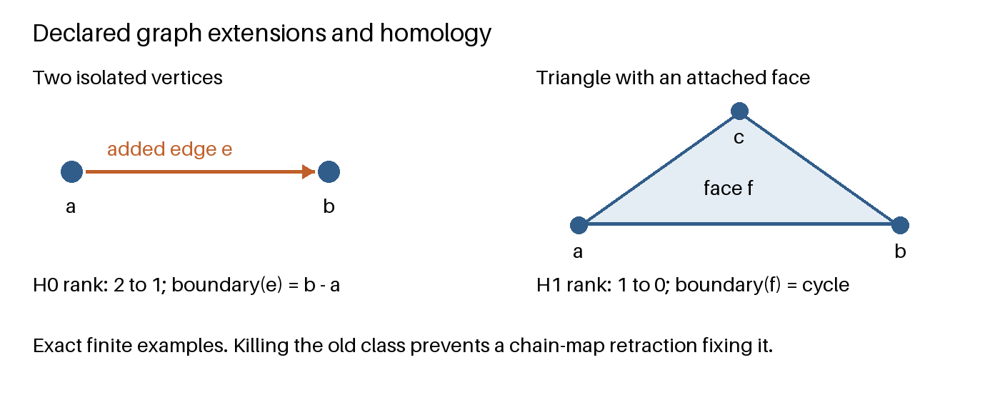

# From Pre-Genesis to MSS-N

Jeremy H. Carroll

2026-10-09

Version 1.0.0

## Abstract

An uninterpreted inscription supplies no admission policy, observation rule or
mathematical realization on its own. This paper joins the recorded Pre-Genesis
trials to the S(n) presentation account and the Minimal Symbol System atlas.
It distinguishes supplied text, admitted objects, reports, grammar profiles and
proposed capability targets. Exact report reconstruction, finite demand
accounting, typed recovery and alphabet extension provide separate preservation
criteria. At the chain-complex level, a retraction prevents an extension from
killing an old nonzero homology class. Graph and word examples show why recovering
syntax, distinguishing observations and repairing topology require different
proofs. The companions construct integral component and triangle homology,
canonical free-word reduction and an exact rational Bell-mixture obstruction.
The three recorded model runs are historical examples with missing model
metadata; they supply no success rates. The consolidation retains corrected
source claims and withdrawn physical interpretations, and identifies the precise
scope of its Lean, Python and Rust companions. As an entry companion to the
Witnessed Difference Programme monograph, it prepares the report, recovery and
repair contracts used by that work's later conditional finite-QM constructions.

## 1. Starting before `<>`

The first question is what has been supplied and what has been licensed to happen
with it. The author, reader and computer already use a metalanguage. This paper
makes that fact explicit; it does not describe an observer-free creation from
nothing.

| Condition | Host-level description | What has not followed |
| --- | --- | --- |
| Absent input | No payload was supplied, for example `None` in a declared option type. | No object-level empty word or ground has been produced. |
| Empty word | The word epsilon in a declared free monoid has length zero. | It need not be accepted by a selected grammar start. |
| Literal `<>` | Two ASCII characters, possibly one opaque token under a stated lexer. | Neither an empty set nor a singleton carrier is forced. |
| Admitted ground | A named initial object under an explicit regime definition. | Its carrier, operations and permitted transitions still need definitions. |

“Before” here marks the order of questions in the account. It is not a derivation
of physical time. Even writing `None` presupposes a host capable of representing
absence. Likewise, a grammar production cannot demonstrate that there is no grammar
in the metalanguage in which that production was written.

Let a declared transition system have state set X and transition relation T.
If T is empty, no state has a T-successor. This follows from the definition of an
empty relation. It does not say that an external caller cannot provide more data,
or that every later rule is prohibited. External supply and admission are events
whose effects must be specified.

### 1.1 Reading toward the WDP monograph

This paper supplies the entrance to *The Witnessed Difference Programme — From
Finite Distinction to Witnessed Measurement*. Pre-Genesis asks what was supplied,
admitted and retained. S(n) separates presentation stages from mathematical
degree. MSS-N supplies a vocabulary of proposed targets whose realizations need
explicit contracts. The report and graph examples below make those contracts
concrete before the monograph introduces its richer repair and observer models.

The contribution presented here is the organized passage from admission and
observation questions to typed mathematical preservation and repair, with
inspectable formal constructions and executable contracts. Standard algebraic
results are identified at their points of use. The route is evaluated through
its explicit maps, hypotheses and worked examples.

Read §§4–5 for sufficient reports, §§9–12 for typed recovery, and §13 for the
preservation/repair distinction. Section 17.1 then gives the chapter handoff.
The [reading route and edition binding](docs/monograph_route.md) identify the
companion draft. The later quantum carriers and readout rules are constructed
in that monograph under its stated additional assumptions.

## 2. What the Pre-Genesis trials actually recorded

The [Pre-Genesis strand](docs/sources/pre_genesis/readme.txt) contains the experiment
design, Trial 1, Trial 2 and a full-history replay. Its
[trial record](docs/sources/pre_genesis/02_trial_record.txt) points to the original
transcripts. The prompts withheld the intended comparison theories and asked the
model to distinguish external presentation from internal expressibility. “No move
is forced” was an admissible outcome. The next inscription was not prescribed as a
successful rediscovery of an existing calculus.

The record supports the following limited observations:

| Event | Recorded behavior | Evidential boundary |
| --- | --- | --- |
| Bare marks and punctuation controls | A fenced prompt elicited familiar interpretations; raw controls elicited different replies. | The runs did not isolate every causal difference between conditions. |
| No declared continuation rule | All three runs said that a successor was not forced; some proposed a continuation under an added assumption. | A proposal and its adoption are different events. |
| `<a>` supplied after `<>` | Replies differed between presentation-relative and inscription-relative readings of identity. | The identity convention had not been fixed. |
| A separation task about `<a>` and `<ab>` | A reply treated observational indistinguishability as identification; another used a stale account of the current state. | Lack of a distinguishing operation does not itself install an object-language equality rule. |
| Truncated audit versus replay | An auditor examining only the local response missed a historical-state mismatch. | Local consistency alone did not establish consistency with the adopted history. |

Trial 1 also bundled steps and fenced controls that the design had intended to
send separately and raw. These are recorded design deviations. The model identifier,
settings and dates were not recorded. There were no host-checker verdicts on the
replies and no live PFP evaluation. The earlier invented “50 trials” table is not
part of the evidence used here. No rate, benchmark advantage or theory-rediscovery
claim follows from this record.

The [failure-mode chapter](docs/sources/pre_genesis/04_named_failure_modes.txt) names
semantic overcompletion, premature relation, false provenance, lost state, stale
certification and bundled extension. These are retrospective descriptions. Naming
a failure does not implement a detector for it.

## 3. Six operations that must remain distinct

The trials become easier to interpret when the following operations have separate
signatures and records:

| Operation | Meaning in a declared host |
| --- | --- |
| Mention | Refer to an inscription or possible object in a discussion. |
| Supply | Deliver a payload to an interface. |
| Designate | Identify which presentation is currently under consideration. |
| Admit | Add a datum, form, instance or rule according to an admission policy. |
| Retain | Preserve an admitted object or event for subsequent use. |
| Operate | Apply an admitted transformation with stated preconditions. |

A response proposing `<a>` does not establish that `<a>` was adopted. A later task
that mentions `<ab>` need not erase `<a>`. A checker cannot reconstruct these facts
from punctuation alone; it needs event semantics and enough of the event record.

The trial method is consequently modest: keep discovery prompts free of expected
solutions, preserve the exact controls, separate steps, record adoption explicitly,
and bind an audit to its actual context. These are design lessons from the record,
not experimentally established universal remedies.

## 4. Observation-relative difference

Let A be a declared carrier and O a family of functions on A. Write

\[
x\sim_O y \quad\Longleftrightarrow\quad
   o(x)=o(y)\text{ for every }o\in O.
\]

Equality here is metatheoretic equality in each observation's codomain. If O is
empty, every pair is equivalent. This does not imply that the inscription strings
are equal or that the regime contains an equality operator.

**Proposition 1 — separation cannot be recovered from a collapsed quotient.**
Suppose x and y have the same O-profile, while a task f requires f(x) different
from f(y). No function on the current observational quotient can answer f on all
inputs.

**Proof.** The quotient map q sends x and y to the same class. If f=g composed
with q, then f(x)=g(q(x))=g(q(y))=f(y), a contradiction. Therefore a representation
supporting this task must preserve more information than q preserves. This may be
achieved by adding an observation that separates the pair. The proposition does
not select that observation. ∎

For `<a>` and `<ab>`, a predicate for presence of `b` and a predicate for payload
length greater than one both separate the pair, under a supplied string decoder.
They disagree on `<aa>`. Full inscription identity also separates the pair and
retains additional information. These are alternative admitted solutions, not
capabilities obtained without a decoder or comparison operation.

## 5. A history projection can destroy the answer

Let \(H\) be a set of admissible histories, \(\sigma:H\to S\) the state or
protected answer required by a task, and \(\pi:H\to V\) the report shown to an
auditor.

**Theorem 2 — history report criterion.** An answer map
\(A:\pi(H)\to S\) satisfying \(A(\pi(h))=\sigma(h)\) for every \(h\in H\)
exists if and only if

\[
\pi(h)=\pi(h')\quad\Longrightarrow\quad\sigma(h)=\sigma(h').
\]

When it exists, it is unique on the report image. In particular, two histories
with the same report and different required answers rule out an auditor that
answers correctly on all admissible histories while seeing only that report.

**Proof.** A factorization gives
\(\sigma(h)=A(\pi(h))=A(\pi(h'))=\sigma(h')\). Conversely, define
\(A(\pi(h))=\sigma(h)\); the displayed condition makes this well-defined.
Every member of \(\pi(H)\) has this form, so the factor is unique. For a finite
listed history population with decidable report equality, the construction is
executable: find the first matching report and return that history's answer.
Extending the map outside \(\pi(H)\) requires a chosen answer there; no such
extension is needed for reconstruction on admissible inputs. ∎

The carrier-general criterion and uniqueness on the report image are
mechanized as `PreMssn.history_report_criterion` and `history_factor_unique`
in [the Lean companion](lean4/Paper.lean). The existence direction uses
`Classical.choice`; the finite listed-history reconstruction in the Python and
Rust companions is constructive.

This is an information-loss theorem, not a theorem that every task requires every
raw token of history. A sufficient state summary may preserve \(\sigma\). Conversely,
more context alone does not guarantee that an auditor will use it correctly. Raw
history retention is a useful provenance policy; task-sufficient reconstruction
is the mathematical requirement.

The local response in the trials could be consistent with its asserted premise
and still be inappropriate for the adopted state. Checking internal steps and
checking the binding of their premises to the actual history are separate tasks.
The report criterion makes this distinction precise for any specified answer
function on admissible histories.

## 6. The indices and layers

| Symbol or object | Meaning | Separate quantity |
| --- | --- | --- |
| S(n) | A presentation stage in the specified admission account. | The number of glyphs or a homotopy degree. |
| k | Alphabet size under a declared token policy. | Number of decoded objects or operations. |
| p | Grammar/profile and public start. | Semantic interpretation or evaluation verdict. |
| MSS-m | An externally specified atlas target. | A native Genesis stage or a completed lift. |
| \(H_j\) | Homology in degree j of a declared complex. | Stage n or active-demand count. |
| C(m), D | A declared coverage measure and length of a contiguous licensed chain. | One another; neither is inferred from the number of folders. |

For example, S(2) in the teaching crosswalk records retained but observationally
collapsed data. MSS-2 is a target about relations. Equating them by their numerals
silently changes the object under discussion.

Four responsibilities remain distinct: native admissions; mathematical
representations; downstream interpretations; and verification/evidence machinery.
A Lean proof, a Python calculation and a SQL view may refer to related structures,
but shared terminology does not prove that they evaluate the same property.

## 7. The finite-stage crosswalk

The [Genesis account](docs/sources/genesis_education.txt) is the source for admission,
observation, candidate costs and the sealed/post-seal distinctions. The following
is a presentation crosswalk, not a claim that the displayed glyphs derive their
own semantics or that every row is forced independently of policy.

| Stage | Presentation question | Required qualification |
| --- | --- | --- |
| S(0) | What is received as the opaque ground inscription? | `<>` has no inherited object-language meaning. Ground inertia is relative to the specified rules. |
| S(1) | Has a newly supplied mark been consumed or admitted? | Supply alone may be an internal no-op. |
| S(2) | What data have been retained, and which profiles remain equal? | Host-level multiplicity does not create an internal distinguishing context. |
| S(3) | How can a supplied pair-separation task be met? | The cost-two result uses a particular response grammar and cost; it is not a universal witness count. |
| S(4) | Have the relevant pairs been separated under the chosen closure policy? | Pair closure needs its finite-carrier and preservation assumptions. |
| S(5) | Where does the next requirement or fresh datum come from? | External continuation is a declared policy, not an endogenous generator proved by saturation. |
| S(6) | How are old presentations represented and recovered after an extension? | Typed maps and their preservation laws must be supplied and checked. |

A branching set of tied responses is not automatically a linear tower. A chosen
cost order, equivalence and continuation policy select or retain its branches.
Subsequent atlas targets may ask for graphs, algebra, categories or geometry.
Their presence in the atlas does not establish that the native process has reached
them.

### 7.1 Where the HoTT interpretation entered

The Pre-Genesis trials did not derive homotopy type theory (HoTT) from the
inscriptions. The S(n) account considered a connection with Postnikov towers,
conditional on supplying a topological realization and its preservation maps.
The MSS-N account explicitly introduced Genesis, HoTT and category theory as
three mathematical lenses. Its types-as-spaces and identity-path vocabulary
was an additional interpretation, not a conclusion of the trial record.
The [source reader](docs/references.md) identifies these historical passages.

The current Lean constructions concern ordinary equality, algebraic chain
complexes and quotient groups. A chain homotopy is a relation between chain maps;
it does not by itself construct a HoTT identity type or a univalent universe.
The corrected account therefore retains the mathematical connections while
requiring a separate construction for any claimed derivation of HoTT.

## 8. Active demands, receipt sets and ordered histories

Let \(W_n\) be a finite register of active demands. A demand identifies its carrier,
protected condition, witness data and activity predicate. It is not simply a label
such as “curvature” or “missing structure.” Let \(D_{n+1}\) be the demands discharged
in a step and \(B_{n+1}\) the demands introduced. Assume

\[
D_{n+1}\subseteq W_n,\qquad
B_{n+1}\cap(W_n\setminus D_{n+1})=\varnothing,
\]

and define

\[
W_{n+1}=(W_n\setminus D_{n+1})\sqcup B_{n+1}.
\]

**Proposition 3 — finite demand accounting.** With \(s_n=|W_n|\),
\(d_{n+1}=|D_{n+1}|\) and \(b_{n+1}=|B_{n+1}|\),

\[
s_{n+1}=s_n-d_{n+1}+b_{n+1}.
\]

**Proof.** Subset removal gives \(|W_n\setminus D_{n+1}|=|W_n|-|D_{n+1}|\).
Disjoint union then adds \(|B_{n+1}|\). ∎

This identity does not prove which demands an engine actually carries. In
particular, the previously displayed sequence (0,1,1,1,0,1,1) follows from one
chosen assignment of singleton demands to the crosswalk. It is an illustrative
ledger, not a universal native survivor sequence or a physical observable.

A cumulative receipt set \(H_{n+1}=H_n\cup C_{n+1}\) has nondecreasing cardinality.
An ordered event log additionally retains order and multiplicity. Neither is \(W_n\).
An empty active register need not erase receipts, imply thermodynamic equilibrium,
or prove that every possible future question has been answered. Adding two map
symbols does not imply two active demands or two newly admitted carrier elements.

## 9. Binary support and observation refinement

An inhabited irreflexive relation R(a,b) forces a≠b, by the irreflexivity argument below.
Indeed, equality a=b would turn the witness into R(a,a), contradicting irreflexivity. This gives two endpoints for that edge, not two observers or two certificate
occurrences. The pointed graph D2 with vertices 0 and 1 and the single edge 0→1
has exactly one endpoint-preserving map to a specified pair (a,b); that map
preserves the edge. This elementary pointed property does not make D2 initial
in an unspecified category of all possible systems.

Suppose q:A→O identifies a and b. If a supplied tag t:A→{0,1} has t(a)=0 and
t(b)=1, define q'(x)=(q(x),t(x)). Then q'(a)≠q'(b), while projection to the first
component recovers q. Both claims follow directly from equality of ordered pairs.
The tag and its construction are supplied data. A method for finding tags is a
separate algorithmic obligation.

For several required pairs, form a conflict graph on A. A tag assignment separating
every edge is a proper coloring. Thus the number of tag values needed for many
pairwise constraints need not remain two: a three-clique needs three colors.
The constraints remain binary without implying a globally binary solution space.

## 10. Typed recovery on the old image

Let u:A→B be a proposed lift and let

\[
\widehat r:B\to A+\{\mathrm{NON\_DESCENT}\}
\]

be a typed recovery map. The old-image law is

\[
\widehat r(u(a))=\mathrm{inl}(a)\quad(a\in A).
\]

**Proposition 4 — injectivity.** This law implies that u is injective.
If u(a)=u(a'), applying the recovery map gives inl(a)=inl(a'), hence a=a'. ∎

The law alone says nothing about off-image inputs. A checker intended to reject
all of them needs the additional specification

\[
b\notin\operatorname{im}(u)\;\Longrightarrow\;
\widehat r(b)=\mathrm{inr}(\mathrm{NON\_DESCENT}).
\]

It also needs a way to decide the image condition within its declared domain and
budget. That is immediate for some finite presentations and not a general
computability theorem.

Two further qualifications prevent stronger promises from being inferred:

- **Observation preservation needs a commuting condition.** For old observation
  q:A→O and new observation q':B→O, require q' composed with u=q, or provide a
  declared transport to the old report space. Recovering a term does not by itself
  prove that a new evaluator uses the old observations.
- **Repair needs its own proof.** An identity embedding has a perfect old-image
  law and can leave every original obstruction unchanged.

The pair is not generally an involution. Moreover, u composed with r-hat is not
even a map B→B until handling of the refusal summand has been defined. No global
preservation of all certificates follows from a successful term round trip alone.

The current [SnCarrier model](lean4/SnCarrier.lean) restricts the section
to `BasePresentation`: ground, supplied mark, retained pair, directed cut and
simplex cut. Nested lifts, retractions and refusal tokens are outside this source
type. The theorem `SnTheorems.old_image_base` establishes the recovery equation for
every base constructor and every stage. `Carrier n` is `Fin (carrierCard n)`,
and `ground_carrier_empty` establishes that the index-zero carrier is empty.
These definitions correct the older unrestricted fallback and cardinality-table
mismatch described by the predecessor draft. They establish the declared local
model, rather than a correspondence theorem for every parser or source regime.

## 11. Formal languages and conditional expressive capacity

A symbol system must declare terminal spellings, tokenization, grammar, public
start, layout policy, identity policy, annotation decoding and allowed
manipulations. These eight choices determine what an inscription does.

For the familiar alphabet \(\Gamma_{38}\), the glyph inventory comprises 26 lowercase
Latin letters, ten decimal digits and `<`, `>`. Some MSS grammar profiles add
punctuation or Unicode; they are not confined to these 38 characters.

Keep three relations separate:

\[
E\subseteq V\times V,\qquad
\to_{\rm rewrite}\;\subseteq\Sigma^*\times\Sigma^*,\qquad
q:V\to O.
\]

They represent an encoded relation, rewrites between inscriptions and an
observation map respectively. A change in any one need not change the others.

With repetition admitted, the one-letter language \(a^+\) supports positive unary
counting under the length decoder. Including epsilon gives \(a^*\) and a representation
of zero. With two letters, concatenation is noncommutative: ab and ba are different
words. A declared binary decoder can use any two distinct printed letters. A
relation may be encoded by positions or a table without an arrow glyph. These are
conditional constructions, not semantic resources supplied by alphabet size alone.

### 11.1 Free monoids and numeral decoders

**Theorem 5.** Free monoids on finite alphabets of different sizes are not
isomorphic.

**Proof.** In a free monoid, the nonidentity elements that cannot be factored as
a product of two nonidentity elements are exactly the one-letter words. A monoid
isomorphism preserves identity and this indecomposability property in both
directions. It therefore induces a bijection of the generating alphabets. Their
sizes must agree. ∎

Thus binary and decimal string monoids are not isomorphic. Decoders can map their
strings onto the same natural numbers without making the string monoids identical.
A fixed-width binary encoding of decimal digits is injective under concatenation,
but not onto the binary free monoid.

Likewise, discrete categories with two and 26 objects are not equivalent: all
isomorphism classes are singletons, and an equivalence would have to match those
classes bijectively.

### 11.2 Three recovery constructions with different types

For alphabets A contained in B, language inclusion and restriction are

\[
\ell:\mathcal P(A^*)\to\mathcal P(B^*),\quad\ell(L)=L,
\qquad r(M)=M\cap A^*.
\]

Then \(r(\ell(L))=L\). This is a retraction of sets of words.

For individual words, exact recovery of old words can instead return the same
word if it is in A*, and a typed refusal otherwise. A total erasure homomorphism
h:B*→A* is another choice: map each new letter to epsilon and concatenate. It
recovers every old word but loses new letters and their positions. These are
three distinct contracts, not one overloaded “down-map.”

No abelian category of ordinary formal languages has been specified here. An
Ext calculation cannot be inferred from language restriction. Even in an abelian
category, a split extension is one zero extension class; it does not show that an
entire Ext group vanishes.

## 12. Manipulations and actual information loss

A renaming f:A→B has a two-sided inverse on the entire codomain B exactly when
it is bijective. Recovery of source letters from the image f(A) only requires
injectivity. Mapping
both c and d to d collapses ac and ad. This is independent of whether the resulting
word is grammatically well formed.

For the code a↦0 and b↦00, the different source words aa and b both encode as 00;
ab and ba both encode as 000. A decoder cannot recover the source universally
without additional retained information or a restricted source domain.

For declared directed-edge syntax:

| Inscription | Represented edge |
| --- | --- |
| `a>b` | a→b |
| `b>a` | b→a |
| `a<b` | b→a |
| `b<a` | a→b |

Reversing the vertex sequence and every arrow in `a>b>c` gives `c<b<a` and
preserves its directed edge multiset. It changes the traversal order. A checker
must name whether it protects the edge multiset, the ordered trace, annotations,
or exact source bytes. AST recovery and byte recovery are different questions.

## 13. Finite graphs and the homological obstruction

For a finite directed graph, regard the underlying graph as a one-dimensional
cell complex and define

\[
C_1=\mathbb Z^E\xrightarrow{\partial_1}C_0=\mathbb Z^V,
\qquad\partial_1(e)=t(e)-s(e).
\]

If V is nonempty and the underlying undirected graph has c components, then
\(H_0\cong\mathbb Z^c\) and \(\widetilde H_0\cong\mathbb Z^{c-1}\). The maximal component count
|V| occurs when no edge joins distinct vertices; self-loops do not affect it.
Adding an edge reduces the component count only when it joins previously distinct
components. It does not separate a and b under an unchanged observation q with
q(a)=q(b).

These standard graph and homology facts use the conventions in
[Hatcher's *Algebraic Topology*](https://pi.math.cornell.edu/~hatcher/AT/AT.pdf),
§1.A, Proposition 2.7 and §2.A.

Formal negative coefficients do not authorize reverse physical traversal. In a
CW graph, a self-loop has zero boundary and can generate nonzero \(H_1\). It is not
a degenerate simplex solely because its endpoints coincide; the model matters.

### 13.1 The chain-retraction obstruction

**Theorem 6.** Let \(i:C\to D\) and \(r:D\to C\) be chain maps with \(r\circ i=\mathrm{id}_C\).
Then \(H_j(i)\) is injective for every j. In particular, i cannot kill a
nonzero homology class of C.

**Proof.** If z is a cycle in C and i(z)=partial_D b, then

\[
z=r(i(z))=r(\partial_D b)=\partial_C r(b).
\]

So z was already a boundary in C. Therefore the kernel of \(H_j(i)\) is zero. ∎

This is the central preservation limit inherited from the MSS-N monograph.
It does not prohibit every useful extension; it identifies incompatible promises.
An extension may repair a cycle while preserving inscriptions, labels or selected
questions, but it cannot simultaneously claim this chain-map retraction fixing
all of C.

The obstruction persists when the retraction equation holds only up to chain
homotopy. The [homotopy companion](lean4/ChainHomotopy.lean) establishes that
homotopic chain maps induce the same map on the constructed homology quotient.
A homotopy left inverse therefore still induces a left inverse and forces
injectivity. In particular, the filled triangle below has no such homotopy
retraction onto its unfilled complex.

### 13.2 Two isolated points

Let \(C_0=\mathbb Za\oplus\mathbb Zb\) and \(C_1=0\). Add an edge e with \(\partial_D e=b-a\), obtaining D.
A retraction fixing the original vertices would have \(r_0=\mathrm{id}\) and \(r_1(e)=0\). The
chain-map equation would require \(b-a=\partial_C(0)=0\), contradicting the linear
independence of a and b in the free abelian group. The new edge kills the old reduced zero-dimensional
class, so the theorem applies.

### 13.3 A triangle and an explicitly attached face

Under label identity, `a>b>c>a` represents edges \(e_{ab},e_{bc},e_{ca}\). Their sum
z has boundary \((b-a)+(c-b)+(a-c)=0\). With no two-cells, \(H_1\) is generated by \([z]\).
Adjoining a face f with \(\partial_2 f=z\) makes z a boundary and satisfies
\(\partial_1\partial_2=0\). The inscription gave the one-skeleton; the face is an
additional declared object.

Killing this class prevents a chain-map retraction fixing the original complex.
It does not prove that an unrelated observational collision has been resolved.
Nor does one vanishing class show that every homology group vanishes.

Chains and cochains must remain typed separately: \(C^j=\operatorname{Hom}(C_j,\mathbb Z)\) and
\((d^j\varphi)(c)=\varphi(\partial_{j+1}c)\). Filling a chain is not the same equation as
finding a cochain primitive. Homological vanishing also differs from
null-homotopy: the commutator loop in the wedge of two circles has zero abelianized
homology class but is nontrivial in its free fundamental group.

### 13.4 Constructed homology groups and integral classes

The [homology companion](lean4/Homology.lean) constructs the cycle subgroup,
the equivalence relation modulo boundaries and its quotient abelian group.
It constructs the homomorphism induced by a chain map and establishes the induced
retraction equation. The theorem `induced_homology_injective` realizes Theorem 6
on these quotient groups. Group laws, well-definedness and injectivity are
proved from the supplied additive-group and chain-map laws; they are not
assumed properties of a named homology object.

An integral test complex has three consecutive chain groups equal to
\(\mathbb Z\), with \(\partial_2(k)=mk\) and \(\partial_1=0\).
Its middle classes satisfy
\([n]=[p]\) exactly when \(n=p+mk\) for some integer k. The companion establishes
that Euclidean remainders classify these classes for every integer m, including
m=0. At m=2, the class of 1 is nonzero and its double is zero. This is a
constructed torsion example, without assigning it to an undeclared surface.
The shared runtime encoding retains n when m=0 and otherwise returns the
nonnegative remainder modulo \(|m|\).

### 13.5 The component group is constructed

The [graph companion](lean4/GraphHomology.lean) constructs integral zero-chains
as the free abelian group on vertices and one-chains as the free abelian group
on edges. Its boundary sends an edge to its target minus its source. Connected
components are the quotient of vertices by the equivalence relation generated
by edges, allowing reversal and concatenation of paths.

The maps in `h0ComponentIso` give mutually inverse homomorphisms between the
boundary quotient and the free abelian group on these components. The construction
also identifies that boundary quotient with the kernel/image homology group of
the graph's degree-zero chain fragment. Thus the unreduced component statement
in §13 has a carrier-general companion, including empty graphs, loops and
parallel edges. The free abelian group's extension and uniqueness properties are
established from its term quotient; freeness is not a supplied hypothesis.

The theorem `vertex_class_eq_iff_connected` states that two vertex generators
give the same zero-dimensional class exactly when they are connected. A loop's
boundary is zero. In the finite replay, a component is named by its least vertex
and a zero-chain is sent to its integer coefficient sum in each component.
These coordinates preserve component information and vanish on boundaries;
they do not alter the observation map q.

### 13.6 Finite coordinates and constructive edge retractions

The [finite-coordinate construction](lean4/FiniteCoordinates.lean) identifies
the free abelian group on a carrier enumerated by `Fin c` with integer c-tuples.
It transports this isomorphism to the actual graph component group. For c=n+1,
the augmentation kernel is isomorphic to integer n-tuples: retain the last n
coordinates and recover the first as minus their sum. This establishes the displayed
reduced-rank formula from explicit inverse homomorphisms.

The [edge-extension construction](lean4/GraphExtensions.lean) establishes that adding
an edge reduces the finite component count exactly when its endpoints were
previously disconnected. It also establishes the maximal-count criterion and that
a loop gives a nonzero class in the graph complex with no two-cells.

More precisely, an added edge has a chain retraction fixing every old zero-chain
if and only if its endpoints were already connected. In the connected case,
[the construction](lean4/GraphRetraction.lean) sends the new edge to an integral
old path chain with the same boundary and fixes the old edges. In the disconnected
case, its induced homology map identifies two old distinct vertex classes,
contradicting Theorem 6.

The [component algorithm](lean4/UnionComponents.lean) merges label fibers along
the supplied edge list. Its labels agree exactly on connected vertices and,
equivalently, on equal vertex classes in H0. Choosing the first matching vertex
in a complete enumeration gives actual component representatives and a basis
for H0. With vertices enumerated in increasing order, the construction establishes
that the selected representative is the least vertex in its component.

### 13.7 Triangle classification and the nonabelian distinction

The [triangle construction](lean4/TriangleHomology.lean) establishes that every
integral cycle has a unique form (k,k,k). Its actual unfilled H1 quotient is
isomorphic to the integers. Every cycle becomes a boundary after the displayed
face is attached, and the filled H1 quotient is trivial. The attachment kills
the old generator and has no chain retraction fixing the old middle group.
Noncycles are refused by the runtime class encoder.

More generally, prescribe the face boundary as m times the triangle cycle for
any integer m. The [degree construction](lean4/TriangleDegree.lean) gives actual
inverse homology maps to the integral quotient complex, so its H1 classes are
classified by integers modulo m. At m=0 the full integer coordinate remains;
at m=1 the group is trivial; at m=2 the cycle has a nonzero order-two class.
This is an algebraic chain-complex construction, without an inferred surface
realization.

The [dual construction](lean4/Cochain.lean) forms cochains as additive
homomorphisms and coboundaries by precomposition. The chain square-zero law
implies the cochain square-zero law. An edge cochain with coefficients (p,q,r)
evaluates on the attached triangle face as p+q+r.
Pullback along a chain map reverses its direction. A chain retraction gives
a split surjection on cohomology in the inclusion direction, as the dual
construction establishes for arbitrary abelian coefficient groups.

The [free-group construction](lean4/FreeGroup.lean) is a term quotient by the
group laws with a proved unique homomorphism extension property. Its commutator on two generators
is nontrivial, as a finite permutation interpretation detects. Abelianization
has the unique factorization property for maps into abelian groups. The
[reduction theorem](lean4/FreeWord.lean) strengthens this witness: two signed
words represent the same group element exactly when adjacent inverse
cancellation gives the same reduced word. The reduction algorithm terminates
structurally and is idempotent.

The [two-loop chain complex](lean4/WedgeHomology.lean) has H1 isomorphic to
integer pairs. The commutator is nontrivial in the constructed free group and
has zero class in this actual homology group. These algebraic and cellular
constructions do not yet identify that free group with the quotient of
continuous based loops by homotopy in a topological two-circle wedge.
That comparison remains the cited background statement and an open formal
obligation.

## 14. Profiles, parsers and evidence scope

The [MSS grammar](code/grammar/mssn.ebnf)
defines the 22 explicit starts inventoried in Appendix A. It supplies formation
rules, not physical models or admitted semantic operations.

| Selected profile | `a>b>c>a` | `a0>b2>c1>a0` | Interpretation if a decoder is supplied |
| --- | --- | --- | --- |
| `raw_glyphs` | Accepted | Accepted | Character sequence only. |
| `label_path` | Accepted | Accepted | Whole labels such as `a0` are identifiers. |
| `suffix_path` | Rejected | Accepted | A letter plus a required digit suffix. |
| `glyph_path` | Accepted | Rejected | Single glyphs separated by direction marks. |

An outer enclosure is not a universal requirement. Profile choice is part of the
input contract; a parser must not guess a favorable interpretation after seeing
an otherwise invalid candidate. Byte sequences, Unicode scalar values, grapheme
clusters and grammar tokens also need separate counting conventions.

The historical inventory describes 22 starts alongside six retained runtime
profiles. That inventory is not evidence of 28 semantic evaluators or a single
shared resource limit. Recognition, AST construction, decoding, evaluation and
exact serialization are distinct checks. A scalar syntax that accepts `a:1/0`
still needs a decoder to reject zero denominators unless the grammar itself has
been changed to exclude them.

The historical source manuscripts preserve the original parser descriptions and historical
codec example. They must be bound to their profile and implementation revision
before being used as current protocol requirements.

## 15. What a justified lift must demonstrate

For a claim that an extension is necessary or minimal:

1. State the failed predicate and protected observations or laws.
2. Specify admissible repairs within the current carrier and operations.
3. Establish that those repairs cannot meet the predicate, or report incomplete
   search if the budget prevents that conclusion.
4. Specify the extension class, equivalence and cost order.
5. Retain all tied minima unless an explicit selection policy is applied.
6. Check that each accepted extension meets the predicate and preserves the
   particular contract being claimed.

A finite candidate census is exhaustive only for its declared domain. A budget
stop is not proof of obstruction. A declared successor, a proposed lift and a
licensed transition therefore have separate evidence states. Exact names of
runtime terminal values belong to the engineering protocol's schema; combining
papers does not create a new enum or claim every runner already conforms.

Similarly, proposer, evaluator and authorizer are roles with different inputs and
responsibilities. Three agents are neither necessary nor sufficient. A theorem
that an already halted state is unchanged by replay establishes that equation;
it does not prove the authorization of an active transition.

## 16. Boundaries retained from the corrected walkthrough

The following withdrawn claims must not re-enter through consolidation:

| Earlier inference | Correct scope |
| --- | --- |
| Two-sided inverse carrier maps prove univalence. | They establish the stated equivalence. A univalent universe requires a different construction and proof. |
| S(n) is automatically a Postnikov tower. | Construction stage and truncation degree differ; maps and preservation properties of a fixed-space Postnikov tower are extra data. |
| A selected CHSH expression detects all contextuality. | All required orientations and the model assumptions must be checked. A Bell score alone is not a constructed Cech cohomology class. |
| `F²=I` establishes a pentagon identity. | It is an involution check; full associator coherence is a different statement. |
| A SQL comparison and a Lean compilation prove bisimulation. | A relation connecting their states and transitions still needs a proof. |
| Small matrix/graph fixtures certify a physical theory. | They establish only the checked finite calculation, within their arithmetic model and input assumptions. |

For the correlator tuple \((1,1,-1,1)\), the selected expression
\(E_{00}+E_{01}+E_{10}-E_{11}\) is zero, while \(E_{00}+E_{01}-E_{10}+E_{11}\) is four. Uniform-marginal
pairwise distributions with those correlations exist. No global deterministic
assignment can satisfy all four signs: the product of the four required pair
products is −1, but every assignment gives +1. This is the concrete missed
orientation from the corrected walkthrough.

The [pair-distribution construction](lean4/BellPair.lean) supplies probabilities
0 or 1/2, establishes normalization and both uniform marginals, and computes all
four correlations exactly. The [mixture theorem](lean4/BellMixture.lean) establishes
that every normalized nonnegative rational distribution over the sixteen joint
deterministic output assignments has oriented CHSH score at most two. The proof
checks the deterministic bound and sums it with nonnegative weights. Hence no
such joint distribution has correlations (1,1,−1,1), whose oriented score is
four. This is a statement about the declared finite probability model; it
supplies no physical realization.

The [correction record](docs/sources/architecture.txt)
records removed fabricated implementations and repaired finite examples. Valid
trace, determinant, commutator, boundary and finite graph calculations remain
useful. Their utility does not reinstate removed CDT, Super-WDW, sign-problem,
chiral-superconductor or universal physical-verification claims. The verification scope of this paper is stated below; it does not restore those withdrawn claims.

## 17. A common preservation question

The report criterion in §5 connects the examples without identifying their
types. For a report q and protected answer f, reconstruction on the report image
is possible exactly when f is constant on each fiber of q. A grammar decoder,
history projection or observation map can therefore be checked against a named
question. A typed recovery map asks for an inverse on a declared source image;
a chain-map retraction asks for stronger algebraic compatibility. Each promise
must be stated before an extension is evaluated.

An atlas heading is a proposed capability. A candidate lift is submitted data.
A verified construction meets a particular mathematical contract, and permission
to use or publish it is a separate decision. These distinctions do not establish
a native derivation of every MSS capability from the initial inscription.

### 17.1 Handoff to the Witnessed Difference Programme

The monograph continues the preservation question using declared repair maps,
observer interfaces and progressively richer carriers. The following route
identifies the assumptions passed forward rather than identifying objects
because their names agree. It targets the companion edition identified in the
[reading route](docs/monograph_route.md).

| This paper prepares | Monograph destination | Data carried into the next model |
| --- | --- | --- |
| Supply, admission, stage and retained history (§§1–3, 6–10) | Chapters 1–3; Appendix L | Actual admitted objects, permitted changes and source provenance |
| Report-image factorization (§§4–5) | Mathematical entrance; Appendices P.1 and K.1 | The report, protected question and decoder or collision witness |
| Chains, dual cochains and retractions (§13) | Chapter 4; Appendices P.2–P.4 | The specified complex, repair image and commuting transport maps |
| Words, reversal and signed generators (§§11–13) | §§17.7–17.8 | Typed histories, protected contexts, admitted signed completion and reversal |
| Pairwise probabilities and the joint-model obstruction (§16) | Chapters 18–19; Appendix J.4 | Explicit comparison models and the chosen composition/readout assumptions |

The next steps toward finite QM are the monograph's conditional constructions:
§17.9 supplies a checked complex structure and Hermitian form; §17.10 supplies
state/effect certificates and an admitted trace readout; §17.11 supplies process
families and composition. This paper prepares their information and preservation
questions. Those additional structures are not selected by the initial glyphs,
alphabet size or a successful recovery round trip.

### 17.2 One concrete passage from graph syntax to repair

Supply the oriented triangle and an integral edge cochain h=(p,q,r). Its
circulation is L(h)=p+q+r. Declare vertex-potential repairs

\[
d_0(a,b,c)=(b-a,c-b,a-c).
\]

Then L(d_0(a,b,c))=0 and L(h-d_0(a,b,c))=L(h). Conversely, L(h)=0 permits
the potential (0,p,p+q), whose repair is exactly h. Thus circulation is the
complete obstruction to repair by these declared integral potentials. The
cochain (1,1,1) has circulation three and cannot be repaired to zero this way.
The [cochain companion](lean4/Cochain.lean) establishes both the invariant and
the exact repair criterion as `triangle_repair_invariant` and
`triangle_repair_exact_iff`.

This hands a specified repair problem to Chapter 4 of WDP. It differs from
attaching a face to kill a chain homology class: the carrier and repair map here
are declared cochain data. A norm and optimization problem are further inputs;
the monograph develops their exact certificates. No physical interpretation is
needed for this handoff.

## Mechanism inventory

| Mechanism | Mathematical evidence | Executable scope |
| --- | --- | --- |
| Pre-Genesis trials | Three source-recorded runs; explicit separation and history questions | Exact primary records and grammar controls; no benchmark or learning claim |
| Report reconstruction | Constancy on fibers, factorization on the image and uniqueness | Carrier-general proof obligations and finite report counterexamples |
| Presentation stages and demand registers | Supplied stage crosswalk and finite removal/disjoint-birth identity | Ledger examples are fixtures rather than a forced native sequence |
| Typed old-image recovery | Injectivity from the old-image law; base-presentation recovery | Current SnCarrier definitions; no blanket parser/source refinement claim |
| Words and language extension | Free-monoid generator distinction, inclusion/restriction and encoding collisions | Declared finite alphabets, token policies and exact word examples |
| Chain retraction and graph examples | Constructed homology groups, free component group and induced-map injectivity | Declared chain groups; exact graph/triangle, component and integral quotient examples |
| MSS grammar profiles | Twenty-two named starts with separate decoders and interpretations | Recognition, AST construction and semantic evaluation remain distinct |
| Lift selection and authorization | Explicit repair domain, cost, ties and protected conditions | Budget exhaustion is not proof; an execution result grants no authority |

## 18. Sources and current verification status

The [source reader](docs/references.md) and [source manifest](manifests/imported_sources.json)
bind 34 imported files to exact Git blobs at revision
`d1d2f034198a72b730320a69691e63351557c019`. The internal intake also preserves the
predecessor manuscripts and historical review records. The consolidated paper
replaces the former education paper packages; the Pre-Genesis experiment records
remain in their source location.

The standalone package builds with Lean 4.33.0 and no external Lean dependencies.
Its complete compiled-declaration census includes generated declarations and
records individual dependencies on `propext`, `Quot.sound` and `Classical.choice`.
The report criterion, demand accounting, typed injectivity and finite-alphabet
non-isomorphism statements are in `lean4/Paper.lean`. At the chain level, the
companion formalizes cycle preservation, boundary reflection and reflection of
the relation defined by a boundary difference. `lean4/Homology.lean` additionally
constructs quotient homology groups and establishes injectivity of the induced map
under a chain retraction. It also establishes the integral class-encoding criterion
and the nonzero order-two example. The [graph homology module](lean4/GraphHomology.lean) constructs the
unreduced graph component group and identifies vertex-class equality with
connectivity. The finite-coordinate, reduced-H0, triangle-H1, constructive
edge-retraction and free-group results are constructed in the companions
described in §§13.6–13.7. Continuous topological fundamental groups and their
comparison with the displayed free group remain outside the current formal
construction.

The [observation companion](lean4/Observation.lean) constructs the profile
setoid, its quotient, the task-descent criterion and the unique pointed D2 map.
The [word-recovery companion](lean4/WordRecovery.lean) constructs fixed-width
decimal/binary coding and its partial decoder, language restriction,
individual-word refusal, erasure, renaming inverses and arrow/trace reversal.
The [discrete-category companion](lean4/DiscreteCategory.lean) constructs
functors and natural isomorphisms, deriving an object bijection from an
equivalence and the finite obstruction for two versus twenty-six objects.

The Python tests check report reconstruction, disjoint demand accounting,
tagging, graph ranks, integral quotient classes, code collisions, CHSH signs and
source mutations. Rust tests check the corresponding runtime examples and
malformed inputs, free-word cancellation and exact joint mixtures.
Fresh Lean, Python and Rust executions agree on 33,104
versioned replay records, including 13,493 refusals. The reproduction uses
canonical ASCII decimal spellings, an
eight-element carrier/history bound, at most sixteen graph edges and integer
magnitude at most one million, signed words of length at most 64 and joint
mixtures with sixteen nonnegative integer masses. It is a finite comparison, not a general
compiler-refinement theorem. Grammar conformance covers 30 Pre-Genesis, 85 S(n)
and 39 MSS-N recorded controls, without supplying semantic evaluators for every
grammar start.

This remains an author review draft. Local compilation, executable checks and
package integrity do not discharge independent mathematical review or authorize
a public deposit. No new model trial, physical validation or general derivation
of the MSS atlas is claimed.

## Appendix A. The 22 declared MSS grammar starts

This table is the source inventory, not a list of completed semantic adapters.
The production grammar remains the authority for accepted syntax.

| # | Start symbol | Canonical input | Lexical and structural contract |
| --- | --- | --- | --- |
| **01** | `raw_glyphs` | `a><b0<<` | Raw strings over $\Gamma_{38}$, including $\varepsilon$. No balancing required. |
| **02** | `word` | `alpha01` | Nonempty sequence over $\Sigma_{36}$. No delimiters. |
| **03** | `glyph_path` | `a>b<c>a` | Alternating single glyphs and directions. |
| **04** | `label_path` | `a0>b2>c1` | Directed paths between multi-glyph identifiers. |
| **05** | `suffix_path` | `a0>b12<c3` | Vertex structured as `lower_latin` followed by `digits`. |
| **06** | `path_list` | `a>b;c<d` | Semicolon-delimited sequence of independent paths. |
| **07** | `suffix_list` | `a0>b1;c2<d3` | Semicolon-delimited sequence of suffix paths. |
| **08** | `scalar_path` | `a:1.5>b:-2/3` | Paths with colon-separated scalar weights. `a:1/0` parses syntactically. |
| **09** | `vector_path` | `a[1,2]>b[3,4]` | Bracketed vector-annotated vertices. |
| **10** | `edge_weight_path` | `a>2.5>b<1<c` | Arrow-flanked edge weights (`>w>` or `<w<`). Opposing marks (`>w<`) rejected. |
| **11** | `labelled_path` | `a-step>b` | Named relation links (`-label>`). |
| **12** | `prefix_tree` | `>ab` | Polish prefix notation for binary syntax trees. |
| **13** | `postfix_tree` | `ab>` | Reverse Polish notation for binary syntax trees. |
| **14** | `sequence` | `a,b,c` | Comma-delimited list of single glyphs. |
| **15** | `nested_tree` | `(a,(b,c))` | Parenthesized nested trees. |
| **16** | `head_term` | `f(x,g(y))` | Functional terms with head words and argument lists. |
| **17** | `incidence` | `[a,b]>[c,d]` | Hypergraph directed incidence lists. |
| **18** | `unicode_path` | `α→β←γ` | Directed paths over Greek/symbolic Unicode alphabets. |
| **19** | `arrow_path` | `a→b←c` | ASCII glyphs joined by Unicode arrows (`→`, `←`). |
| **20** | `bitstream` | `10011010` | Nonempty binary digit strings (`0` and `1`). |
| **21** | `octets` | `deadbeef` | Lowercase hexadecimal byte strings (even length required). |
| **22** | `rewrite_rule` | `a=>b` | String rewrite rules with optional empty sides. |
