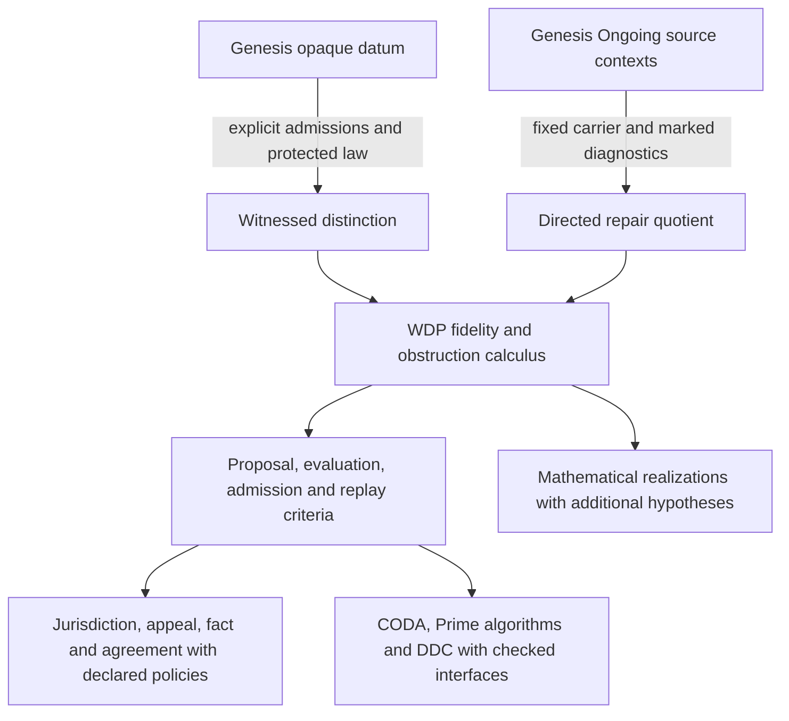

# Genesis, Genesis Ongoing and the Witnessed Difference Programme

This is the programme's organizing dependency order: Genesis and Genesis
Ongoing supply the audited source developments; WDP preserves their declared
differences, observations, changes and witnesses; mathematical realizations
and institutional protocols follow through explicit, checked bridges.
The goal is to recover proposal, evaluation and authorization; certification
and replay; jurisdiction, appeal, fact and agreement; CODA, the three Prime
algorithms and DDC. This document records the current proofs and the remaining
foundational obligations. It does not assert that the entire programme has
been derived from one inscription.




## 1. Source commitments and the first bridge

At Genesis revision `f1d56c0`, `prompt/seed_prompt.md` makes `<>` one opaque
atomic datum. Its visible glyphs do not license a pair, an inside, order or a
relation. `CL-0-INERTIA` proves the initial regime has no internally forced
successor. `CL-0-NO-PROPOSAL-MUTATION` separates proposals from admission.
The initial challenges supply `<a>` and `<ab>` as opaque wholes.

`<ara>` and `<arb>` appear as interpretation in
`research/notes/mark_semantics_note.md`. The formal five-ingredient exhibit
uses two admitted data, one binary form, an instance and an irreflexivity law.
The source's `paper/bridge_provenance.md` proves and prices the missing steps:
a single deduplicated datum cannot produce two admitted data; a form needs
admission; orientation needs additional data; finite irreflexive facts do not
entail a universally protected irreflexivity law. These are substantive
foundational results, not gaps to fill by interpreting glyphs.

Once `R(a,b)` and `forall x, not R(x,x)` are given, `a != b` follows: otherwise
substitution gives the prohibited diagonal. Identification of the endpoints
therefore obstructs that law. Both the relation and protected law must be
listed among the inputs to this theorem. `PrimDiff.lean` shows that an
irreflexive witness has two distinct endpoints. This is a lower bound on its
carrier, not a transition cost or a theorem that every obstruction can be
resolved in two steps. The $S(n)$ construction stages require their own
specified admission and update rules.

Genesis Ongoing revision `5d94883` starts its first seed with asserted `arb`
and forbidden `xrx`. Later seeds change their commitments: the twenty-third
uses two assertion relations and raising; the twenty-fifth permits loops and
marks filled triples. Fifteenth admission is a record, while sixteenth
admission promotes leftovers into assertions. These are separate source
contexts, not one theory obtained by silently accumulating their axioms.

The source pins and relevant files are recorded in
[`genesis_bridge_sources.json`](../manifests/genesis_bridge_sources.json).
Both original checkouts remain read-only. Their original Lean builds and
evidence generators have not been rerun by this bridge project.

## 2. Exact necessity of semantic role separation

Let `X` be the actual cases, `E : X -> Reports` a declared evaluation and
`A : X -> Decisions` a protected admission or permission decision. A decoder
on the actual image of `E` exists exactly when

```text
E(x) = E(y) implies A(x) = A(y), for every x,y.
```

Necessity follows by applying the decoder to equal reports. For sufficiency,
assign each occupied report the decision of any representative; the displayed
condition makes that assignment independent of the representative. No decision
on unused reports is required. This theorem includes arbitrary types; the
native and Python checkers compute the finite specialization and return
explicit conflicting rows when descent fails. Undefined and false outcomes
remain distinct in the executable partial models. The Rust role/history
constructors require a nonempty declared sample domain; Python and the abstract
Lean image criterion also cover the empty decision domain.

For example, two cases can have the same successful evaluation and opposite
permissions. Hence successful evidence alone cannot recover independent
permission. A declared rule that grants permission from evidence can make
descent possible; that rule and its standing are additional inputs.

The joint signature `(E(x), A(x))` identifies exactly agreement of these two
protected meanings. It supplies both projections, and any report sufficient
for both has a well-defined map to this signature. This is minimal information
relative to the selected questions, not an injective description of all of X.

Proposal, evaluation and admitted state change have different signatures:

```text
generate : admitted state -> candidates
evaluate : admitted state x candidate -> checked report
admit    : admitted state x candidate x declared permission -> new state
```

The source already distinguishes proposal and admission. The new bridge shows
when evaluation and admission must retain different information. It does not
derive an evaluator or a legitimate grantor from the mark. One program can
implement all three typed roles; three physical agents can still share the
same false authorization flag. Agent count is neither a proof nor a necessary
consequence of this semantic distinction.

Evidence: [`ProposalAdmissionBridge.lean`](../lean4/WitnessedDifference/ProposalAdmissionBridge.lean),
the Rust `omega_wdp::proposal_admission_bridge`, and the Python
[`proposal_admission_bridge`](../code/witnessed_difference/proposal_admission_bridge.py).

## 3. Certification and replay

For a declared deterministic step, replay is an ordered fold from an explicit
initial state. It obeys

```text
replay(s, first ++ second) = replay(replay(s, first), second).
```

Every declared run has exactly the state computed by this replay. In the
chosen guarded admission model, invalid or unpermitted proposals leave the
admitted state unchanged. A refusal may still append an audit occurrence;
unchanged admitted state does not mean unchanged history.

A representation `r : Histories -> Records` can reconstruct protected history
semantics `F` exactly when `r(h) = r(k)` implies `F(h) = F(k)`. Applying the
same image theorem proves this criterion. An event multiset loses order:
`[set0,set1]` and `[set1,set0]` need not reach the same state. A final state can
lose occurrence count: one admission and duplicate re-admission can reach the
same state. A hash of an already collapsed record preserves that collapse.

Executable receipts are checked against independently supplied initial state,
ordered events, rule, scope and actual transition data. A freshly rehashed
false receipt is rejected. Byte integrity, replay correctness, mathematical
validity, physical calibration and permission are separate predicates. Replay
soundness is relative to the declared step; verifier soundness and authentic
grantor configuration require their own proofs or evidence.

Future execution requires more than agreement of today's report: history
equivalence must respect extension by admitted events and every protected
future observation. The existing finite Moore and history-context owners
provide the relevant congruence criteria. The new finite history fixture
checks its explicitly supplied domain, not all possible histories.

## 4. The actual Genesis Ongoing mathematical bridge

Fix a carrier and marked triples F. Preserve the full directed integer table
`e(x,y) = M_r(x,y) - M_s(x,y)`, including loops and independent reverse arcs.
Raising changes this table by `d0(g)(x,y) = g(x) - g(y)`. Every marked triple
has diagnostic `D_F(e)(x,y,z) = e(x,y) + e(y,z) + e(z,x)`, and cancellation
proves `D_F d0 = 0`. This is an actual repair quotient with descending reports.

It is not automatically cohomology: `C1/im(d0)` differs from
`ker(D_F)/im(d0)`. A marked triple may be unbalanced. Triangle reports can
miss loops and two-way defects. Ordinary antisymmetric simplicial coordinates
require the additional conditions `e(x,x)=0` and `e(x,y)+e(y,x)=0`.
The source's rank criterion 25:D7 includes those hypotheses.

For n>0, rationalizing the repair quotient preserves equality of integer
tables. If integer e equals `d0(g)` for rational g, choose a root o and put
`h(x)=g(x)-g(o)=e(x,o)`. Then h is integer and `d0(h)=e`. This proves the
repair-equality bridge; it does not identify integer change costs with a
continuous norm optimization.

Source 23:D4 supplies explicit failures of quotient-respecting term addition
and identification. The adapter is therefore scoped to the fixed carrier and
declared F. Dynamic transport must retain representatives or prove additional
congruence. See [`genesis_ongoing_fixed_carrier_bridge.md`](genesis_ongoing_fixed_carrier_bridge.md).

## 5. Later meanings and structures

| Target | What the bridge supports | Additional obligation |
| --- | --- | --- |
| Jurisdiction | Scope and actor-dependent admission are protected questions in the signature theorem. | Declare recognized grantors, scope, permissions and enforcement. A validity proof does not create standing. |
| Appeal | A challenged decision can be retained, reevaluated and replayed under a revision rule. | Declare who may challenge, admissible new evidence, review jurisdiction and lawful revision. A denial record alone grants no appeal right. |
| Fact | A declared predicate can be checked and preserved by an adapter. | Specify its interpretation, soundness and relevant access to the world. Mathematical success does not prove an undeclared physical claim. |
| Agreement | Equality of protected reports, compatible local sections, or authorized shared commitments can be specified separately. | State which meaning is intended; consensus does not imply truth or global gluing. |
| Category theory | Declared states and composable lawful histories admit a path/composition realization. | Quotients of histories need composition-compatible equivalence. Initiality depends on the declared class of objects and maps. |
| Sheaves | Checked restriction tables and compatible local reports give existence/uniqueness descent tests. | Supply a site, coverage and restrictions; prove local-to-global conditions. Local agreement need not have a unique extension. |
| Homology/cohomology | Directed tables, repair images and compatible diagnostics already form a checked linear complex. | Declare the grading and differential relations. A repair quotient is not automatically closed-class cohomology. |
| HoTT | Witnesses, identifications and higher coherence can be represented by declared cells. | A numerical obstruction cannot manufacture path constructors or horn fillers; identity elimination and coherence need their own model. |
| Linear algebra | Fixed integer tables rationalize to exact matrix repair/report presentations. | Specify scalars, operations and basis transport. Costs and positivity do not follow just from linearity. |
| Logic and reasoning | Scoped claims, checks, countermodels and replay support explicit inference bookkeeping. | Supply judgments and sound inference rules; neither one mark nor failed separation selects a logic or guarantees intelligence. |
| Number theory | Declared integer multiplicities and exact rational/cyclotomic owners support arithmetic realizations. | Supply addition, iteration, multiplication and their laws where used. A difference does not force a particular arithmetic carrier. |
| QM | Declared Hilbert effects and instruments have exact WDP witnesses; realification preserves their operational statistics. | Scalars, inner product, positivity, probability/effect axioms and composition remain explicit. Phase-blind normalization alone does not select Born weights. |
| CODA, Prime 000/001/002 and DDC | Typed intake, adequate reports, exact repair, checked transport, scoped terminalization and separate grants can be connected. | Bind each operation to its actual source carrier and laws. Structural admission, detector adequacy, progress, and execution permission are distinct. |
| $S(n)$ construction stages | An irreflexive witness has two distinct endpoints (`PrimDiff.lean`, `GEN-WDP-01`/`02`). For a declared inclusion $u_n:S(n)\hookrightarrow S(n+1)$ and partial retraction $\widehat r_n:S(n+1)\to S(n)\sqcup\{\mathrm{NON\_DESCENT}\}$, the typed section law is $\widehat r_n\circ u_n=\mathrm{inl}$. | These are construction stages, not Postnikov truncations of a single space. Endpoint cardinality does not determine transition price, and an external representation does not supply an admission rule. See the definitions in [sn.md](../../../../../../omega_engine_education/documentation/002_s_n/sn.md). |

See [`genesis_qm_realification_bridge.md`](genesis_qm_realification_bridge.md)
for the scalar representation bridge. Its constrained real representation
reproduces the declared complex model; it does not select complex QM from
Genesis or identify unrestricted real and complex theories.

## 6. Derivation order and current frontier

1. Close the primitive provenance and admission-floor question, retaining
   every permitted minimum alternative and every no-transition countermodel.
2. State the protected questions and prove source-specific observation,
   evaluation, admission and replay refinement maps.
3. Prove fixed-carrier repair/diagnostic bridges before dynamic carrier changes.
4. Add coherent context restriction and composition, then certify the precise
   categorical, sheaf, homological or HoTT realization that those data support.
5. Reconstruct effects, probability, scalars and composition under explicitly
   named operational hypotheses; retain classical and alternative readouts
   until a theorem excludes them.
6. Bind CODA, the Prime algorithms and DDC to those proved interfaces, including
   detector adequacy, priced change, external standing and appeal policy.

The companion [`genesis_bridge_register.md`](genesis_bridge_register.md)
separates the new proved criteria, conditional realizations and outstanding
source-refinement obligations. The earlier 154-row WDP register concerns its
own explicitly scoped statements; resolving those rows did not complete this
larger first-principles programme.
