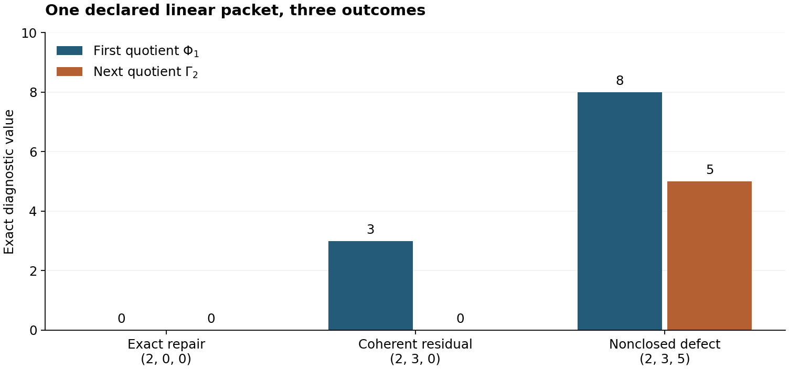
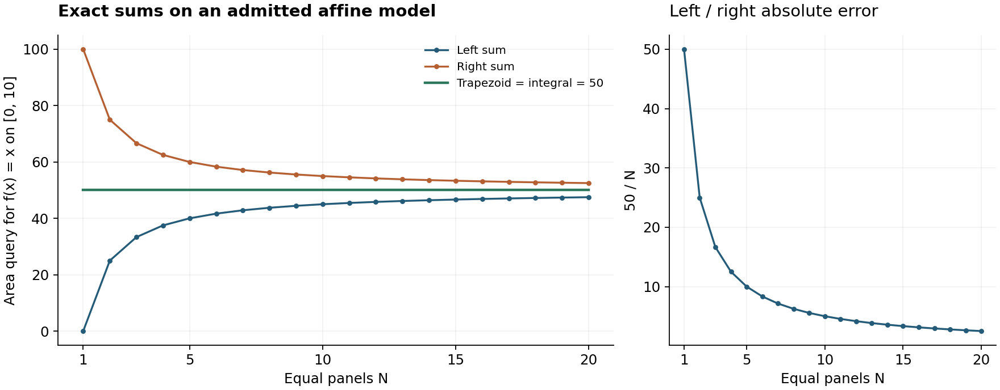

# CODA: The Calculus of Obstruction, Descent, and Authority

**A unified account of witnessed difference, finite repair, representation, and scoped evidence**

**Author:** Jeremy H. Carroll

**Version:** 2.0.1 — consolidated research manuscript

**Date:** 2026-09-28

**Manuscript license:** Creative Commons Attribution 4.0 International

## Abstract

CODA studies what a declared representation can preserve, what its admitted
repairs can change, and what evidence supports a subsequent decision. This
paper consolidates the design, foundational manuscript, discipline statement,
and recovery records in one exposition. Its starting point is a witnessed
irreflexive relation; observation, algebra, repair families, costs, and
authorization are additional data. The mathematical core consists of an
image-factorization criterion, collision obstructions, laws for scoped repair
menus, a finite-dimensional repair quotient, and elementary transport and
gluing results. A common interface relates finite obstruction calculus (FOC),
finite descent authority (FDA), re-presentation (MUR and OR), finite shadows
(CS), continuum models (Q), their bridge (CS_Q), and typed residuals (A).
GTLA supplies the proposed architecture for keeping evidence and grants
separate. Exact examples exhibit the three FOC grades, local solutions
without a global section, and identical finite samples with different
integrals. An explicit counterexample prevents promotion of the inherited
point-span construction to a faithful groupoid embedding. The accompanying
ledger distinguishes local Lean results, prose proofs, finite calculations,
policies, historical reports, and open targets. Consolidation provides one
paper and a replayable finite companion; it does not settle the research
programme's open foundation, continuum, or authority questions.

## Mechanism inventory

| Slot | Value / Description |
| --- | --- |
| **Primitive Differences** | Witnessed irreflexive relation $W \subseteq X \times X$ declaring distinguished state pairs |
| **Carriers / Structure** | Finite state spaces $X$, observation fibers $Y$, and finite cochain spaces $C^0, C^1$ |
| **Cochain complex** | Finite complex $0 \to C^0 \xrightarrow{d_0} C^1 \xrightarrow{d_1} C^2$ with rational/real coefficients |
| **Coboundary maps** | Coboundary difference map $d_0: C^0 \to C^1$ assigning edge discrepancies $(d_0 s)(e) = s(v) - s(u)$ |
| **ZeroRel** | Invariance under observation fiber equivalence $p(x) = p(y)$; exact cocycle condition $h + d_0 f = 0$ |
| **Licensed repairs** | Subspace of admitted repairs $R \subseteq C^0$ and finite candidate menus $A$ |
| **Quotient / Q1** | First obstruction quotient $Q_1 = C^1 / \text{im}(d_0)$ with quotient norm $\Phi_1([h]) = \inf_{f \in R} \|h + d_0 f\|_1$ |
| **Residuals** | Persistent non-exact quotient class $[h] \in Q_1$ where $\Phi_1([h]) > 0$ |
| **Witnesses** | Primal repair certificate $f \in R$ paired with certified dual witness functional $w \in (C^1)^*$ |
| **Observers / profiles** | Observation map $p: X \to Y$ and finite query profiles evaluating invariant preservation |
| **Anomalons** | `OPEN`: Unrepresented distinctions or unmodeled state transitions exceeding the declared finite repair grammar |
| **CompletionLaw** | Bounded menu exhaustion with tie-breaking, or primal-dual linear programming termination |
| **Terminal / route** | Evaluator terminal routing to exact repair, certified obstruction witness, or typed residual record |
| **AuthorityEffect** | `None`. Evaluators assess declared inputs and emit receipts; they confer zero authority or external grant |

## 1. The question and the scope of the answer

Suppose an investigator records a state, observes only part of it, and tries
to repair a failure. Three questions arise. Does the observation retain the
information required by the query? Do the available repairs actually remove
the failure? Does the resulting evidence satisfy the conditions of a
separately supplied permission to act? A correct answer to one question can
leave the others unresolved. CODA makes the objects and assumptions of each
question explicit.

**Naming convention (CODA-19).** CODA means *Calculus of Obstruction, Descent,
and Authority*, following the author-fixed expansion in the discipline
source. Authorization names the act of granting or checking permission;
it does not change the acronym. Earlier expansions and the alias RCOC remain
withdrawn in the source history. Here *primitive difference* means the
witnessed relation in §2; *residual* means data left by a stated repair or
closure; *defect* means a stated diagnostic of such data. These objects are
not interchangeable.

The central claim of this paper is a conditional one: once the state space,
observation, query, and repair family are declared, explicit mathematical
criteria can separate successful descent, a witnessed obstruction, and an
unresolved search. This is useful even when the choice of those data remains
contestable. The exposition does not infer its extra structure from a bare
distinction.

Claims have stable identifiers. The [claim ledger](coda_claim_ledger.md)
gives assumptions, supporting files, and the scope of mechanization. A
prose proof is a proof of its written statement; a finite calculation checks
its declared instance; a Lean declaration verifies its formal statement and
listed dependencies. None of these descriptions substitutes for another.
The [changelog](coda_change_log.md) records the substantive corrections.

### 1.1 Source basis

The source corpus contains two main expositions: a historical design paper
and a shorter foundational manuscript. It also contains a discipline paper
with code and Lean fragments, six recovery notes, a declaration-location
scan, and fourteen diagrams. The synthesis uses the foundational manuscript
for its mathematical order, the design for its operational interfaces, the
discipline for its naming and withdrawal rules, and the recovery notes for
the component relationships and unresolved evidence obligations.

**Source scope (CODA-20).** The [source manifest](source_manifest.json)
verifies seventeen local historical files from baseline commit
`d435c7f86d2896b1b738d45abd7f47a690dcd388`: fourteen diagrams and three
byte-preserved discipline source transcripts in `docs/source_archive/`.
Each entry records its Git blob, byte count, SHA-256, and immutable retrieval URL.
The active code and Lean files are maintained derivatives, distinct from those
originals. The other twenty-two tracked inputs, including the historical root
manuscripts, ledgers, recovery notes, and scanner, have immutable external
retrieval pointers in the same manifest. They are not claimed as local copies.
Six formerly reported ignored build logs cannot be recovered from that Git
commit and are excluded from the present custody claim.

The active exposition is `coda.md`; its current code, formal sources, and
notebooks have separate release checksums. Historical file-and-line citations
retain their original context and do not certify current builds.

## 2. Witnessed difference and admitted observation

### 2.1 A distinction with an actual witness

A **witnessed difference** is a tuple

\[
 W=(X,D,a,b,w),\qquad D\subseteq X\times X,
 \quad (\forall x\in X)\;\neg D(x,x),\quad w:D(a,b).
\]

The relation is irreflexive and a related pair is supplied. Symmetry,
transitivity, decidability, finiteness, and a numerical magnitude are absent
from this definition. Ordinary equality in the ambient mathematics is
already available; a derived observational equivalence below is not a
construction of every possible notion of identity.

**Proposition 2.1 (CODA-01; inhabited distinction).** The supplied elements
satisfy \(a\ne b\).

**Proof.** Substituting \(a=b\) into \(D(a,b)\) gives \(D(a,a)\), contradicting
irreflexivity. The witness also rules out an empty carrier. ∎

A detector is a different signature. It consists of
\(\delta:X\times X\to V\) and a designated \(0_V\). If
\(\delta(x,x)=0_V\) for every \(x\), and
\(\delta(a,b)\ne0_V\), then \(D_\delta(x,y)\) defined by
\(\delta(x,y)\ne0_V\) supplies a witnessed irreflexive relation. The proof of
\(a\ne b\) is the same substitution argument. Symmetry requires another
law. A quotient by \(\delta(x,y)=0_V\) requires that zero relation to be an
equivalence relation. Neither a zero diagonal nor a nonzero pair supplies
all those laws.

This distinction reconciles two objects called “primitive difference” in
the sources: the detector-and-quotient primer and the witnessed relation.
The former is an admitted evaluation model. The latter is the starting
signature adopted here. Their conditional bridge does not identify them.

### 2.2 Observation and the query it must preserve

Add an observation \(p:X\to P\). Define
\(x\sim_p y\) when \(p(x)=p(y)\). Equality in \(P\) makes this relation
reflexive, symmetric, and transitive. Those laws come from the observation
model, not from the irreflexive relation \(D\).

Add a query \(q:X\to Y\). Let \(I=p(X)\) be the **realized image**, considered
as a subset of \(P\). Query descent asks for a map
\(\bar q:I\to Y\) satisfying \(\bar q(p(x))=q(x)\).

**Theorem 2.2 (CODA-02; descent on the image).** A unique image factor
\(\bar q\) exists if and only if the query is constant on every observation
fiber:

\[
 p(x)=p(y)\quad\Longrightarrow\quad q(x)=q(y).
\]

**Proof.** A factor sends equal observations to equal answers. Conversely,
for each realized \(z\), choose an \(x\) with \(p(x)=z\) and put
\(\bar q(z)=q(x)\). Fiber constancy makes this definition independent of
the representative. Any other factor agrees at \(z\), since \(z\) has a
representative. If \(X\) is empty, so is its image, and the empty function
is the unique factor. ∎

The local Lean implementation uses classical selection for the image
factor; its uniqueness proof reports `Quot.sound`. These are explicit
dependencies, not a claim of an executable inverse on an arbitrary infinite
space. On a supplied finite domain the Python routine constructs the factor
by enumerating fibers and uses no such infinite selection procedure.

A map on all of \(P\) is a stronger request. The theorem ensures no value
off the image. If \(X=\varnothing\), \(P\) is a singleton, and
\(Y=\varnothing\), the image factor exists but no map \(P\to Y\) does.
Even when an extension exists, off-image values need not be unique.

### 2.3 Collisions and the limits of post-processing

A **collision witness** is a pair \(x,y\) with the same observation and
different query answers. On \(X=\{0,1\}^2\), the observation
\(p(u,v)=u\) cannot recover \(q(u,v)=v\), as \((0,0)\) and \((0,1)\)
witness. It does recover \(q(u,v)=2u\). Adequacy is query-relative.

**Proposition 2.3 (CODA-03; collision persistence and repair).** A collision
rules out a factor through \(p\) and through every coarsening \(c\circ p\).
Any new observation \(p'\) through which the same query factors must
separate that pair.

**Proof.** Equality \(p(x)=p(y)\) remains equality after applying \(c\).
A factor would then imply \(q(x)=q(y)\), a contradiction. Applying the same
argument to \(p'\) establishes the second assertion. ∎

The last conclusion is necessary, not sufficient: separating one exhibited
pair can leave another collision. Bundling an informative additional
observation can help; repeating or relabeling the same collapsed observation
cannot. A detector that displays the same value for every state is adequate
only for queries constant on that whole domain.

## 3. Repair families, search budgets, and extension

A repair problem supplies a set \(A\) of admitted moves and a predicate
\(R(a)\) saying that move \(a\) meets the protected requirement. A protected
requirement might preserve a query, maintain a distinction, or satisfy a
constraint. Its choice is part of the problem. Define

\[
 \operatorname{Exhausted}(A,R)
 \quad:\Longleftrightarrow\quad
 (\forall a\in A)\;\neg R(a).
\]

An obstruction is this scoped assertion or a proved criterion for it.
A search log that stops after checking part of \(A\) does not establish it.
An empty menu is vacuously exhausted; this is not evidence about any larger
class of possible repairs.

**Proposition 3.1 (CODA-04; exhaustion and ties).** A working member of \(A\)
refutes exhaustion. If \(B\subseteq A\), exhaustion of \(A\) implies
exhaustion of \(B\); the reverse implication fails. If a cost
\(c:A\to V\) takes values in a preorder and \(c(a)=c(b)\), every attained
minimum property of \(a\) is also a minimum property of \(b\).

**Proof.** Instantiate the exhaustion assertion at the working member.
Restricting the exhaustive condition establishes the submenu implication. For its
failed converse, take \(A=\{0,1\}\), \(B=\{0\}\), and \(R(a)\) meaning
\(a=1\). For ties, substitute \(c(b)=c(a)\) into
\(c(a)\le c(x)\) for every candidate \(x\). ∎

No minimum-existence theorem follows solely from a preorder. A finite
nonempty successful menu with rational costs does attain its least cost;
the companion enumerator returns **all** tied minimizers. During a partial
search it may report working witnesses, but withholds a minimum claim
because an unchecked candidate may be cheaper.

The source phrase “remove the obstruction or construct structure” is used
here as a workflow rule. A **repair** uses already declared operations. An
**extension** changes the observation, carrier, operations, or requirements
and therefore creates a new problem whose relationship to the old one
must be stated. Failure of all current repairs does not prove that a
successful extension exists or select one. Refusal records a reason to stop
an attempt. It can coexist with a residual and an open extension question.

The cost measure and any choice among tied candidates are separate
declarations. Ties may be identified only under an explicitly justified
equivalence that preserves the relevant success and cost properties.
Counting one class after such a quotient is a statement about that quotient.

## 4. Finite obstruction calculus: a declared algebraic extension

### 4.1 The packet and its quotient values

FOC adds finite-dimensional real vector spaces and linear maps

\[
 C^0\xrightarrow{d_0}C^1\xrightarrow{d_1}C^2,
 \qquad U^2\xrightarrow{a_2}C^2,
 \qquad d_1d_0=0.
\]

Choose coordinates and strictly positive weights \(w_i\), defining
\(\|v\|_{1,w}=\sum_i w_i|v_i|\). The full declared linear repair
subspaces are \(M_1=\operatorname{im}d_0\) and
\(M_2=\operatorname{im}a_2\). “Admitted” here means belonging to the
mathematical repair class; it does not mean institutionally authorized.

For \(x\in C^1\), define

\[
 \Phi_1([x])=\min_f\|x+d_0f\|_{1,w_1},\qquad
 \Gamma_2([d_1x])=\min_u\|d_1x+a_2u\|_{1,w_2}.
\]

**Theorem 4.1 (CODA-05; quotient diagnostics and trichotomy).** These minima
are attained, depend only on the displayed quotient classes, and vanish
exactly when their arguments belong to the respective repair subspaces.
Exactly one of the following grades holds:

| Grade | Condition | Meaning within this packet |
|---|---|---|
| `ExactRepair` | \(\Phi_1=0\) | A declared stage-one repair removes the vector. |
| `CoherentResidual` | \(\Phi_1>0,\ \Gamma_2=0\) | The first class remains; its next defect is stage-two repairable. |
| `NonclosedDefect` | \(\Phi_1>0,\ \Gamma_2>0\) | Both stated repair quotients detect a remaining class. |

**Proof.** Each repair set is an affine translate of a finite-dimensional
linear subspace and is closed. A sequence whose norms approach the infimum
can be chosen bounded. In finite dimension it has a convergent subsequence;
the limit remains in the affine subspace and attains the infimum. Strictly
positive weights make zero norm equivalent to the zero vector. Thus zero
minimum is equivalent to membership in the repair subspace. Translating a
representative by an element of that subspace leaves the affine repair set
unchanged. Finally, \(d_1d_0=0\) ensures that changing the first
representative does not change \(d_1x\), and that \(\Phi_1=0\) implies
\(\Gamma_2=0\). Nonnegativity then gives the three disjoint cases. ∎

This theorem has a prose proof here. The companion code implements the
explicit packet below, not a general optimizer, and the local Lean library
does not mechanize the finite-dimensional compactness argument.
With zero weights, a nonzero vector can have zero score. With nonlinear,
incompletely enumerated, or nonclosed repair sets, the proof needs different
hypotheses. A failed packet validation precedes classification.

### 4.2 A certificate that can be checked independently

**Proposition 4.2 (CODA-06; a matching dual bound).** Suppose
\(r=x+d_0f\), a covector \(y\) satisfies \(y d_0=0\) and
\(|y_i|\le w_i\), and \(y(x)=\|r\|_{1,w}\). Then \(f\) is an optimal
repair and that common value equals \(\Phi_1([x])\).

**Proof.** For every \(g\), annihilation gives
\(y(x+d_0g)=y(x)\), while the coordinate bounds give
\(y(x+d_0g)\le\|x+d_0g\|_{1,w}\). The supplied repair attains this lower
bound. ∎

The proposition checks a supplied certificate; it does not assert that a
particular solver always finds one. A stored certificate should identify the
packet, weights, and query it concerns. The example JSON records its exact
input, and the package manifest binds its bytes to the implementation.

Take \(C^1=\mathbb R^3\), \(d_0(t)=(t,0,0)\),
\(d_1(a,b,c)=c\), and \(a_2=0\), with unit weights. Then

\[
 f=-a,\quad r=(0,b,c),\quad
 \Phi_1=|b|+|c|,\quad\Gamma_2=|c|,
 \quad y=(0,\operatorname{sgn}b,\operatorname{sgn}c).
\]

The covector supplies the matching lower bound even though infinitely many
real repairs were available. The exact rational examples are:

| Input | Repair | Residual | \(\Phi_1\) | \(\Gamma_2\) | Grade |
|---|---|---|---:|---:|---|
| \((2,0,0)\) | \(-2\) | \((0,0,0)\) | 0 | 0 | `ExactRepair` |
| \((2,3,0)\) | \(-2\) | \((0,3,0)\) | 3 | 0 | `CoherentResidual` |
| \((2,3,5)\) | \(-2\) | \((0,3,5)\) | 8 | 5 | `NonclosedDefect` |

“Coherent” describes the next quotient in this packet. It does not establish
stability under every extension, a global mathematical object, or authority.

## 5. Representation transport and local-to-global obstruction

### 5.1 MUR: what a transport certificate establishes

A representation transport consists of maps \(F:X\to X'\) and
\(f:P\to P'\), observations \(p,p'\), and a commuting-square obligation

\[
 p'\circ F=f\circ p.
\]

**Proposition 5.1 (CODA-07; transported query factor).** If
\(q'=\bar q'\circ p'\), then
\(q'\circ F=\bar q'\circ f\circ p\).

**Proof.** Substitute the square identity into
\(q'(F(x))=\bar q'(p'(F(x)))\). ∎

This statement transfers a particular query. It does not make \(F\)
injective, supply an inverse, preserve every other query, or supply a grant.
For FOC packets, compatible linear transports satisfy
\(T_1d_0=d'_0T_0\), \(T_2d_1=d'_1T_1\), and
\(T_2a_2=a'_2S_2\). These laws preserve the relevant algebraic relations.
Quantitative norm preservation additionally needs a bound or isometry law.

MUR contributes a **loss ledger**: which protected distinctions were erased,
identified, approximated, or left unresolved by a transport. These are
reports about the named map. A field called “lossless” cannot replace a
proof that a protected query is preserved. Subtraction of two transported
objects is meaningful only after an additive comparison object has been
chosen; a general commuting-square failure is first a failed equality.

### 5.2 OR: local solvability is insufficient for a global section

Comparison among several presentations adds overlap and compatibility data.
Let three vertices carry values \(s_0,s_1,s_2\in\mathbb F_2\). Impose

\[
 s_0+s_1=0,\qquad s_1+s_2=0,\qquad s_2+s_0=1.
\]

**Proposition 5.2 (CODA-08; an explicit gluing obstruction).** Each edge
equation has solutions, but the three equations have no common solution.

**Proof.** An equality edge admits \((0,0)\); the unequal edge admits
\((0,1)\). The first two global equations imply \(s_0=s_1=s_2\), contradicting
the third. Equivalently, summing the three equations in \(\mathbb F_2\)
gives \(0=1\). ∎

There are four assignments on the three-vertex carrier satisfying any
single edge equation and zero satisfying all three. The local Lean proof
uses Boolean equality and inequality for the same pattern. This is a
local-solvability counterexample: it does not supply a compatible family of
local sections and then refute a sheaf gluing axiom. The missing condition
is precisely compatible choices on shared vertices.

Averaging the three edge verdicts does not repair the contradictory system.
One must change a constraint, extend the representation with an explicit
translation, or retain the obstruction. Each action changes the stated
problem and belongs in the loss and change records.

## 6. Finite shadows, continuum models, and query descent

### 6.1 The roles of CS, Q, and CS_Q

A finite shadow is a declared observation \(p_\lambda:X\to P_\lambda\).
A family may have refinement maps and compatibility laws. Calling its
index set a scale does not itself supply an order, a topology, cofinality,
an inverse limit, or a convergence theorem. Q concerns continuum models
when their required metric, topological, analytic, or completion data are
admitted. CS_Q asks whether a particular continuum query factors through
the relevant shadow or family of shadows.

The image-factor theorem answers the exact descent question. It does not
construct the continuum domain, prove continuity, or turn infinitely many
conditions into a finite verifier. Approximate descent instead needs a
declared error notion and a bound; exact and approximate questions should
not share an unqualified success label.

### 6.2 Finite samples do not determine an arbitrary continuous integral

**Proposition 6.1 (CODA-09; the sampling collision).** On a nondegenerate
compact real interval, a finite set of point samples does not determine
the integral of every continuous function.

**Proof.** For sample nodes \(x_1,\ldots,x_k\), set
\(h(x)=\prod_i(x-x_i)^2\); for no nodes take \(h=1\). This polynomial
vanishes at every node, is nonnegative everywhere, and is positive on some
subinterval because a finite set does not fill the interval. Its integral
is strictly positive. Thus \(f\) and \(f+h\) have identical samples but
different integrals, giving a collision for the integral query. ∎

The proof is analytic prose, not a theorem in the local Lean package.
An exact polynomial instance is replayed in Python. On \([0,10]\), use
samples at \(0,5,10\), put \(u=x/10\), and choose

\[
 f(x)=x,\qquad h(x)=[u(u-\tfrac12)(u-1)]^2.
\]

Direct polynomial integration gives
\(\int_0^{10}h(x)\,dx=1/84\). The common samples are \((0,5,10)\),
but the integrals are \(50\) and \(50+1/84=4201/84\).
If the admissible class is instead affine functions, distinct endpoint
samples determine the function and its integral. That is a narrower domain
with an explicit reconstruction law.

### 6.3 A worked calculation with all boundaries visible

**Proposition 6.2 (CODA-10; affine quadrature).** For \(f(x)=x\) on
\([0,10]\), an equal partition with \(N\ge1\) panels gives

\[
 L_N=50-\frac{50}{N},\qquad
 R_N=50+\frac{50}{N},\qquad
 T_N=\frac{L_N+R_N}{2}=50=\int_0^{10}x\,dx.
\]

**Proof.** With \(\Delta x=10/N\), the left sum is
\((100/N^2)\sum_{i=0}^{N-1}i\), and the right sum replaces the index range
by \(1,\ldots,N\). The two arithmetic-sum formulas give the displayed
values. Their average is 50; direct integration gives the same value. ∎

At \(N=10\), the three values are 45, 55, and 50. Their relationship has
a proof; it is not a vote for the middle answer. The scalar error \(50/N\)
is a diagnostic relative to this quadrature and this query. If a full
repair family contains the exact trapezoid replacement, the residual after
optimal repair is zero. Calling the pre-repair quadrature error a surviving
FOC obstruction would be incorrect.

The continuum interval and ordinary integral were admitted before this
calculation. The finite calculation evaluates a query about them. It neither
derives their existence from witnessed difference nor authorizes an action.

## 7. FDA and GTLA: evidence, standing, and permission

FDA organizes the movement from a proposal to a finite packet, verifier
result, and scoped decision grade. GTLA is used here for the architecture
that records how evidence and separately supplied grants relate. A proposed
admission record identifies the proposal, its scope, the supporting evidence,
and its grant. Verifier soundness and the grantor's standing are assumptions
whose justification must be supplied outside a mere status flag.

**Policy and proposition 7.1 (CODA-11).** In the declared logical model
\(\operatorname{Standing}(E,G):=E\land G\), standing implies a grant,
whereas evidence alone does not imply standing.

**Proof.** A conjunction supplies its second component. The valuation
\(E=\mathrm{True}\), \(G=\mathrm{False}\) has evidence and lacks standing. ∎

The theorem is elementary because the policy is explicit. It establishes a
property of that model. It does not authenticate a grantor, enforce roles,
provide a cryptographic signature, or assert that every possible institution
must use this policy. An authorization system may use automated rules, but
the rules and their authority must then be admitted and justified as data
of that system. Mathematical evaluation does not supply them solely by
returning a low defect.

The historical sources sometimes put “authority” inside a terminal type or
inside a conjunction of successful checks. Here a terminal reports the
evaluation outcome; an admission record separately records a grant. Solely
renaming a Boolean conjunction as a dependent record does not authenticate
its contents. Conversely, a typed residual and a valid grant for some other
scope may coexist on one object. There is no assertion that every residual
forbids every kind of permission.

Typical outcomes include a successful repair witness, a negative result
over the declared menu, a retained tie, `BudgetUnknown`, a typed refusal,
and an open extension obligation. A refusal can accompany a calculation;
it is not represented by a large numerical defect. “No rule in this menu”
does not become “false globally.” A receipt supports a statement about a
particular run only to the extent that its inputs, computation, and verifier
are actually checked.

## 8. Typed residuals and the unified research architecture

### 8.1 A: the remainder of a declared closure attempt

Let a closure discipline \(\Lambda\) specify an attempted construction,
its comparison, and the target class of acceptable results. A residual is
what remains under that declared attempt. A categorical cofiber residual
requires a category and a cofiber construction; it is not another name for
every numerical error. A decomposition of a residual requires actual
decomposition data and a subsequent classification of its pieces.

The A sources contribute the rule that unsuccessful closure is recorded
as absorption where proved, a typed remainder, a refusal, or an unresolved
attempt. An unverified claim that every repair was tried is insufficient
to call a remainder permanent. An observer that collapses the distinction
of interest can also hide the remainder. A “surviving anomalon” therefore
requires explicit closure, observer, and nonvanishing hypotheses. No
existence axiom for anomalons is used by the local proofs in this package.

### 8.2 Eight components and one authority architecture

**Definition 8.1 (CODA-13; organizational interfaces).** The eight component
names designate the responsibilities below. GTLA is the overarching
authority architecture rather than an additional necessary mathematical
layer. This arrangement is an editorial and research organization, not a
theorem that exactly these components must exist.

| Component | Admitted input | Main question or output | Boundary |
|---|---|---|---|
| FOC — Finite Obstruction Calculus | Complex, full repair subspaces, positive weights | Quotient class, diagnostic, checked certificate | Low defect does not supply permission. |
| FDA — Finite Descent Authority | Proposal, packet, verifier, grant conditions | Scoped evaluation and admission conditions | Soundness and grantor legitimacy remain assumptions. |
| MUR — Meta-Unifying Re-Presentation | Representations and a declared family of maps | Commuting comparisons and loss records | Transport need not be invertible or norm preserving. |
| OR — Omniversal Re-Presentation | A declared diagram and compatibility data | Global section or gluing obstruction | Local solvability alone is insufficient. |
| CS — Continuum Shadow | Observation family and declared refinement laws | Query-relative finite information | A family name supplies no limit theorem. |
| Q — Continuum | Explicit analytic or completion data | Continuum model and scoped queries | No quantum or ontology theorem follows from the name. |
| CS_Q — Continuum Shadow–Continuum Bridge | Profile map and query | Factor on the realized image, or a collision | An image factor is not a total inverse. |
| A — Anomalon | Closure discipline, observer, typed remainder | Residual classification and next obligation | A remainder supplies neither its own origin nor authority. |

The inherited names “MUR” and “OR” in component titles do not
quantify over every representation or every world. Every theorem still
names its actual domain. FOC's linear model and Q's analytic models are
extensions of the foundational language; neither is inferred from it.

### 8.3 One operational loop, with its status stated

**Declared workflow (CODA-14).** A proposed run records the following stages:

1. Supply a proposal or datum and record its source.
2. Declare the state space, observation, protected query or constraint,
   repair menu, cost, budget, and verifier before the relevant evaluation.
3. Evaluate and return a witness, obstruction, tie, unresolved result, or
   refusal with its scope.
4. Seek or check a grant when an actual admission requires one under the
   chosen policy.
5. Apply the admitted change, replay its evidence, and record remaining
   obligations and losses.

Within this proposed interface, supply presents information without itself
changing the admitted mathematical state. An admission is the designated
state-changing operation. This is an interface choice here, not a claim
that all software or reasoning changes state in this way.

| Operation | Required record | What the record alone does not establish |
|---|---|---|
| Supply | Source and content | Admission |
| Admission | Named change, scope, grant when required | Grantor legitimacy |
| Observation | Domain, map, query | Adequacy for every query |
| Obstruction | Witness or quantified repair exclusion | Global impossibility |
| Menu | Enumerated domain or a justified quantifier | Exhaustion from a timeout |
| Cost | Measure and comparison rule | A uniquely preferred measure |
| Ties | All retained minimizers or justified classes | A selected representative |
| License | Grant object and scope | Permission outside that scope |
| Repair | Move and preserved requirements | Existence of an extension |
| Result | Typed payload and diagnostic | A grant |
| Terminal | Stop condition and extent of evaluation | Truth outside that extent |
| Refusal | Reason and affected operation | A numerical residual |
| Replay | Inputs, implementation, command, output | Semantic correctness by hashing alone |
| Leftover | Open question, blocker, proposed next test | A result already obtained |
| Order | Event sequence or commit relationship | A physical or intrinsic clock |

A research run, a chain of runs, and a library entry may each be organized
with these records. Their similarity is a design analogy. Encoding and
replaying a real research run inside the sealed kernel remains a separate
open research obligation.

### 8.4 The six foundational authority boundaries and invariant enforcements

To prevent epistemic conflation across proposal generation, evidence verification, and normative authorization, CODA integrates six foundational invariant boundaries formulated as declared policies (Papers 004, 005, 027, 028, 029, and 030).

**Policy 8.3 (CODA-21; Coproduct Separation Invariant).** In the declared evaluation-authority interface, the evidence type \(\mathbb{E}\) and the authority terminal \(\mathbb{T}\) are strictly separated into a coproduct:
\[
 \mathbb{T} := \mathbb{T}_{\mathsf{auth}} \amalg \mathbb{T}_{\mathrm{res}} \amalg \mathbb{F}_{\mathrm{term}},
\]
where \(\mathbb{T}_{\mathsf{auth}}\) denotes an authorized grant, \(\mathbb{T}_{\mathrm{res}}\) denotes a typed residual with explicit unresolved debt, and \(\mathbb{F}_{\mathrm{term}}\) denotes a terminal refusal. The declared policy requires guards appropriate to each branch. For admission into the authorizing terminal \(\mathbb{T}_{\mathsf{auth}}\), all seven FDA guards must hold, including g₃ `zero_residual_mass` and g₇ `no_refusal`, with the guards derived from an evidence record and an external grant supplied separately (Paper 027). For non-authorizing terminals (\(\mathbb{T}_{\mathrm{res}}\) and \(\mathbb{F}_{\mathrm{term}}\)), admission does not assert zero residual mass or absence of refusal; rather, \(\mathbb{T}_{\mathrm{res}}\) records positive residual mass under valid determinism and structure preservation, while \(\mathbb{F}_{\mathrm{term}}\) routes a terminal refusal upon detecting an obstruction or scope violation. The FDA guard identifiers are g₁ `accepted`, g₂ `deterministic`, g₃ `zero_residual_mass`, g₄ `skeleton_preserving`, g₅ `exhaustive`, g₆ `no_pending_lift`, and g₇ `no_refusal`. These names refer to `coda_fda_core.derive_guards` in the separate FDA package. The finite CODA application uses a different seven-check firewall and does not construct this FDA standing witness.

**Policy 8.4 (CODA-22; Role Non-Impersonation Invariant).** The proposal category \(\mathcal{P}\), evaluation category \(\mathcal{E}\), and authorization category \(\mathcal{A}\) have disjoint morphism classes. In particular, no morphism in \(\mathcal{P}\) or \(\mathcal{E}\) can be cast or type-pushed into \(\mathcal{A}\). The policy requires an automated solver, heuristic searcher, or reasoning system to act within \(\mathcal{P}\) without issuing its own verification receipt or execution grant (Paper 004). This is a design requirement; this section supplies no proof that an implementation enforces it.

**Policy 8.5 (CODA-23; Authority Gap Invariant).** Epistemic verification does not entail normative authorization:
\[
 \operatorname{eval}(x) = \mathrm{valid} \;\nRightarrow\; \operatorname{grant}(x) = \mathrm{authorized}.
\]
A vanishing mathematical residual (\(\|\Omega\| = 0\)) or valid dual witness certificate confirms mathematical consistency; it does not supply administrative or operational entitlement to execute state changes (Paper 005).

**Policy 8.6 (CODA-24; Reasoning Authority Non-Generation Invariant).** Under the assumption that each evaluation step preserves the evaluation domain (\(\operatorname{step}(\mathcal{E}) \subseteq \mathcal{E}\)), finite computation cycles, deductive steps, and heuristic tree searches cannot synthesize authority tokens:
\[
 \forall n \in \mathbb{N},\quad \operatorname{step}^n(\mathcal{E}) \subseteq \mathcal{E}.
\]
Every reasoning loop is **required** to run under a finite budget that can interrupt it (\(T < T_{\max}\)); a check made only between steps does not satisfy this (see change log regarding the 2026-09-23 withdrawal of implementation claims). If the budget is exhausted without terminal certificate generation, the system returns `BudgetUnknown` or a typed refusal, rather than an unearned pass (Paper 028).

**Policy 8.7 (CODA-25; Anomalon Boundary Invariant).** The primitive ontology of the system is partitioned into difference and structure:
\[
 \mathrm{Real}_0 = \text{Diff} \cup \text{Struct}.
\]
The declared policy (Paper 029; see change log): a class whose exact \(\ell^1\) quotient distance (the FOC-T2 optimum, not a feasible dual pairing) is positive is retained, not smoothed, averaged or suppressed, in an append-only register whose fingerprint covers the shape-qualified defect data. The finite CODA application implements this with a JSONL file in which the first registration of a fingerprint wins. The file is persistent, not immutable: whoever controls the file system can delete it.

**Policy 8.8 (CODA-26; Verification Limits Invariant).** A finite formal verifier operating over finite states cannot decide arbitrary undecidable authorization envelopes, nor evaluate self-referential authorization envelopes lacking an admitted grounded carrier or stratified fixed point. Self-reference alone does not establish undecidability without a demonstrated diagonal obstruction. When evidence identifies such a scope limitation, the policy requires the system to halt closed into \(\mathbb{F}_{\mathrm{term}}(\text{refusal})\) with explicit scope documentation, rather than defaulting to an open execution license (Paper 030). The condition must be derived from the envelope; an unbound caller assertion does not establish it. This policy does not supply a general decision procedure for undecidable envelopes.

## 9. A failed construction and the faithful-functor target

The discipline source proposes a category of finite presentations modulo
span isomorphism, an intensional trace category, an erasure functor, and a
faithful functor from each finite groupoid. Its accompanying implementation
does not establish that target.

**Proposition 9.1 (CODA-12; the inherited point-span collision).** The
inherited construction is not faithful on the one-object groupoid
\(\mathbb Z_2\).

**Proof.** The distinct arrows \(e\) and \(g\) both map to the same span
\(1\leftarrow1\to1\), with the same leg maps and zero cost. Their images
are equal even before passing to span-isomorphism classes. Thus the map
on that hom-set is not injective. ∎

The Python method `check_faithfulness()` checks uniqueness of dictionary
keys, so it returns true for these two distinct names despite the collision
of their represented values. The included audit runs the actual preserved
source and records this contradiction. The inherited Lean construction
also ignores its arrow argument in `groupoidArrowSpan`; its seven stated
theorems concern costs and erasure, not injectivity. The new local Lean
theorem establishes the general obstruction for a constant map on two Boolean
inputs, while the source audit binds that pattern to the Python example.

**Open target (CODA-17).** Construct the proposed presentation and trace
categories, establish identity and associativity on the declared morphism
classes, and formalize a faithful functor with the advertised transport
structure. A repair must distinguish parallel arrows in the represented
hom-set; unique source names are insufficient. Extensional cost must be
well defined on the quotient, while intensional work belongs to traces.
Inverse round trips can have identity as their erased morphism and positive
declared trace work, but a cost calculation alone establishes no functor law.

The counterexample refutes this candidate, not the existence of every
possible faithful construction. The target remains open in this package.
No subsumption of homotopy type theory, higher category theory, or any
other foundation is asserted.

## 10. Evidence status, historical custody, and limitations

### 10.1 Current local evidence

The companion [Python core](code/coda_core.py) implements finite image
factorization, bounded menu evaluation, the coordinate FOC packet and an
independent certificate checker, binary constraint enumeration, and exact
quadrature and polynomial examples. It rejects floating-point and Boolean
values at its rational arithmetic boundary. Its calculations exercise the
written statements; exhaustive Boolean tests concern the enumerated domains.

The [Lean root](lean4/README.md) builds `Foundations.lean` and
`Boundaries.lean` with Lean 4.33.0 and `Std` only. The twenty audited
declarations cover witnessed distinction, image descent, collision laws,
repair-menu scope, ties, a transport identity, the triangle example, and
two elementary non-inference examples. General norm optimization,
continuous integration, a faithful groupoid functor, the whole component
architecture, and deployment authorization are not mechanized there.

The [worked notebook](jupyter_notebooks/01_coda_walkthrough.ipynb) follows
the paper's examples. Figures are generated from those exact example values;
rendering converts them to floating-point display coordinates only. Current
commands and results are recorded in [validation](docs/validation.md).

### 10.2 What the older records establish

**Historical report (CODA-15).** The recovery note describes a 2026-09-01
survey of 865 Lean files, 773 distinct contents, 92 duplicates, 261 Mathlib
importers, and 262 cited names. Its recorded scan classified 250 names as
declarations, five as mentions, and seven as missing. The note also reports
builds from scratch copies whose source copies and six ignored logs were not
committed. Those logs are unavailable in the current package; their earlier
reported outcomes are summarized with this limitation in
[historical build records](docs/historical_build_logs.md). The source manifest
pins the original recovery note, scanner and scan output externally. The scan
locates declaration names; it does not establish semantic correspondence or a
successful current build. No local custody or replay claim is made for the
missing logs or scratch sources.

The source ledgers identify missing or placeholder theorem homes, conflicting
status tables, and a declared `anomalon_exists` axiom. The consolidation
neither upgrades those claims nor declares that their evidence must still
be missing in every later checkout. Their current disposition is historical
or open until individually re-established. The original claim IDs remain
mapped in the unified ledger; the proof of a narrower statement does not
discharge a broader historical claim.

**External boundary (CODA-16).** The sealed derivation is cited only as
[`sealed-derivation-v1`, commit `3100c4e`](https://github.com/dbccpage/19L57G1/tree/3100c4ed5ce70d2b6cff6d2ccd3b0251cf918d0a).
Its recorded mechanical stopping conditions are not a verdict on all
mathematical interpretations. No sealed source or gate implementation is
imported into this package. The local elementary proofs were written on
the CODA side from the stated definitions. Later research references in
the externally pinned design retain their immutable commits and historical status;
they are not recertified by this consolidation.

### 10.3 The remaining programme

**Open programme (CODA-18).** The source design's N1–N10 and D1–D9 targets
remain a dated research agenda, available in its externally pinned §§7–8. The
consolidated package makes no new completion claim for them. Their central
obligations can be stated as follows:

| Obligation | Evidence needed to advance it |
|---|---|
| Lost or mismatched proof homes | Exact source, build root, theorem statement, axiom report, and claim comparison |
| A successful faithful representation | The category construction and hom-set injectivity required in §9 |
| Self-hosting and a running instance | An actual encoded run with replayed events and terminal correspondence |
| Endogenous demand, stake, and selection | A theorem or countermodel in a stated grammar and candidate class |
| Removal and unprompted transitions | A new event grammar and rechecked preservation laws |
| Multiple observers | Declared observation maps and query/repair comparisons on a common domain |
| Limits and continuum structure | Stage maps, topology or metric, existence, compatibility, and relevant convergence proofs |
| Costs and conserved quantities | Explicit measures with invariant, monotonicity, or transformation laws |
| General mathematical comparisons | A sound interpretation or other precisely stated model construction |
| Publication or catalog admission | The applicable author, producer, metadata, and release decisions |

This package does not derive Hilbert space, the Born rule, a physical clock,
an exhaustive classification of mathematical structures, or an unconditional
authorization rule. It does not close the sealed derivation's residual
register, establish an intrinsic origin of every new question, or turn
finite agreement into semantic closure.

## 11. Conclusion

CODA's unified contribution here is a sequence of explicit obligations.
A supplied distinction precedes an observation; a query descends exactly
when it is constant on the observation fibers; a repair result is quantified
over its declared family; a transport or global section needs its own
compatibility laws; an action needs the permission required by its stated
policy. The examples show where each implication succeeds and where it
fails. The claim ledger preserves the difference between these results,
their implementations, and the programme's open constructions.

## Source references and reading map

| Key | Source | Role in this paper |
|---|---|---|
| S-DES | Historical design (v1.1) | Operational loop, component census, proposed notation, dated research targets |
| S-FDN | Foundational manuscript | Witnessed difference, image factorization, menu scope, and shared interfaces |
| S-DIS | Discipline statement | Author-fixed name, declaration pricing, withdrawals, and faithful-functor target |
| R-A | A-series recovery | Beginning, observer failures, residual typing, and conditional anomalon claims |
| R-CS | CS-series recovery | Finite shadows, detector adequacy, image-reverse limits, and bridge evidence |
| R-F | FDA, FOC, NSA recovery | Repair quotients, verifier and authority boundaries, and nonselection scope |
| R-M | MUR, OR, discipline recovery | Transport, loss, compatibility, integral example, and target construction |
| R-Q | Q-series recovery | Quarantined questions, collision barriers, and finite/continuum non-inference |
| R-L | Lean recovery | Dated source census and limits of historical build custody |
| P-004 | Paper 004 | Role Non-Impersonation and Authority Preservation |
| P-005 | Paper 005 | The Authority Gap (Verification != Authorization) |
| P-027 | Paper 027 | The Authority Firewall: Machine-Checked Separation of Evidence from Authority |
| P-028 | Paper 028 | Finite Authority and Non-Terminal Computation |
| P-029 | Paper 029 | The Anomalon Boundary: Difference and Structure |
| P-030 | Paper 030 | Authority Firewall and Verification Limits |

Historical file-and-line references inside these notes may point to an
earlier estate.
The source manifest distinguishes seventeen byte-verified local sources from
twenty-two externally pinned tracked inputs. It does not independently recover
every external object cited by those inputs.
