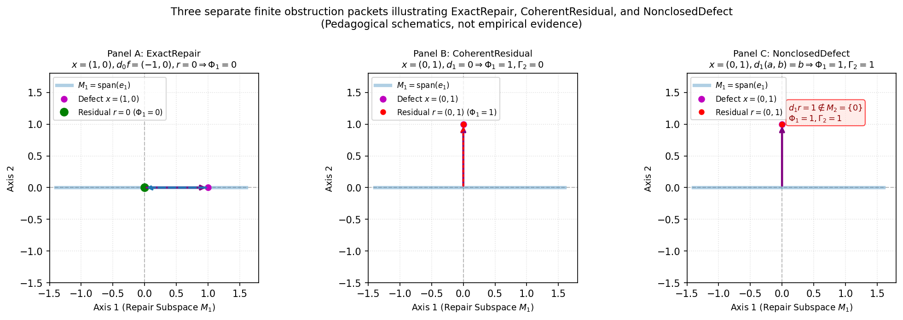

# Finite Obstruction Calculus: Exact Quotient Diagnostics, Dual Witnesses, Two-Stage Coherence, and Transport (CODA-FOC)

**Subtitle:** Exact quotient diagnostics, dual witnesses, two-stage coherence, and transport

**Author:** Jeremy H. Carroll

**Date:** 2026-09-28

**Version:** 3.2.1

**License:** Creative Commons Attribution 4.0 International

## Abstract

A defect is a vector that you are allowed to change only by adding a licensed
linear repair. What cannot be cancelled is the leftover. This paper measures
that leftover in a finite-dimensional weighted $\ell^1$ quotient, then measures
the image of the same vector under a compatible next-defect map in a second
quotient. The two numbers classify every well-posed input into exactly one of
three labels: the vector is an exact repair, a coherent residual, or a
nonclosed defect. Strong linear-programming duality supplies a dual witness on
the whole repair subspace; direct sums add; and a compatible map of carriers
cannot inflate leftovers beyond its operator norm. The three labels classify
the vector. They do not, by themselves, choose an action.

## Introduction

Obstruction language is easy to overstate. In a finite setting the claim “this
vector still has a leftover” can be tied to four concrete objects: a declared
repair subspace, a strictly positive coordinate weight, an exact linear
program, and a dual vector certifying that no cheaper repair exists. The resulting
calculus is small enough to replay by hand on a two-dimensional example, and
strong enough to catch common errors — substituting least squares for
$\ell^1$, allowing a zero weight, annihilating only named generators rather
than the whole repair subspace, or reading a diagnostic label as a decision.

The mathematical components of this calculus — quotient norms [1, 4], linear
programming duality [2, 3], cochain complexes and obstruction cocycles [5, 6],
direct sums of complexes [5], and operator-norm bounds [3, 4] — are standard
tools in discrete analysis, homological algebra, and polyhedral geometry. The
contribution of this paper is their explicit, certificate-producing assembly into
an exact two-stage diagnostic and evidence contract that strictly separates
mathematical classification from operational authorization.

Figure 1 illustrates three separate finite obstruction packets matching the prose
(`public_export/fig1_authority_descent.png`). Take $C_1=\mathbb{R}^2$ and allow
repairs along the first axis: adding any multiple of $(1,0)$. The vector
$(1,0)$ can be cancelled completely ($d_0 f = (-1, 0)$, residual $r=0$). The vector
$(0,1)$ cannot; its leftover, in the ordinary $\ell^1$ norm, is $1$. If the next-defect map
is the zero map, that leftover produces nothing at the next stage ($\Phi_1=1, \Gamma_2=0$).
If instead the next-defect map reads the second coordinate ($d_1(a, b) = b$), the same
leftover appears one degree up ($\Phi_1=1, \Gamma_2=1$). Those are the three diagnoses of
the paper, in order: exact repair, coherent residual, nonclosed defect.

The implementation or evidence contract is refuted by a valid packet for which
a reported quotient value is negative or fails to attain its claimed optimum, a
supplied primal and dual certificate fails replay, the reported classifier is
not total and exclusive, a claimed annihilator fails on the repair subspace,
direct-sum additivity fails, or a compatible transport exceeds its stated bound.
The mathematical theorems would be refuted only by a counterexample satisfying
their stated hypotheses.

## Notation

Throughout, all vector spaces are finite-dimensional and real.

- $C_0$, $C_1$, $C_2$ are the carriers. $C_1$ is the space of first-stage
  defects; $C_2$ is the space of next defects.
- $d_0\colon C_0\to C_1$ lists the licensed first-stage repairs. Adding
  $d_0 f$ to a vector in $C_1$ is an allowed exact correction.
- $d_1\colon C_1\to C_2$ is the next-defect map. The cochain condition
  $d_1\circ d_0=0$ says that an exact first-stage repair produces no
  next-stage defect.
- $a_2\colon U_2\to C_2$ lists the licensed second-stage repairs of the
  next defect.
- $w_1$ and $w_2$ are strictly positive coordinate weights on $C_1$ and
  $C_2$. They are the observer: they say how expensive each coordinate of
  leftover is.
- $M_1=\operatorname{im} d_0$ and $M_2=\operatorname{im} a_2$ are the full
  linear repair subspaces, rather than an unclosed list of named generators.
- $Q_1=C_1/M_1$ and $Q_2=C_2/M_2$ are the quotients in which leftovers live.
- The weighted $\ell^1$ norm is $\|v\|_{1,w}=\sum_i w_i|v_i|$.
- $\Phi_1([x])$ is the cheapest first-stage leftover of $x$.
- $\Gamma_2([d_1 x])$ is the cheapest second-stage leftover of $d_1 x$.

A **finite obstruction packet** is the tuple
$(C_0,C_1,C_2,U_2,d_0,d_1,a_2,w_1,w_2)$ of these spaces, maps, and weights.

## 1. Finite obstruction packets

A packet consists of linear maps

$$
C_0\xrightarrow{d_0} C_1\xrightarrow{d_1} C_2, \qquad U_2\xrightarrow{a_2} C_2
$$

with $d_1 d_0=0$ and strictly positive weights $w_1$ on $C_1$, $w_2$ on $C_2$.
The nilpotence condition $d_1 d_0=0$ defines a two-stage cochain complex in the
sense of homological algebra [5, 6]. The matrix of $d_0$ must span every licensed
linear first-stage repair; the matrix of $a_2$ must span every licensed linear
second-stage repair. A list of informal generators is not enough unless its
columns already span those images.

Set

$$
Q_1=C_1/M_1,\qquad Q_2=C_2/M_2,
$$

$$
\Phi_1([x])=\min_f\,\|x+d_0 f\|_{1,w_1},
$$

$$
\Gamma_2([d_1 x])=\min_u\,\|d_1 x+a_2 u\|_{1,w_2}.
$$

The second quantity is invariant under first-stage repair, because
$d_1(x+d_0 f)=d_1 x$.

### Definition FOC-D1 — valid packet

A packet is valid only when all dimensions match, all entries are finite,
$d_1 d_0=0$ exactly; this release's exact rail accepts exact integer or rational data and does not use numerical tolerances, and
every observer weight is strictly positive. Invalid packets are refused before
any mathematical classification.

## 2. Quotient values and dual witnesses

### Theorem FOC-T1 — quotient norms and attainment

$\Phi_1$ and the corresponding norm on $Q_2$ are well-defined attained norms.

**Proof.** In finite dimension, the repair subspace $M$ is closed. The value at $m=0$ is $\|x\|_{1,w}$. By the reverse triangle inequality, every $m\in M$ with $\|m\|_{1,w}>2\|x\|_{1,w}$ has $\|x+m\|_{1,w}>\|x\|_{1,w}$. Therefore the infimum may be restricted to the compact set $M\cap\{m:\|m\|_{1,w}\le 2\|x\|_{1,w}\}$ (the intersection of a closed subspace with a compact ball [1, 4]), on which the continuous objective attains its minimum. Definiteness ($\Phi_1([x]) = 0 \iff x \in M_1$), homogeneity, and the triangle inequality follow standard quotient norm properties [1, 4]. The identical argument applies to $(C_2, M_2)$ and $\Gamma_2$. □

In words: the leftover is the distance from the vector to the repair subspace,
and in finite dimensions a nearest point exists.

### Theorem FOC-T2 — full-subspace duality

For a matrix $A$ whose image is the declared repair subspace and positive
weights $w$,

$$
\min_y\,\|x+Ay\|_{1,w}
=\max_z\bigl\{z^T x:A^T z=0,\ |z_i|\le w_i\bigr\}.
$$

Both extrema are attained.

**Proof.** We formulate the primal quotient minimization as a linear program in standard form. For a vector $x \in C_1$, repair matrix $A$, and weights $w > 0$, write the residual as $r = x + A y = r^+ - r^-$ with $r^+, r^- \ge 0$. The primal problem is:
$$
\min_{y, r^+, r^-} \sum_{i} w_i (r_i^+ + r_i^-) \quad \text{subject to} \quad r^+ - r^- - A y = x, \quad r^+ \ge 0, \quad r^- \ge 0.
$$
Assigning an unconstrained Lagrange multiplier vector $z$ to the equality constraint $r^+ - r^- - A y = x$, the dual objective is $z^T x$. Dual feasibility requires:

1. Non-negativity on the reduced costs for $r^+$: $w_i - z_i \ge 0 \implies z_i \le w_i$.
2. Non-negativity on the reduced costs for $r^-$: $w_i + z_i \ge 0 \implies z_i \ge -w_i$, so $|z_i| \le w_i$.
3. Vanishing reduced cost for unconstrained $y$: $-A^T z = 0 \implies A^T z = 0$.
The resulting dual problem is $\max_z \{z^T x : A^T z = 0, |z_i| \le w_i\}$. Since the primal is feasible ($y=0, r^+ = \max(x, 0), r^- = \max(-x, 0)$) and bounded below by $0$, strong linear programming duality [2, 3] ensures that both primal and dual optimal values are attained and strictly equal. □

The dual vector $z$ is a price: it is blind to every licensed repair, and it
charges at most the observer weight on each coordinate. Its pairing with $x$
cannot exceed the leftover, and strong duality says some such $z$ achieves
equality. The annihilation condition is annihilation of **every vector in
$\operatorname{im} A$**, rather than only the original named generators before
closure. If a declared operation sends $e_1$ to $e_2$, the repair matrix must
span both before a functional can certify the quotient.

### Corollary FOC-C1 — exact separation

$[x]$ is nonzero in $C/\operatorname{im} A$ if and only if some
dual vector $z$ with $A^T z=0$ and $|z_i|\le w_i$ satisfies $z^T x>0$.

**Proof.** If $[x]=0$, then $x\in\operatorname{im} A$, so $z^T x=0$ for every
$z$ with $A^T z=0$. If $[x]\ne 0$, Theorem FOC-T2 gives $\max z^T x=\|x\|_{1,w/M}>0$.
Because the maximum is attained, there exists a feasible $z^*$ with $z^{*T} x>0$. □

This exact separation by an annihilating dual witness reflects classical
geometric separation and annihilator duality for closed subspaces in normed
linear spaces [1, 2, 4].

### Implementer remark — feasible witnesses and exact optima

A single normalized basis vector of $\ker A^T$ is a feasible dual point,
whose pairing supplies only a lower bound. For $A=e_1\in\mathbb{Q}^3$ and
$x=e_3$, the feasible vector $z=e_2$ pairs to zero although $\Phi_1([x])=1$.
For two directed cycles with circulations $+2$ and $-2$, adding unsigned cycle
indicators also gives a zero pairing, while the exact quotient value is $4$.
Zero at a selected feasible witness therefore does not establish exact repair.

The seven exact conformance cases in `code/tests/test_foc_conformance.py`
cover a zero repair column, repeated coordinates, a multidimensional left
kernel, opposite circulations, two triangles, and the positive sign of an
optimal witness pairing. They check finite examples of FOC-T2 and FOC-C1.
The companion's vertex enumeration is a reference for small instances;
its worst-case cost is exponential in dimension. Larger instances require
an exact linear-programming solver with independently checked primal and
dual feasibility and matching objective values.

### Definition FOC-D2 — certificate

A certificate records a primal repair, residual, dual annihilator, common
value, and input digest. It is valid only if primal feasibility, full-subspace
annihilation, capacity bounds, and equality of primal and dual objectives all
replay against the same packet.

## 3. Observer positivity and nullity invariance

### Proposition FOC-P1 — nullity invariance

Changing from strictly positive weights $w$ to strictly positive weights $w'$
changes the values of $\Phi_1([x])$ and $\Gamma_2([d_1 x])$, but not whether
they are zero.

**Proof.** In finite dimensions, all norms on $Q_1$ are equivalent. Since $w$
and $w'$ are strictly positive on every coordinate, there exist constants
$0<c\le C<\infty$ such that $c\|v\|_{1,w}\le\|v\|_{1,w'}\le C\|v\|_{1,w}$ for
all $v\in C_1$. Taking infima over $M_1$ preserves these inequalities:
$c\Phi_{1,w}([x])\le\Phi_{1,w'}([x])\le C\Phi_{1,w}([x])$. Therefore
$\Phi_{1,w'}([x])=0\iff\Phi_{1,w}([x])=0$. The same holds for $\Gamma_2$ on
$Q_2$. □

The observer sets prices, not zeros. A zero weight is refused because it would
allow an infinite coordinate error to pass without penalty.

## 4. Direct sums

Let $P=(C_0,C_1,C_2,U_2,d_0,d_1,a_2,w_1,w_2)$ and
$P'=(C_0',C_1',C_2',U_2',d_0',d_1',a_2',w_1',w_2')$ be two packets. Their
direct sum $P\oplus P'$ has carriers $C_i\oplus C_i'$, repair map
$d_0\oplus d_0'$, next-defect map $d_1\oplus d_1'$, second-stage repair map
$a_2\oplus a_2'$, and concatenated weights $(w_1,w_1')$ and $(w_2,w_2')$.

### Theorem FOC-T4 — direct-sum additivity

For $(x,x')\in C_1\oplus C_1'$,

$$
\Phi_{1,P\oplus P'}\bigl([(x,x')]\bigr)
=\Phi_{1,P}([x])+\Phi_{1,P'}([x']),
$$

$$
\Gamma_{2,P\oplus P'}\bigl([(d_1 x,d_1' x')]\bigr)
=\Gamma_{2,P}([d_1 x])+\Gamma_{2,P'}([d_1' x']).
$$

**Proof.** The objective decomposes: $\|(v,v')\|_{1,(w,w')}=\|v\|_{1,w}+\|v'\|_{1,w'}$.
The repair space decomposes: $\operatorname{im}(d_0\oplus d_0')=\operatorname{im} d_0\oplus\operatorname{im} d_0'$.
Therefore the minimization uncouples into two independent problems:

$$
\min_{f,f'}\,\bigl(\|x+d_0 f\|_{1,w_1}+\|x'+d_0' f'\|_{1,w_1'}\bigr)
=\min_f\,\|x+d_0 f\|_{1,w_1}+\min_{f'}\,\|x'+d_0' f'\|_{1,w_1'}.
$$

The same argument applies to $\Gamma_2$. □

The direct-sum cochain complex and objective decomposition follow standard
direct-sum decoupling in homological algebra and convex optimization [3, 5].
Two uncoupled problems have the sum of their individual leftovers.

## 5. Transport

Let $P$ and $P'$ be packets, and let $T_0\colon C_0\to C_0'$,
$T_1\colon C_1\to C_1'$, $T_2\colon C_2\to C_2'$, and $S_2\colon U_2\to U_2'$
be linear maps satisfying:

$$
T_1 d_0 = d_0' T_0, \qquad T_2 d_1 = d_1' T_1, \qquad T_2 a_2 = a_2' S_2.
$$

These commutation relations ensure that $T_1$ preserves the repair space
($T_1(M_1)\subseteq M_1'$) and $T_2$ preserves the second-stage repair space
($T_2(M_2)\subseteq M_2'$), forming cochain morphisms whose induced quotient
maps satisfy standard operator norm bounds [4, 5]. Let $\|T_1\|_{1,w_1\to w_1'}$
and $\|T_2\|_{1,w_2\to w_2'}$ denote the weighted operator norms:

$$
\|T_1\|_{1,w_1\to w_1'}
=\max_j\,\frac{1}{w_{1,j}}\sum_i w_{1,i}'\,|(T_1)_{ij}|.
$$

### Theorem FOC-T5 — transport bounds

For any defect $x\in C_1$,

$$
\Phi_1'\bigl([T_1 x]\bigr)\le\|T_1\|_{1,w_1\to w_1'}\,\Phi_1([x]),
$$

$$
\Gamma_2'\bigl([T_2 d_1 x]\bigr)\le\|T_2\|_{1,w_2\to w_2'}\,\Gamma_2([d_1 x]).
$$

**Proof.** Let $f^*$ be an optimal repair for $x$ in $P$, so that
$\Phi_1([x])=\|x+d_0 f^*\|_{1,w_1}$. Set $f'=T_0 f^*$. Then
$T_1 x+d_0' f'=T_1 x+d_0' T_0 f^*=T_1(x+d_0 f^*)$. Since $f'$ is a feasible
repair in $P'$,

$$
\Phi_1'\bigl([T_1 x]\bigr)
\le\|T_1 x+d_0' f'\|_{1,w_1'}
=\|T_1(x+d_0 f^*)\|_{1,w_1'}
\le\|T_1\|_{1,w_1\to w_1'}\,\|x+d_0 f^*\|_{1,w_1}
=\|T_1\|_{1,w_1\to w_1'}\,\Phi_1([x]).
$$

The same argument applies to $\Gamma_2$, using $u'=S_2 u^*$ with an optimal
second-stage repair $u^*$. □

A compatible packet map bounds the transported leftover by its operator norm
times the original value. Growth alone is compatible with this bound: twice the
identity has norm two and doubles the quotient distance. Only a violation of
the stated norm bound contradicts these hypotheses.

## 6. Diagnosis, refusal, and authorization

The pair $(\Phi_1([x]),\Gamma_2([d_1 x]))$ gives three mathematical labels:

1. **ExactRepair:** $\Phi_1([x])=0$. The vector belongs to the repair
   subspace; its leftover is zero.
2. **CoherentResidual:** $\Phi_1([x])>0$ and $\Gamma_2([d_1 x])=0$. The
   leftover is nonzero, but its boundary in the next quotient vanishes.
3. **NonclosedDefect:** $\Phi_1([x])>0$ and $\Gamma_2([d_1 x])>0$. The
   leftover is nonzero and produces an uncancelled defect one degree up.

### Theorem FOC-T3 — diagnostic trichotomy

Every well-posed defect in a valid packet falls into exactly one of these
three categories.

**Proof.** By Theorem FOC-T1, $\Phi_1([x])\ge 0$ and $\Gamma_2([d_1 x])\ge 0$.
The outcome $\Phi_1([x])=0$ and $\Gamma_2([d_1 x])>0$ cannot occur: if
$\Phi_1([x])=0$, then $x\in\operatorname{im} d_0$, so $x=d_0 f$ for some $f$.
Then $d_1 x=d_1 d_0 f=0$ by the cochain condition. Setting $u=0$ in the
definition of $\Gamma_2$ gives $\Gamma_2([0])\le\|0+a_2 0\|_{1,w_2}=0$. Since
$\Gamma_2\ge 0$, $\Gamma_2([d_1 x])=0$. The three cases partition the attainable value pairs and therefore classify every valid defect uniquely. □

A diagnostic label is not an authorization. In particular, a coherent residual
is a vector whose next defect vanishes in the quotient. It is not an assertion
that the vector is desirable, stable, or permitted to act. The mathematical
diagnostic labels (`ExactRepair`, `CoherentResidual`, `NonclosedDefect`)
strictly classify the cochain vector; operational authorization and descent
decisions require explicit grounded gates governed by CODA-FDA [9].

The reference companion supports a bounded stabilization check for a declared
finite registry of exact additive corrections. The caller supplies the same
packet, defect, scope, and complete finite list independently of the evidence
record. A correction is improving when it strictly lowers Φ₁. Each correction
is replayed with the exact quotient solver; the packet and observer are frozen.
The record binds the concrete corrections, every replay result, evaluator
version, scope, and budget. The budget must cover every listed move.

`StabilizedSurvivor` means that a coherent residual has no improving correction
in that supplied finite list. Completeness is relative to the declared list;
this implementation does not establish completeness of an external licensing
policy, search over undeclared operators, authenticate an issuer, or grant
permission. Digest strings without the matching registry and successful replay
leave the route `OpenObstruction`. Invalid algebraic input raises a refusal
exception before any mathematical diagnostic is returned.

OpenObstruction is an operational evidence-state label. It is not the mathematical diagnostic NonclosedDefect.

No finite iteration bound is asserted here. In particular, a budget counter
does not bound a height that later operations may increase.

## 7. Computational companion

The production module `code/finite_obstruction.py` validates packets, solves
the four primal and dual linear programs needed for $\Phi_1$ and $\Gamma_2$,
checks the full-subspace annihilator equations, returns digest-bound
certificates and the total diagnostic, and applies the optional later record
of Section 6. A survivor route requires `FiniteRepairRegistry` replay, including
all concrete corrections and their exact outcomes; syntactically valid hashes
or caller-written dispositions are insufficient.

Adversarial tests include:

- the $\ell^1$ versus $\ell^2$ instance $A=(1,1,1)^T$, $x=(0,0,10)$;
- refusal of zero observer weights;
- a generator-closure counterexample where $e_1$ reaches $e_2$ and $z=(0,1)$
  is not an annihilator of the full repair subspace;
- exact, coherent-residual, and nonclosed-defect packets;
- direct sums, transport squares, and partial later records.

Exact rational solving via `LinearRepairProblem` supplies algebraic
certificates without floating-point error. Lean 4 files in `lean4/` [7]
formalize stated logical and algebraic kernels, with no `sorry` stubs:

- `TerminalCompleteness.lean` — abstract decidable trichotomy
  partition underlying Theorem FOC-T3;
- `L20AKernel.lean` — logical separation implications of Theorem
  FOC-T3 conditional on four declared quotient-kernel facts;
- `Algebra.lean` (`FOC.lean`) —
  dual separation theorem `Coda.FOC.separator_exists` (Corollary FOC-C1) and
  basic quotient algebra;
- `EpkPrimitiveDifference.lean` and `PrimitiveDifference.lean` —
  quotient factorization of local diagnostics;
- `Core.lean` — re-exports the files above.

The general theorem follows from finite LP strong duality; each computed rational
instance carries replayable exact primal and dual witnesses with equal objectives.

## 8. Limitations

The calculus is linear and finite-dimensional. It does not treat nonlinear
repair maps. The Lean files formalize the abstract decidable trichotomy
partition and conditional logical/algebraic kernels; Python exact rational
certificates verify individual problem instances; and the general numerical
LP duality theorem is established by the manuscript's mathematical proof.
They do not formalize simplex-method polyhedral duality in Lean.

## Appendix: Context within CODA Architecture

CODA stands for the Calculus of Obstruction, Descent, and Authority. Its eight research components are FOC, MUR, CS, CS_Q, Q, A, OR, and FDA; GTLA is the overarching authority architecture, not a ninth mathematical component. The architecture was established in the frozen baseline derivation [11]. The obstruction calculus presented here (FOC) interacts with the typed residual records of CODA-A [8], the evidence-derived guards of CODA-FDA [9], and representation transport in CODA-MUR [10]. The order below is the application's runtime order, not a derivation of one component from another.

| Runtime stage | Abbreviation | Component or architecture |
| :---: | :--- | :--- |
| 1 | **FOC** | Finite Obstruction Calculus |
| 2 | **MUR** | Meta & Universal Re-Presentation (what presentations exist) |
| 3 | **CS** | Continuum Shadow (what continuum presentation may descend to a finite calculus system) |
| 4 | **CS_Q** | Continuum Shadow to Continuum Bridge (how continuum presentations descend) |
| 5 | **Q** | The Continuum (continuum presentations via completion and enclosure) |
| 6 | **A** | Anomalon (global residuals not removed and typed instead) |
| 7 | **OR** | Omniversal Re-Presentation (what presentations can transport) |
| 8 | **FDA** | Finite Descent Authority (what presentation may descend to evaluation and authorization) |
| 9 | **GTLA** | Layered Authority Architecture for CODA |

No theorem or certificate in this paper depends on the other CODA layers; the obstruction calculus presented here is self-contained.

## References

1. R. T. Rockafellar, *Convex Analysis*, Princeton Mathematical Series, vol. 28, Princeton University Press, Princeton, NJ, 1970. [doi:10.1515/9781400873173](https://doi.org/10.1515/9781400873173)
2. A. Schrijver, *Theory of Linear and Integer Programming*, Wiley-Interscience Series in Discrete Mathematics and Optimization, John Wiley & Sons, Chichester, 1986.
3. S. Boyd and L. Vandenberghe, *Convex Optimization*, Cambridge University Press, Cambridge, UK, 2004. [doi:10.1017/CBO9780511804441](https://doi.org/10.1017/CBO9780511804441), <https://web.stanford.edu/~boyd/cvxbook/>
4. W. Rudin, *Functional Analysis*, 2nd ed., International Series in Pure and Applied Mathematics, McGraw-Hill, New York, NY, 1991.
5. S. Mac Lane, *Homology*, Die Grundlehren der mathematischen Wissenschaften, Band 114, Springer-Verlag, Berlin, Heidelberg, 1963. [doi:10.1007/978-3-642-62029-4](https://doi.org/10.1007/978-3-642-62029-4)
6. N. E. Steenrod, *The Topology of Fibre Bundles*, Princeton Mathematical Series, vol. 14, Princeton University Press, Princeton, NJ, 1951.
7. L. de Moura and S. Ullrich, "The Lean 4 Theorem Prover and Programming Language," in *Automated Deduction – CADE 28*, Lecture Notes in Computer Science, vol. 12699, pp. 625–635, Springer, Cham, 2021. [doi:10.1007/978-3-030-79876-5_37](https://doi.org/10.1007/978-3-030-79876-5_37)
8. J. H. Carroll, *CODA-A: Residuals of Projections, Kernels, and Cokernels — The Anomalon as a Typed Leftover*, CODA Technical Monograph Series, 2026. Companion manuscript; no verified DOI supplied.
9. J. H. Carroll, *CODA-FDA: Finite Descent Authority — Standing Authorization Gate, Boundary Isolation, and Grounded Action Contracts*, CODA Technical Monograph Series, 2026. Companion manuscript; no verified DOI supplied.
10. J. H. Carroll, *CODA-MUR: Certified Representation Transport, Composition, and Irreversible Forgetting*, CODA Technical Monograph Series, 2026. Companion manuscript; no verified DOI supplied.
11. J. H. Carroll, *CODA System Foundations and Architecture*, Sealed Derivation v1 (`3100c4e`), cut 2026-08-17. <https://github.com/dbccpage/19L57G1/tree/sealed-derivation-v1>
