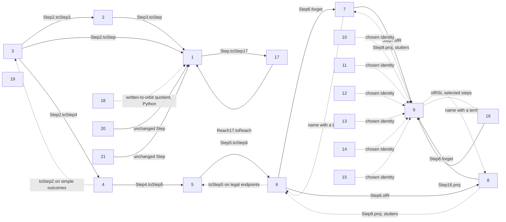

# Correspondence audit (outside the derivational seal)

This file asks whether structures named in the task occur in the existing
derivations. It is **not** an input to a seed or a paper. Source status is
attached to every row below: **given** is text in a seed, **chosen** is an
interpretation fixed for this audit, **derived** is backed by a cited proof,
**computed** is a regenerable finite check, **refuted** has a witness, and
**open** has neither a proof nor a counterexample. These statuses concern the
correspondence, not a new theorem about all possible systems.

## Objects, steps, paths, and potentials

**Chosen:** take well-formed states as objects and a performed change as a
step. A graded `Reach s t n` proves that some sequence of length `n` connects
them. Forgetting `n` gives a reachability preorder where `refl` and `trans`
are available. Because Lean's `Reach` is `Prop`, it does not retain two
different proof terms as distinct path arrows. The Python sequence counts
are separate data. The change protocol, refusal log, and state object may
therefore carry more information than this preorder.

| Derivation | State; step; path in Lean | Identity and composition | Potential with one-step upper bound | Status / source |
|---|---|---|---|---|
| 1 base | `St`; `Step`; `Reach` | `Reach.refl`, `Reach.trans` | `costA`/`costB`, `Step.costA_le` and B analogue on legal states | derived, `H3V7N5QF/Cost.lean`, `Paths.lean` |
| 2 | `St`; `Step3`; `Reach3` | `Reach3.refl`, `.trans` | `size`, `Step3.size_le` | derived, `Second/Step.lean`, `Cost.lean` |
| 3 | `St`; `Step2`; `Reach2` | `Reach2.refl`, `.trans` | `size` rises exactly one, `Step2.size_eq` | derived, `Third/Step.lean`, `Cost.lean` |
| 4 | `MSt`; `Step4`; `Reach4` | `Reach4.refl`, `.trans` | `size` rises exactly one, `Step4.size_eq` | derived, `Fourth/Step.lean`, `Cost.lean` |
| 5 | `MSt`; `Step5`; `Reach5` | `Reach5.refl`, `.trans` | `costA5`/B, `Step5.costA_le` and B analogue | derived, `Fifth/Step.lean`, `Cost.lean` |
| 6 | `MSt`; `Step6`; `Reach6` | `Reach6.refl`, `.trans` | `costA6`/B, `Step6.costA_le` and B analogue | derived, `Sixth/Step.lean`, `Cost.lean` |
| 7 | `NSt`; `Step7`; `Reach7` | `Reach7.refl`, `.trans` | `size`, `Step7.size_step` | derived, `Seventh/Step.lean`, `Cost.lean` |
| 8 | `DSt`; `Step8`; `Reach8` | `Reach8.refl`, `.trans` | `costA8`/B, `Step8.costA_le` and B analogue | derived, `Eighth/Step.lean`, `Cost.lean` |
| 9 | `NDSt`; `Step9`; `Reach9` | `Reach9.refl`, `.trans` | `size`, `Step9.size_step` | derived, `Ninth/Step.lean`, `Cost.lean` |
| 10 | chosen `NDSt`; `Step10 := Step9`; `Reach10 := Reach9` | inherited 9 | inherited 9 by identity | chosen model, derived inheritance, `Tenth/Step.lean` |
| 11 | chosen `NDSt`; `Step11 := Step9`; `Reach11 := Reach9` | inherited 9 | inherited 9 by identity | chosen model, derived inheritance, `Eleventh/Step.lean` |
| 12 | chosen `NDSt`; `Step12 := Step9`; `Reach12 := Reach9` | inherited 9 | inherited 9 by identity | chosen model, derived inheritance, `Twelfth/Step.lean` |
| 13 | chosen `NDSt`; `Step13 := Step9`; `Reach13 := Reach9` | inherited 9 | inherited 9 by identity | chosen model, derived inheritance, `Thirteenth/Step.lean` |
| 14 | chosen `NDSt`; `Step14 := Step9`; `Reach14 := Reach9` | inherited 9 | inherited 9 by identity | chosen model, derived inheritance, `Fourteenth/Step.lean` |
| 15 | chosen `NDSt`; `Step15 := Step9`; `Reach15 := Reach9` | inherited 9 | inherited 9 by identity | chosen model, derived inheritance, `Fifteenth/Step.lean` |
| 16 | `RSt`; `Step16`; `Reach16` | `Reach16.refl`, `.trans` | `potential = size + 2 × record`, `Step16.potential_le` | derived, `Sixteenth/Step.lean`, `Cost.lean` |
| 17 | `St`; `Step17`; `Reach17` (unobstructed) and `ReachAll` | both have `.refl`; no named composition lemma | base cost bound survives for `Reach17` from a loop-free state; it fails for `ReachAll` (`cost_not_lower_bound_A`) | derived: `Reach17` bound; refuted: `ReachAll` bound, `Seventeenth/Step.lean`, `Cost.lean` |
| 18 | base `St`, `Step`, `Reach`; written equality replaces quotient | inherited base | base cost bound for named writings; free-writing excess is measured, with a return-from-higher-bound question open | derived: base bound; computed: bounded excess; open: return question, `Eighteenth/Writing.lean`, paper §3–6 |
| 19 | base `St`; `PStep`; ungraded `PReach` | `.refl`; no named composition lemma | term cardinality never falls (`PReach.card_ge`); a general cost-to-ℕ bound is open | derived: cardinality; open: general cost bound, `Nineteenth/Partial.lean` |
| 20 | base `St`, `Step`, `Reach`; attempt order changes | inherited base | inherited base | derived by unchanged change type, `Twentieth/Order.lean` |
| 21 | base `St`, `Step`, `Reach`; obstruction answer is refusal | inherited base for performed steps | inherited base | derived by unchanged change type, `Twentyfirst/Refusal.lean` |

The one-step upper bounds do not say every change *raises* a potential.
Removal and identification can lower size; `Reach16` can run a two-change
cycle. Likewise, a `Prop`-valued `Reach` with proof-irrelevant inhabitants is
not the free category of recorded histories. These are **refuted** stronger
readings, witnessed by `Fifth/cycle2` and `Sixteenth/cycle2_assert16` and by
the distinct Python sequence counts in `evidence/third/`.
For `Reach17` and `PReach`, the committed inductive definitions have `refl`
and `step` constructors but no named `trans` lemma. A paper-level induction
on the second path composes them (base case returns the first path; step case
appends its last step). A Lean composition theorem for these two is **open as
an interface item**, not a claimed absence of composition.

## Translation graph and edge types

The arrows show a map's direction, which need not be the chronological
direction of a seed edit. A solid arrow carries every performed step to a
step and therefore every sequence to a sequence, preserving zero-length
identity and concatenation by induction. A dotted arrow needs the qualifier
on its label and in the text below: it is restricted, may map a step to a
step **or stuttering equality**, may be an identity only in a chosen model,
or may have no established path map. A restricted or stuttering map acts on
the ungraded reachability preorder only on its stated object domain and
after deleting stutters; a state-only arrow has no such functor claim.

The graph draws the principal rule-5 routes. The reverse arrows from 4, 6,
7, and 9 are restricted: `Step4.toStep2` needs a simple target;
`Step6.toStep5` needs legal endpoints; `Step7.name` and `Step9.name` need a
term and may change which term carries the name after identification. They
map the stated steps to steps under those hypotheses. The 4→3 and 6→5
restrictions are not maps of all later objects. `Reach17` is the
unobstructed path family and maps back to the base by `Reach17.toReach`;
17's broader `ReachAll` does not. The 10–15 dotted arrows are full
identities only for each paper's **chosen** result reading; their tagged
alternatives carry extra record data and need a different object map.
Eighteenth's quotient arrow is computed in Python, not a Lean map.
The ninth's `ofRSt` embeds a state with no leftover record into 16 and
embeds additions and identifications as steps. A removal can leave a record,
so `Step9.embed` does not give a step between the two embedded endpoints;
`AddReach9.embed` is scoped to additions. Nineteenth is shown as an isolated
node because its one-assertion rewrite has no exhibited base step map.
`Step6.toTry5` is total into a fifth-seed *attempt*, while
`Step6.toStep5` exists only at legal endpoints; an attempted change is not
automatically a performed path arrow. Similarly, `Step4.toTry4` and
`Step5.toTry5` translate a performed step into their local attempt protocol,
not into a new reachability map. These distinctions are why the dotted
arrows cannot all be promoted to functors on the full object sets.

**Derived:** `Reach2.toReach3` and `Reach2.toReach` make the triangle
3→2→1 commute: `Step2.toStep` is defined as `h.toStep3.toStep`
(`Third/Step.lean:42–48`). The fourth's `toSt_ofSt` is a retraction on
well-formed third states; `ofSt_toSt` needs `Simple`. The seventh's
`forget_name` and ninth's `forget_name9` retract naming on a chosen term.
`proj_ofR_false` and `proj_ofR9_false` retract embedding a one-relation state
as the `r` part. These theorems are about the displayed state domains; they
are not global inverse equivalences (`Fourth/State.lean`,
`Seventh/State.lean`, `Eighth/State.lean`, `Ninth/State.lean`).

**Derived with restriction:** `Step4.toStep2` needs a simple outcome;
`Step6.toStep5` needs loop-free endpoints; `Step17.toStep` needs an
unobstructed step on a loop-free state; `Step9.embed_identify` into 16
needs an empty record and its own conditions. The seventh and ninth naming
lemmas require a term to name, and the chosen name can follow a merge. Thus
none is a total fixed-object functor from every state of the later seed back
to the earlier one. The empty state of 7/9 is a concrete counterexample.

**Open:** a step-preserving map from `PStep` (19) to base `Step` is not
exhibited. Its one-assertion rewrite can keep three terms while a base
identification drops one (`Nineteenth/Partial.lean:32–63`); the other three
changes match. The result-set inclusion in `paper/nineteenth/paper.md` is a
bounded computation, not a step functor. The written-to-orbit map of 18 is
Python `canonical`; a corresponding Lean functor is open because the base
Lean model represents named states but not its FREE quotient.

## Squares, renaming, symmetry, and adjunction

| Test | Evidence | Status |
|---|---|---|
| 6→8→9 equals 6→7→9 on objects | `check_maps.py`: all 66 states with 1–2 terms, binary multiplicities, every name placement; no disagreement | computed; general object identity follows by the tuple constructors, but no named Lean theorem |
| 8→6→7 equals 8→9→7 on the `r` part | `Ninth.proj_forget9`; 1,028 bounded named two-relation states checked | derived on objects, computed bounded check |
| 9→8→6→7 equals 9→7 on the `r` part | `Ninth.proj_name9`, `Ninth.proj_forget9`; 516 bounded name placements checked | derived on objects, computed bounded check |
| 7→9→7 and 9→8→9 | `proj_ofR9_false`, `forget_name9` | derived, conditional naming when a term exists |
| 3→2→1 | `Step2.toStep` is the composition in source | derived, definitional |
| Rename commutes with forgetting, projecting and naming | `Seventh.forget_rename4`; `Ninth.forget_rename8`, `proj_rename9`, `rename8_name`; `Step9.rename`, `Reach9.rename` | derived for the named maps; base's O3 is still open in Lean for its full cost statement |
| Swapping `r` and `s` twice | `swap9_swap`, `Step9.swap`, `Reach9.swap` | derived involution on ninth objects and paths |
| `ofR ⊣ proj_r` on the ungraded reachability preorder | `map_checks.json`: 4,959 pairs in the 0–2-term binary universe, no disagreement; `reach7_iff`, `reach9_iff` both reduce reachability to “target has a term or source is empty”, and `ofR`/`proj` preserve those term sets | derived as a written general proof from those Lean lemmas; computed finite cross-check; no dedicated Lean adjunction theorem |
| A global adjunction using `name` as a right adjoint to `forget` | empty ninth state has no term to name; `name9_wf` requires `c ∈ s.T` | refuted as a total-object claim; possible restricted adjunction on nonempty states is open |
| Ninth projection preserves length | adding one `s` assertion changes `1::|` to `1::|0-0*1` while the `r` part stays `1::`; `Step9.proj` permits equality, `Reach9.proj` permits fewer steps | refuted; `map_checks.json` witness |

The two named object squares have a direct general check on their
constructors. For a sixth state `(T,M,a,b)`, either route to ninth gives
`(T,r=M,s=0)` with no names. For an eighth state `(T,M_r,M_s,a,b)`, either
route to seventh gives `(T,M_r)` with no names. The 66 and 1,028 finite
checks independently exercise these equations on every listed writing.
For performed changes, a case split on add term, add assertion, remove, and
identify gives the same projected endpoint on both routes of each square.
In the 6→9 square both routes keep the operation in `r`; in the 8→7 square
an `s`-only assertion change stutters on both routes, while an `r` change
has the same projected operation. Concatenating those cases gives the same
ungraded image for a path after stutters are erased. This is a **derived
written proof** from the constructors of `Step6.ofR`, `Step6.forget`,
`Step7.ofR`, `Step8.proj`, `Step8.forget`, and `Step9.proj`; equality of two
*named Lean path-map functions* is **open**, because the corresponding composites are
not packaged as such functions.
For the adjunction row, `reach7_iff` and `reach9_iff` give, on well-formed
states, the same condition `s.T.Nonempty → t.T.Nonempty` on both sides:
`ofR(s).T = s.T` and `proj_r(t).T = t.T`. This proves the stated ungraded
preorder equivalence; it does not prove equality of path lengths.

Every route in each finite square probe was checked on its declared exact
universe; the named checks omit the empty state because a name requires a
term. The nontrivial directed diamonds in the displayed graph are the
3→2→1 direct/composite triangle, 6→8→9 versus 6→7→9, and 8→6→7 versus
8→9→7; their status is given in the table. Longer duplicate routes factor
through these diamonds and the displayed retractions. The section using
9→8 requires a chosen term and is a restricted square, not a total arrow.
The square check and the 9/7 adjunction do not certify any other pair of
maps. In particular, the 16→9 projection forgets the record, so a two-change
record cycle can become an identity in the target preorder; it is not a
faithful map of recorded histories. The record-growing state and its
empty-record projection are two legal witnesses to that failure
(`Sixteenth/Step.lean`, `Cost.lean`).

**Open:** these named commutation results do not supply naturality for every
translation arrow, a composition law for proposed higher cells, or a
coherent 2-category of the 21 derivations. A counterexample would be one
well-formed state/step square whose two routes disagree; a supporting test
would need explicit path maps and naturality for every displayed edge,
including the restricted and state-only cases. The current Lean sources
prove only the named instances above.

## Immune-system and Genesis readings

The role-by-role test, ablation matrix, historical incidence test, and Genesis
comparison are recorded separately in `roles.md`, `ablation_lattice.md`,
`defect_incidence.md`, and `genesis_correspondence.md`. The words “variation”,
“selection”, “inheritance”, and “antibody” in those files name hypotheses
about the *review process*.
They are not terms of any seed and carry no authority over a derivation.
