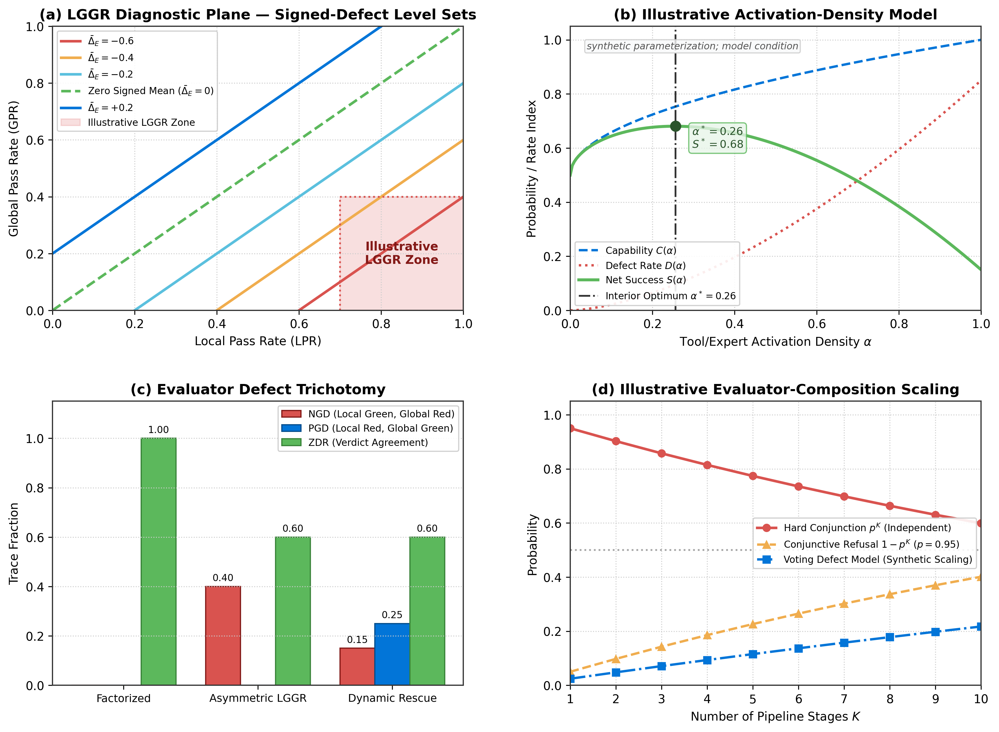

# Local Green, Global Red I

## Evaluated Path Kernels for Composed Agent Reliability

**Author:** Jeremy H. Carroll

**Date:** 2026-10-15

**Version:** 1.2.4

**DOI:** [10.5281/zenodo.22881911](https://zenodo.org/records/22881911) (lineage / previous version: [10.5281/zenodo.20675803](https://doi.org/10.5281/zenodo.20675803))

## Abstract

A composed system can pass each local check yet fail its end-to-end test. For
binary local verdicts \(E_1,E_2\) and global verdict \(E_g\), define the
evaluator gluing defect

\[
\Delta_E=E_g-E_1E_2\in\{-1,0,1\}.
\]

We prove finite sample identities, a conditional composition theorem for
weighted path sums, and its residual when evaluator judgments do not factor.
We characterize the summaries that retain defect information and show how a
carrier collision can place a globally failing trace in a locally green class.
Python, Lean 4, and notebook companions are included. The benchmarks are
proposed testbeds; no benchmark result or population-level claim is reported.

## 1. Finite setup

Let \(\mathsf S\) be a finite set of states. For \(a,b\in\mathsf S\), let
\(\Omega(a,b)\) be a finite set of recorded trajectories from \(a\) to \(b\).
Each trajectory has a non-negative weight \(w(\gamma)\) and a binary evaluator
\(E(\gamma)\in\{0,1\}\). The evaluated path kernel is

\[
Z_E(b\mid a)
  =\sum_{\gamma\in\Omega(a,b)}E(\gamma)w(\gamma).
\]

The action-weighted instance uses
\(w(\gamma)=\exp[-\beta\mathcal A(\gamma)]\) with \(\beta\ge0\).
Section 6 adds proposal, cost, and risk factors. All sums in this paper are
finite.

Suppose a trajectory from \(a\) to \(c\) is considered in two stages, with a
declared boundary state \(b\):

\[
\gamma=\gamma_2\star\gamma_1,\qquad
\gamma_1:a\to b,\quad\gamma_2:b\to c.
\]

Write \(E_1=E(\gamma_1)\), \(E_2=E(\gamma_2)\), and
\(E_g=E(\gamma_2\star\gamma_1)\). The local joint verdict is
\(L=E_1E_2\).

## 2. The evaluator defect

### 2.1 Definition and normal forms

Define

\[
\Delta_E(\gamma_2,\gamma_1)=E_g-E_1E_2.
\]

Because \(E_g,L\in\{0,1\}\), exactly one of three cases occurs:

| Name | \(\Delta_E\) | Local joint verdict | Global verdict |
|---|---:|---:|---:|
| negative gluing defect (NGD) | \(-1\) | \(1\) | \(0\) |
| zero defect residual (ZDR) | \(0\) | \(0\) or \(1\) | same as \(L\) |
| positive gluing defect (PGD) | \(+1\) | \(0\) | \(1\) |

Thus “local green, global red” is precisely the NGD case. One instance,
\((E_1,E_2,E_g)=(1,1,0)\), is already a counterexample to the implication
\(E_1=E_2=1\Rightarrow E_g=1\).

### 2.2 Five-trace example

This worked example records the absolute local and global verdicts so that the
defect can be recomputed, rather than reporting only a pass-rate total.

| Trace | \(E_1\) | \(E_2\) | \(L=E_1E_2\) | \(E_g\) | \(\Delta_E\) | Kind |
|---:|---:|---:|---:|---:|---:|---|
| 1 | 1 | 1 | 1 | 1 | 0 | ZDR |
| 2 | 1 | 1 | 1 | 0 | -1 | NGD |
| 3 | 1 | 1 | 1 | 0 | -1 | NGD |
| 4 | 1 | 0 | 0 | 0 | 0 | ZDR |
| 5 | 0 | 1 | 0 | 0 | 0 | ZDR |

For these five traces,

\[
\mathrm{LPR}=3/5,\quad
\mathrm{GPR}=1/5,\quad
\overline{\Delta}_E=-2/5,\quad
\mathrm{NGD}=2/5.
\]

The numbers are a computed fixture, not an empirical estimate.

### 2.3 Exact sample identities

For a nonempty sample of \(N\) traces, let \(n_-,n_+,n_0\) be the NGD, PGD,
and ZDR counts. Let

\[
\mathrm{LPR}=\frac1N\sum_i L_i,\qquad
\mathrm{GPR}=\frac1N\sum_i E_{g,i},\qquad
\mathrm{EGD}=\frac{n_-+n_+}{N}.
\]

Summing \(E_{g,i}-L_i=\Delta_{E,i}\) gives

\[
\mathrm{GPR}-\mathrm{LPR}
 =\overline{\Delta}_E
 =\frac{n_+-n_-}{N}.
\]

The trichotomy gives

\[
n_-+n_++n_0=N,\qquad
\mathrm{EGD}=\frac{n_-+n_+}{N}.
\]

Consequently,

\[
2n_+=N\,\mathrm{EGD}+\sum_i\Delta_{E,i},\qquad
2n_-=N\,\mathrm{EGD}-\sum_i\Delta_{E,i}.
\]

These formulas show both the value and the limit of aggregate rates. LPR and
GPR determine the signed balance \(n_+-n_-\), but not the absolute defect
count \(n_-+n_+\). A sample containing one NGD and one PGD has zero signed
defect while retaining two pointwise discrepancies.

Global failures split into two disjoint classes:

\[
\#\{E_g=0\}=n_-+\#\{L=0,E_g=0\}.
\]

NGD therefore measures the locally passing part of global failure; it is not
the global-failure rate itself.

## 3. Conditional kernel composition

Let \(\mathsf B\subseteq\mathsf S\) be a declared intermediate slice. Exact
composition uses three hypotheses.

- **G1, boundary-slice bijection.** Concatenation and splitting give a
  bijection

  \[
  \Omega(a,c)\;\cong\;
  \bigsqcup_{b\in\mathsf B}
  \bigl(\Omega(b,c)\times\Omega(a,b)\bigr).
  \]

  Thus every \(\gamma\in\Omega(a,c)\) has exactly one representation
  \((b,\gamma_2,\gamma_1)\), and conversely every compatible segment pair in
  the displayed dependent disjoint union concatenates to an admitted global
  path. No compatible pair is omitted or duplicated.
- **G2, multiplicative weight.**
  \(w(\gamma_2\star\gamma_1)=w_2(\gamma_2)w_1(\gamma_1)\).
  For action weights this follows from
  \(\mathcal A(\gamma_2\star\gamma_1)
    =\mathcal A(\gamma_2)+\mathcal A(\gamma_1)\).
- **G3, evaluator factorization.**
  \(E_g(\gamma_2\star\gamma_1)=E_2(\gamma_2)E_1(\gamma_1)\).

**Theorem 1 (evaluated path-kernel composition).** Under G1–G3,

\[
Z_E(c\mid a)
=\sum_{b\in\mathsf B}Z_{E_2}(c\mid b)Z_{E_1}(b\mid a).
\]

**Proof.** G1 reindexes the global finite sum by the unique boundary and the
two segment paths. G2 and G3 factor each summand:

\[
\begin{aligned}
Z_E(c\mid a)
&=\sum_{b\in\mathsf B}
  \sum_{\gamma_2,\gamma_1}
  E_g(\gamma_2\star\gamma_1)
  w(\gamma_2\star\gamma_1)\\
&=\sum_{b\in\mathsf B}
  \sum_{\gamma_2,\gamma_1}
  E_2(\gamma_2)w_2(\gamma_2)
  E_1(\gamma_1)w_1(\gamma_1)\\
&=\sum_{b\in\mathsf B}
  Z_{E_2}(c\mid b)Z_{E_1}(b\mid a).
\end{aligned}
\]

The theorem is sufficient, not biconditional: an aggregate equality can hold
through cancellation even when G3 fails pointwise.

## 4. Residual decomposition

Assume G1 and G2, but do not assume G3. Substituting
\(E_g=E_1E_2+\Delta_E\) gives the exact identity

\[
Z_E(c\mid a)
=\sum_{b\in\mathsf B}Z_{E_2}(c\mid b)Z_{E_1}(b\mid a)
+R_E(c,a),
\]

where

\[
R_E(c,a)=
\sum_{b,\gamma_2,\gamma_1}
\Delta_E(\gamma_2,\gamma_1)
w_2(\gamma_2)w_1(\gamma_1).
\]

The residual is signed. Hence \(R_E=0\) says that the weighted sum vanishes;
it does not say \(\Delta_E=0\) for every pair.

If the global weight also fails to factor, write

\[
w_g=w_1w_2+\Delta_w.
\]

Then each global contribution expands as

\[
E_gw_g
=E_1E_2w_1w_2
+\Delta_Ew_1w_2
+E_1E_2\Delta_w
+\Delta_E\Delta_w.
\]

This is the fully corrected two-channel bookkeeping identity. The Lean
development checks the abstract integer-weight expansion. The displayed
real-exponential instance is not a Lean real-analysis theorem.

## 5. Information retained by a dashboard

The finite Boolean model permits sharper statements than a two-rate summary.
The claim identifiers below match the Lean root module and the claim ledger.

1. **E3–E4.** Local pass count alone does not determine the global pass count,
   NGD count, or signed defect. A quotient that remembers only the local
   verdict cannot carry \(E_g\) or \(\Delta_E\).
2. **E5–E8.** NGD, PGD, and ZDR have the normal forms in Section 2.
   EGD is NGD plus PGD, while the signed defect is PGD minus NGD.
3. **E9–E11.** LPR and GPR do not determine EGD. EGD together with signed
   defect reconstructs the oriented defect counts, and NGD count is bounded
   by the local-pass count.
4. **E12–E16.** The pair \((L,E_g)\) carries the defect packet
   \((\Delta_E,\mathrm{kind})\). The packet alone does not recover the two
   absolute verdicts, but the packet plus either one does. Three diagnostic
   classes exist, so no single Boolean key can encode the exact diagnostic
   quotient.
5. **E17–E18.** A collision under an observed carrier becomes a zero-relation
   in the induced quotient, and global failures partition into NGD and
   local-red/global-red traces.

These are statements about information in finite records. They do not assess
whether the evaluators themselves are semantically adequate.

## 6. Proposal-weighted paths

Let a proposal mechanism assign non-negative mass \(P_\theta(\gamma)\), with
cost \(C(\gamma)\) and risk \(R(\gamma)\). One useful finite kernel is

\[
Z_\theta(b\mid a)=
\sum_{\gamma\in\Omega(a,b)}
E(\gamma)P_\theta(\gamma)
\exp[-\lambda C(\gamma)-\mu R(\gamma)],
\]

where \(\lambda,\mu\ge0\). For the displayed proposal–cost–risk kernel, G2
is ensured by additive cost and risk under concatenation. At fixed penalties,
equality of the combined weighted cost is sufficient; requiring factorization
for all independently variable nonnegative penalties forces the separate
additive identities. The implementation keeps three modes distinct:
action weight, proposal-cost-risk weight, and their hybrid.

For two-stage composition, add:

- **G4, proposal factorization.**
  \(P_\theta(\gamma_2\star\gamma_1)
   =P_\theta(\gamma_2)P_\theta(\gamma_1)\).

Under G1–G4, the proof of Theorem 1 applies to the proposal-weighted
contribution. The evaluator residual in this mode uses the same proposal,
cost, and risk weight as the kernel. This extension is conditional on the
declared factorization; it does not claim that an arbitrary language-model
proposal distribution has that property.

## 7. Two conditional engineering models

### 7.1 Active support density

Let \(C(\alpha)\) denote capability and \(D(\alpha)\) defect probability in a
declared model with active-support parameter \(\alpha\in[0,1]\). Define

\[
S(\alpha)=C(\alpha)(1-D(\alpha)).
\]

If \(C,D\) are differentiable, then

\[
S'(\alpha)=C'(\alpha)(1-D(\alpha))-C(\alpha)D'(\alpha).
\]

An interior optimum satisfies

\[
C'(\alpha^\ast)(1-D(\alpha^\ast))
=C(\alpha^\ast)D'(\alpha^\ast).
\]

A strict change of sign from positive to negative at \(\alpha^\ast\) is a
sufficient single-crossing condition for the claimed reversal. The calculus
does not derive that condition from primitive assumptions, and a boundary
optimum need not satisfy the interior equation.

### 7.2 Product and mixture aggregation

Let \(\mathcal W\) be a nonempty finite candidate set and let each expert score
be non-negative. Define

\[
D_{\mathrm{PoE}}=\sum_{\eta\in\mathcal W}\prod_e p_e(\eta).
\]

The normalized Product of Experts is defined only under the common-support
condition \(D_{\mathrm{PoE}}>0\), equivalently when at least one candidate has
strictly positive score from every expert. Under that condition,

\[
p_{\mathrm{PoE}}(W)
=\frac{\prod_e p_e(W)}
       {D_{\mathrm{PoE}}}.
\]

If \(p_e(W)\propto e^{-J_e(W)}\), its energy is additive up to the
normalization constant. A zero from any hard expert forces that candidate's
numerator, and hence its normalized probability when
\(D_{\mathrm{PoE}}>0\), to zero. If the experts have no common positive-support
candidate, the denominator is zero and the normalized distribution is
undefined. A Mixture of Experts instead forms a weighted sum. The resulting
false-accept/false-reject tradeoff is an engineering interpretation, not a
general dominance theorem.

## 8. Carrier collisions

Let \(\pi:\Omega\to P\) record only a finite packet. An evaluator is
packet-bounded when it has the form \(e\circ\pi\). If
\(\pi(\gamma)=\pi(\gamma')\), every packet-bounded evaluator gives the same
verdict on the pair. Therefore, if a target verdict differs on a packet
fiber, no packet-bounded evaluator realizes that target exactly.

For two local carriers, let
\(\Pi(\gamma_2,\gamma_1)=(\pi_2(\gamma_2),\pi_1(\gamma_1))\).
The local product is constant on every \(\Pi\)-fiber. If such a fiber is
locally green but contains two different global verdicts, one member has
\(\Delta_E=-1\). Any downstream map applied only after \(\Pi\) preserves the
collision. Conversely, when \(E_g\) is constant on every fiber, the diagnostic
pair \((L,E_g)\) descends to the packet quotient.

These statements explain a finite information ceiling. They neither identify
the correct packet nor prove that any deployed packet has the required
collision.

## 9. Falsification protocol

The main empirical hypothesis is prospective:

> Features available before terminal execution may predict held-out global
> failure better when they include historical defect structure than when they
> include local pass rates alone.

A valid test must:

1. declare the local and global evaluators before data collection;
2. show that local evaluators are neither constant nor tautological;
3. identify a genuine intermediate cut;
4. freeze all predictor features before the terminal evaluator runs;
5. separate training tasks from held-out tasks;
6. report NGD, PGD, ZDR, EGD, and ordinary global-failure rates;
7. compare against a local-pass-only baseline; and
8. retain failed and refused traces rather than conditioning them away.

Same-trace NGD cannot serve as an advance predictor on a locally green trace,
because there \(\mathrm{NGD}=1-E_g\). That equality is accounting after the
outcome, not prediction before it.

SWE-bench, tau-bench, OSWorld, WebArena, and AgentBench are possible sources
of multi-step tasks [1–5]. They do not natively instantiate the evaluator
split used here; an experiment must define and justify it.

## 10. Executable evidence

The Python module implements the finite data structures, defect metrics,
weight modes, composition checks, expert models, and observed detector
warnings. The tests include invalid-input refusal, mutation injection,
cancellation fixtures, and headless execution of all notebooks.

The nested Lean project formally mechanizes the Boolean trichotomy, sample-count
identities, integer-weight composition and residual identities, diagnostic
quotient results, detector count identities, and carrier-collision theorems.
The root module in the `lean4` directory names the declarations by ledger ID.
`docs/lean_claim_map.md` states the exact mechanization boundary.

Neither a Python test nor a Lean build supplies the empirical observations
required by Section 9.

## 11. Conclusion

The central calculation is small:
\(\Delta_E=E_g-E_1E_2\). Its value is that it separates three questions that
a local pass rate conflates: whether local checks passed, whether the global
check passed, and whether those verdicts agree under composition. Under an
explicit path decomposition and factorization hypotheses, evaluated path
kernels compose. When evaluator factorization fails, the exact signed
residual records the failure, while pointwise counts prevent cancellation
from looking clean.

The result is a finite diagnostic calculus. Its next scientific step is a
prospective, held-out experiment with independently justified evaluators.

## References

1. C. E. Jimenez et al., “SWE-bench: Can Language Models Resolve Real-World
   GitHub Issues?” arXiv:2310.06770, 2023.
2. S. Yao et al., “tau-bench: A Benchmark for Tool-Agent-User Interaction in
   Real-World Domains.” arXiv:2406.12045, 2024.
3. T. Xie et al., “OSWorld: Benchmarking Multimodal Agents for Open-Ended
   Tasks in Real Computer Environments.” arXiv:2404.07972, 2024.
4. S. Zhou et al., “WebArena: A Realistic Web Environment for Building
   Autonomous Agents.” arXiv:2307.13854, 2023.
5. X. Liu et al., “AgentBench: Evaluating LLMs as Agents.”
   arXiv:2308.03688, 2023.
6. R. A. Jacobs, M. I. Jordan, S. J. Nowlan, and G. E. Hinton,
   “Adaptive Mixtures of Local Experts,” Neural Computation 3(1), 79–87,
   1991. doi:10.1162/neco.1991.3.1.79.
7. G. E. Hinton, “Training Products of Experts by Minimizing Contrastive
   Divergence,” Neural Computation 14(8), 1771–1800, 2002.
   doi:10.1162/089976602760128018.
8. J. Hansen and R. Ghrist, “Toward a Spectral Theory of Cellular Sheaves,”
   Journal of Applied and Computational Topology 3, 315–358, 2019.
   doi:10.1007/s41468-019-00038-7.
