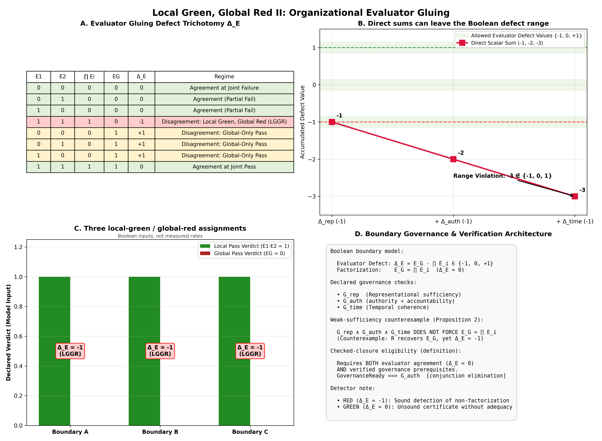
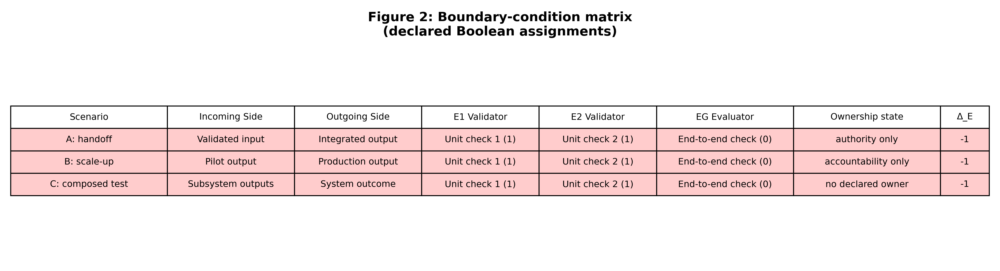

## 1. The composition problem

While Part I formalizes evaluated path kernels for composed agent workflows
under proposal-weighted trajectories, Part II studies the organizational
gluing boundary, separating evaluator factorization, representation sufficiency,
and governance prerequisites under Conway-style organizational interfaces.

Suppose a workflow crosses an interface. Each local unit has a Boolean
evaluator

\[
E_i:X\to\{0,1\},
\]

and the composed outcome has a Boolean evaluator

\[
E_G:X\to\{0,1\}.
\]

For a trace \(x\), write

\[
L(x)=\prod_{i=1}^{n}E_i(x), \qquad
\Delta_E(x)=E_G(x)-L(x).
\]

Because both terms are Boolean,

\[
\Delta_E(x)\in\{-1,0,1\}.
\]

Lean evidence: claim-ledger row **M1**.

The four Boolean inputs have distinct readings:

- \((E_G,L)=(0,1)\) gives \(\Delta_E=-1\): every local evaluator
  passes and the global evaluator fails.

- \((E_G,L)=(0,0)\) gives \(\Delta_E=0\): agreement at failure.

- \((E_G,L)=(1,1)\) gives \(\Delta_E=0\): agreement at success.

- \((E_G,L)=(1,0)\) gives \(\Delta_E=1\): a global pass despite a
  local failure.

Thus zero defect means agreement, not success. This small distinction prevents
the phrase “global green” from silently replacing the equation
\(E_G=L\).

## 2. Exact finite results

### 2.1 Local green and global red

**Proposition 1.** For Boolean \(E_G\) and \(L\),

\[
\Delta_E=-1 \quad\Longleftrightarrow\quad E_G=0\ \text{and}\ L=1.
\]

**Proof.** There are four Boolean pairs. Direct evaluation gives defects
\(0,1,-1,0\) for \((E_G,L)=(0,0),(1,0),(0,1),(1,1)\), respectively. Only
\((0,1)\) gives \(-1\), which yields the proposition.

Lean evidence: claim-ledger row **M2**.

### 2.2 Weak representation does not imply factorization

Let a boundary representation be

\[
R(x)=(E_1(x),E_2(x),E_G(x)).
\]

Call it *weakly sufficient* when its third coordinate recovers \(E_G\). This
condition says nothing about whether \(E_G=E_1E_2\).

**Proposition 2.** Weak sufficiency, an owner flag, and temporal coherence do
not imply evaluator factorization.

**Witness.** Take

\[
E_1=1,\quad E_2=1,\quad E_G=0,\quad
R=(1,1,0),\quad G_{\mathrm{auth}}=G_{\mathrm{time}}=1.
\]

The representation recovers \(E_G\), but
\(E_G=0\ne1=E_1E_2\). Hence \(\Delta_E=-1\).

Lean evidence: claim-ledger row **M3**.

Define *product sufficiency* by requiring the recovered global coordinate to
equal the local product. Under weak sufficiency this is exactly evaluator
factorization:

\[
R_3=E_1E_2 \quad\Longleftrightarrow\quad E_G=E_1E_2.
\]

The Python census evaluates this equivalence on every 8-bit Boolean boundary.
Lean evidence: claim-ledger row **M4**.

### 2.3 Zero defect can be uninformative

On a finite sample of traces, call a detector *product-collapsing* when its
complete local product copies the global evaluator:

\[
L(x)=E_G(x)\ \text{for every sampled }x
\quad\Longrightarrow\quad
\Delta_E(x)=0\ \text{on the sample}.
\]

A detector can therefore report agreement by construction. Copying \(E_G\)
into only one local validator is not enough: if another validator fails on a
trace where \(E_G=1\), then the complete product is zero and the premise above
fails. Conversely, a copied validator together with passing peer validators
does make the product equal \(E_G\). The Lean theorem recorded in row **M7**
checks the product identity and its all-other-pass specialization. The Python
audit checks the complete product on the supplied nonempty sample, including
the failing-peer counterexample.

Zero defect also occurs when \(E_G=L=0\), so it cannot by itself certify a
passing outcome. Lean checks the counterexample recorded in row **M6**.

### 2.4 Scalar defects are not additive channels

Three legal defect values need not have a legal sum:

\[
(-1)+(-1)+(-1)=-3\notin\{-1,0,1\}.
\]

Therefore channel labels such as representation, ownership, and timing cannot
be added as though each were an independent copy of \(\Delta_E\). Lean
evidence is recorded in row **M5**.

The Python package includes Shapley attribution as an optional descriptive
alternative for a user-supplied coalitional value function. That computation
is an implementation feature, not part of the Lean result.

## 3. The carrier-class obstruction

The previous propositions use only Boolean arithmetic. A second question is
whether the global evaluator depends solely on the local information retained
at a boundary.

Let a composed trace be \(c=(a,b)\), with local carrier maps
\(\pi_1:A\to P\) and \(\pi_2:B\to Q\). Define

\[
J(c)=(\pi_1(a),\pi_2(b)).
\]

Two traces are locally indistinguishable when their joint carriers agree. Let
\(A\times B/{\sim_J}\) be the quotient by this relation.

**Theorem 3 (carrier mixing blocks factorization).** If traces \(c,c'\) satisfy

\[
J(c)=J(c') \qquad\text{and}\qquad E_G(c)\ne E_G(c'),
\]

then there is no function

\[
F:(A\times B/{\sim_J})\to\{0,1\}
\]

such that \(F([x])=E_G(x)\) for every trace \(x\).

**Proof.** Equality \(J(c)=J(c')\) gives \([c]=[c']\) in the quotient. Any
function on quotient classes must therefore satisfy \(F([c])=F([c'])\).
If it represented \(E_G\), this would give \(E_G(c)=E_G(c')\), contrary to
the hypothesis.

Lean evidence: claim-ledger row **M8**. Its only nonlogical dependency in the
axiom census is the standard quotient soundness principle `Quot.sound`.

For this consequence, assume the local evaluators are carrier-local: there are
functions \(e_1:P\to\{0,1\}\) and \(e_2:Q\to\{0,1\}\) such that the two local
verdicts are \(e_1(\pi_1(a))\) and \(e_2(\pi_2(b))\). Equality of joint carriers
then transports both local verdicts.

If both local evaluators pass on one of these equal carrier classes, local
pass status transports to the other trace. Since the global Boolean values
differ, one of the traces has global value zero and hence defect \(-1\). Lean
checks this consequence in row **M9**. Finite traces of this form are evaluated by
`quotient_factor_table` and `negative_defect_witness`.

\newpage

## 4. Organizational interpretation

For an organizational boundary, the local evaluators may represent unit-level
acceptance tests and \(E_G\) an end-to-end outcome test. We record three
Boolean prerequisites:

\[
G_{\mathrm{rep}},\qquad G_{\mathrm{auth}},\qquad G_{\mathrm{time}}.
\]

- \(G_{\mathrm{rep}}\): the boundary record retains the information required
  by its declared checks.
- \(G_{\mathrm{auth}}\): an identified owner has both power to change the
  interface and accountability for the global evaluator.
- \(G_{\mathrm{time}}\): local and global verdicts refer to the same declared
  evaluation interval.

The package defines governance readiness as their conjunction:

\[
G=G_{\mathrm{rep}}\wedge G_{\mathrm{auth}}\wedge G_{\mathrm{time}}.
\]

The implication \(G\Rightarrow G_{\mathrm{auth}}\) is conjunction elimination,
with Lean evidence recorded under definition row **D1**. Conversely, an owner
flag alone does not imply \(G\); Lean supplies explicit assignments with
\(G_{\mathrm{rep}}=0\) or \(G_{\mathrm{time}}=0\).

For an observed trace, the Python reference implementation calls the boundary
*checked-closure eligible* exactly when \(\Delta_E=0\) and \(G=1\).

This is a definition. It does not follow from the weak representation of
Section 2.2, and it does not turn the model into an empirical certification
procedure.

\newpage

## 5. Executable evidence

### 5.1 Python

`code/organizational_gluing_core.py` implements the finite data model, the
defect arithmetic, governance conjunction, collapse check, diagnostic
records, and Shapley calculation. Evaluator callbacks accept only exact
Python `bool` values: numeric stand-ins such as `0`, `1`, `0.0`, and `1.0` are
rejected. Valid verdicts are encoded as integer (0/1) values in defect
records. Constructors also reject inconsistent records.

The twelve break-and-recover tests cover nine fault families:

1. non-Boolean local and global verdicts;
2. missing ownership or one-sided ownership;
3. malformed boundary tokens;
4. a collapsing detector;
5. a zero-defect claim without adequacy evidence;
6. an additive range overflow;
7. the weak-sufficiency counterexample;
8. a temporal mismatch; and
9. an attempted evidence-level escalation.

Each mutation must meet its intended guard before the corrected input is
accepted. Across the two production modules, the release gate separately
requires at least 95 percent line/statement coverage and 95 percent branch
coverage.

### 5.2 Lean 4

The nested `lean4/` project builds five paper-facing modules:

- `01_certified_closure.lean`: governance conjunction and owner necessity;
- `02_boundary_sufficiency.lean`: weak-sufficiency counterexample and product
  equivalence;
- `03_non_additivity.lean`: defect range, trichotomy, and non-additivity;
- `04_carrier_boundary_obstruction.lean`: carrier transport and quotient
  obstruction; and
- `05_detector_adequacy.lean`: collapsing and zero-defect counterexamples.

`check_axioms.lean` names every declaration cited in this paper. The package
contains no `sorry` or `admit` token. The axiom report is expected to be empty
except for `Quot.sound` where quotient equality is used.

The compact labels **M1–M9** and **D1** used in the prose resolve to exact,
fully qualified Lean declarations in the claim ledger and the canonical
`docs/lean_claim_map.md`. The machine-readable companion is
`docs/claim_code_map.yaml`.

### 5.3 Notebook and figures

The single public notebook begins with the four-line truth table, introduces
the governance conditions, lets a reader vary all seven Boolean inputs with
widgets, draws the defect landscape, and finishes with counterexamples and a
bad-input recovery exercise. A pytest case executes every cell headlessly.
The publication figures are regenerated by `code/generate_figures.py` under
the non-interactive Matplotlib backend.

## 6. Scope

The paper establishes finite mathematical and implementation claims only. Its
included scenarios are illustrative Boolean assignments; they are not audits,
predictions, or findings about any organization.

## 7. Related work

The local-to-global vocabulary follows the broad gluing perspective used by
Abramsky and Brandenburger, while the mathematical object here is a much
simpler Boolean evaluator model. The organizational reading is compatible
with Conway's observation that communication structure shapes designed
systems. Shapley attribution appears only as a standard optional analysis of
a declared coalitional value function.

## References

1. Abramsky, S., and Brandenburger, A. “The Sheaf-Theoretic Structure of
   Non-Locality and Contextuality.” *New Journal of Physics* 13 (2011),
   113036. [doi:10.1088/1367-2630/13/11/113036](https://doi.org/10.1088/1367-2630/13/11/113036)
2. Conway, M. E. “How Do Committees Invent?” *Datamation* 14(4) (1968),
   28–31. [Author-hosted scan](https://melconway.com/Home/pdf/committees.pdf).
3. Shapley, L. S. “A Value for n-Person Games.” In *Contributions to the
   Theory of Games II*, Annals of Mathematics Studies 28, 307–318. Princeton
   University Press, 1953.
   [doi:10.1515/9781400881970-018](https://doi.org/10.1515/9781400881970-018)