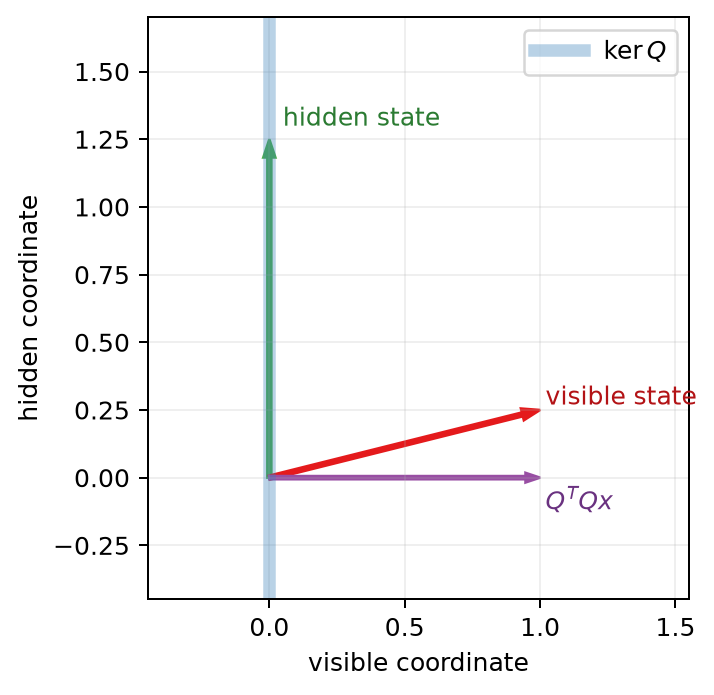
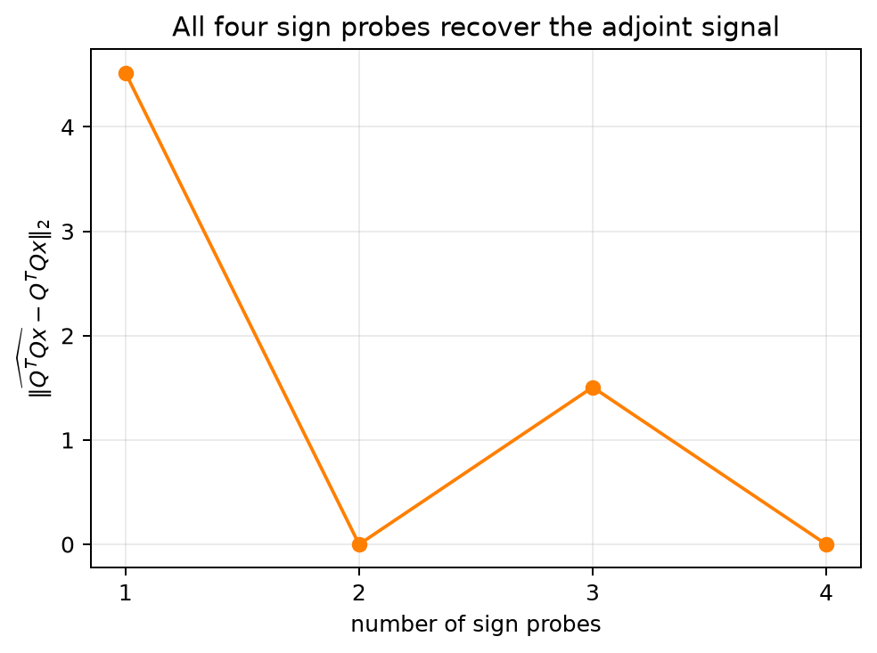

# Blind Spots Under Nonlinear Aggregation and Adjoint Probing

**Author:** Jeremy H. Carroll

**Date:** 2026-10-15

**Version:** 0.1.1

## Abstract

Let a finite family of evaluators be represented by one stacked real matrix

\[
Q:\mathbb{R}^{d}\longrightarrow\mathbb{R}^{m}.
\]

The local report is \(Qx\). Any deterministic rule applied only after this
report—thresholding, voting, ranking, or another nonlinear map—receives the
same input on states \(x\) and \(y\) whenever \(Qx=Qy\). It therefore cannot
separate them. In particular, a rule that accepts the zero report also accepts
every state in \(\ker Q\).

The positive result is equally small. The Gram operator
\(H=Q^{\mathsf T}Q\) vanishes exactly on \(\ker Q\). Centered directional
evaluations of the quadratic energy \(f(x)=\tfrac12\lVert Qx\rVert_2^2\)
recover pairings with \(Hx\); averaging over the full sign cube recovers
\(Hx\) itself. These facts give a finite, testable account of observation
blind spots and adjoint probes. The package includes a self-contained Python
implementation, Lean proofs of the rational Gram identity and the two probe
identities, two executable notebooks, and an injected watcher mutation that
must be detected and then recovered.

## 1. The picture before the notation

Consider

\[
Q=\begin{bmatrix}1&0\end{bmatrix}.
\]

The evaluator sees the horizontal coordinate and ignores the vertical one.
Every state \((0,t)\) produces the report \(0\), regardless of \(t\). Sending
that report through a majority vote or a complicated ranking model does not
reveal the missing coordinate: the downstream rule still receives \(0\).



The blue axis in Figure 1 is \(\ker Q\). A vector on that axis is hidden. A
vector with a horizontal component is visible, and \(Q^{\mathsf T}Qx\) points
in the visible subspace. This two-dimensional diagram is the whole argument
in miniature.

## 2. Observation-only decisions

Let \(Q\in\mathbb{R}^{m\times d}\). The stacked report of a state
\(x\in\mathbb{R}^{d}\) is

\[
O(x)=Qx.
\]

A deterministic postprocessor is any function
\(A:\mathbb{R}^{m}\to\mathcal V\), where \(\mathcal V\) is a set of verdicts.
No continuity, linearity, or monotonicity is assumed.

### Theorem 1: postprocessing invariance

If \(Qx=Qy\), then

\[
A(Qx)=A(Qy).
\]

**Proof.** Substitute the equal arguments into the function \(A\). \(\square\)

The theorem is elementary, but it locates the information boundary precisely:
nonlinearity after observation cannot reconstruct a coordinate discarded by
observation.

### Corollary 1: zero-preserving aggregation

Suppose a distinguished verdict \(\mathsf{green}\in\mathcal V\) satisfies
\(A(0)=\mathsf{green}\). Then every \(x\in\ker Q\) receives
\(\mathsf{green}\).

This includes a threshold rule, unanimous voting on zero local scores, and a
\(k\)-of-\(n\) rule when all local scores vanish. It says nothing about rules
that inspect the original state or make an additional observation.

### Theorem 2: the accepted cylinder

Assume \(Q\neq 0\) and \(\tau\geq 0\). Let \(\sigma_{\min}^{+}(Q)\) be its least positive
singular value. If

\[
\lVert Qx\rVert_2\leq \tau,
\]

then

\[
\operatorname{dist}(x,\ker Q)
\leq \frac{\tau}{\sigma_{\min}^{+}(Q)}.
\]

**Proof.** Write \(x=k+u\) using the orthogonal decomposition
\(\mathbb R^d=\ker Q\oplus(\ker Q)^\perp\). Then \(Qx=Qu\), and the singular
value bound on \((\ker Q)^\perp\) gives

\[
\lVert Qx\rVert_2=\lVert Qu\rVert_2
\geq \sigma_{\min}^{+}(Q)\lVert u\rVert_2.
\]

Because \(\lVert u\rVert_2=\operatorname{dist}(x,\ker Q)\), division yields
the result. \(\square\)

This singular-value argument is cited from classical Euclidean matrix analysis [1].
The package does not mechanize real singular
values in Lean 4, and the floating-point helper `cylinder_radius` is not this
argument. The zero operator is excluded because it has no positive singular
value and its accepted set is all of \(\mathbb R^d\).

## 3. The adjoint signal

Define

\[
H=Q^{\mathsf T}Q.
\]

### Theorem 3: Gram kernel identity

For every finite real matrix \(Q\),

\[
\ker H=\ker Q.
\]

Consequently,

\[
Hx\neq 0\quad\Longleftrightarrow\quad Qx\neq 0.
\]

The classical real-matrix sentence
\(\operatorname{range}(H)=(\ker Q)^\perp\)
is recorded here and is not part of the mechanized statement.

**Proof.** If \(Qx=0\), then \(Hx=Q^{\mathsf T}Qx=0\). Conversely, if
\(Hx=0\), then

\[
0=x^{\mathsf T}Hx=x^{\mathsf T}Q^{\mathsf T}Qx
=\lVert Qx\rVert_2^2,
\]

so \(Qx=0\). Thus the kernels agree. \(\square\)

Lean formalizes that identity for every finite rational matrix (`lean4/Core.lean` [3]), together with the
equivalent statement that the Gram response is nonzero exactly on detectable
states. The further sentence \(\operatorname{range}(H)=(\ker Q)^\perp\), which
uses the orthogonal complement of a real kernel, is outside the rational Lean
formalization.

This result does not make a hidden state visible: if \(x\in\ker Q\), then
\(Hx=0\). It identifies the response produced by a state that already has a
detectable component and supplies an operator for selecting visible probe
directions.

## 4. Two-query and sign probes

Set

\[
f(x)=\frac12\lVert Qx\rVert_2^2=\frac12x^{\mathsf T}Hx.
\]

### Theorem 4: centered directional identity

For every \(c>0\) and direction \(d\),

\[
\frac{f(x+cd)-f(x-cd)}{2c}=d^{\mathsf T}Hx.
\]

**Proof.** Expand both quadratic forms. The \(x^{\mathsf T}Hx\) and
\(c^2d^{\mathsf T}Hd\) terms cancel; symmetry of \(H\) leaves
\(2c\,d^{\mathsf T}Hx\) in the numerator. \(\square\)

Thus two evaluations of \(f\) measure one pairing with the adjoint signal.

### Theorem 5: full sign-cube recovery

Let \(\delta\) range uniformly over \(\{-1,+1\}^{d}\), and define

\[
\widehat g(\delta)
=\left(\frac{f(x+c\delta)-f(x-c\delta)}{2c}\right)\delta.
\]

Then

\[
\mathbb E_{\delta}[\widehat g(\delta)]=Hx.
\]

**Proof.** Theorem 4 gives

\[
\widehat g(\delta)=\delta\delta^{\mathsf T}Hx.
\]

Across the full sign cube, diagonal products are \(1\), while each
off-diagonal product is \(+1\) for half the signs and \(-1\) for half. Hence
\(\mathbb E[\delta\delta^{\mathsf T}]=I\), which establishes the identity.
\(\square\)



Figure 2 shows a two-dimensional ordering of the four signs. Intermediate
prefixes need not be accurate; the full average is exact up to floating-point
roundoff. A random finite subset is an estimator with sampling error. No
optimization-rate or live-model claim follows from this finite identity. The
construction is related to simultaneous perturbation methods [2].

## 5. Executable falsification

The reference fixture uses

\[
Q_0=\begin{bmatrix}1&0\end{bmatrix},
\qquad
k=\begin{bmatrix}0\\1\end{bmatrix}.
\]

It checks three ordered facts:

1. baseline: \(Q_0k=0\);
2. break: replacing the second matrix entry by \(0.25\) makes the observation
   nonzero;
3. recovery: restoring the entry to zero restores \(Q_0k=0\).

The test is useful because it demonstrates that the check can fail for a targeted bad
input. It is one finite falsifier, not an estimate of mutation-detection power.

The Python package also validates dimensions and finite values, computes SVD
bases and cylinder radii, evaluates zero-preserving aggregators, runs Gram
power iteration, generates both figures, and rejects malformed probe inputs.

## 6. What Lean mechanizes

`lean4/Core.lean` formalizes these statements.

1. Deterministic postprocessing preserves an equality of observations.
2. Zero-preserving postprocessing accepts a state with the zero observation.
3. Where a `GramSystem` assumes the kernel identity, hidden states are exactly
   the zero Gram response, and a detectable state has nonzero Gram response.
4. For every finite rational matrix, the Gram response is zero exactly when
   the observation is zero.
5. The centered two-query derivative equals the Gram pairing for every nonzero
   rational step.
6. The average of that probe over the full sign cube recovers each coordinate
   of the Gram response.

The Euclidean cylinder bound in Theorem 2 and the orthogonal-range statement in
Theorem 3 are classical real-matrix results outside the rational Lean formalization.
Exact rational Python checks call the shipped Fraction functions on the paper
fixture and on one nonsingular step. `check_axioms.lean` prints the dependency
report for the mechanized declarations. `lean4/AXIOM_REPORT.txt` records a
deterministic source-bound rendering of a fresh elaboration; the release
verifier recaptures and compares it.

## 7. Learning path

The two notebooks are the public interactive face of the package.

- `01_observation_blind_spots.ipynb` starts with shadows and hidden motion,
  then builds \(Q\), \(\ker Q\), nonlinear verdicts, the SVD cylinder, and the
  proof of Theorems 1–3. Sliders vary visible and hidden coordinates.
- `02_adjoint_probes_and_falsifiers.ipynb` derives Theorems 4–5, visualizes
  sign-probe error, runs the watcher mutation, and ends with research-level
  questions about noisy or adaptive observations. A widget varies the probe
  prefix length.

Both notebooks execute from a clean kernel in the test suite; their committed
outputs are empty.

## 8. Disposition of the former omnibus

The former manuscript combined the finite theorems above with cached or live
language-model experiments, repository fixtures, distributed communication,
Byzantine behavior, transformer dynamics, Lie-group examples, and sheaf
models. Those subjects require different assumptions and evidence. They are
not absorbed into this paper.

Earlier exploratory prototypes and receipts from the preliminary omnibus lineage
are excluded from this release. `docs/research_program_25_steps.md` assigns each
deferred topic an artifact and an acceptance test. A later paper may cite a
result only after the corresponding steps are satisfied with current evidence.

## 9. Scope

This paper establishes finite real-matrix statements and reports deterministic
fixtures. It does not evaluate a language model, certify a software or social
system, establish convergence of a stochastic optimizer, or demonstrate the
distributed, adversarial, transformer, Lie-group, or sheaf extensions in the
research program.

## 10. Reproduction

From the package root, install the declared development dependencies and run
the release verifier:

```text
uv run --isolated --frozen --extra dev python verify_deposit.py --lean
```

It runs the full Python suite over eight workers, requires at least 95% line
and 95% branch coverage separately for each production module, rebuilds the
TeX and PDF twice with pdfLaTeX, builds the dated archive twice, and performs a
short-path Lean build and theorem-level axiom census.

To refresh producer outputs before regenerating the manifests:

```text
uv run --isolated --frozen --extra dev python code/generate_figures.py
uv run --isolated --frozen --extra dev python scripts/capture_axiom_report.py
uv run --isolated --frozen --extra dev python scripts/build_paper_artifacts.py
uv run --isolated --frozen --extra dev python scripts/regen_sha256sums.py
uv run --isolated --frozen --extra dev python scripts/build_deposit_zip.py
```

The paper producer verifies the live shared-preamble hash, runs pdfLaTeX
exactly twice, leaves sections unnumbered, and writes a layout log under
`dist/`. The archive name carries the paper identifier and release date. The
release manifest pins the paper, code, notebooks, figures, bundled preamble,
axiom report, and proof sources.

## References

1. G. H. Golub and C. F. Van Loan, *Matrix Computations*, fourth edition,
   Johns Hopkins University Press, 2013.
   [doi:10.56021/9781421407944](https://doi.org/10.56021/9781421407944)
2. J. C. Spall, “Multivariate stochastic approximation using a simultaneous
   perturbation gradient approximation,” *IEEE Transactions on Automatic
   Control* 37(3), 332–341, 1992.
   [doi:10.1109/9.119632](https://doi.org/10.1109/9.119632)
3. L. de Moura and S. Ullrich, “The Lean 4 theorem prover and programming
   language,” *Automated Deduction—CADE 28*, Lecture Notes in Computer Science,
   vol. 12699, 625–635, 2021.
   [doi:10.1007/978-3-030-79876-5_37](https://doi.org/10.1007/978-3-030-79876-5_37)
