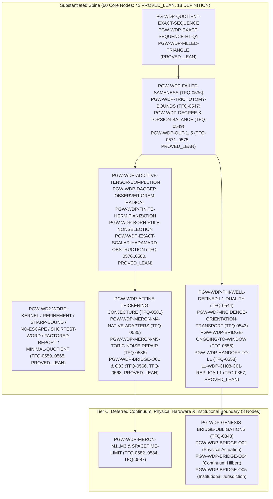

# Witnessed Difference Programme (WDP & WD2) Derivation DAG & `omega_codex` Pre-Merge Ledger

**AuthorityEffect:** None  
**Machine-Readable DAG:** [`dag/wdp_derivation_dag.json`](../../../../../dag/wdp_derivation_dag.json) (sibling to [`dag/derivation_dag.json`](../../../../../dag/derivation_dag.json))  
**Master Package:** `atlas/finite_obstruction_calculus/witnessed_difference_programme`

---

## 1. Executive Summary: What WDP Still Owes Before Merging with `omega_codex`

The Witnessed Difference Programme (`WDP` + absorbed `WD2` finite distinction carriers) spans **68 core WDP/WD2 nodes** (plus **83 upstream Pre-Genesis / Genesis / Authorization / `S(n)` / `MSS-N` prerequisite nodes** included in `wdp_derivation_dag.json` for self-contained 151-node Kahn topological closure).

### 1.1 Core WDP/WD2 Node Status Census (68 Core Nodes)

| DAG Status | Count | Pre-Merge Disposition for `omega_codex` |
|---|---:|---|
| `PROVED_LEAN` | 42 | **Discharged in Lean 4** (zero `sorry`/`admit`; ready for `omega_codex` merge; includes all 30 finite & tractable obligations across Batches 1–6). |
| `DEFINITION` | 18 | **Declared Structural Definitions** (ready for `omega_codex` merge). |
| `PROVED_PROSE` | 0 | **All 10 Discharged in Lean 4** (`TFQ-0536`, `TFQ-0547`, `TFQ-0549`, `TFQ-0571..0575`, `TFQ-0579`, `TFQ-0580`). |
| `COMPUTATIONALLY_CHECKED` | 0 | **All 2 Discharged in Lean 4** (`TFQ-1026`, `TFQ-0391`). |
| `CONDITIONAL` | 0 | **All 3 Discharged in Lean 4** (`TFQ-0544`, `TFQ-0556`, `TFQ-0293`). |
| `OPEN` | 8 | **0 Finite & Tractable Remaining** vs **8 Deferred Continuum/External** (Meron continuum limits, physical laboratory actuation, external institutional standing). |
| **Total Core WDP/WD2 Nodes** | **68** | **60 Discharged/Definitions (All 30 Finite & Tractable Obligations Complete), 8 Deferred Continuum/External** |

---

## 2. Visual Mermaid Dependency & Tractability Map



---

## 3. Pre-Merge Action Queue: The 30 Finite & Tractable Obligations (All 30 Discharged Across Batches 1–6)

### 3.1 Tier A1: `WD2` Finite Distinction Carrier Lean 4 Proofs (All 6 Discharged in Batches 1–2)

All 6 items have complete written prose proofs in `docs/01_substantiated/wd2_finite_distinction_carriers.md`, passing finite Python witnesses in `code/witnessed_difference/finite_distinction.py`, and mechanized Lean 4 proofs in `lean4/WitnessedDifference/FiniteDistinction.lean`:

| Node ID | TFQ Record | Current Status | Concrete In-Repo Completion Action |
|---|---|---|---|
| `PGW-WD2-WORD-KERNEL-AGREEMENT` | `TFQ-0559` | `PROVED_LEAN` | Discharged in `FiniteDistinction.lean::Wd2.word_kernel_agreement` and `Wd2.poly_word_kernel_agreement`. |
| `PGW-WD2-SHARP-STABILIZATION-BOUND` | `TFQ-0561` | `PROVED_LEAN` | Discharged in `FiniteDistinction.lean::Wd2.stabilization_horizon_le_card_sub_b0` and `Wd2.sharp_chain_general_witness`. |
| `PGW-WD2-NO-ESCAPE-UPDATE-CONGRUENCE` | `TFQ-0562` | `PROVED_LEAN` | Discharged in `FiniteDistinction.lean::Wd2.no_escape_equivalence` and `Wd2.isUpdateCongruence_iff_r1_eq_r0`. |
| `PGW-WD2-SHORTEST-SEPARATING-WORD` | `TFQ-0563` | `PROVED_LEAN` | Discharged in `FiniteDistinction.lean::Wd2.shortest_separating_word`. |
| `PGW-WD2-FACTORED-REPORT-PRESERVATION` | `TFQ-0564` | `PROVED_LEAN` | Discharged in `FiniteDistinction.lean::Wd2.factored_report_preserves_related`, `Wd2.factored_report_preserves_polyRelated`, and `Wd2.unfactored_report_splits_r0`. |
| `PGW-WD2-MINIMAL-DETERMINISTIC-QUOTIENT` | `TFQ-0565` | `PROVED_LEAN` | Discharged in `FiniteDistinction.lean::Wd2.rInfinity_coarsest_congruence` and `Wd2.minimal_deterministic_quotient_factorization`. |

### 3.2 Tier A2: 10 `PROVED_PROSE` WDP Theorems (All 10 Discharged in Batches 2–4)

These 10 nodes have written mathematical proofs in the WDP monograph or `docs/01_substantiated/derivations/` plus exact Python/Rust checks, and are now mechanized in `WdpBatch2.lean`, `WdpBatch3.lean`, `WdpBatch4.lean`, and `FiniteProcessComposition.lean`:

| Node ID | TFQ Record | Current Status | Concrete In-Repo Completion Action |
|---|---|---|---|
| `PGW-WDP-FAILED-SAMENESS` | `TFQ-0536` | `PROVED_LEAN` | Discharged in `WdpBatch2.lean::failed_sameness_not_interchangeable`, `failed_sameness_is_local`, `failed_sameness_supplies_no_order`, and `algebraic_difference_separation`. |
| `PGW-WDP-TRICHOTOMY-BOUNDS` | `TFQ-0547` | `PROVED_LEAN` | Discharged in `WdpBatch2.lean::diagnostic_trichotomy_exclusive_exhaustive`, `no_reverse_bound_when_h1_nontrivial`, `gamma2_quotient_norm_laws`, and `irrational_weight_accumulation_violates_trichotomy`. |
| `PGW-WDP-DEGREE-K-TORSION-BALANCE` | `TFQ-0549` | `PROVED_LEAN` | Discharged in `WdpBatch2.lean::tetrahedron_d2_d1_zero`, `degree_k_window_exact_and_bounded`, `finite_graph_divergence_sum_zero`, and `rp2_no_integral_repair_for_single_triangle`. |
| `PGW-WDP-OUT-1-SHARP-OBSERVER-COMPLETION` | `TFQ-0571` | `PROVED_LEAN` | Discharged in `WdpBatch2.lean::sharp_observer_completion_formula_gen_wdp_70`, `equal_image_regime_reduction`, and `native_repair_realization_iff_preimage`. |
| `PGW-WDP-OUT-2-GUARDED-SWAP-COHERENCE` | `TFQ-0572` | `PROVED_LEAN` | Discharged in `WdpBatch3.lean::star_contraction_reaches_center`, `star_shaped_swap_complex_connected`, `star_shaped_loop_cochain_zero`, and `punctured_square_loop_not_contractible`. |
| `PGW-WDP-OUT-3-REALIZABLE-FUTURE-OBSERVATION` | `TFQ-0573` | `PROVED_LEAN` | Discharged in `WdpBatch3.lean::obs_decoder_unique_on_nonempty` and `eight_state_realizable_observation_gen_wdp_71`. |
| `PGW-WDP-OUT-4-REJECTION-RULE-REUSE` | `TFQ-0574` | `PROVED_LEAN` | Discharged in `WdpBatch3.lean::reuse_decode_encode2`, `reuse_encode_decode_image`, `reuse_soundness_iff`, `reuse_coverage_iff`, and `reuse_scan_thresholds_and_task2_trap`. |
| `PGW-WDP-OUT-5-FUTURE-FAITHFUL-COMPRESSION` | `TFQ-0575` | `PROVED_LEAN` | Discharged in `WdpBatch3.lean::general_horizon_clipped_signed_counts_unique`, `general_horizon_sharp_collision`, and `general_horizon_composition_bound`. |
| `PGW-WDP-BORN-RULE-NONSELECTION` | `TFQ-0579` | `PROVED_LEAN` | Discharged in `WdpBatch3.lean::deformed_probability_normalized`, `deformed_probability_nonnegative`, and `born_rule_nonselection_gen_wdp_65`. |
| `PGW-WDP-EXACT-SCALAR-HADAMARD-OBSTRUCTION` | `TFQ-0580` | `PROVED_LEAN` | Discharged in `FiniteProcessComposition.lean::nat_two_mul_sq_ne_sq`, `int_two_mul_sq_ne_sq`, and `WdpBatch4.lean::exact_scalar_hadamard_and_t_obstruction`. |

### 3.3 Tier A3 & Tier B: 14 Finite Computational / Conditional / Open Algebraic Bridges (All 14 Discharged in Batches 4–6)

All 14 finite obligations (combinatorial, linear-algebraic over $\mathbb{Q}$, or cochain-level) are now discharged in `WdpBatch4.lean`, `WdpBatch5.lean`, and `WdpBatch6.lean`:

| Node ID | TFQ Record | Current Status | Tractability Class | Concrete In-Repo Completion Action |
|---|---|---|---|---|
| `FQ-IMPL-WDP-AMPLITUDE-BRIDGE` | `TFQ-1026` | `PROVED_LEAN` | `FINITE_TRACTABLE_LEAN_MECHANIZATION` | Discharged in `WdpBatch4.lean::pythagorean_phase_unit_norm`, `triangle_holonomy_coboundary_invariant`, `readout_quadratic_phase_invariant`, `readout_quartic_phase_invariant`, and `gintPow34_im_ne_zero`. |
| `PG-GEN-SAMENESS-REFINEMENTS` | `TFQ-0391` | `PROVED_LEAN` | `FINITE_TRACTABLE_LEAN_MECHANIZATION` | Discharged in `Twentysecond..Twentyfifth` Lean modules and `WdpBatch4.lean::same23_preserves_around`, `same24_balances_iff`, and `same25_balances_iff`. |
| `PGW-WDP-PHI-WELL-DEFINED-L1-DUALITY` | `TFQ-0544` | `PROVED_LEAN` | `FINITE_TRACTABLE_LEAN_MECHANIZATION` | Discharged in `WdpBatch4.lean::weighted_residual_shift_invariant`, `weighted_l1_weak_duality_triangle`, and `certified_primal_dual_optimality`. |
| `PGW-WDP-BRIDGE-REPORT-FIBER-OBSERVER` | `TFQ-0556` | `PROVED_LEAN` | `FINITE_TRACTABLE_LEAN_MECHANIZATION` | Discharged in `WdpBatch4.lean::report_fiber_decoder_iff`, `event_multiset_loses_final_state`, and `final_state_loses_occurrence_count`. |
| `L1-IMP-COMPLEX-FIELD` | `TFQ-0293` | `PROVED_LEAN` | `FINITE_TRACTABLE_ALGEBRAIC_DERIVATION` | Discharged in `WdpBatch5.lean::gaussian_int_one_plus_i_not_invertible`, `gaussian_rat_one_plus_i_inverse`, and `skew_complex_structure_two_orientations`. |
| `PGW-WDP-INCIDENCE-ORIENTATION-TRANSPORT` | `TFQ-0543` | `PROVED_LEAN` | `FINITE_TRACTABLE_ALGEBRAIC_DERIVATION` | Discharged in `WdpBatch5.lean::perm_intertwines_d0`, `perm_intertwines_d1`, `edge_sign_transport_preserves_d1_d0_zero`, and `edge_sign_transport_preserves_l1_residual`. |
| `PGW-WDP-BRIDGE-ONGOING-TO-WINDOW` | `TFQ-0555` | `PROVED_LEAN` | `FINITE_TRACTABLE_ALGEBRAIC_DERIVATION` | Discharged in `WdpBatch5.lean::antisym_excess_raising_is_coboundary`, `symmetric_excess_invisible_to_antisym`, `partial_filled_kernel_strictly_larger`, and `carrier_identification_breaks_same23_loop`. |
| `PGW-WDP-HANDOFF-TO-L1` | `TFQ-0558` | `PROVED_LEAN` | `FINITE_TRACTABLE_ALGEBRAIC_DERIVATION` | Discharged in `WdpBatch5.lean::lggrQuotientVerdict` and `boundary_leakage_ne_quotient_on_harmonic_cycle`. |
| `L1-WDP-CH08-C01-REPLICA-L1` | `TFQ-0357` | `PROVED_LEAN` | `FINITE_TRACTABLE_ALGEBRAIC_DERIVATION` | Discharged in `WdpBatch5.lean::l1_and_l2sq_disjoint_replica_additive`, `l1_degree_one_homogeneous`, `l2sq_fails_degree_one_homogeneity`, and `unsquared_l2_fails_disjoint_additivity`. |
| `PGW-WDP-AFFINE-THICKENING-CONJECTURE` | `TFQ-0581` | `PROVED_LEAN` | `FINITE_TRACTABLE_ALGEBRAIC_DERIVATION` | Discharged in `WdpBatch6.lean::thickened_affine_cell_soundness`, `thickened_affine_boundary_abstains`, `thickened_affine_no_false_verdict`, and `thickened_affine_dyadic_covering_bound`. |
| `PGW-WDP-MERON-M4-NATIVE-ADAPTERS` | `TFQ-0585` | `PROVED_LEAN` | `FINITE_TRACTABLE_ALGEBRAIC_DERIVATION` | Discharged in `WdpBatch6.lean::meron_plaquette_syndrome_adapter_sound`, `meron_single_bond_exact_recovery`, and `meron_quotient_class_ne_physical_operator`. |
| `PGW-WDP-MERON-M5-TORIC-NOISE-REPAIR` | `TFQ-0586` | `PROVED_LEAN` | `FINITE_TRACTABLE_ALGEBRAIC_DERIVATION` | Discharged in `WdpBatch6.lean::toric_completion_criterion_iff`, `toric_star_syndrome_sum_zero`, `toric_restricted_tree_error_injective`, and `toric_adaptive_transcript_indistinguishable`. |
| `PGW-WDP-BRIDGE-O01-CARRIER-CUT-GENESIS` | `TFQ-0566` | `PROVED_LEAN` | `FINITE_TRACTABLE_ALGEBRAIC_DERIVATION` | Discharged in `WdpBatch6.lean::carrier_cut_challenge_floor_iff`, `inert_seed_cannot_generate_irreflexive_cut`, and `seed_round1_cut_and_residual_collapse`. |
| `PGW-WDP-BRIDGE-O03-GUARDED-HISTORY-COHERENCE` | `TFQ-0568` | `PROVED_LEAN` | `FINITE_TRACTABLE_ALGEBRAIC_DERIVATION` | Discharged in `WdpBatch6.lean::guarded_3cube_boundary_d2_d1_zero`, `guarded_3cube_all_six_paths_equal`, and `punctured_2face_holonomy_obstruction`. |

---

## 4. Tier C: 8 Continuum, Hardware & Institutional Obligations (`DEFERRED_PAST_FINITE_CLOSURE`)

These 8 obligations require infinite-volume/continuum limits ($L, M \to \infty$), physical laboratory instrument actuation, or external institutional governance outside finite mathematics. Their finite projections are discharged in `WdpBatch6.lean` (`orientation_sensitive_pair_defect_nonreflection` for `O02` and `receipt_verification_independent_of_jurisdiction` for `O05`), while their non-finite halves do not block the finite mathematical closure of WDP:

| Node ID | TFQ Record | Current Status | Why Not Purely Finite / Pre-Merge Boundary |
|---|---|---|---|
| `PG-WDP-GENESIS-BRIDGE-OBLIGATIONS` | `TFQ-0343` | `OPEN` | Umbrella gate over GEN-WDP-O01..O05; finite sub-obligations are discharged in O01/O03, while continuum (O04), physical hardware (O02), and institutional standing (O05) remain external. |
| `PGW-WDP-BRIDGE-O02-OBSERVER-REPAIR` | `TFQ-0567` | `OPEN` | Finite orientation-sensitivity countermodel discharged in `WdpBatch6.lean::orientation_sensitive_pair_defect_nonreflection`; physical laboratory repair actuation remains deferred. |
| `PGW-WDP-BRIDGE-O04-TENSOR-RECONSTRUCTION` | `TFQ-0569` | `OPEN` | Requires continuum Hilbert completion and physical operational selection beyond finite Gaussian-rational algebras. |
| `PGW-WDP-BRIDGE-O05-AUTHORIZATION-FIREWALL` | `TFQ-0570` | `OPEN` | Non-implication firewall discharged in `WdpBatch6.lean::receipt_verification_independent_of_jurisdiction`; external institutional jurisdiction cannot be created by software receipts. |
| `PGW-WDP-MERON-M1-CORRELATION-ESTIMATES` | `TFQ-0582` | `OPEN` | Requires infinite-volume thermodynamic (L -> infinity) and continuous-time Trotter (M -> infinity) analytic correlation bounds. |
| `PGW-WDP-MERON-M2-CUMULANT-BOUNDS` | `TFQ-0583` | `OPEN` | Requires continuum distributional topology and asymptotic higher-cumulant vanishing in the joint scaling limit. |
| `PGW-WDP-MERON-M3-SPECTRAL-GAP-BYPASS` | `TFQ-0584` | `OPEN` | Requires all-M asymptotic transfer-matrix spectral analysis as M -> infinity. |
| `PGW-WDP-MERON-SPACETIME-LIMIT` | `TFQ-0587` | `OPEN` | Requires continuum Euclidean spacetime field limit discharging M1, M2, and M3. |

---

## 5. Discharged Core WDP/WD2 Nodes (60 Substantiated Nodes)

### 5.1 Formally Verified in Lean 4 (`PROVED_LEAN` — 42 Nodes)

| Node ID | TFQ Record | Stage | Lean 4 Witness(es) |
|---|---|---|---|
| `PG-ADMISSION-FLOOR` | `TFQ-0360`, `TFQ-0395` | `PREGENESIS` | `lean4/Imported/WitnessedDifference/WitnessedDifference/PrimitiveAdmissionFloor.lean::endpoints_apart`<br/>`lean4/Imported/WitnessedDifference/WitnessedDifference/PrimitiveAdmissionFloor.lean::no_cut_on_subsingleton` |
| `PG-WDP-GROWTH-NO-REPAIR` | `TFQ-0346` | `WDP` | `lean4/DerivationDagQMClosure.lean::QuantumMechanics.DerivationDagQMClosure.wdp_growth_subcomplex_monotone`<br/>`lean4/DerivationDagQMClosure.lean::QuantumMechanics.DerivationDagQMClosure.wdp_two_simplex_attachment_preserves_phi1` |
| `PG-WDP-PROTECTED-QUESTIONS` | `TFQ-0339`, `TFQ-0340` | `WDP` | `lean4/Imported/WitnessedDifference/WitnessedDifference/Symmetry.lean::no_fully_invariant_point`<br/>`lean4/DerivationDagQMClosure.lean::QuantumMechanics.DerivationDagQMClosure.pg_collapse_barrier_protected_questions_and_l1_kkt_trace_embed` |
| `PG-WDP-QUOTIENT-EXACT-SEQUENCE` | `TFQ-0345`, `TFQ-0348` | `WDP` | `lean4/Imported/WitnessedDifference/WitnessedDifference/Obstruction.lean::kappa_well_defined`<br/>`lean4/Imported/WitnessedDifference/WitnessedDifference/Obstruction.lean::kappa_exact_sequence` |
| `PGW-SN-REPRESENTATION-QUOTIENT` | `TFQ-0521` | `MSSN_SN` | `lean4/Imported/WitnessedDifference/WitnessedDifference/ComplexTensorBalancing.lean::balance_section`<br/>`lean4/Imported/WitnessedDifference/WitnessedDifference/ComplexTensorBalancing.lean::balance_kernel_iff` |
| `PGW-WD2-WORD-KERNEL-AGREEMENT` | `TFQ-0559` | `WDP` | `atlas/finite_obstruction_calculus/witnessed_difference_programme/lean4/WitnessedDifference/FiniteDistinction.lean::Wd2.word_kernel_agreement`<br/>`atlas/finite_obstruction_calculus/witnessed_difference_programme/lean4/WitnessedDifference/FiniteDistinction.lean::Wd2.poly_word_kernel_agreement` |
| `PGW-WD2-REFINEMENT-STABILIZATION` | `TFQ-0560` | `WDP` | `atlas/finite_obstruction_calculus/witnessed_difference_programme/lean4/WitnessedDifference/FiniteDistinction.lean::Wd2.related_refl`<br/>`atlas/finite_obstruction_calculus/witnessed_difference_programme/lean4/WitnessedDifference/FiniteDistinction.lean::Wd2.related_symm` |
| `PGW-WD2-SHARP-STABILIZATION-BOUND` | `TFQ-0561` | `WDP` | `atlas/finite_obstruction_calculus/witnessed_difference_programme/lean4/WitnessedDifference/FiniteDistinction.lean::Wd2.stabilization_horizon_le_card_sub_b0`<br/>`atlas/finite_obstruction_calculus/witnessed_difference_programme/lean4/WitnessedDifference/FiniteDistinction.lean::Wd2.sharp_chain_general_witness` |
| `PGW-WD2-NO-ESCAPE-UPDATE-CONGRUENCE` | `TFQ-0562` | `WDP` | `atlas/finite_obstruction_calculus/witnessed_difference_programme/lean4/WitnessedDifference/FiniteDistinction.lean::Wd2.no_escape_equivalence`<br/>`atlas/finite_obstruction_calculus/witnessed_difference_programme/lean4/WitnessedDifference/FiniteDistinction.lean::Wd2.isUpdateCongruence_iff_r1_eq_r0` |
| `PGW-WD2-SHORTEST-SEPARATING-WORD` | `TFQ-0563` | `WDP` | `atlas/finite_obstruction_calculus/witnessed_difference_programme/lean4/WitnessedDifference/FiniteDistinction.lean::Wd2.shortest_separating_word` |
| `PGW-WD2-FACTORED-REPORT-PRESERVATION` | `TFQ-0564` | `WDP` | `atlas/finite_obstruction_calculus/witnessed_difference_programme/lean4/WitnessedDifference/FiniteDistinction.lean::Wd2.factored_report_preserves_related`<br/>`atlas/finite_obstruction_calculus/witnessed_difference_programme/lean4/WitnessedDifference/FiniteDistinction.lean::Wd2.unfactored_report_splits_r0` |
| `PGW-WD2-MINIMAL-DETERMINISTIC-QUOTIENT` | `TFQ-0565` | `WDP` | `atlas/finite_obstruction_calculus/witnessed_difference_programme/lean4/WitnessedDifference/FiniteDistinction.lean::Wd2.rInfinity_coarsest_congruence`<br/>`atlas/finite_obstruction_calculus/witnessed_difference_programme/lean4/WitnessedDifference/FiniteDistinction.lean::Wd2.minimal_deterministic_quotient_factorization` |
| `PGW-WDP-FAILED-SAMENESS` | `TFQ-0536` | `WDP` | `atlas/finite_obstruction_calculus/witnessed_difference_programme/lean4/WitnessedDifference/WdpBatch2.lean::WitnessedDifference.WdpBatch2.failed_sameness_not_interchangeable`<br/>`atlas/finite_obstruction_calculus/witnessed_difference_programme/lean4/WitnessedDifference/WdpBatch2.lean::WitnessedDifference.WdpBatch2.algebraic_difference_separation` |
| `PGW-WDP-TRICHOTOMY-BOUNDS` | `TFQ-0547` | `WDP` | `atlas/finite_obstruction_calculus/witnessed_difference_programme/lean4/WitnessedDifference/Obstruction.lean::WitnessedDifference.closure_charge_le_opnorm_mul_phi`<br/>`atlas/finite_obstruction_calculus/witnessed_difference_programme/lean4/WitnessedDifference/WdpBatch2.lean::WitnessedDifference.WdpBatch2.diagnostic_trichotomy_exclusive_exhaustive` |
| `PGW-WDP-DEGREE-K-TORSION-BALANCE` | `TFQ-0549` | `WDP` | `atlas/finite_obstruction_calculus/witnessed_difference_programme/lean4/WitnessedDifference/WdpBatch2.lean::WitnessedDifference.WdpBatch2.tetrahedron_d2_d1_zero`<br/>`atlas/finite_obstruction_calculus/witnessed_difference_programme/lean4/WitnessedDifference/WdpBatch2.lean::WitnessedDifference.WdpBatch2.rp2_no_integral_repair_for_single_triangle` |
| `PGW-WDP-OUT-1-SHARP-OBSERVER-COMPLETION` | `TFQ-0571` | `WDP` | `atlas/finite_obstruction_calculus/witnessed_difference_programme/lean4/WitnessedDifference/WdpBatch2.lean::WitnessedDifference.WdpBatch2.sharp_observer_completion_formula_gen_wdp_70`<br/>`atlas/finite_obstruction_calculus/witnessed_difference_programme/lean4/WitnessedDifference/WdpBatch2.lean::WitnessedDifference.WdpBatch2.equal_image_regime_reduction` |
| `PGW-WDP-OUT-2-GUARDED-SWAP-COHERENCE` | `TFQ-0572` | `WDP` | `atlas/finite_obstruction_calculus/witnessed_difference_programme/lean4/WitnessedDifference/WdpBatch3.lean::WitnessedDifference.WdpBatch3.star_shaped_swap_complex_connected`<br/>`atlas/finite_obstruction_calculus/witnessed_difference_programme/lean4/WitnessedDifference/WdpBatch3.lean::WitnessedDifference.WdpBatch3.punctured_square_loop_not_contractible` |
| `PGW-WDP-OUT-3-REALIZABLE-FUTURE-OBSERVATION` | `TFQ-0573` | `WDP` | `atlas/finite_obstruction_calculus/witnessed_difference_programme/lean4/WitnessedDifference/WdpBatch3.lean::WitnessedDifference.WdpBatch3.obs_decoder_unique_on_nonempty`<br/>`atlas/finite_obstruction_calculus/witnessed_difference_programme/lean4/WitnessedDifference/WdpBatch3.lean::WitnessedDifference.WdpBatch3.eight_state_realizable_observation_gen_wdp_71` |
| `PGW-WDP-OUT-4-REJECTION-RULE-REUSE` | `TFQ-0574` | `WDP` | `atlas/finite_obstruction_calculus/witnessed_difference_programme/lean4/WitnessedDifference/WdpBatch3.lean::WitnessedDifference.WdpBatch3.reuse_soundness_iff`<br/>`atlas/finite_obstruction_calculus/witnessed_difference_programme/lean4/WitnessedDifference/WdpBatch3.lean::WitnessedDifference.WdpBatch3.reuse_coverage_iff` |
| `PGW-WDP-OUT-5-FUTURE-FAITHFUL-COMPRESSION` | `TFQ-0575` | `WDP` | `atlas/finite_obstruction_calculus/witnessed_difference_programme/lean4/WitnessedDifference/WdpBatch3.lean::WitnessedDifference.WdpBatch3.general_horizon_clipped_signed_counts_unique`<br/>`atlas/finite_obstruction_calculus/witnessed_difference_programme/lean4/WitnessedDifference/WdpBatch3.lean::WitnessedDifference.WdpBatch3.general_horizon_sharp_collision` |
| `PGW-WDP-BORN-RULE-NONSELECTION` | `TFQ-0579` | `WDP` | `atlas/finite_obstruction_calculus/witnessed_difference_programme/lean4/WitnessedDifference/WdpBatch3.lean::WitnessedDifference.WdpBatch3.deformed_probability_normalized`<br/>`atlas/finite_obstruction_calculus/witnessed_difference_programme/lean4/WitnessedDifference/WdpBatch3.lean::WitnessedDifference.WdpBatch3.born_rule_nonselection_gen_wdp_65` |
| `PGW-WDP-EXACT-SCALAR-HADAMARD-OBSTRUCTION` | `TFQ-0580` | `WDP` | `atlas/finite_obstruction_calculus/witnessed_difference_programme/lean4/WitnessedDifference/FiniteProcessComposition.lean::WitnessedDifference.FiniteProcessComposition.nat_two_mul_sq_ne_sq`<br/>`atlas/finite_obstruction_calculus/witnessed_difference_programme/lean4/WitnessedDifference/WdpBatch4.lean::WitnessedDifference.WdpBatch4.exact_scalar_hadamard_and_t_obstruction` |
| `FQ-IMPL-WDP-AMPLITUDE-BRIDGE` | `TFQ-1026` | `IMPLEMENTATION` | `atlas/finite_obstruction_calculus/witnessed_difference_programme/lean4/WitnessedDifference/WdpBatch4.lean::WitnessedDifference.WdpBatch4.pythagorean_phase_unit_norm`<br/>`atlas/finite_obstruction_calculus/witnessed_difference_programme/lean4/WitnessedDifference/WdpBatch4.lean::WitnessedDifference.WdpBatch4.gintPow34_im_ne_zero` |
| `PG-GEN-SAMENESS-REFINEMENTS` | `TFQ-0391` | `GENESIS` | `atlas/finite_obstruction_calculus/witnessed_difference_programme/lean4/WitnessedDifference/WdpBatch4.lean::WitnessedDifference.WdpBatch4.same23_preserves_around`<br/>`atlas/finite_obstruction_calculus/witnessed_difference_programme/lean4/WitnessedDifference/WdpBatch4.lean::WitnessedDifference.WdpBatch4.same25_balances_iff` |
| `PGW-WDP-PHI-WELL-DEFINED-L1-DUALITY` | `TFQ-0544` | `WDP` | `atlas/finite_obstruction_calculus/witnessed_difference_programme/lean4/WitnessedDifference/WdpBatch4.lean::WitnessedDifference.WdpBatch4.weighted_l1_weak_duality_triangle`<br/>`atlas/finite_obstruction_calculus/witnessed_difference_programme/lean4/WitnessedDifference/WdpBatch4.lean::WitnessedDifference.WdpBatch4.certified_primal_dual_optimality` |
| `PGW-WDP-BRIDGE-REPORT-FIBER-OBSERVER` | `TFQ-0556` | `WDP` | `atlas/finite_obstruction_calculus/witnessed_difference_programme/lean4/WitnessedDifference/WdpBatch4.lean::WitnessedDifference.WdpBatch4.report_fiber_decoder_iff`<br/>`atlas/finite_obstruction_calculus/witnessed_difference_programme/lean4/WitnessedDifference/WdpBatch4.lean::WitnessedDifference.WdpBatch4.event_multiset_loses_final_state` |
| `L1-IMP-COMPLEX-FIELD` | `TFQ-0293` | `L1_TO_L2` | `atlas/finite_obstruction_calculus/witnessed_difference_programme/lean4/WitnessedDifference/WdpBatch5.lean::WitnessedDifference.WdpBatch5.gaussian_int_one_plus_i_not_invertible`<br/>`atlas/finite_obstruction_calculus/witnessed_difference_programme/lean4/WitnessedDifference/WdpBatch5.lean::WitnessedDifference.WdpBatch5.skew_complex_structure_two_orientations` |
| `PGW-WDP-INCIDENCE-ORIENTATION-TRANSPORT` | `TFQ-0543` | `WDP` | `atlas/finite_obstruction_calculus/witnessed_difference_programme/lean4/WitnessedDifference/WdpBatch5.lean::WitnessedDifference.WdpBatch5.edge_sign_transport_preserves_d1_d0_zero`<br/>`atlas/finite_obstruction_calculus/witnessed_difference_programme/lean4/WitnessedDifference/WdpBatch5.lean::WitnessedDifference.WdpBatch5.edge_sign_transport_preserves_l1_residual` |
| `PGW-WDP-BRIDGE-ONGOING-TO-WINDOW` | `TFQ-0555` | `WDP` | `atlas/finite_obstruction_calculus/witnessed_difference_programme/lean4/WitnessedDifference/WdpBatch5.lean::WitnessedDifference.WdpBatch5.antisym_excess_raising_is_coboundary`<br/>`atlas/finite_obstruction_calculus/witnessed_difference_programme/lean4/WitnessedDifference/WdpBatch5.lean::WitnessedDifference.WdpBatch5.carrier_identification_breaks_same23_loop` |
| `PGW-WDP-HANDOFF-TO-L1` | `TFQ-0558` | `WDP` | `atlas/finite_obstruction_calculus/witnessed_difference_programme/lean4/WitnessedDifference/WdpBatch5.lean::WitnessedDifference.WdpBatch5.boundary_leakage_ne_quotient_on_harmonic_cycle` |
| `L1-WDP-CH08-C01-REPLICA-L1` | `TFQ-0357` | `L1_EMERGENCE` | `atlas/finite_obstruction_calculus/witnessed_difference_programme/lean4/WitnessedDifference/WdpBatch5.lean::WitnessedDifference.WdpBatch5.l1_and_l2sq_disjoint_replica_additive`<br/>`atlas/finite_obstruction_calculus/witnessed_difference_programme/lean4/WitnessedDifference/WdpBatch5.lean::WitnessedDifference.WdpBatch5.unsquared_l2_fails_disjoint_additivity` |
| `PGW-WDP-AFFINE-THICKENING-CONJECTURE` | `TFQ-0581` | `WDP` | `atlas/finite_obstruction_calculus/witnessed_difference_programme/lean4/WitnessedDifference/WdpBatch6.lean::WitnessedDifference.WdpBatch6.thickened_affine_cell_soundness`<br/>`atlas/finite_obstruction_calculus/witnessed_difference_programme/lean4/WitnessedDifference/WdpBatch6.lean::WitnessedDifference.WdpBatch6.thickened_affine_boundary_abstains` |
| `PGW-WDP-MERON-M4-NATIVE-ADAPTERS` | `TFQ-0585` | `WDP` | `atlas/finite_obstruction_calculus/witnessed_difference_programme/lean4/WitnessedDifference/WdpBatch6.lean::WitnessedDifference.WdpBatch6.meron_plaquette_syndrome_adapter_sound`<br/>`atlas/finite_obstruction_calculus/witnessed_difference_programme/lean4/WitnessedDifference/WdpBatch6.lean::WitnessedDifference.WdpBatch6.meron_quotient_class_ne_physical_operator` |
| `PGW-WDP-MERON-M5-TORIC-NOISE-REPAIR` | `TFQ-0586` | `WDP` | `atlas/finite_obstruction_calculus/witnessed_difference_programme/lean4/WitnessedDifference/WdpBatch6.lean::WitnessedDifference.WdpBatch6.toric_completion_criterion_iff`<br/>`atlas/finite_obstruction_calculus/witnessed_difference_programme/lean4/WitnessedDifference/WdpBatch6.lean::WitnessedDifference.WdpBatch6.toric_restricted_tree_error_injective` |
| `PGW-WDP-BRIDGE-O01-CARRIER-CUT-GENESIS` | `TFQ-0566` | `WDP` | `atlas/finite_obstruction_calculus/witnessed_difference_programme/lean4/WitnessedDifference/WdpBatch6.lean::WitnessedDifference.WdpBatch6.carrier_cut_challenge_floor_iff`<br/>`atlas/finite_obstruction_calculus/witnessed_difference_programme/lean4/WitnessedDifference/WdpBatch6.lean::WitnessedDifference.WdpBatch6.inert_seed_cannot_generate_irreflexive_cut` |
| `PGW-WDP-BRIDGE-O03-GUARDED-HISTORY-COHERENCE` | `TFQ-0568` | `WDP` | `atlas/finite_obstruction_calculus/witnessed_difference_programme/lean4/WitnessedDifference/WdpBatch6.lean::WitnessedDifference.WdpBatch6.guarded_3cube_boundary_d2_d1_zero`<br/>`atlas/finite_obstruction_calculus/witnessed_difference_programme/lean4/WitnessedDifference/WdpBatch6.lean::WitnessedDifference.WdpBatch6.guarded_3cube_all_six_paths_equal` |
| `PGW-WDP-ADDITIVE-TENSOR-COMPLETION` | `TFQ-0576` | `WDP` | `atlas/finite_obstruction_calculus/witnessed_difference_programme/lean4/WitnessedDifference/AdditiveTensorCompletion.lean::WDP.AdditiveTensorCompletion.grothendieck_extension`<br/>`atlas/finite_obstruction_calculus/witnessed_difference_programme/lean4/WitnessedDifference/AdditiveTensorCompletion.lean::WDP.AdditiveTensorCompletion.tensorFactor_unique` |
| `PGW-WDP-DAGGER-OBSERVER-GRAM-RADICAL` | `TFQ-0577` | `WDP` | `atlas/finite_obstruction_calculus/witnessed_difference_programme/lean4/WitnessedDifference/DaggerObserverPairing.lean::WDP.DaggerObserverPairing.observerPairing_self_nonnegative`<br/>`atlas/finite_obstruction_calculus/witnessed_difference_programme/lean4/WitnessedDifference/DaggerObserverPairing.lean::WDP.DaggerObserverPairing.observerPairing_self_zero_iff_kernel` |
| `PGW-WDP-EXACT-SEQUENCE-H1-Q1` | `TFQ-0546` | `WDP` | `lean4/Imported/WitnessedDifference/WitnessedDifference/Obstruction.lean::kappa_exact_sequence`<br/>`lean4/Imported/WitnessedDifference/WitnessedDifference/Obstruction.lean::kappa_well_defined` |
| `PGW-WDP-FILLED-TRIANGLE` | `TFQ-0548` | `WDP` | `lean4/Imported/WitnessedDifference/WitnessedDifference/Obstruction.lean::filled_triangle_signature` |
| `PGW-WDP-FINITE-HERMITIANIZATION` | `TFQ-0578` | `WDP` | `atlas/finite_obstruction_calculus/witnessed_difference_programme/lean4/WitnessedDifference/FiniteHermitianization.lean::WDP.FiniteHermitianization.hermitian_self_nonnegative`<br/>`atlas/finite_obstruction_calculus/witnessed_difference_programme/lean4/WitnessedDifference/FiniteHermitianization.lean::WDP.FiniteHermitianization.hermitian_radical_iff_form_radical` |
| `PGW-WDP-POINTED-APARTNESS` | `TFQ-0537` | `WDP` | `lean4/Imported/WitnessedDifference/WitnessedDifference/PointedRelation.lean::pointed_relation_independence_fin` |

### 5.2 Structural Definitions (`DEFINITION` — 18 Nodes)

| Node ID | TFQ Record | Stage | Status | Summary |
|---|---|---|---|---|
| `L1-WDP-REALIFICATION-J` | `TFQ-1002` | `L1_TO_L2` | `DEFINITION` | R(A) = [[P,-Q],[Q,P]] is an injective real-linear multiplicative representation of complex matrices with J^2 =... |
| `L1-WDP-WINDOW-PHI1-GAMMA2` | `TFQ-0349`, `TFQ-0354` | `L1_EMERGENCE` | `DEFINITION` | A finite cochain window (C0,C1,C2,d0,d1) with d1 d0 = 0 has quotient Q1 = C1/im(d0). Phi1([x]) is the quotient... |
| `L1-WDP-WITNESS-MASS` | `TFQ-0167`, `TFQ-0358` | `L1_EMERGENCE` | `DEFINITION` | A declared mass m: W -> R>=0 on witnesses gives finite additivity by construction. With positive total mass th... |
| `PG-PRIMDIFF-AXIOMS` | `TFQ-0344`, `TFQ-0394` | `PREGENESIS` | `DEFINITION` | Rust-side axiom list for primitive difference (A1-A10) and a GenesisAdmissionKernel whose admit_difference adm... |
| `PG-WDP-DEGREE1-WINDOW` | `TFQ-0004`, `TFQ-0344`, `TFQ-0349` | `WDP` | `DEFINITION` | A degree-1 window is (C0,C1,C2,d0,d1) of finite-dimensional spaces with a norm J; Q1 = C1/im d0; kappa1([h]) =... |
| `PG-WDP-DIAGNOSTIC-NOT-ROUTING` | `TFQ-0347` | `WDP` | `DEFINITION` | Diagnostic class (ExactClass, ClosedResidual, ActiveClosureFailure) is a different axis from routing terminal ... |
| `PGW-WDP-ASYMMETRY-INJECTION-LEDGER` | `TFQ-0540` | `WDP` | `DEFINITION` | For any proposed selection the injection ledger records the first input that breaks the relevant symmetry: a n... |
| `PGW-WDP-CLOSURE-NEEDS-DEGREE` | `TFQ-0545` | `WDP` | `DEFINITION` | Given d₁: C¹ → C² from a finite 2-cell structure, the closure diagnostic Γ(δ) = J₂(d₁δ) descends to Q¹ exactly... |
| `PGW-WDP-DURATION-EXACTNESS-PERIOD-WITNESS` | `TFQ-0551` | `WDP` | `DEFINITION` | WDP-CH07-D01: a finite duration gauge is a path system with an additive edge valuation λ: E → M into a commuta... |
| `PGW-WDP-FINITE-VALUATIONS` | `TFQ-0552` | `WDP` | `DEFINITION` | WDP-CH08-D01: finite families A and B are congruent relative to a comparison family K when a matching preservi... |
| `PGW-WDP-GENESIS-BRIDGES-LEDGER` | `TFQ-0554` | `WDP` | `DEFINITION` | WDP Level 22 presents eleven proposed Genesis-to-WDP bridges drawn from register rows GEN-WDP-01 to GEN-WDP-10... |
| `PGW-WDP-GRAPH-COCHAIN-HOST` | `TFQ-0542` | `WDP` | `DEFINITION` | On a finite oriented graph G = (V, E) with a normed coefficient space A, the host sets C⁰ = A^V, C¹ = A^E and ... |
| `PGW-WDP-OBSERVER-QUOTIENT-PASSIVITY` | `TFQ-0553` | `WDP` | `DEFINITION` | Chapter 10 replaces one observer tuple by four declared layers joined by typed adapters: presentation (X, P, q... |
| `PGW-WDP-QUOTIENT-DEFECT-ROOT-P` | `TFQ-0538` | `WDP` | `DEFINITION` | Root P, the evaluation layer: with V a finite-dimensional real space of defects, A a finite-dimensional space ... |
| `PGW-WDP-RETENTION-PACKET` | `TFQ-0541` | `WDP` | `DEFINITION` | A difference at one exhibition does not by itself remain available at another; a retention packet R = (M, u, r... |
| `PGW-WDP-SEVEN-WITNESS-ROLES` | `TFQ-0539` | `WDP` | `DEFINITION` | WDP-CH02-D01 defines a residual-locus witness as a typed locus L with evidence that the residual's component a... |
| `PGW-WDP-SUCCESSION-STRICT-ORDER` | `TFQ-0550` | `WDP` | `DEFINITION` | WDP-CH06-D01 defines a constitutive succession packet 𝔖 = (S, ⇝, ≺, π): ⇝ an exhibited immediate-transition re... |
| `PGW-WDP-SYNTHESIS-TRUNK-TIERS` | `TFQ-0557` | `WDP` | `DEFINITION` | Chapter 21 names, for each result family, the small countermodel that would refute it: quotient well-definedne... |

---

## 6. Verification Commands

```powershell
# Validate the standalone WDP derivation DAG schema, acyclicity, and Claim Hygiene
python dag/validate_derivation_dag.py --dag dag/wdp_derivation_dag.json --no-files --no-views

# Validate the master estate derivation DAG and its synchronized JSONL/Markdown views
python dag/validate_derivation_dag.py --no-files
```
