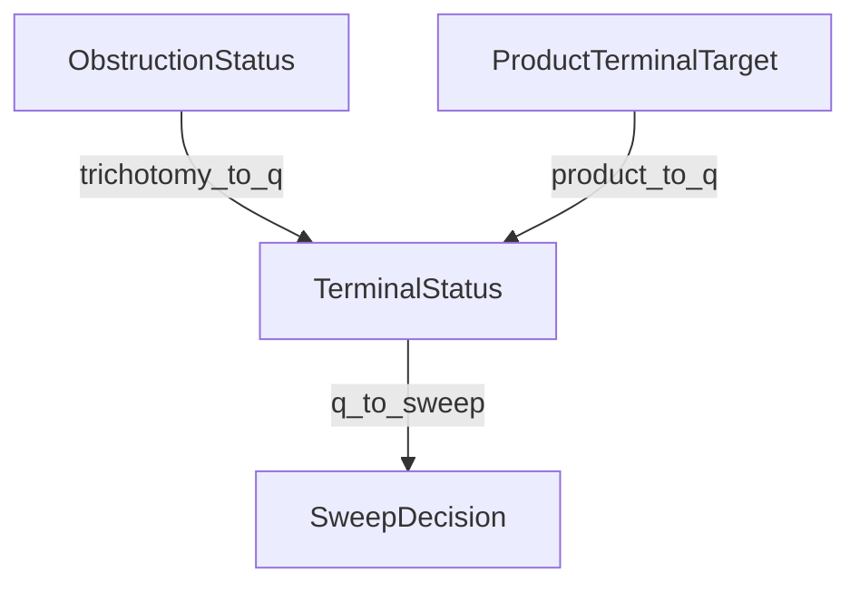

Omega Conductor Status Vocabulary & Foundational Lexicon
========================================================

This canonical contract separates lifecycle, GTOC terminal, and authority state. Legacy repository enums map into these domains but cannot change authority.

**Lifecycle status:** ACTIVE
**GTOC terminal:** OpenObstruction
**Authority status:** None
**Authority effect:** `None`

Canonical independent domains
-----------------------------

```text
LifecycleStatus:
  PLANNED | READY | ACTIVE | BLOCKED | COMPLETED

GtocTerminal:
  NOT_EVALUATED
  ExactRepair
  StabilizedSurvivor
  OpenObstruction
  OracleNeeded
  LiftLicenseNeeded
  Refused
  Invalid
  InfrastructureFailure

AuthorityStatus:
  None
  PendingHumanPromotion
  AuthorizedLocalResult
  HumanRejected
```

Lifecycle describes progress. A GTOC terminal classifies one frozen attempt. Authority records a separate human-controlled transition. An unfrozen packet cannot be `ACTIVE`; `Completed` and `Incomplete` are not GTOC terminals; a passing gate cannot set `AuthorizedLocalResult`.

1. Legacy Status Enums
----------------------

Anomalon uses several distinct status enums to represent classification, process, and authority states:

| Enum | Location | Purpose | Variants |
|---|---|---|---|
| `ObstructionStatus` | `omega_functional::trichotomy` | Core exact rational trichotomy classification | `ExactRepair`, `StabilizedSurvivor`, `OpenObstruction` |
| `TerminalStatus` | `omega_types::q_continuum` | Q-layer bookkeeping/descent tracking | `Supported`, `ConditionallySupported`, `Residual`, `Underdetermined`, `Refuted`, `Refused`, `Speculative`, `Implemented` |
| `ProductTerminalTarget` | `omega_types::status_vocabulary` | Prose targets in obstruction packets | `Repaired`, `ExactRepair`, `ClosedSurvivor`, `LiftNeeded`, `OracleNeeded`, `NoRule`, `Refusal`, `Accepted` |
| `SweepDecision` | `omega_types::status_vocabulary` | Output decisions from the sweep kernel | `Certified`, `Killed`, `Obligation`, `DeferredToValidator`, `RefusedHostAuthority`, `NotGated` |

2. Mapping Rules
----------------

The `StatusVocabularyMap` records legacy diagnostic translations. Current Rust methods return enum values directly; they do not emit mapping receipts. Receipt-bearing translation is target behavior owned by S01-001 and S06-001, and any future receipt must leave `AuthorityStatus` unchanged.



### Mappings Reference

#### Trichotomy -> Q-Continuum (`trichotomy_to_q`)

* `ExactRepair` $\to$ `TerminalStatus::Supported`
* `StabilizedSurvivor` $\to$ `TerminalStatus::Residual`
* `OpenObstruction` $\to$ `TerminalStatus::Refused`

#### Product Target -> Q-Continuum (`product_to_q`)

* `Repaired` / `ExactRepair` $\to$ `TerminalStatus::Supported`
* `ClosedSurvivor` $\to$ `TerminalStatus::Residual`
* `LiftNeeded` / `OracleNeeded` $\to$ `TerminalStatus::Underdetermined`
* `NoRule` / `Refusal` $\to$ `TerminalStatus::Refused`
* `Accepted` $\to$ `TerminalStatus::Implemented`

#### Q-Continuum -> Sweep Decision (`q_to_sweep`)

* `Supported` $\to$ `SweepDecision::Certified`
* `ConditionallySupported` $\to$ `SweepDecision::Obligation`
* `Residual` / `Underdetermined` $\to$ `SweepDecision::DeferredToValidator`
* `Refuted` $\to$ `SweepDecision::Killed`
* `Refused` $\to$ `SweepDecision::RefusedHostAuthority`
* `Speculative` / `Implemented` $\to$ `SweepDecision::NotGated`

3. The Authority Firewall Constraint
------------------------------------

> [!IMPORTANT]
> A product-level certificate, `SweepDecision::Certified`, compiler pass, model judgment, status mapping, or terminalizer never constructs `AuthorizedLocalResult`. In the bounded S14-001 carrier, `omega_certifiers::certify_checked_packet` is evidence-only and repository canaries prohibit authority-return paths in the migrated source roots. SAGA-14 remains open on the low-level public authority owner, host-capability issuance, historical doctrine, and public evidence-type policy.

4. Certificate and promotion contract
-------------------------------------

Current bounded certificate transition:

```text
certify_checked_packet(...) -> CheckedPacketCertificate -> AuthorityEffect::None
```

Dormant promotion contract:

```text
VerifiedReceiptDAG

+ AuthorityWitnessAttestation
+ HumanPromotion
= promote_authorized_local_result(...)
= AuthorizedLocalResult
```

No authenticated production capability issuer exists yet, so this transition is not active and was not invoked by S14-001.

Unknown or contradictory mappings terminate as `OpenObstruction` or `Invalid`; they are never coerced into success.
