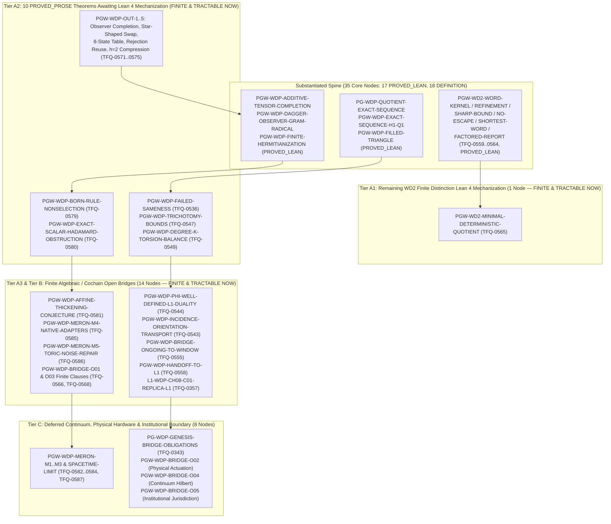

# Witnessed Difference Programme (WDP & WD2) Derivation DAG & `omega_codex` Pre-Merge Ledger

**AuthorityEffect:** None  
**Machine-Readable DAG:** [`dag/wdp_derivation_dag.json`](./wdp_derivation_dag.json) (sibling to [`dag/derivation_dag.json`](./derivation_dag.json))  
**Master Package:** `atlas/finite_obstruction_calculus/witnessed_difference_programme`

---

## 1. Executive Summary: What WDP Still Owes Before Merging with `omega_codex`

The Witnessed Difference Programme (`WDP` + absorbed `WD2` finite distinction carriers) spans **68 core WDP/WD2 nodes** (plus **83 upstream Pre-Genesis / Genesis / Authorization / `S(n)` / `MSS-N` prerequisite nodes** included in `wdp_derivation_dag.json` for self-contained 151-node Kahn topological closure).

### 1.1 Core WDP/WD2 Node Status Census (68 Core Nodes)

| DAG Status | Count | Pre-Merge Disposition for `omega_codex` |
|---|---:|---|
| `PROVED_LEAN` | 17 | **Discharged in Lean 4** (zero `sorry`/`admit`; ready for `omega_codex` merge; includes 5 Batch 1 WD2 proofs). |
| `DEFINITION` | 18 | **Declared Structural Definitions** (ready for `omega_codex` merge). |
| `PROVED_PROSE` | 10 | **Owed — Finite & Tractable Now (Tier A2)**: Written proofs exist in WDP; mechanize in Lean 4 before merge. |
| `COMPUTATIONALLY_CHECKED` | 2 | **Owed — Finite & Tractable Now (Tier A3)**: Checked in Python/Rust; mechanize general theorem in Lean 4 before merge. |
| `CONDITIONAL` | 3 | **Owed — Finite & Tractable Now (Tier A3/B)**: Discharge finite LP duality / fiber-observer / realification bridge in Lean 4. |
| `OPEN` | 18 | **10 Finite & Tractable Now** (1 `WD2` + 9 finite algebraic/cochain) vs **8 Deferred Continuum/External**. |
| **Total Core WDP/WD2 Nodes** | **68** | **35 Discharged/Definitions, 25 Finite & Tractable Pre-Merge, 8 Deferred Continuum/External** |

---

## 2. Visual Mermaid Dependency & Tractability Map



---

## 3. Pre-Merge Action Queue: The Finite & Tractable Obligations (`COMPLETE_BEFORE_OMEGA_CODEX_MERGE`)

### 3.1 Tier A1: `WD2` Finite Distinction Carrier Lean 4 Proofs (5 Discharged in Batch 1, 1 Remaining)

All 6 items have complete written prose proofs in `docs/01_substantiated/wd2_finite_distinction_carriers.md` and passing finite Python witnesses in `code/witnessed_difference/finite_distinction.py`. Five have been mechanized in Lean 4 in `lean4/WitnessedDifference/FiniteDistinction.lean` (Batch 1), leaving `TFQ-0565` (`WD2-T6`) for Batch 2:

| Node ID | TFQ Record | Current Status | Concrete In-Repo Completion Action |
|---|---|---|---|
| `PGW-WD2-WORD-KERNEL-AGREEMENT` | `TFQ-0559` | `PROVED_LEAN` | Discharged in `FiniteDistinction.lean::Wd2.word_kernel_agreement` and `Wd2.poly_word_kernel_agreement`. |
| `PGW-WD2-SHARP-STABILIZATION-BOUND` | `TFQ-0561` | `PROVED_LEAN` | Discharged in `FiniteDistinction.lean::Wd2.stabilization_horizon_le_card_sub_b0` and `Wd2.sharp_chain_general_witness`. |
| `PGW-WD2-NO-ESCAPE-UPDATE-CONGRUENCE` | `TFQ-0562` | `PROVED_LEAN` | Discharged in `FiniteDistinction.lean::Wd2.no_escape_equivalence` and `Wd2.isUpdateCongruence_iff_r1_eq_r0`. |
| `PGW-WD2-SHORTEST-SEPARATING-WORD` | `TFQ-0563` | `PROVED_LEAN` | Discharged in `FiniteDistinction.lean::Wd2.shortest_separating_word`. |
| `PGW-WD2-FACTORED-REPORT-PRESERVATION` | `TFQ-0564` | `PROVED_LEAN` | Discharged in `FiniteDistinction.lean::Wd2.factored_report_preserves_related`, `Wd2.factored_report_preserves_polyRelated`, and `Wd2.unfactored_report_splits_r0`. |
| `PGW-WD2-MINIMAL-DETERMINISTIC-QUOTIENT` | `TFQ-0565` | `OPEN` | Mechanize Theorem WD2-T6 (coarsest observation-preserving update congruence S / R_infinity) in FiniteDistinction.lean and bridge to BehavioralQuotient.lean. |

### 3.2 Tier A2: 10 `PROVED_PROSE` WDP Theorems Awaiting Lean 4 Mechanization

These 10 nodes already have written mathematical proofs in the WDP monograph or `docs/01_substantiated/derivations/` plus exact Python/Rust checks, and are finite theorems ready for Lean 4 formalization:

| Node ID | TFQ Record | Current Status | Concrete In-Repo Completion Action |
|---|---|---|---|
| `PGW-WDP-FAILED-SAMENESS` | `TFQ-0536` | `PROVED_PROSE` | Mechanize the finite failed-sameness witness theorem in Lean 4 on declared finite carriers. |
| `PGW-WDP-TRICHOTOMY-BOUNDS` | `TFQ-0547` | `PROVED_PROSE` | Mechanize the finite diagnostic trichotomy rank inequalities in Lean 4. |
| `PGW-WDP-DEGREE-K-TORSION-BALANCE` | `TFQ-0549` | `PROVED_PROSE` | Mechanize the degree-k integer vs rational torsion-balance comparison in Lean 4. |
| `PGW-WDP-OUT-1-SHARP-OBSERVER-COMPLETION` | `TFQ-0571` | `PROVED_PROSE` | Mechanize the subspace-dimension row-completion formula dim(R cap B_1) - dim(R cap B_1 cap ker O_0) over Q in Lean 4. |
| `PGW-WDP-OUT-2-GUARDED-SWAP-COHERENCE` | `TFQ-0572` | `PROVED_PROSE` | Mechanize the Appendix P.20 star-shaped guarded swap loop contraction theorem in Lean 4. |
| `PGW-WDP-OUT-3-REALIZABLE-FUTURE-OBSERVATION` | `TFQ-0573` | `PROVED_PROSE` | Mechanize the 8-state realizable static vs unrestricted partition cost separation in Lean 4. |
| `PGW-WDP-OUT-4-REJECTION-RULE-REUSE` | `TFQ-0574` | `PROVED_PROSE` | Mechanize the 9-element image-carrier rejection-rule pushforward and NO_RULE abstention theorem in Lean 4. |
| `PGW-WDP-OUT-5-FUTURE-FAITHFUL-COMPRESSION` | `TFQ-0575` | `PROVED_PROSE` | Extend NativeFutureCompression.lean from horizon h=2 to the sharp general-horizon retention converse on finite carriers. |
| `PGW-WDP-BORN-RULE-NONSELECTION` | `TFQ-0579` | `PROVED_PROSE` | Add the explicit 1-parameter non-trace state-effect readout family theorem to FiniteStateEffectReadout.lean. |
| `PGW-WDP-EXACT-SCALAR-HADAMARD-OBSTRUCTION` | `TFQ-0580` | `PROVED_PROSE` | Add the 2-adic rational non-square theorem (forall q : Rat, q * q != 1/2) to FiniteProcessComposition.lean. |

### 3.3 Tier A3 & Tier B: 14 Finite Computational / Conditional / Open Algebraic Bridges

These 14 obligations are purely finite (combinatorial, linear-algebraic over $\mathbb{Q}$, or cochain-level) and can be discharged or answered by a finite countermodel in-repo before merging with `omega_codex`:

| Node ID | TFQ Record | Current Status | Tractability Class | Concrete In-Repo Completion Action |
|---|---|---|---|---|
| `FQ-IMPL-WDP-AMPLITUDE-BRIDGE` | `TFQ-1026` | `COMPUTATIONALLY_CHECKED` | `FINITE_TRACTABLE_LEAN_MECHANIZATION` | Mechanize the finite rational/Gaussian-rational amplitude bridge identity in Lean 4. |
| `PG-GEN-SAMENESS-REFINEMENTS` | `TFQ-0391` | `COMPUTATIONALLY_CHECKED` | `FINITE_TRACTABLE_LEAN_MECHANIZATION` | Mechanize the finite sameness-refinement comparison across Genesis and WDP in Lean 4. |
| `PGW-WDP-PHI-WELL-DEFINED-L1-DUALITY` | `TFQ-0544` | `CONDITIONAL` | `FINITE_TRACTABLE_LEAN_MECHANIZATION` | Mechanize finite LP strong duality for quotient norm Phi_1 over Q in Lean 4 using explicit dual circulation certificates. |
| `PGW-WDP-BRIDGE-REPORT-FIBER-OBSERVER` | `TFQ-0556` | `CONDITIONAL` | `FINITE_TRACTABLE_LEAN_MECHANIZATION` | Bind FoundationalBridges.lean::fiber_constant_iff_factors directly to the report-fiber observer node. |
| `L1-IMP-COMPLEX-FIELD` | `TFQ-0293` | `CONDITIONAL` | `FINITE_TRACTABLE_ALGEBRAIC_DERIVATION` | Formalize the exact finite realification/Hermitianization condition selecting J^2 = -I up to orientation sign. |
| `PGW-WDP-INCIDENCE-ORIENTATION-TRANSPORT` | `TFQ-0543` | `OPEN` | `FINITE_TRACTABLE_ALGEBRAIC_DERIVATION` | Prove finite edge-sign cochain isomorphism under orientation reversal in Lean 4. |
| `PGW-WDP-BRIDGE-ONGOING-TO-WINDOW` | `TFQ-0555` | `OPEN` | `FINITE_TRACTABLE_ALGEBRAIC_DERIVATION` | Formalize the finite carrier-change counterexample and fixed-carrier cochain bridge in Lean 4. |
| `PGW-WDP-HANDOFF-TO-L1` | `TFQ-0558` | `OPEN` | `FINITE_TRACTABLE_ALGEBRAIC_DERIVATION` | Construct the finite rational weighted-l1 and LGGR quotient-evidence adapter beyond the single triangle witness. |
| `L1-WDP-CH08-C01-REPLICA-L1` | `TFQ-0357` | `OPEN` | `FINITE_TRACTABLE_ALGEBRAIC_DERIVATION` | Mechanize finite disjoint-union replica additivity of l1 vs l2 valuation in Lean 4. |
| `PGW-WDP-AFFINE-THICKENING-CONJECTURE` | `TFQ-0581` | `OPEN` | `FINITE_TRACTABLE_ALGEBRAIC_DERIVATION` | Construct a finite dyadic-cell partition and NO_RULE abstention witness for rational affine supports thickened by rational epsilon > 0. |
| `PGW-WDP-MERON-M4-NATIVE-ADAPTERS` | `TFQ-0585` | `OPEN` | `FINITE_TRACTABLE_ALGEBRAIC_DERIVATION` | Construct finite cochain syndrome-to-repair adapter tables for finite lattice fermion/spin windows. |
| `PGW-WDP-MERON-M5-TORIC-NOISE-REPAIR` | `TFQ-0586` | `OPEN` | `FINITE_TRACTABLE_ALGEBRAIC_DERIVATION` | Formalize the Chapter 23 finite toric-code restricted-error rank and syndrome kernel theorem in Lean 4. |
| `PGW-WDP-BRIDGE-O01-CARRIER-CUT-GENESIS` | `TFQ-0566` | `OPEN` | `FINITE_TRACTABLE_ALGEBRAIC_DERIVATION` | Extend PrimitiveAdmissionFloor.lean to classify the finite challenge-generation floor across all declared Genesis seeds. |
| `PGW-WDP-BRIDGE-O03-GUARDED-HISTORY-COHERENCE` | `TFQ-0568` | `OPEN` | `FINITE_TRACTABLE_ALGEBRAIC_DERIVATION` | Classify finite non-star-shaped guarded swap components and 3-cell fillers on finite causal ideals. |

---

## 4. Tier C: 8 Continuum, Hardware & Institutional Obligations (`DEFERRED_PAST_FINITE_CLOSURE`)

These 8 obligations require infinite-volume/continuum limits ($L, M \to \infty$), physical laboratory instrument actuation, or external institutional governance outside finite mathematics. Their finite projections are isolated in Tiers A/B above, so their non-finite halves do not block the finite mathematical closure of WDP:

| Node ID | TFQ Record | Current Status | Why Not Purely Finite / Pre-Merge Boundary |
|---|---|---|---|
| `PG-WDP-GENESIS-BRIDGE-OBLIGATIONS` | `TFQ-0343` | `OPEN` | Umbrella gate over GEN-WDP-O01..O05; finite sub-obligations are discharged in O01/O03, while continuum (O04), physical hardware (O02), and institutional standing (O05) remain external. |
| `PGW-WDP-BRIDGE-O02-OBSERVER-REPAIR` | `TFQ-0567` | `OPEN` | Finite half: test wdpPairDefect preservation/reflection on orientation-sensitive FiniteGenesisWindow (tractable now). External half: physical laboratory repair actuation (deferred). |
| `PGW-WDP-BRIDGE-O04-TENSOR-RECONSTRUCTION` | `TFQ-0569` | `OPEN` | Requires continuum Hilbert completion and physical operational selection beyond finite Gaussian-rational algebras. |
| `PGW-WDP-BRIDGE-O05-AUTHORIZATION-FIREWALL` | `TFQ-0570` | `OPEN` | External institutional jurisdiction and appeal standing cannot be created by finite mathematics or software receipts (proved nonselection fence). |
| `PGW-WDP-MERON-M1-CORRELATION-ESTIMATES` | `TFQ-0582` | `OPEN` | Requires infinite-volume thermodynamic (L -> infinity) and continuous-time Trotter (M -> infinity) analytic correlation bounds. |
| `PGW-WDP-MERON-M2-CUMULANT-BOUNDS` | `TFQ-0583` | `OPEN` | Requires continuum distributional topology and asymptotic higher-cumulant vanishing in the joint scaling limit. |
| `PGW-WDP-MERON-M3-SPECTRAL-GAP-BYPASS` | `TFQ-0584` | `OPEN` | Requires all-M asymptotic transfer-matrix spectral analysis as M -> infinity. |
| `PGW-WDP-MERON-SPACETIME-LIMIT` | `TFQ-0587` | `OPEN` | Requires continuum Euclidean spacetime field limit discharging M1, M2, and M3. |

---

## 5. Already Discharged Core WDP/WD2 Nodes (35 Substantiated Nodes)

### 5.1 Formally Verified in Lean 4 (`PROVED_LEAN` — 17 Nodes)

| Node ID | TFQ Record | Stage | Lean 4 Witness(es) |
|---|---|---|---|
| `PG-ADMISSION-FLOOR` | `TFQ-0360`, `TFQ-0395` | `PREGENESIS` | `lean4/Imported/WitnessedDifference/WitnessedDifference/PrimitiveAdmissionFloor.lean::endpoints_apart`<br/>`lean4/Imported/WitnessedDifference/WitnessedDifference/PrimitiveAdmissionFloor.lean::no_cut_on_subsingleton` |
| `PG-WDP-GROWTH-NO-REPAIR` | `TFQ-0346` | `WDP` | `lean4/DerivationDagQMClosure.lean::QuantumMechanics.DerivationDagQMClosure.wdp_growth_subcomplex_monotone`<br/>`lean4/DerivationDagQMClosure.lean::QuantumMechanics.DerivationDagQMClosure.wdp_two_simplex_attachment_preserves_phi1` |
| `PG-WDP-PROTECTED-QUESTIONS` | `TFQ-0339`, `TFQ-0340` | `WDP` | `lean4/Imported/WitnessedDifference/WitnessedDifference/Symmetry.lean::no_fully_invariant_point`<br/>`lean4/DerivationDagQMClosure.lean::QuantumMechanics.DerivationDagQMClosure.pg_collapse_barrier_protected_questions_and_l1_kkt_trace_embed` |
| `PG-WDP-QUOTIENT-EXACT-SEQUENCE` | `TFQ-0345`, `TFQ-0348` | `WDP` | `lean4/Imported/WitnessedDifference/WitnessedDifference/Obstruction.lean::kappa_well_defined`<br/>`lean4/Imported/WitnessedDifference/WitnessedDifference/Obstruction.lean::kappa_exact_sequence` |
| `PGW-SN-REPRESENTATION-QUOTIENT` | `TFQ-0521` | `MSSN_SN` | `lean4/Imported/WitnessedDifference/WitnessedDifference/ComplexTensorBalancing.lean::balance_section`<br/>`lean4/Imported/WitnessedDifference/WitnessedDifference/ComplexTensorBalancing.lean::balance_kernel_iff` |
| `PGW-WD2-WORD-KERNEL-AGREEMENT` | `TFQ-0559` | `WDP` | `atlas/finite_obstruction_calculus/witnessed_difference_programme/lean4/WitnessedDifference/FiniteDistinction.lean::Wd2.word_kernel_agreement`<br/>`atlas/finite_obstruction_calculus/witnessed_difference_programme/lean4/WitnessedDifference/FiniteDistinction.lean::Wd2.poly_word_kernel_agreement` |
| `PGW-WD2-REFINEMENT-STABILIZATION` | `TFQ-0560` | `WDP` | `atlas/finite_obstruction_calculus/witnessed_difference_programme/lean4/WitnessedDifference/FiniteDistinction.lean::Wd2.related_refl`<br/>`atlas/finite_obstruction_calculus/witnessed_difference_programme/lean4/WitnessedDifference/FiniteDistinction.lean::Wd2.related_symm` |
| `PGW-WD2-SHARP-STABILIZATION-BOUND` | `TFQ-0561` | `WDP` | `atlas/finite_obstruction_calculus/witnessed_difference_programme/lean4/WitnessedDifference/FiniteDistinction.lean::Wd2.stabilization_horizon_le_card_sub_b0`<br/>`atlas/finite_obstruction_calculus/witnessed_difference_programme/lean4/WitnessedDifference/FiniteDistinction.lean::Wd2.sharp_chain_general_witness` |
| `PGW-WD2-NO-ESCAPE-UPDATE-CONGRUENCE` | `TFQ-0562` | `WDP` | `atlas/finite_obstruction_calculus/witnessed_difference_programme/lean4/WitnessedDifference/FiniteDistinction.lean::Wd2.no_escape_equivalence`<br/>`atlas/finite_obstruction_calculus/witnessed_difference_programme/lean4/WitnessedDifference/FiniteDistinction.lean::Wd2.isUpdateCongruence_iff_r1_eq_r0` |
| `PGW-WD2-SHORTEST-SEPARATING-WORD` | `TFQ-0563` | `WDP` | `atlas/finite_obstruction_calculus/witnessed_difference_programme/lean4/WitnessedDifference/FiniteDistinction.lean::Wd2.shortest_separating_word` |
| `PGW-WD2-FACTORED-REPORT-PRESERVATION` | `TFQ-0564` | `WDP` | `atlas/finite_obstruction_calculus/witnessed_difference_programme/lean4/WitnessedDifference/FiniteDistinction.lean::Wd2.factored_report_preserves_related`<br/>`atlas/finite_obstruction_calculus/witnessed_difference_programme/lean4/WitnessedDifference/FiniteDistinction.lean::Wd2.unfactored_report_splits_r0` |
| `PGW-WDP-ADDITIVE-TENSOR-COMPLETION` | `TFQ-0576` | `WDP` | `atlas/finite_obstruction_calculus/witnessed_difference_programme/lean4/WitnessedDifference/AdditiveTensorCompletion.lean::WDP.AdditiveTensorCompletion.grothendieck_extension`<br/>`atlas/finite_obstruction_calculus/witnessed_difference_programme/lean4/WitnessedDifference/AdditiveTensorCompletion.lean::WDP.AdditiveTensorCompletion.tensorFactor_unique` |
| `PGW-WDP-DAGGER-OBSERVER-GRAM-RADICAL` | `TFQ-0577` | `WDP` | `atlas/finite_obstruction_calculus/witnessed_difference_programme/lean4/WitnessedDifference/DaggerObserverPairing.lean::WDP.DaggerObserverPairing.observerPairing_self_nonnegative`<br/>`atlas/finite_obstruction_calculus/witnessed_difference_programme/lean4/WitnessedDifference/DaggerObserverPairing.lean::WDP.DaggerObserverPairing.observerPairing_self_zero_iff_kernel` |
| `PGW-WDP-EXACT-SEQUENCE-H1-Q1` | `TFQ-0546` | `WDP` | `lean4/Imported/WitnessedDifference/WitnessedDifference/Obstruction.lean::kappa_exact_sequence`<br/>`lean4/Imported/WitnessedDifference/WitnessedDifference/Obstruction.lean::kappa_well_defined` |
| `PGW-WDP-FILLED-TRIANGLE` | `TFQ-0548` | `WDP` | `lean4/Imported/WitnessedDifference/WitnessedDifference/Obstruction.lean::filled_triangle_signature` |
| `PGW-WDP-FINITE-HERMITIANIZATION` | `TFQ-0578` | `WDP` | `atlas/finite_obstruction_calculus/witnessed_difference_programme/lean4/WitnessedDifference/FiniteHermitianization.lean::WDP.FiniteHermitianization.hermitian_self_nonnegative`<br/>`atlas/finite_obstruction_calculus/witnessed_difference_programme/lean4/WitnessedDifference/FiniteHermitianization.lean::WDP.FiniteHermitianization.hermitian_radical_iff_form_radical` |
| `PGW-WDP-POINTED-APARTNESS` | `TFQ-0537` | `WDP` | `lean4/Imported/WitnessedDifference/WitnessedDifference/PointedRelation.lean::pointed_relation_independence_fin` |

### 5.2 Structural Definitions (`DEFINITION` — 18 Nodes)

| Node ID | TFQ Record | Stage | Status | Summary |
|---|---|---|---|---|
| `L1-WDP-REALIFICATION-J` | `TFQ-1002` | `L1_TO_L2` | `DEFINITION` | R(A) = [[P,-Q],[Q,P]] is an injective real-linear multiplicative representation of complex matrices with J^2 =... |
| `L1-WDP-WINDOW-PHI1-GAMMA2` | `TFQ-0349`, `TFQ-0354` | `L1_EMERGENCE` | `DEFINITION` | A finite cochain window (C0,C1,C2,d0,d1) with d1 d0 = 0 has quotient Q1 = C1/im(d0). Phi1([x]) is the quotient... |
| `L1-WDP-WITNESS-MASS` | `TFQ-0167`, `TFQ-0358` | `L1_EMERGENCE` | `DEFINITION` | A declared mass m: W -> R>=0 on witnesses gives finite additivity by construction. With positive total mass th... |
| `PG-PRIMDIFF-AXIOMS` | `TFQ-0344`, `TFQ-0394` | `PREGENESIS` | `DEFINITION` | Rust-side axiom list for primitive difference (A1-A10) and a GenesisAdmissionKernel whose admit_difference adm... |
| `PG-WDP-DEGREE1-WINDOW` | `TFQ-0004`, `TFQ-0344`, `TFQ-0349` | `WDP` | `DEFINITION` | A degree-1 window is (C0,C1,C2,d0,d1) of finite-dimensional spaces with a norm J; Q1 = C1/im d0; kappa1([h]) =... |
| `PG-WDP-DIAGNOSTIC-NOT-ROUTING` | `TFQ-0347` | `WDP` | `DEFINITION` | Diagnostic class (ExactClass, ClosedResidual, ActiveClosureFailure) is a different axis from routing terminal ... |
| `PGW-WDP-ASYMMETRY-INJECTION-LEDGER` | `TFQ-0540` | `WDP` | `DEFINITION` | For any proposed selection the injection ledger records the first input that breaks the relevant symmetry: a n... |
| `PGW-WDP-CLOSURE-NEEDS-DEGREE` | `TFQ-0545` | `WDP` | `DEFINITION` | Given d₁: C¹ → C² from a finite 2-cell structure, the closure diagnostic Γ(δ) = J₂(d₁δ) descends to Q¹ exactly... |
| `PGW-WDP-DURATION-EXACTNESS-PERIOD-WITNESS` | `TFQ-0551` | `WDP` | `DEFINITION` | WDP-CH07-D01: a finite duration gauge is a path system with an additive edge valuation λ: E → M into a commuta... |
| `PGW-WDP-FINITE-VALUATIONS` | `TFQ-0552` | `WDP` | `DEFINITION` | WDP-CH08-D01: finite families A and B are congruent relative to a comparison family K when a matching preservi... |
| `PGW-WDP-GENESIS-BRIDGES-LEDGER` | `TFQ-0554` | `WDP` | `DEFINITION` | WDP Level 22 presents eleven proposed Genesis-to-WDP bridges drawn from register rows GEN-WDP-01 to GEN-WDP-10... |
| `PGW-WDP-GRAPH-COCHAIN-HOST` | `TFQ-0542` | `WDP` | `DEFINITION` | On a finite oriented graph G = (V, E) with a normed coefficient space A, the host sets C⁰ = A^V, C¹ = A^E and ... |
| `PGW-WDP-OBSERVER-QUOTIENT-PASSIVITY` | `TFQ-0553` | `WDP` | `DEFINITION` | Chapter 10 replaces one observer tuple by four declared layers joined by typed adapters: presentation (X, P, q... |
| `PGW-WDP-QUOTIENT-DEFECT-ROOT-P` | `TFQ-0538` | `WDP` | `DEFINITION` | Root P, the evaluation layer: with V a finite-dimensional real space of defects, A a finite-dimensional space ... |
| `PGW-WDP-RETENTION-PACKET` | `TFQ-0541` | `WDP` | `DEFINITION` | A difference at one exhibition does not by itself remain available at another; a retention packet R = (M, u, r... |
| `PGW-WDP-SEVEN-WITNESS-ROLES` | `TFQ-0539` | `WDP` | `DEFINITION` | WDP-CH02-D01 defines a residual-locus witness as a typed locus L with evidence that the residual's component a... |
| `PGW-WDP-SUCCESSION-STRICT-ORDER` | `TFQ-0550` | `WDP` | `DEFINITION` | WDP-CH06-D01 defines a constitutive succession packet 𝔖 = (S, ⇝, ≺, π): ⇝ an exhibited immediate-transition re... |
| `PGW-WDP-SYNTHESIS-TRUNK-TIERS` | `TFQ-0557` | `WDP` | `DEFINITION` | Chapter 21 names, for each result family, the small countermodel that would refute it: quotient well-definedne... |

---

## 6. Verification Commands

```powershell
# Validate the standalone WDP derivation DAG schema, acyclicity, and Claim Hygiene
python dag/validate_derivation_dag.py --dag dag/wdp_derivation_dag.json --no-files --no-views

# Validate the master estate derivation DAG and its synchronized JSONL/Markdown views
python dag/validate_derivation_dag.py --no-files
```
