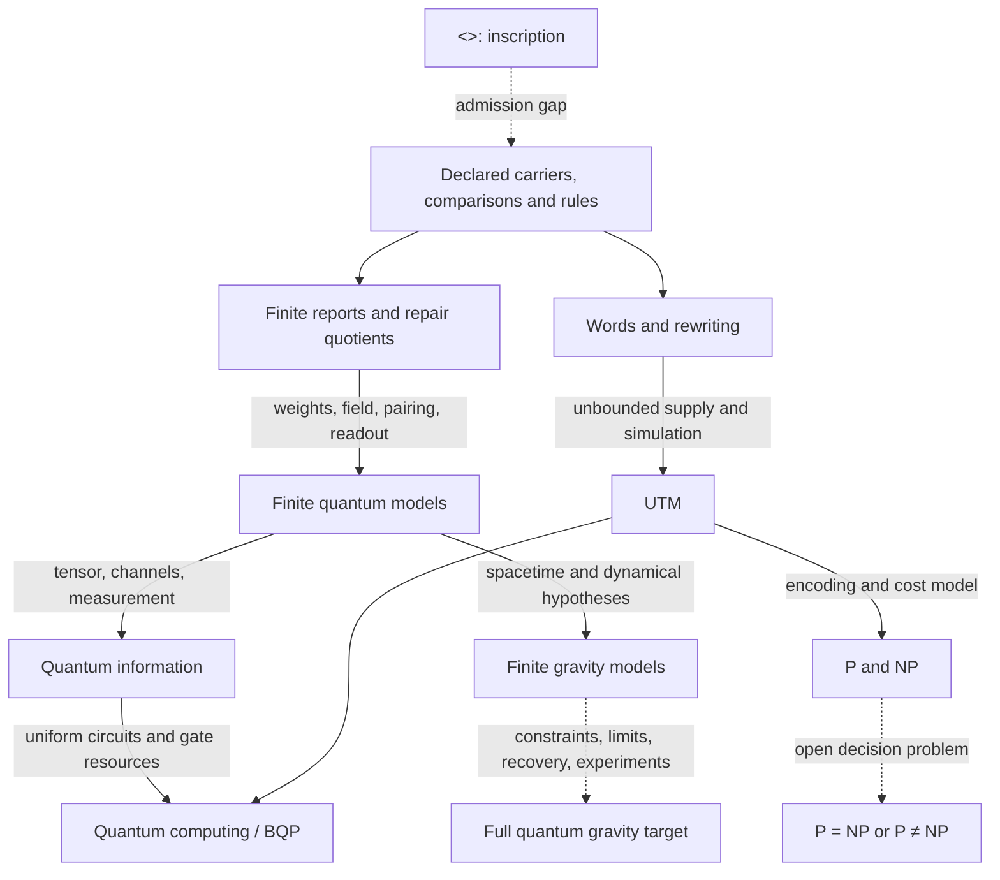

# From the first mark to quantum gravity: the derivation map

AuthorityEffect: None. Editorial consolidation, 2026-11-05.

`<>` is the starting inscription. It does not yet give two objects, a clock,
logic, a set, a probability law, or a physical universe. The existing DAG's
`PG-INERT-DIAMOND` and `TFQ-0001` distinguish the inscription from an admitted
mathematical structure. Every route below begins with that admission boundary.

This is the short reading spine. The TFQ papers remain the individual claim
records, and `../derivation_dag.json` remains the graph's source of truth.
The long manuscripts are supporting sources, not additional independent proofs.
Existing proof statuses are inherited from the graph; this edit did not rebuild Lean.

## Read in this order

| Step | Read | What it supplies | What is still paid for |
|---|---|---|---|
| 1 | [Admission and reports](01_pregenesis/ADMISSION_AND_REPORTS.md) | Separability, report fibres, stated retention contracts | Carrier, comparison, logic, admission rules |
| 2 | [Repair, weights and Hilbert structure](08_l1_to_l2/REPAIR_TO_HILBERT.md) | Quotient repair; phase-sensitive counterexamples; conditional lifts | Positive weights, scalar field, inner product, readout |
| 3 | [Finite quantum states and structure](10_finite_qm_core/FINITE_QUANTUM_STATES.md) | Declared states, effects, correlations and composition | Physical model selection and operational availability |
| 4 | [Dynamics, Hamilton and Noether](11_finite_qm_dynamics/DYNAMICS_HAMILTON_NOETHER.md) | Finite transport and two distinct generator arguments | Time, regularity, symplectic or matrix algebra structure |
| 5 | [Records and interpretations](12_finite_qm_structure/RECORDS_AND_INTERPRETATIONS.md) | Relative states, interference and record erasure | Ontological interpretation and actual experimental control |
| 6 | [Quantum information](13_finite_qm_information/QUANTUM_INFORMATION.md) | Channels, distinguishability, entropy, coding contracts | Tensor factors, CPTP operations, measurement, asymptotic families |
| 7 | [Computation, complexity and P versus NP](../../atlas/computation_complexity_pvnp/README.md) | Conditional UTM, cost model, NP verification, P/NP and BQP | Unbounded supply, uniformity, encoding and quantum operations |
| 8 | [Gravity and continuum obligations](19_finite_qg/QUANTUM_GRAVITY_GAPS.md) | Finite relational, Regge, gauge and spin-foam targets | Dynamics, constraints, controlled limits and physical predictions |

An arrow identifies a dependency. Its label is part of the claim. It is not a
claim that its input forces its output uniquely. In particular, P versus NP
does not need to be solved before quantum information can be defined.

## What was combined and where the originals went

The foundations and core accounts are combined by mathematical role in the
eight chapters above. Repeated introductions, scope warnings and lists of
imports are stated once in that reading path. Detailed packets, claim ledgers,
proofs, code and export artifacts are assigned to the matching numbered stage.
The long core manuscript belongs to stage 10; its historical source notes and
claim ledger remain beside it. Its PDF and TeX exports retain their original
bytes and are not asserted to match a newer Markdown revision.

The Hamilton/Noether draft is reduced to its two mathematical arguments in
stage 11. Its reviewed drawings, all review responses, intermediate versions,
renderers and the Everett companion are preserved together in
[the teaching source package](11_finite_qm_dynamics/hamilton_noether_sources/START_HERE.md).
That package is historical supporting material, not a second canonical route.

[The source crosswalk](../../docs/maintenance/source_consolidation/source_crosswalk.md) gives destinations and DAG matches.
[The manifest](../../docs/maintenance/source_consolidation/source_consolidation_manifest.json) accounts for every original
file. Historical hash-bound packages and verbatim reviews keep their original
internal paths; those are provenance references, resolved through the crosswalk.
No file was called a duplicate merely because its title or conclusion matched.
The [validation receipt](../../docs/maintenance/source_consolidation/consolidation_validation.md) records the completed
checks and the inherited reference failures.

## Completion is a list of obligations

1. **Admission:** explain or explicitly admit the comparison structure beyond
   `<>`. A model of difference already assumes enough mathematics to state it.
2. **Quantum selection:** identify hypotheses that select a quantum state/effect
   theory among rivals. `FQ-PRIM-TO-QM-SELECTION-OPEN` is currently conditional;
   executing a supplied packet is not physical selection.
3. **Readout:** keep positivity, normalization, frame assumptions and dimension
   in the Born claim. `FQ-GAP-BORN-UNIQUENESS-GLEASON` is conditional, not a
   derivation from bare difference.
4. **Composition and operations:** the conditional tensor reconstruction and
   effect-cone results need their operational hypotheses. An available matrix
   does not establish an available laboratory procedure.
5. **Dynamics:** separate a discrete step, an algebraic derivation, a continuous
   group, its generator, and an identification with physical energy.
6. **Computational cost:** expose uniform algorithms, encodings, input size and
   resource bounds. Supply the missing TM0 output decoding theorem; retain
   `COMP-C6-TM0-OUTPUT-FORM-OPEN` and the unbounded-supply import.
7. **Complexity:** P versus NP is open. Exponential enumeration is an upper
   bound for one algorithm, not a lower bound for every algorithm. An unchecked
   ETH announcement has no role in the admitted route.
8. **Information and hardware:** specify entropy base, channel families, error
   metric, achievable encodings and noise assumptions. A finite repair queue
   or code-distance calculation is not a threshold theorem for a device.
9. **Quantum gravity:** discharge the separate obligations in the
   [gravity register](19_finite_qg/QUANTUM_GRAVITY_GAPS.md). Neither a finite
   curvature proxy nor a kinematic spin network supplies a full theory.

The graph records these boundaries as assumptions, conditional results or open
targets. Organization does not change the evidence level of the underlying work.
