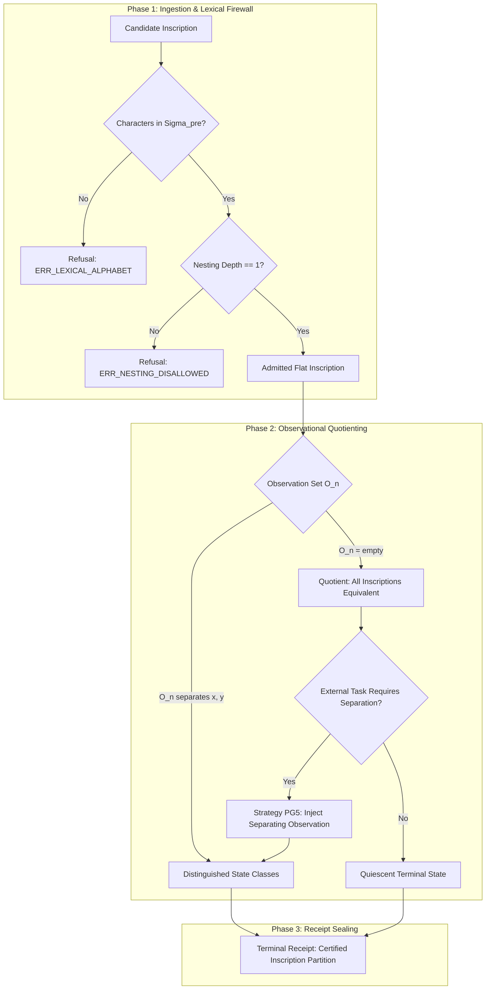

# Formal Rewriting Architecture, Diagrams, and Strategy Definitions over the Pre-Genesis Inscription Substrate (Σ_pre)

**AuthorityEffect:** None.  
**Framework:** Pre-Genesis Inscription Substrate & Proposal Fidelity Protocol (PFP).  
**Substrate Alphabet:** $\Sigma_{\text{pre}} = \{<, >, a, b\}$.  
**Normative Status:** Active Architectural Specification and Formal Pre-Genesis Rewriting Engine Reference.  
**Companion Documents:**
- [`Pre-Genesis Grammar Specification`](../grammar/pre_genesis.ebnf)
- [`000_pre_genesis Strand Reference`](../README.md)
- [`Pre-Genesis Results and Arguments`](../03_results_and_arguments.md)
- [`Genesis Rewriting Strategies`](../../001_genesis/rewriting/rewriting_strategies_gen_wire.md)
- [`S(n) Wire Rewriting Strategies`](../../002_s_n/rewriting/rewriting_strategies_sn_wire.md)
- [`MSS-N Wire Rewriting Strategies`](../../003_minimal_symbol_system_n_mssn/rewriting/rewriting_strategies_mssn_wire.md)

---

## 1. The Expressive Universe of the Pre-Genesis Alphabet ($\Sigma_{\text{pre}}$)

The Pre-Genesis inscription regime is defined over an austere alphabet of exactly four glyphs:

$$\Sigma_{\text{pre}} = \Sigma_{\text{boundary}} \cup \Sigma_{\text{payload}}$$

where:
- $\Sigma_{\text{boundary}} = \{<, >\}$ ($|\Sigma_{\text{boundary}}| = 2$)
- $\Sigma_{\text{payload}} = \{a, b\}$ ($|\Sigma_{\text{payload}}| = 2$)

### 1.1 Four Epistemic States Maintained Apart

As established in the foundational Pre-Genesis trial records and formal grammar (`pre_genesis.ebnf`), this substrate strictly separates four distinct states:

1. **Absent Input:** No document or communication occurs; not an element of $\Sigma_{\text{pre}}^*$, matched by no grammar start symbol.
2. **Empty Word ($\varepsilon$):** The length-zero string `""`; refused fail-closed by all public grammar start symbols.
3. **Ground Token (`<>`):** A single balanced boundary container with empty payload; length 2 bytes (`0x3C 0x3E`), possessing zero internal observation coordinates.
4. **Ground Carrier:** The semantic stage object adopted by stage $S(0)$; a mathematical entity rather than a concrete wire string.

### 1.2 The Adjacency Axiom and Refusal of Ambient Formatting

Unlike conventional computer science grammars that admit whitespace separators, tabs, newlines, commas, or parentheses, the Pre-Genesis wire regime refuses smuggled ambient formatting:

- **Non-Nested Boundary Constraint:** Boundaries do not nest hierarchically within an inscription. The token `<<>>` or `<<a>>` is rejected by `pre_genesis.ebnf`.
- **Direct Adjacency:** Sibling tokens concatenate directly without whitespace: `<><a><ab>`.
- **Quiescent Regime Enclosures:** A collection of inscriptions is enclosed in set braces `{...}`, where `{}` denotes the quiescent empty regime (which is strictly distinct from the empty word $\varepsilon$).

### 1.3 Substrate Dialect Stratification in Pre-Genesis

| Dialect Tier | Lexical Alphabet | Structural Grammar Rule | Example Expression | Operational Role |
|---|---|---|---|---|
| **Tier PG-Ground** | $\{<, >\}$ | `ground_token = "<>"` | `<>` | Uncarved mark presentation, baseline quiescence |
| **Tier PG-Atom** | $\{<, >, a, b\}$ | `occupied_token = "<", payload, ">"` | `<a>`, `<ab>`, `<ba>` | Single-container occupied token with payload string |
| **Tier PG-Regime** | $\{<, >, a, b, \{, \}, ,\}$ | `pre_genesis_regime = "{", [ ... ], "}"` | `{}`, `{<>}`, `{<a>,<ab>}` | Multi-token state register with declared membership |
| **Tier PG-Quarantine** | $\Sigma_{\text{pre}} \cup \text{Codebook}$ | Sidecar slot projection | `<<s0><s1>>` | External prose quarantine with pure codebook slots |

---

## 2. Formal Mathematical Definitions of Pre-Genesis Rewriting

### Definition 2.1 (Substrate Inscriptions and Word Monoid)
Let $\Sigma_{\text{pre}} = \{<, >, a, b\}$. The set of finite sequences over $\Sigma_{\text{pre}}$ forms the free monoid $\Sigma_{\text{pre}}^*$ under concatenation, with identity $\varepsilon$. The grammar `pre_genesis.ebnf` defines the language of well-formed inscriptions:

$$\mathcal{L}_{\text{pre}} = \{ \langle\rangle \} \cup \{ \langle w \rangle \mid w \in \{a, b\}^+ \}$$

### Definition 2.2 (The Flat Inscription Algebra)
A Pre-Genesis inscription $t \in \mathcal{L}_{\text{pre}}$ has no proper subterm positions other than the root $\epsilon$ and the internal payload string position $1$. In particular, nesting depth is bounded:

$$\operatorname{depth}(t) = 1 \quad \forall t \in \mathcal{L}_{\text{pre}}$$

Any expression with $\operatorname{depth}(t) > 1$ constitutes an immediate syntactic defect and is refused fail-closed.

### Definition 2.3 (Observational Equivalence Relation $\approx_n$)
Let $O_n$ be the finite set of observation predicates available to the evaluation regime at stage $n$. Two inscriptions $x, y \in \mathcal{L}_{\text{pre}}$ are observationally equivalent relative to $O_n$ (denoted $x \approx_n y$) if and only if:

$$\forall o \in O_n, \quad o(x) = o(y)$$

1. **Empty Observation Set:** If $O_n = \emptyset$, then for all $x, y \in \mathcal{L}_{\text{pre}}$, $x \approx_n y$ holds vacuously. Under an empty observation set, `<a>` $\approx$ `<ab>`.
2. **Opaque vs Exact-Inscription Convention:**
   - Under the *opaque convention*, state identity is quotiented by $\approx_n$. If $O_n = \emptyset$, supplying `<a>` after `<>` creates no new internal state distinction.
   - Under the *exact-inscription convention*, state identity is defined by string identity over $\Sigma_{\text{pre}}^*$. Because `"<a>"` $\neq$ `"<>"` in $\Sigma_{\text{pre}}^*$, the strings differ.

### Definition 2.4 (No-Transition Quiescence)
Let $\mathcal{R}$ be the rewrite relation of the Pre-Genesis regime. Prior to Genesis event admission, $\mathcal{R} = \emptyset$. Under an empty transition relation:

$$\forall t \in \mathcal{L}_{\text{pre}}, \quad \not\exists u \in \mathcal{L}_{\text{pre}} \text{ such that } t \to_{\mathcal{R}} u$$

Every well-formed inscription is irreducible by definition. No autonomous step is forced. An operational move requires external supply or explicit rule addition.

### Definition 2.5 (Forced Separation Theorem)
Let $x, y \in \mathcal{L}_{\text{pre}}$ such that $x \approx_n y$ under current observation set $O_n$. If an external task contract $T$ requires distinguishing $x$ from $y$:

1. Any operation $f$ defined on the quotient equivalence classes satisfies $f([x]) = f([y])$.
2. Therefore, no operation on the existing quotient can separate $x$ and $y$.
3. To satisfy task $T$, the regime must gain a new observation $o^* \in \mathcal{O}$ such that $o^*(x) \neq o^*(y)$.
4. **Non-Uniqueness of Lift:** The required observation $o^*$ is not uniquely determined. Multiple non-isomorphic predicates separate $x$ and $y$ (e.g., $o_1$: payload length is $1$; $o_2$: payload contains glyph $b$; $o_3$: payload parity).

### Definition 2.6 (Replay Necessity and Auditor Projection)
Let $\mathcal{H}$ denote the set of execution histories, $\sigma: \mathcal{H} \to \mathcal{S}$ the state mapping, and $\pi: \mathcal{H} \to \mathcal{H}_{\text{partial}}$ an observation projection (e.g., observing only the single most recent turn).

If there exist histories $h_1, h_2 \in \mathcal{H}$ such that $\pi(h_1) = \pi(h_2)$ but $\sigma(h_1) \neq \sigma(h_2)$, then no auditor evaluating solely through $\pi$ can determine the true regime state for every history. Consequently, the Proposal Fidelity Protocol requires append-only history retention for all rewrite steps.

---

## 3. Comprehensive Rewriting Diagrams

### Diagram 3.1: Pre-Genesis Intake and Quiescent Evaluation Flow

```text
+---------------------------------------------------------------------------------------------------------+
|                                PRE-GENESIS INTAKE & EVALUATION PIPELINE                                 |
+---------------------------------------------------------------------------------------------------------+
|                                                                                                         |
|   +--------------------------+                                                                          |
|   |   Raw Ingress String     |   Candidate input over character stream                                  |
|   +-------------+------------+                                                                          |
|                 |                                                                                       |
|                 v  [Strategy PG2: Lexical Firewall]                                                     |
|   +--------------------------+   Characters outside {<, >, a, b}?                                       |
|   | Lexical Alphabet Check   |----------------------------------------+                                 |
|   +-------------+------------+                                        |                                 |
|                 | Admitted in Sigma_pre                               | Outside Sigma_pre               |
|                 v                                                     v                                 |
|   +--------------------------+   Nested boundary? (<<a>>)     +-----------------------------------+     |
|   | Boundary Balance & Nest  |------------------------------->| Refusal: <<refusal><ERR_SYNTAX>>> |     |
|   +-------------+------------+   [Strategy PG3]               +-----------------------------------+     |
|                 | Well-formed flat inscription                                                          |
|                 v                                                                                       |
|   +--------------------------+                                                                          |
|   | Current Observation Set  |   Is O_n empty?                                                          |
|   |          (O_n)           |                                                                          |
|   +-------------+------------+                                                                          |
|                 |                                                                                       |
|        +--------+--------+                                                                              |
|        | O_n = empty     | O_n contains separating predicate                                            |
|        v                 v                                                                              |
|   +------------------+  +------------------------------------+                                          |
|   | Observational    |  | Separated Inscription Partition    |                                          |
|   | Equivalence:     |  | o(x) != o(y)                       |                                          |
|   | [x] == [y]       |  | [Strategy PG5: Forced Lift]        |                                          |
|   | [Strategy PG4]   |  +-----------------+------------------+                                          |
|   +--------+---------+                    |                                                             |
|            |                              v                                                             |
|            v                    +------------------------------------+                                  |
|   +------------------+          | Quiescent Terminal Receipt:        |                                  |
|   | Quiescent Normal |          | <<cert><t><receipt>>>              |                                  |
|   | Form (No-Step)   |          +------------------------------------+                                  |
|   | [Strategy PG1]   |                                                                                  |
|   +------------------+                                                                                  |
|                                                                                                         |
+---------------------------------------------------------------------------------------------------------+
```



---

### Diagram 3.2: Observational Equivalence and Forced Lift Branching

```text
                                  Task Demands: Tell <a> Apart from <ab>
                                                    |
                                                    v
                                  Current State: O_n is Empty
                                      (<a> ~ <ab> vacuously)
                                                    |
                         +--------------------------+--------------------------+
                         |                          |                          |
                         v                          v                          v
                  Candidate Lift o_1         Candidate Lift o_2         Candidate Lift o_3
                  Predicate: len(p) == 1     Predicate: 'b' in payload  Predicate: even/odd parity
                         |                          |                          |
                         v                          v                          v
                  o_1(<a>)  = true           o_2(<a>)  = false          o_3(<a>)  = odd
                  o_1(<ab>) = false          o_2(<ab>) = true           o_3(<ab>) = even
                         |                          |                          |
                         +--------------------------+--------------------------+
                                                    |
                                                    v
                                    Separation Satisfied: o*(x) != o*(y)
                                       (No Single Lift is Unique)
```

---

## 4. Comprehensive Strategy Inventory (PG1 through PG8)

```text
+----------------------------------------------------------------------------------------------------------+
|                                    PRE-GENESIS STRATEGY DISPATCH MATRIX                                  |
+-----+----------------------------+-----------------------+-----------------------+-----------------------+
| ID  | Name                       | Target Stratum        | Input Pattern         | Output Form           |
+-----+----------------------------+-----------------------+-----------------------+-----------------------+
| PG1 | Ground Quiescence          | Stratum 0 (Ground)    | Bare `<>`             | Quiescent `<>` (halt) |
| PG2 | Lexical Firewall           | Stratum 1 (Lexical)   | String over Char*     | Inscription in Σ_pre  |
| PG3 | Non-Nesting Enforcement    | Stratum 1 (Syntax)    | Nested containers     | Flat token or Refusal |
| PG4 | Observational Quotienting  | Stratum 2 (Epistemic) | Inscription pair      | Equivalence class     |
| PG5 | Forced Separation Lift     | Stratum 2 (Epistemic) | Conflicted class      | Separated partition   |
| PG6 | Convention Disambiguation  | Stratum 2 (Epistemic) | Untyped query         | Explicit convention   |
| PG7 | Replay History Custody     | Stratum 3 (Protocol)  | Step sequence         | Bound audit ledger    |
| PG8 | Quiescent Refusal Routing  | Stratum 3 (Protocol)  | Ill-posed demand      | Typed refusal packet  |
+-----+----------------------------+-----------------------+-----------------------+-----------------------+
```

---

### Strategy PG1: Ground Token Quiescence
- **Target Stratum:** Stratum 0 (Ground State).
- **Trigger Precondition:** Evaluation encounters ground token `<>` with empty transition rules.
- **Redex Pattern:** `<>`.
- **Rewrite Rule:**
  $$\langle\rangle \quad \xrightarrow{\text{PG1}} \quad \langle\rangle \quad (\text{quiescent halt})$$
- **Operational Invariant:** Forbids autonomous synthesis of next-state tokens. Without external supply or admitted rule, execution halts at `<>`.

---

### Strategy PG2: Lexical Boundary Firewall
- **Target Stratum:** Stratum 1 (Lexical Monoid).
- **Trigger Precondition:** Ingress inscription contains glyphs outside $\Sigma_{\text{pre}} = \{<, >, a, b\}$.
- **Redex Pattern:** Inscription $w \in \Sigma^*$ containing character $c \notin \Sigma_{\text{pre}}$.
- **Rewrite Rule:**
  $$w \quad \xrightarrow{\text{PG2}} \quad \langle\langle\text{refusal}\rangle \langle\text{errlexicalglyph}\rangle \langle c \rangle\rangle$$
- **Operational Invariant:** Fails closed immediately without guessing token mappings or coercing unknown glyphs.

---

### Strategy PG3: Non-Nesting Flatness Enforcement
- **Target Stratum:** Stratum 1 (Syntax Inscription).
- **Trigger Precondition:** Ingress term attempts recursive boundary nesting (e.g., `<<>>` or `<<a>>`).
- **Redex Pattern:** $\langle \dots \langle \dots \rangle \dots \rangle$.
- **Rewrite Rule:**
  $$\langle u \langle v \rangle w \rangle \quad \xrightarrow{\text{PG3}} \quad \langle\langle\text{refusal}\rangle \langle\text{errnestedboundary}\rangle\rangle$$
- **Operational Invariant:** Maintains flat container depth $\operatorname{depth}(t) = 1$ in accordance with the adjacency axiom.

---

### Strategy PG4: Observational Quotienting under Empty Context
- **Target Stratum:** Stratum 2 (Epistemic State).
- **Trigger Precondition:** Query compares two inscriptions $x, y \in \mathcal{L}_{\text{pre}}$ when internal observation set $O_n$ is empty.
- **Redex Pattern:** $\operatorname{compare}(x, y)$ with $O_n = \emptyset$.
- **Rewrite Rule:**
  $$\operatorname{compare}(x, y) \quad \xrightarrow{\text{PG4}} \quad \langle\langle\text{equiv}\rangle \langle x \rangle \langle y \rangle \langle\text{vacuous}\rangle\rangle$$
- **Operational Invariant:** Acknowledges regime-relative equivalence; does not assert string equality over $\Sigma_{\text{pre}}^*$.

---

### Strategy PG5: Forced Separation Lift
- **Target Stratum:** Stratum 2 (Epistemic State).
- **Trigger Precondition:** External task contract $T$ requires distinct evaluation paths for $x \approx_n y$.
- **Redex Pattern:** $\operatorname{distinguish}(x, y)$ where $x \approx_n y$.
- **Rewrite Rule:**
  $$\operatorname{distinguish}(x, y) \quad \xrightarrow{\text{PG5}} \quad \langle\langle\text{lift}\rangle \langle o^* \rangle \langle\langle x \rangle \langle o^*(x) \rangle\rangle \langle\langle y \rangle \langle o^*(y) \rangle\rangle\rangle$$
  where $o^* \in \mathcal{O}$ satisfies $o^*(x) \neq o^*(y)$.
- **Operational Invariant:** The choice of separating observation $o^*$ must be declared explicitly; the evaluator records that $o^*$ is not uniquely forced.

---

### Strategy PG6: Convention Disambiguation Lift
- **Target Stratum:** Stratum 2 (Epistemic State).
- **Trigger Precondition:** Ingress prompt poses questions regarding whether a presentation change represents a new state.
- **Redex Pattern:** $\operatorname{is\_new\_state}(t_1, t_2)$.
- **Rewrite Rule:**
  $$\operatorname{is\_new\_state}(t_1, t_2) \quad \xrightarrow{\text{PG6}} \quad \langle\langle\text{undecidable\_without\_convention}\rangle \langle\text{opaque\_convention}\rangle \langle\text{exact\_convention}\rangle\rangle$$
- **Operational Invariant:** Forbids unhedged binary answers when the response depends on undeclared regime conventions.

---

### Strategy PG7: Replay History Ledger Accumulation
- **Target Stratum:** Stratum 3 (Protocol Custody).
- **Trigger Precondition:** A rewrite step transition $t_k \to t_{k+1}$ occurs.
- **Redex Pattern:** Inscription change $(t_k, t_{k+1})$.
- **Rewrite Rule:**
  $$(H_k, t_k \to t_{k+1}) \quad \xrightarrow{\text{PG7}} \quad H_{k+1} = H_k \mathbin{\Vert} \langle\langle\text{step}\rangle \langle k+1 \rangle \langle t_k \rangle \langle t_{k+1} \rangle\rangle$$
- **Operational Invariant:** Retains full sequential history to satisfy the Replay Necessity Theorem against one-turn auditor failure.

---

### Strategy PG8: Quiescent Refusal Routing
- **Target Stratum:** Stratum 3 (Protocol Custody).
- **Trigger Precondition:** An impossible or ill-posed task is requested of the Pre-Genesis regime (e.g., requesting arithmetic evaluation over non-numeric alphabet $\{a, b\}$).
- **Redex Pattern:** $\operatorname{eval}_{\text{arithmetic}}(t)$ where $t \in \mathcal{L}_{\text{pre}}$.
- **Rewrite Rule:**
  $$\operatorname{eval}_{\text{arithmetic}}(t) \quad \xrightarrow{\text{PG8}} \quad \langle\langle\text{refusal}\rangle \langle\text{errnoarithmeticcapacity}\rangle\rangle$$
- **Operational Invariant:** Refuses out-of-regime operations fail-closed. Emits an immutable typed refusal packet without synthesizing heuristic approximations.

---

## 5. Concrete Worked Rewriting Traces

### Trace 1: Ground Quiescence on `<>`
**Initial State:** Prompt supplies ground token `<>` and requests one operational step.
```text
<>
```
**Step 1:** Evaluator checks rule set $\mathcal{R}$ in Pre-Genesis.
$$\mathcal{R} = \emptyset$$
**Step 2:** Apply Strategy PG1 (Ground Token Quiescence).
No active redexes exist; no transition is enabled.
**Terminal Normal Form:**
```text
<>
```
*Receipt:* `<<cert><<token><>>><<status><quiescent>><<steps><0>>>>`

---

### Trace 2: Forced Separation of `<a>` and `<ab>` under External Task
**Initial State:** Task contract $T$ demands: `"Route <a> to left, <ab> to right"`.
Current observation set: $O_0 = \emptyset$.
```text
task<distinguish<<a>,<ab>>>
```
**Step 1:** Audit observational equivalence (Strategy PG4).
Since $O_0 = \emptyset$, `<a>` $\approx_0$ `<ab>`. Both evaluate to the same equivalence class $[ \langle a \rangle ]$. Task cannot be resolved on existing quotient.
**Step 2:** Trigger Forced Separation Lift (Strategy PG5).
Evaluator selects separating predicate $o_{\text{len}}: \text{payload length} == 1$.
- $o_{\text{len}}(a) = \text{true}$
- $o_{\text{len}}(ab) = \text{false}$
**Step 3:** Split quotient classes:
$$[ \langle a \rangle ]_{\text{new}} \neq [ \langle ab \rangle ]_{\text{new}}$$
**Step 4:** Route task destinations deterministically:
- `<a>` $\mapsto$ `left`
- `<ab>` $\mapsto$ `right`
**Terminal Normal Form:**
```text
<<partition><<left><a>><<right><ab>>><<obs><len1>>>
```
*Receipt:* `<<cert><<status><separated>><<predicate><len1>><<canonical_lift><false>>>>`

---

### Trace 3: Quiescent Codebook Enclosure Transformation
**Source Natural Language Prompt:**
`"Consider two distinct initial states alpha and beta where alpha has no mark and beta has mark a."`
1. **Quarantine Prose Spans into Codebook:**
   - Slot $s_0$: `"state alpha has no mark"` $\mapsto$ `<>`
   - Slot $s_1$: `"state beta has mark a"` $\mapsto$ `<a>`
2. **Apply Strategy PG2 & PG3:**
   Form pure Pre-Genesis regime string:
   ```text
   {<>,<a>}
   ```
3. **Audit Regime Conformance:**
   Evaluated against `pre_genesis.ebnf`: conforms to `pre_genesis_regime`.
4. **Emit Verified Custody Receipt:**
   ```text
   <<regime><tokens><<ground><>><<occupied><a>>><<codebook><s0><s1>>>
   ```

---

## 6. Anti-Patterns and Refusal Catalog

| Anti-Pattern ID | Name | Violation Description | Evaluator Error Code |
|---|---|---|---|
| **AP-PG01** | Lexical Alphabet Leakage | Admitting characters outside $\{<, >, a, b\}$. | `ERR_LEXICAL_ALPHABET` |
| **AP-PG02** | Nested Container Defect | Admitting nested brackets `<<>>` violating flat adjacency. | `ERR_NESTING_DISALLOWED` |
| **AP-PG03** | Spontaneous Autonomous Step | Hallucinating a continuation from `<>` with empty relation $\mathcal{R}$. | `ERR_SPONTANEOUS_STEP` |
| **AP-PG04** | Smuggled Counting Multiplicity | Assuming counting semantics prior to declared observation lift. | `ERR_UNLICENSED_COUNTING` |
| **AP-PG05** | One-Turn Certification | Certifying state without verifying full history trace. | `ERR_ONE_TURN_BLINDNESS` |
| **AP-PG06** | Unique Tower Promotion | Promoting an arbitrary separating observation into a uniquely forced law. | `ERR_UNEARNED_UNIQUENESS` |

---

## 7. Claim Hygiene Quadrant

In accordance with the workspace Claim Hygiene Rule, the claims supported by this document are explicitly bounded:

1. **What this document supports:**
   - Formalizes rewriting dynamics over the four-glyph alphabet $\Sigma_{\text{pre}} = \{<, >, a, b\}$ under `pre_genesis.ebnf`.
   - Specifies eight explicit rewrite strategies (PG1 through PG8) covering ground quiescence, lexical firewalling, non-nesting enforcement, observational quotienting, forced separation, convention disambiguation, and replay custody.
   - Formulates the exact mathematical definitions of no-transition quiescence, observational equivalence, forced non-unique lift, and replay necessity.
   - Details concrete reduction traces and an anti-pattern refusal catalog.

2. **What this document does not support:**
   - Does not claim that any language model autonomously invents these strategies without external prompting or scaffolding.
   - Does not establish empirical task performance rates across model families.
   - Does not claim that a separating observation lift is unique or universally optimal.
   - Does not mint authority or self-certify correctness (`AuthorityEffect: None`).

3. **The narrowest defensible claim:**
   - Under the declared assumptions of `pre_genesis.ebnf` and the Pre-Genesis trial records, the eight strategies PG1–PG8 provide a checkable specification for handling inscriptions over $\Sigma_{\text{pre}}$ without smuggling arithmetic semantics or unhedged continuation rules.

4. **The next test needed:**
   - Run the grammar conformance validator `py -3.12 omega_engine_education/documentation/000_pre_genesis/code/check_pre_genesis.py` to confirm grammar consistency.
