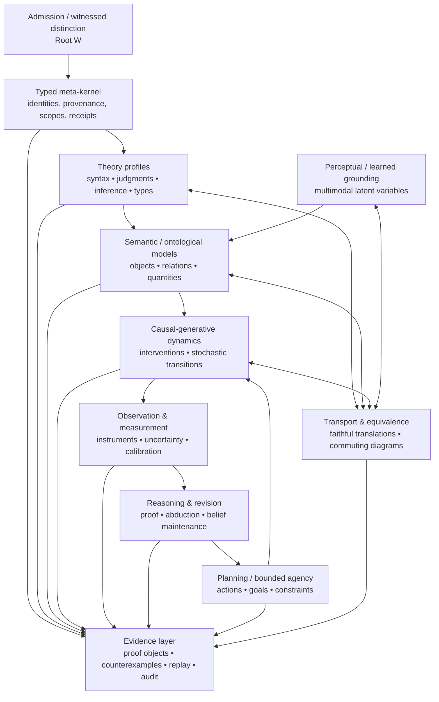
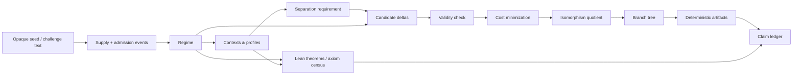
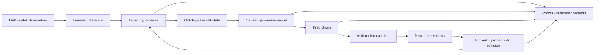

# Genesis / 19L57G1: an external study of minimal finite admission

*By repository rule, 19L57G1 is an external, self-contained study and a conceptual analogy for the Omega Engine, not its mathematical foundation or a code dependency. The Witnessed Difference Programme keeps the two apart (WDP Appendix L).*

**Edition 3, 2026-09-29 (Closeout & Freeze Edition).** This edition supersedes previous
editions, incorporating the closeout of the research phase and the author's approved
freeze of the §9.5 snapshot on 2026-09-28 (at commit `f1d56c01`, PR #271). Both authorized
continuation attempts (#267, #269) are closed and merged. AuthorityEffect: None.

**Pinning and scope.** This atlas pins its Genesis references to
`dbccpage/19L57G1@sealed-derivation-v1` (`3100c4e`, 2026-08-17). That tag
predates the whole post-seal research estate, and the sealed paths have
changed in 66 files since it was made. Everything below that postdates the
pin is labelled **post-pin** and cited at `f1d56c01` (or earlier baseline `b368f28c`).
Post-pin material is current information about the repository, not an atlas
claim at the pinned reference.

Claims attributed to 19L57G1 below cite repository paths at `b368f28c`.
Citation tokens of the form `cite…` are carried over from the first
edition's literature retrieval and were not re-verified for this edition.
No file under `prompt/`, `paper/`, `code/derivation/`, `lean4/Derivation/`
or `artifacts/` is copied here.

**Modular Level & Foundational Estate Architecture.** This directory provides a teaching and audit layer over Genesis / 19L57G1 (the 2026-10-01 audit withdrew the claim that it is a complete or faithful formalization; see `primitives/README.md`):
- [`levels/`](levels/) & [`levels/README.md`](levels/README.md): Standalone level-by-level specifications from Level 00 to Level 21 (Sealed Blind Core) and extended research estate milestones up to Level 100.
- [`primitives/`](primitives/) & [`primitives/README.md`](primitives/README.md): The 19 foundational primitive carrier families extracted from `19L57G1`, a selected educational implementation in Python (`code/`, 82 tests across three files on 2026-10-06) with a Lean 4 Lake package (`lean4/`, 22 build jobs, 9 theorems in 4 files, no custom axioms). Most family Lean modules hold definitions only, so the two are not dual implementations.
- [`normal_forms/`](normal_forms/) & [`normal_forms/README.md`](normal_forms/README.md): Canonical normal form contracts (`APNF`, `IGNF`, `IRNF`, `LSNF`, `EFNF`, `MTNF`) standardizing passage routing, $S_n$ isomorphism quotients, regime minimal carriers, ladder filtration, and trace monoids.
- [`scripts/`](scripts/) & [`_images/`](_images/): Deterministic generator script ([`generate_genesis_svgs.py`](scripts/generate_genesis_svgs.py)) synthesizing the 22 formal architectural schematics across Levels 00–21.

## Executive summary

The GitHub repository `dbccpage/19L57G1` is best understood **not as a
completed foundational theory of the world, nor as a conventional theorem
prover, nor as an AI world model**. It is an unusually disciplined
experiment in *metatheoretic admission, observational distinction, finite
construction, and evidence-preserving derivation*. That was true at the
first edition's revision, and it is truer now.

Its sealed core starts with an intentionally impoverished object language.
It distinguishes external presentation from internal admission, and it
allows state changes only through explicit admission events or imposed
requirements. It defines observational identity behaviourally, through
contexts and derivability. It enumerates minimal responses to failed
separability, quotients them by an explicitly implemented isomorphism
relation, and records the resulting branch structure with deterministic
computational and Lean evidence (`code/derivation/model.py`,
`code/derivation/observe.py`, `README.md`).

The central sealed result is still a **non-uniqueness/stopping result**, not
an emergence-of-everything result.

- Under the declared candidate grammar and cost measures, the first
  nontrivial requirement has several tied minimal responses: three
  non-isomorphic classes under Reading L (plus an infinite family indexed by
  arity), and five under Reading F for the item-count measure.
- A finer declared measure picks a unique minimum.
- The cost measures, candidate grammar, isomorphism relation and
  continuation policy are declared, not derived.

That honesty remains the project's strongest feature. Genesis finds a
boundary at which more structure must be admitted, rather than pretending
the boundary is not there. The sealed derivation is essentially unchanged
since the first edition: two paper-prose narrowings on 2026-09-23 (below),
and no code, Lean or artifact change.

**What is new since the first edition (post-pin).** Five developments
change the assessment.

1. **Bridging is now tested, and mostly refused.** Four "foundations" trees
   (`research/native_bridge`, `native_structure`, `conservation_ladder`,
   `domain_adapters`) turn the first edition's call for a transport layer
   into machine-checked theorems, most of them negative.
   - A commuting square plus an injective encoding is *not* evidence that a
     translation reproduces its source. Every injectively numbered system
     commutes through budget writes alone (NB-9, refuted).
   - Requiring the *observation* to be preserved is what separates real
     translations from cheap ones. A budget register preserves only a
     constant observation, and a toggle has no faithful
     observation-preserving translation (NB-16).
   - Every quantity conserved by every event is constant on the reachable
     states, so no proposed action generates a separating charge (CL-13).
   - Reversible or periodic sources collapse on the core (DA-2, DA-4, DA-6).
   - The only faithful translations exhibited are a monotone counter (DA-3)
     and the identity (NB-16).
2. **The blind second derivation ran to the end of its budget and is closed.** Both
   authorized continuation attempts have closed and been merged (#267, #269).
   - It decided every row of its twelve-notion "census of definability" in
     the DEFINABLE or USEFUL REALIZATION column.
   - It decided none in the FORCED column.
   - It declared a class of 144 engines. Minimal members exist, none is
     unique up to its probe-isomorphism, and none is initial.
   - It did *not* reduce its count of declared inputs below two, nor prove
     that two is the floor (recorded as NOT_ESTABLISHED).
   - Its own completion gate is recorded as **UNSATISFIED** (two clauses UNMET: not
     every gate proved by injection, post-freeze comparison not written).
   - The research phase is **CLOSED_WITH_OPEN_OBSTRUCTIONS** and the §9.5 snapshot
     was approved and frozen on September 28, 2026.
3. **The Alpha reference contract has been audited and repaired.** It is a
   small, audited contract for proposals, evaluation evidence, authorized
   admission, replay, retained alternatives and typed stops (`research/alpha_engine`, `docs/ALPHA_HANDOFF.md`).
   - The audit reproduced three admission defects through the real code
     path: a substituted member executed under a valid key; a parent node
     that does not replay; an authorization reusable at another source.
   - It repaired all three and proved each repair by live injection.
   - The contract's status is **READY_WITHIN_DECLARED_SCOPE**.
4. **The evidence layer has hardened.**
   - Gate 11 now registers 36 research trees across two jobs. Before, it
     registered 12 in one job and two research Lean audits.
   - A custody census runs every research tree's own verifier (108 verifiers)
     and fails on any change in their outcomes.
   - A dated vocabulary ruling (2026-09-23) governs outside terminology, and
     a digest-stored test refuses two outside names anywhere in the
     repository, identifiers included.
5. **Overclaims were withdrawn.**
   - A Section 3 correction review withdrew or narrowed twelve research-layer
     overclaims: categorical initiality, a strict 2-category, native state
     isomorphism, and several "general" results.
   - It recorded that it "introduces no new mathematical bridge"
     (`docs/section3_claim_corrections.md`).

My overall assessment is refined, not reversed:

> **Genesis now has a working evidence-carrying meta-framework, a small audited admission contract, and a body of machine-checked no-go results about when a translation deserves the name. It still lacks the semantic, probabilistic, causal, continuous, learned-perceptual, dependent/higher-typed and cross-domain transport machinery required of a state-of-the-art foundational world model.**

The highest-value next result is still **not another isolated domain
example**. It is a **faithful representation and transport theorem and
implementation contract**. This edition can say something sharper about it
than the first could. The repository has now shown, with Lean proofs, that
the cheap versions of such a theorem are worthless:

- squares without observation preservation (NB-9);
- injective encodings of reversible systems (DA-4);
- read-back without realized steps (NB-13).

The first edition proposed an evidence ladder (§"The most important
mathematical gap"). The repository now holds instance-level results on its
lower rungs, and its upper rungs are empty.

A state-of-the-art target architecture should look approximately like this:

At `b368f28c`, Genesis has:

- credible pieces of `W` and `K`, and of finite parts of `T/S/C/O/R/A`;
- an unusually strong `E`, which is stronger than at the first edition;
- for the first time, a **negatively characterized `X`**. The repository now
  knows, with proofs, several things a transport must not be.

What it still lacks is a *general, positively proved* `X` layer tying the
others together.

## Repository, formal core, and claim architecture

### The sealed derivation

The README describes the project as a "blind finite derivation" from an
opaque seed. For its 2026-09-19 local run it reports:

- 60 typed Python source files;
- 75 Lean modules, 63 in the root's import closure and 12 parked;
- 55 test files with 787 collected tests;
- deterministic artifacts (40 JSON exports and 6 full gzipped trees);
- 140 `CL-*` claim entries;
- Axiom reports strictly within `{propext, Quot.sound}`: 1,314 audited theorem reports at the sealed core pin (`3100c4e`), expanding to 1,530 on later `main` (`README.md`, lines
  20–31).

Counts at `b368f28c` confirm these, with one exception: there are now 61
test files, so the README's test row is stale. The most recent full local
run of the Python gate job (2026-09-25, recorded in `docs/GENESIS_CLOSEOUT.md`)
passed 13 of 13 steps with 918 tests passed and 1 skipped. The axiom
artifact `artifacts/lean_axioms.txt` on later main records 1,530 reports with no `Classical.choice`
and no `sorryAx` (matching the sealed baseline of 1,314 reports with zero choice and zero sorry). The README is equally explicit that these receipts do
**not** prove the mathematical payload by themselves, and that several
policy choices remain declarations.

**Since the first edition,** the only changes under the sealed paths are two
paper-prose narrowings (2026-09-23):

- The initial-member wording was withdrawn. `paper/native_derivation_completion.md`
  now says the member is "uniquely probe-compliant in the declared 64-member
  toggle class; this does not establish categorical initiality".
- The §13 comparison flags of `paper/paper.md` were updated to record the
  author's vocabulary ruling.

No `CL-*` entry changed. The paper's terminal statement (§11) is
unchanged.

The six most important Python modules form a clean metatheoretic pipeline:

| Component | Formal role | Important content |
|---|---|---|
| `model.py` | State-transition metatheory | `Regime`, admissions, requirements, deterministic `step`, `replay`, certification |
| `observe.py` | Internal observability | contexts, plugging, derivability, profiles, separability, witnesses |
| `candidates.py` | Finite construction search | delta grammar, validity, `μ₁`, `μ₂`, bounded minimum-response enumeration |
| `iso.py` | Structural quotient | regime isomorphism, canonicalization, automorphisms, pair orbits |
| `engine.py` | Challenge/branch semantics | Readings L/F, imposed separation, closure policy, branch expansion |
| `export.py` | Evidence boundary | deterministic serialization/replay artifacts |

The README gives these as the kernel's reading order.

### Visual Metatheoretic Evolution: Levels N=00 to N=21

The operational trajectory of Genesis 19L57G1 (and its post-pin research estate) is visualized across 22 canonical architectural schematics in [`_images/`](_images/), with standalone granular specifications in [`levels/`](levels/):

| Level | Modular Specification | Schematic Artifact | Core Metatheoretic &amp; Estate Invariant |
|---|---|---|---|
| Level 00 | [`level_00_presentation_void.md`](levels/level_00_presentation_void.md) | [`genesis_00_presentation_void.svg`](_images/genesis_00_presentation_void.svg) | Presentation Void &amp; Supply No-Op (`present(x) / R -> R`) |
| Level 01 | [`level_01_external_admission_datum.md`](levels/level_01_external_admission_datum.md) | [`genesis_01_external_admission_datum.svg`](_images/genesis_01_external_admission_datum.svg) | External Supply &amp; Datum Admission (`D -> D U {x}`) |
| Level 02 | [`level_02_primitive_difference_separation.md`](levels/level_02_primitive_difference_separation.md) | [`genesis_02_primitive_difference_separation.svg`](_images/genesis_02_primitive_difference_separation.svg) | Primitive Difference &amp; Persistent Separation (`Q -> Q U {(i, j)}`) |
| Level 03 | [`level_03_judgment_form_arities.md`](levels/level_03_judgment_form_arities.md) | [`genesis_03_judgment_form_arities.svg`](_images/genesis_03_judgment_form_arities.svg) | Judgment-Form Arities &amp; Declarations (`F -> F ++ [n]`) |
| Level 04 | [`level_04_instance_admission.md`](levels/level_04_instance_admission.md) | [`genesis_04_instance_admission.svg`](_images/genesis_04_instance_admission.svg) | Instance Admission &amp; Asserted Tuples (`I -> I U {f(a)}`) |
| Level 05 | [`level_05_metatheoretic_regime_state.md`](levels/level_05_metatheoretic_regime_state.md) | [`genesis_05_metatheoretic_regime_state.svg`](_images/genesis_05_metatheoretic_regime_state.svg) | Metatheoretic Regime State (`R = (D, F, I, U, Q)`) |
| Level 06 | [`level_06_minimal_candidate_response.md`](levels/level_06_minimal_candidate_response.md) | [`genesis_06_minimal_candidate_response.svg`](_images/genesis_06_minimal_candidate_response.svg) | Minimal Candidate Responses &amp; Cost Floor (`μ₁ = 2`, `μ₂`) |
| Level 07 | [`level_07_observational_context_profiles.md`](levels/level_07_observational_context_profiles.md) | [`genesis_07_observational_context_profiles.svg`](_images/genesis_07_observational_context_profiles.svg) | Observational Contexts &amp; Profile Collapse (`Prof_R(d)`) |
| Level 08 | [`level_08_structural_isomorphism_quotient.md`](levels/level_08_structural_isomorphism_quotient.md) | [`genesis_08_structural_isomorphism_quotient.svg`](_images/genesis_08_structural_isomorphism_quotient.svg) | Structural Isomorphism Quotient &amp; Token Erasure (`R₁ ≅ R₂`) |
| Level 09 | [`level_09_readings_branch_closure.md`](levels/level_09_readings_branch_closure.md) | [`genesis_09_readings_branch_closure.svg`](_images/genesis_09_readings_branch_closure.svg) | Surviving Readings Branching &amp; Separation Closure (`Reading L vs F`) |
| Level 10 | [`level_10_epistemic_quarantine.md`](levels/level_10_epistemic_quarantine.md) | [`genesis_10_epistemic_quarantine.svg`](_images/genesis_10_epistemic_quarantine.svg) | Epistemic Quarantine &amp; Axiom Honesty (`{propext, Quot.sound}`) |
| Level 11 | [`level_11_trace_algebra_confluence.md`](levels/level_11_trace_algebra_confluence.md) | [`genesis_11_trace_algebra_confluence.svg`](_images/genesis_11_trace_algebra_confluence.svg) | Trace Algebra &amp; Confluence Gate (`rw_confluent` &amp; Normal Forms) |
| Level 12 | [`level_12_deterministic_replay_export.md`](levels/level_12_deterministic_replay_export.md) | [`genesis_12_deterministic_replay_export.svg`](_images/genesis_12_deterministic_replay_export.svg) | Deterministic Replay &amp; Evidence Serialization (40 JSON Exports) |
| Level 13 | [`level_13_primitive_passage_routing.md`](levels/level_13_primitive_passage_routing.md) | [`genesis_13_primitive_passage_routing.svg`](_images/genesis_13_primitive_passage_routing.svg) | Primitive Passage Routing (Two-Rule Repair vs Lift Routing) |
| Level 14 | [`level_14_search_exhaustion_gate.md`](levels/level_14_search_exhaustion_gate.md) | [`genesis_14_search_exhaustion_gate.svg`](_images/genesis_14_search_exhaustion_gate.svg) | Search Exhaustion &amp; Bounded Gate (`UNKNOWN` vs Proved Obstruction) |
| Level 15 | [`level_15_progress_licensing_contract.md`](levels/level_15_progress_licensing_contract.md) | [`genesis_15_progress_licensing_contract.svg`](_images/genesis_15_progress_licensing_contract.svg) | Alpha Progress Licensing Contract (Contract &amp; R-B-G Authority) |
| Level 16 | [`level_16_presentation_descent_coherence.md`](levels/level_16_presentation_descent_coherence.md) | [`genesis_16_presentation_descent_coherence.svg`](_images/genesis_16_presentation_descent_coherence.svg) | Presentation Descent &amp; Retract Coherence ($d \circ u = \text{id}$, NB-16) |
| Level 17 | [`level_17_digest_identity_compression.md`](levels/level_17_digest_identity_compression.md) | [`genesis_17_digest_identity_compression.svg`](_images/genesis_17_digest_identity_compression.svg) | Digest Identity Compression (`regime_sha256` &amp; `dup_no_refine`) |
| Level 18 | [`level_18_discrete_cochain_fencing.md`](levels/level_18_discrete_cochain_fencing.md) | [`genesis_18_discrete_cochain_fencing.svg`](_images/genesis_18_discrete_cochain_fencing.svg) | Discrete Cochain &amp; Rational Fencing ($\mathbb{Q}$ &amp; `FloatProbabilityError`) |
| Level 19 | [`level_19_spectral_zeta_fencing.md`](levels/level_19_spectral_zeta_fencing.md) | [`genesis_19_spectral_zeta_fencing.svg`](_images/genesis_19_spectral_zeta_fencing.svg) | Spectral Zeta &amp; Polynomial Fencing (Integer Char Poly Fence) |
| Level 20 | [`level_20_autopoietic_reflection_symmetry.md`](levels/level_20_autopoietic_reflection_symmetry.md) | [`genesis_20_autopoietic_reflection_symmetry.svg`](_images/genesis_20_autopoietic_reflection_symmetry.svg) | Autopoietic Reflection &amp; Symmetry Breaking (`Breaking.cycle_detected`) |
| Level 21 | [`level_21_combinatorial_simplex_ceiling.md`](levels/level_21_combinatorial_simplex_ceiling.md) | [`genesis_21_combinatorial_simplex_ceiling.svg`](_images/genesis_21_combinatorial_simplex_ceiling.svg) | Combinatorial Simplex Ceiling &amp; Homology Barrier (`LadderGeneral.d4_demo`) |

For the extended post-pin research estate milestones beyond Level 21 (including Levels 22, 23, 29, 32, 47, 55, 65, 66, 80, 93, and 100), see the master index in [`levels/README.md`](levels/README.md).

The fundamental state is

\[
R=(D,F,I,U,Q),
\]

corresponding operationally to:

- admitted data;
- judgment-form arities;
- admitted instances;
- uniformly derivable forms;
- persistent pair-separation requirements.

`code/derivation/model.py` explicitly classifies this as **metatheory
apparatus**. Presentation-token identity is visible to the metatheory but is
not automatically exposed to the object language.

The primitive state transitions are approximately:

\[
\frac{\text{present}(x)}{R\to R}
\quad\text{Supply}
\]

\[
\frac{x\text{ supplied}}{D\mapsto D\cup\{x\}}
\quad\text{AdmitDatum}
\]

\[
\frac{n\ge1}{F\mapsto F\mathbin{+\!\!+}[n]}
\quad\text{AdmitForm}
\]

\[
\frac{f:n,\;a_1,\ldots,a_n\in D}
     {I\mapsto I\cup\{f(a_1,\ldots,a_n)\}}
\quad\text{AdmitInst}
\]

\[
\frac{f\in F}{U\mapsto U\cup\{f\}}
\quad\text{AdmitRuleAll}
\]

and an external separation obligation

\[
\frac{i<j<|D|}{Q\mapsto Q\cup\{(i,j)\}}.
\]

These rules are not all "inference rules" in the usual proof-theoretic
sense. `AdmitRuleAll` is the sealed core's main explicit object-language
inference mechanism: once it is admitted for a form, every well-formed tuple
instance of that form counts as derivable. Most of the other operations are
**metalevel state constructors**.

That distinction matters. Genesis's core is more accurately a *formal theory
of theory-construction under explicit admissions* than a rich deductive
calculus.

The Lean development relates to the Python kernel only in a stated way.
Lean is a token-erased abstraction of whole histories, and Python is
connected to it by executable checks, **not** by a refinement proof
(`CL-TOKEN-ERASURE`). The implemented isomorphism's soundness is a finite
computation whose Lean side is recorded as unresolved (`CL-ISO-SOUND`);
general soundness of the optimized canonicalizer remains OPEN.

### Observation and internal identity

For a form \(f\), a context is a tuple containing one or more holes.
Substituting a datum \(d\) into all the holes produces an instance. The
profile

\[
\operatorname{Prof}_R(d)
 =\{C\mid R\vdash C[d]\}
\]

is therefore a finite behavioural signature. Two data are observationally
collapsed exactly when their profiles agree:

\[
d_1\sim_R d_2
\iff
\operatorname{Prof}_R(d_1)=\operatorname{Prof}_R(d_2).
\]

Internal separability means that these profiles differ, and a separating
context is an explicit witness to the difference (`code/derivation/observe.py`).

This is conceptually close to observational equivalence in semantics,
automata-theoretic distinguishability, and quotienting by a kernel relation.
It is intentionally narrower, though: the observation language is whatever
contexts and derivability the current regime happens to possess, so a rich
external difference can remain invisible internally.

The sealed observer-descent development (`lean4/Derivation/ObsDescent.lean`)
advances this idea. The observational quotient identifies exactly the
zero-related pairs. A view descends to the quotient exactly when it is
constant on the corresponding classes, and the descent is then unique.

**Post-pin.** The second derivation carries these notions across the
implemented isomorphism, over histories of the sealed step:

- separability, collapse, "holds two" and representative lists are carried
  forward by the sealed isomorphism with no hypothesis on either regime
  (`research/second_profile`);
- element counts are carried between well-formed, duplicate-free regimes
  (`research/second_class`).

### Minimal constructive responses and non-uniqueness

The response grammar permits four item types:

\[
\texttt{NewDatum},\quad
\texttt{NewForm}(n),\quad
\texttt{NewInst}(f,\vec a),\quad
\texttt{NewRuleAll}(f).
\]

Two cost functions are explicitly declared:

\[
\mu_1(\Delta)=|\Delta|
\]

and

\[
\mu_2(\Delta)=
\left(
|\Delta|,
\sum_{\text{new forms } f}\operatorname{arity}(f)
\right)
\]

with lexicographic comparison. The default search bound is two items and
arity at most two. Pruning is justified by four lemmas (rule removal, datum
irrelevance, form irrelevance, and mention), and a full bounded enumeration
serves as a cross-check (`code/derivation/candidates.py`).

This is philosophically significant because **minimality is always minimality
relative to a declared grammar and cost preorder**. Genesis recognizes this
rather than quietly turning one encoding cost into metaphysics.

The implemented isomorphism quotient has a similarly explicit contract
(`code/derivation/iso.py`).

- Two regimes are isomorphic when bijections on datum indices and form
  indices preserve arities, instances, uniform rules and separation
  requirements. Presentation-token spelling is deliberately forgotten.
- Canonicalization uses an isomorphism-invariant refinement followed by a
  bounded permutation search, and tests cross-check it against brute-force
  canonicalization.

The branch engine carries both surviving readings of the seed text rather
than arbitrarily choosing one. It also states that the pair-separation
closure policy and the fresh-token continuation policy are **declared
metatheory**, not internally derived demand generators
(`code/derivation/engine.py`).

The sealed paper's §11 records the resulting tagged terminal clauses (a)–(h):

| Clause | Grade | Statement & Sealed Operational Finding |
|---|---|---|
| **(a)** | theorem | The seed generates nothing. Supply is a provable no-op (`supply_no_op`, `genesis_underivable`). |
| **(b)** | theorem | Admission without judgment structure gives total observational collapse (`Prof(d_1) = Prof(d_2)`). |
| **(c)** | theorem | The first separation costs exactly two items, in both readings (`cost1_insufficient_general`, `deltaU0_valid`, $\mu_1 = 2$). |
| **(d)** | theorem in L; bounded in F | The $\mu_1$ minima tie: 3 classes in Reading L, 5 in Reading F within bounds, plus an infinite arity family. The $\mu_2$ minimum is unique in both readings. |
| **(e)** | theorem | Every supplied demand has an admissible response (`mark_progress`). |
| **(f)** | bounded theorem | **No object-language demand generator was derived.** Pair-separation closure terminates within $n(n-1)/2$ rounds (a bounded theorem in sealed paper §11(f); its Lean form `closedRun_round_bound_from_empty` was added after the seal, at `f1d56c01`, and is absent at `3100c4e`). |
| **(g)** | finite computation | With the declared external supply policy, the requested 15 steps were reached. Continuation beyond that is **unresolved**, and no unboundedness is claimed. |
| **(h)** | unresolved | Both admission readings (Reading L and Reading F) survive without contradiction. |

**Why the derivation stopped.** The sealed run stopped in both of the seed's formal ways:
- **No next challenge:** The closed system reaches its all-pairs fixpoint after 1 round in Reading L and 3 rounds in Reading F.
- **The declared bound:** With supply on, the $\mu_2$ trees reached the requested depth. The $\mu_1$ trees hit the 1200-node guard at depth 6 (Reading L) and 5 (Reading F).

**Axiom Census & Formal Size.** The Lean development spans 75 modules (30,903 lines, 1,673 theorems). The census distinguishes the original sealed core from later `main`:

| Axiom Profile | Sealed Pin (`3100c4e`) | Later `main` (`f1d56c01`) | Evidential Status |
|---|---:|---:|---|
| `none` (computational / constructive) | 413 | 454 | Pure Lean inductive terms |
| `[propext]` | 107 | 186 | Propositional extensionality only |
| `[Quot.sound]` | 60 | 60 | Quotient soundness only |
| `[propext, Quot.sound]` | 734 | 830 | Standard quotiented propositions |
| **Total Axiom Reports** | **1,314** | **1,530** | Zero `Classical.choice`, zero `sorryAx` |

**Staleness in the sealed record.** The review identifies three historical items:
- Paper §12's "kind-(e)" residual is superseded by the declaration census.
- `verification_20260817.md` says "CI is the authority", which predates the no-hosted-CI ruling.
- The paper quotes 137 ledger entries; the repository records 140.

That yields the core dependency pattern:

### Primitive difference and the extended research estate

The primitive-difference formalization carefully distinguishes an arbitrary
witnessed relation from an irreflexive witnessed relation. In Lean,
`irrefl_witness_ne` (`lean4/Derivation/PrimDiff.lean`) proves that if \(R\)
is irreflexive and \(R(a,b)\), then \(a\ne b\). The associated paper
(`paper/primitive_difference.md`) records two countermodels:

- a bare relation witness does not by itself force metatheoretic inequality;
- two unequal points need not carry the proposed relation.

This supports the distinction the *Witnessed Difference Programme* draws
between an **admission kernel** and downstream structure
([`006_oewdp`](../../006_oewdp/README.md)). In that programme,
Root W is an exhibited or witnessed distinction. An earlier *Primitive Axiomatics* draft (no longer in the
repository) treated cochain quotients and obstruction
metrics as Root P: an evaluator that exists only after carriers,
comparisons, repairs and gauges have been declared.

#### The Nineteen Foundational Primitive Categories & Relational World Model

To eliminate smuggled background manifolds, continuous topologies, and external scalar clocks, all 19 primitive families extracted from `19L57G1` are formally codified under [`primitives/`](primitives/) and [`normal_forms/`](normal_forms/):

| Cat. | Foundational Primitive | Primary Mathematical Carriers | Proved / Enforced Invariants | WDP Level Binding |
| :---: | :--- | :--- | :--- | :---: |
| **1** | **Seed, Admission & Regimes** | `Token`, `Supply`, `AdmitDatum`, `AdmitForm`, `AdmitInst`, `Regime`, `Delta` | Deterministic replay; discrete costs $\mu_1, \mu_2$; deduplicated admission. | **WDP-00 / WDP-01** |
| **2** | **Primitive Difference & Pointed Carriers** | `PtdRel`, `Hom`, 9 Readings ($W..F$), Minimal carriers $D_2, D_2^{\mathrm{rev}}, S_2$ | Irreducible asymmetric difference witness; $\mathbf{PtdRel}$ category morphisms. | **WDP-00 / WDP-01** |
| **3** | **Passage Dynamics & Active Obstruction** | `PS` (9-store passage state), `PEvent`, `DiffObs`, `Col`, `Cols` | Four-gate active obstruction decomposition: $\text{obst}_p = \text{ret} \land \text{prot} \land \text{dec} \land \text{zero}$. | **WDP-02 / WDP-03** |
| **4** | **Refusal Frontiers & Boundary Toggles** | `Sup`, `Adm`, `Form`, `Inst`, `RSt`, `Desc` (6-toggle family) | 64-toggle constitution space; typed refusal without exception panics. | **WDP-13 / WDP-14** |
| **5** | **Simplicial Complexes & Boundary Cancellation** | `Cell`, `Edge`, `Tri`, `Tet`, `Complex` $(C_0..C_3)$, `Chain` | Nilpotency of discrete boundary: $\partial^2 \equiv 0$ on all finite simplicial chains. | **WDP-03 / WDP-15** |
| **6** | **Transition Alphabet & Trace Monoid** | DDC 8-letter alphabet $\{E, R, C, I, \Lambda, D, M, T\}$, `Profile`, `TRecord` | Operational profile conservation; step-level budget and license accounting. | **WDP-05 / WDP-06** |
| **7** | **Derivation Engine & Branching Trees** | `Reading` ($L, F$), `TreeNode`, `TreeEdge`, `Tree`, `ProposalRecord` | Canonical branching quotient exploration; isomorphic deduplication of state trees. | **WDP-10 / WDP-19** |
| **8** | **Constructive Apartness & Indistinguishability** | Relational carrier $n$, Apartness $\#$, Indistinguishability $\sim$ | Positive apartness forces $\sim$ to be an equivalence relation; 3 minimal countermodels. | **WDP-00 / WDP-01** |
| **9** | **Primitive Contact & Replacement Kernels** | `WitnessedDiff` kernel, `ContactKernel` | Pre-topological proximity spaces without coordinates; diagonal-zero law $\delta(x,x)=0$. | **WDP-00 / WDP-15** |
| **10** | **Attachment Ladder & Lawful Filtration** | `Policy`, `lawful_to`, `up_block`, `up_family`, `shell_guard` | Lawful attachment without clamping; ascent over unfilled ascending boundary. | **WDP-11 / WDP-15** |
| **11** | **Renaming Structures & Permutation Gauge** | `Perm`, $S_n$ action, `automorphism_group`, `iso_canon_key` | Gauge transport along symmetric group; canonical orbit representatives modulo $S_n$. | **WDP-02 / WDP-04** |
| **12** | **Observer Inventory & Observation Profiles** | 9 observer slots, `Context` with slot holes, `profile`, `separable` | Observational profile separation; profile collapse determines behavioral quotient. | **WDP-09 / WDP-11** |
| **13** | **Presentation Relativity & Frame Transforms** | `PresentationFrame`, `FrameTransformation`, gauge observables | Observable invariance under coordinate transformation across localized patches. | **WDP-10** |
| **14** | **Controller Category & Variable Grammars** | $2^{10} = 1024$ `KindDesc` family, `interp_k`, `response_live` | Controlled interpreter liveness; isolation of response executors and funding gates. | **WDP-09 / WDP-14** |
| **15** | **Trace Algebra & Mazurkiewicz Monoids** | `TRecord`, `are_independent_events`, `trace_commutes` | Causal partial order of discrete transitions without external scalar clock. | **WDP-05 / WDP-16** |
| **16** | **Stable Content & Relational Inertia** | `prot_sep`, `quiescent_p`, `has_relational_inertia` | Persistence of protected separations across perturbation families (discrete inertia). | **WDP-02 / WDP-06** |
| **17** | **Weight Profiles & Projective Ray Equivalence** | `Weights` over integer carriers, `same_profile`, `same_ray` | Exact rational ray equivalence via cross-multiplication: $w(p) v_{\text{tot}} = v(p) w_{\text{tot}}$. | **WDP-07 / WDP-08** |
| **18** | **Represented Progress & Down-Map Retractions** | `World`, `sat`, `viol`, `quiescent`, `ProposalRecord.down_map` | Strict retraction down-map $r: \text{Ext} \to \text{Base}$ with $r|_{B} = \text{id}_B$. | **WDP-10 / WDP-12** |
| **19** | **Endogenous Fidelity & No-Outside Invariants** | `RepresentedSupport`, `extract_support`, `SymmetryBreakingWitness` | Effectual-Outside Dichotomy: differences affecting outcomes must be in represented support. | **WDP-13 / WDP-20 / WDP-21** |

Every category is realized in dual formats:
- **Executable Python (`primitives/code/`):** 19 standalone Python modules with 26 unit tests in [`test_genesis_primitives.py`](primitives/code/tests/test_genesis_primitives.py) validating constructive apartness, boundary cancellation $\partial^2 \equiv 0$, trace commutation, and integer ray equivalence.
- **Formal Lean 4 Lake Package (`primitives/lean4/`):** Sealed Lake package with [`lakefile.lean`](primitives/lean4/lakefile.lean), [`lean-toolchain`](primitives/lean4/lean-toolchain), and [`AxiomAudit.lean`](primitives/lean4/AxiomAudit.lean) passing 22/22 Lake compilation targets with zero synthetic axioms (`[propext, Quot.sound]` only; zero `sorry` / `admit`).
- **Normal Form Contracts (`normal_forms/`):** Six canonical YAML contracts (`nf.derivation.apnf.yaml`, `nf.derivation.ignf.yaml`, `nf.derivation.irnf.yaml`, `nf.derivation.lsnf.yaml`, `nf.epistemic.efnf.yaml`, `nf.runtime.mtnf.yaml`) formalizing the boundaries between presentation, admission, quotienting, and trace commutation.

**Post-pin: the estate at `b368f28c`.** The generated research index
(`research/README.md`) lists 117 research trees.

- 30 are registered in the workflow's `research` job ("workflow (gate 11)").
- 87 are marked "local receipt only".
- 3 are parked.
- Six of the "local receipt" trees have their Lean audited in the
  workflow's `lean` job, so **36 trees are enumerated by some job**. At the
  first edition it was 12 in one job, plus two research Lean audits.

Hosted CI is disabled by a standing author decision (2026-09-08). "Verified"
must therefore be read in the repository's local-receipt sense: the
workflow's commands are run locally, and a green result is a local receipt.

The trees the first edition singled out stand as follows:

- `internal_syntax_logic` holds ordinary syntax infrastructure, including
  renaming and capture-safe substitution laws. It is unchanged apart from
  repins.
- `g013_trace_calculus` develops paths, composition, higher cells, endpoint
  factorization, observer congruence, and additive price and homotopy
  machinery. **Its claims were narrowed.** C07, C10–C12, C23 and C26 were
  corrected, and the tree now states that it "does not establish a strict
  2-category" (`docs/section3_claim_corrections.md`).
- `x300_observer_information` holds finite discrete information channels,
  Markov composition, data-processing-style results, memory loss, and
  operational Landauer accounting. Continuous distributions and infinite
  alphabets are expressly excluded. It now refuses an unnormalised row
  (`UnnormalizedDistributionError`) and refuses float input
  (`FloatProbabilityError`), instead of silently rescaling or approximating.
  "No Lean statement is affected."
- `x301_formal_semantics` holds a finite relational semantics, rational
  Heyting truth values, intervention-linked empirical reference,
  observational congruence, and a grounding firewall. It stays finitary and
  needs supplied intervention operators. Only its pins changed.
- `x302_operational_reasoning` holds firm axioms versus retractable
  hypotheses, a dependency-directed truth-maintenance system, contradiction
  detection, and minimum-hitting-set belief revision. It has no continuous
  probabilistic belief. Only its pins changed.
- `x303_bounded_agency` holds a finite viability envelope, bounded memory,
  fuel, authorization, and licensed state transitions. Only its pins
  changed.
- `p200_operational_protocols` holds finite multi-locus preparation,
  intervention, records, readout/step commutation, and non-signalling
  examples (`causal_signaling_divergence`). Only its pins changed.
- `p201_relational_spacetime` holds relational units, dimensions, future-test
  congruence, and rational internal clock ratios. It explicitly excludes
  continuous four-dimensional manifolds. Only its pins changed.
- `x310_vertical_integration` **still does not prove** either
  "`T^{-1} ∘ T = id` on full `SubstrateState`" or
  "`P ∘ τ = τ ∘ P` for a nontrivial translation".
  - Its claim 4 is re-scoped to a "four-count projection … not gluing of the
    full relational model".
  - A new section, "Proof obligations before a native bridge claim", says the
    projection "forgets identities and relations".
  - Reading back its carrier is `native_bridge` item NB-17, which is OPEN.
- `g012_typed_translation` gained `NativeAdmission.no_roundtrip_commuting_trace_cycle`,
  which is proved as an **obstruction**. "No positive native encode/decode
  construction is supplied."
- `typed_translation`, the typed joining tree, is unchanged. Its result is
  `MAP_WITH_PRICE`: 2 of 128 candidates pass at statement price 2, over
  1,459 prefixes. Two obstructions are proved in Lean (TT-04 and TT-05).
  Global translation is `OPEN_AT_BOUND` (TT-08).

The first edition's diagnostic still stands. The repository has many strong
local constructions, and its *vertical composition theorem* is still
missing. Post-pin, the repository has also proved why several shortcuts to
that theorem fail. The next section turns to that.

## The foundations programme: what "bridge" now means (post-pin)

`docs/foundations_program.md` records seven plans (A–G), executed from
2026-09-23 to 2026-09-25. Four of them built research trees whose Lean is
audited in the `lean` job and whose receipts are checked in the `research`
job. All four report axioms of only `propext` and `Quot.sound`.

| Tree | Claims | Proved | Refuted | Finite only | OPEN |
|---|---|---|---|---|---|
| `native_bridge` | NB-1–17 | NB-1–8, 10–12, 16 | NB-9, NB-13 | NB-14 | NB-15, NB-17 |
| `native_structure` | NS-1–17 | NS-1–3, 5–8, 10–12, 14 | NS-4, NS-15 | NS-9, 13, 16 | NS-17 |
| `conservation_ladder` | CL-1–14 | CL-1–7, 11, 13 | CL-8–10 | CL-12 | CL-14 |
| `domain_adapters` | DA-1–10 | DA-1–7 | — | DA-8 | DA-9, DA-10 |

What these establish, read together:

- **A path is its replayable event list.** Paths are indexed by actual steps
  and correspond exactly to event lists that replay (`Path.toSub_ofSub`,
  `Path.events_injective`). A "commuting translation" lifts source paths to
  native paths and preserves composition (NB-7, `Sim.lift_append`).
- **A commuting square is cheap (NB-9, refuted).** A commuting square plus an
  injective encoding does *not* show that the passage reproduces the source.
  Every injectively numbered system commutes through budget writes alone
  (`budgetSim_enc_injective`, `toggle_encoding`). This is the most important
  negative result for any future representation theorem: syntactic
  commutation at the level of an encoding is not evidence of fidelity.
- **Observation preservation is the real constraint (NB-16, PR #244).**
  - The passage's observation (zero relation, obstruction or refusal) is a
    function of the core (`nobs_of_core`).
  - An observation-preserving translation therefore sees one observation on
    every source cycle (`ObsSim.obs_const_on_cycle`).
  - A budget register preserves only a constant observation, and the toggle
    has "no faithful observation-preserving translation"
    (`toggle_no_faithful_obs`).
  - The identity translation is faithful (`idObsSim_faithful`).
- **Reversible and periodic sources collapse on the core.**
  - A source step that returns to its start in two steps gives both states
    the same core (DA-2).
  - P209b's `matH` has no core-faithful translation, though a budget-only
    injective one exists (DA-4, DA-5).
  - The integer step at coefficient 2 has period four and collapses on the
    core (DA-6, `tick_two_period`).
  - The monotone counter is faithful, with an encoding injective on the core
    (DA-3).
- **Conserved quantities are constant on reachable states (CL-13).** A
  quantity preserved by every event takes its genesis value at every
  reachable state. So "no action, however proposed, generates a charge that
  separates two reachable states" (`passage_charge_const`). The proof rests
  on reachability (`dupState_unreachable`, `occDistinct_step`). Conditional
  conservation (CL-5) is proved, and each of its premises is shown necessary
  by a counterexample (CL-8–10). The tree works in integer and dual-number
  arithmetic only. Its configurations, weights and generators are declared
  supplied structure.
- **Cells form a category, not a groupoid (NS-5, PR #244).**
  - Proof-relevant cells (`CellD`) compose vertically, strictly unitally and
    associatively.
  - Interchange holds only up to a stated far-commutation relation
    (`FarRel`), not strictly.
  - The thin quotient is `Cell`, and it is "a category of cells, not a
    groupoid" (`braid_cells_differ`, `vcomp_inv_ne_id`).
  - Parallel paths need not be related by a cell (NS-4, refuted).
  - The state-change count is closed on every commuting square but not
    exact (NS-10, `writes_closed`, `writes_closed_not_exact`).
- **Renaming.** An injective token renaming commutes with the step and with
  replay (NS-14). A non-injective one does not (NS-15, refuted).
- **Still OPEN:**
  - event selection, meaning no rule is proved that selects the events
    (NB-15);
  - read-back of the X310 pipeline carrier and the G012 codec (NB-17);
  - a native, undeclared action (NS-17). Its charge half is settled by
    CL-13.
  - an adapter for type-theoretic or non-thin higher-cell semantics (DA-9);
  - the smooth tier, which needs a separate, approved analysis package the
    repository does not have (CL-14, DA-10).

**Net effect on transport.** The repository now has three kinds of transport
evidence:

- positive but **instance-level** encodings;
- one faithful non-trivial translation (the counter);
- a set of **proved refusals** for the cheap forms of the claim.

The positive encodings are:

- every finite setting encodes as a well-formed regime, faithfully instance
  by instance (`setting_translation`, CL-ST-01 and CL-ST-02);
- eight readings are decided on the encoding (CL-ST-03);
- separability equals internal visibility for binary regimes (CL-ST-05);
- record programs are read faithfully, with simulation and reflection
  proved (`record_reading`).

It has **no** Lean isomorphism between settings and their transcriptions, no
transport along full automorphisms, and no general theorem.

## The second derivation: a blind rerun and how it stopped (post-pin)

The repository ran a second blind derivation inside itself. Its seed is
`research/second/SEED.md`, with SHA-256 prefix `52439e5f`. Its write root is
`research/second/` plus one tree per attempt. A strict protocol governed it:

- one attempt per session;
- a prompt that is exactly the seed's one line;
- frozen questions and predictions before any computation;
- no attempt merges itself;
- each next attempt is chosen by a declared rule: "the smallest named
  leftover that either reduces the count of declared inputs or extends the
  census of Challenge 5; on a tie, the one named first";
- at most twelve attempts.

Its report existed initially as a draft, with the research phase snapshot approved and frozen at §9.5 on 2026-09-28 (`research/second/paper.md`, `change_log.md` and `claim_ledger.md`, with about 108 claim rows; PR #271, commit `f1d56c01`). The seed forbids comparing its results with outside
mathematics before the run is frozen by hash, and then permits the
comparison only in a companion repository. This edition therefore **reports
the second derivation's results and makes no comparison of them**.

**The attempts.** Twelve research attempts ran under the unchanged seed,
carrying eleven ordinal labels: rung two ran as two separately scoped tracks.

| Rung | Tree | Question taken |
|---|---|---|
| 0 | `second_inheritance` | Replay of the inheritance and a census of declared inputs |
| 1 | `second_stream` | The stream as a response |
| 2 (two tracks) | `second_nofirst`, `second_stake` | No first demand; the stake read off the state |
| 3 | `second_index` | The first-demand index over an arbitrary run |
| 4 | `second_iso` | The index up to the implemented isomorphism |
| 5 | `second_symmetry` | Automorphisms along a history |
| 6 | `second_succession` | Whether the element count settles succession |
| 7 | `second_duration` | Duration under the "changing" reading |
| 8 | `second_class` | Element counts across the isomorphism |
| 9 | `second_profile` | Two-ness and observational classes |
| 10 | `second_response` | Adjacency, reach, branching and exhaustion |

After rung ten the rule selected **no** leftover, and the attempt budget was
exhausted. The author then made a recorded protocol intervention
(2026-09-25, recorded verbatim in `CLAUDE.md` and `research/second/MANUAL.md`):

- deciding a FORCED classification counts as extending the census;
- a named prerequisite (the engine) becomes eligible;
- the twelve attempts are counted as spent;
- at most **two** continuation attempts were authorized: Challenge 3, then
  Challenge 4 with the FORCED census.

Both continuation attempts closed and were merged (#267 for attempt 1, #269 for attempt 2).
The research phase was closed and frozen on 2026-09-28 (§9.5 snapshot approved by author, PR #271).
No further continuation attempt is authorized.

**Dispositions.**

| Challenge | Outcome |
|---|---|
| 0, replay the inheritance | Answered at the stated scope. Supplies change no regime, proved in Lean. |
| 1, the stream as a response | **OPEN.** Within the measured three-item tree, no selected minimum response contains a fresh datum. Four items were never computed. |
| 2, the stake from the state | Answered within a declared nine-rule menu, by finite computation. No rule is both checked invariant and seen to generate both demand kinds. |
| 3, the engine | Unrun in the original stage. **Closed by continuation attempt 1 (#267):** a class of 144 declared engines (108 without an added HALT member), with capabilities counted (six to ten). A minimal member exists in every subclass; none is unique up to the declared probe-isomorphism, and none is initial under inclusions of declarations. |
| 4, run forward | Unrun in the original stage. **Closed by continuation attempt 2 (#269):** every declared engine run forward to bounds. Leftovers H-1 through H-9 unassigned. |
| 5, the census | **All twelve rows** are decided in the DEFINABLE or USEFUL REALIZATION column, over histories of the sealed step. **None** is decided in the FORCED column. |

**The run's own terminal statement,** quoted from `research/second/paper.md`
§11 as it stood at freeze:

> …the original stage of the second derivation established: nothing follows from the inheritance alone (supplies change no regime; under the `free` stake no regime carries a demand, at the level of a definition); within the measured three-item tree no selected minimum response contains a fresh datum, while whether one ever does remains OPEN; no member of a declared nine-rule stake menu is both checked invariant on its rectangle and observed to generate both demand kinds; and every one of the twelve census rows is decided in its DEFINABLE or USEFUL REALIZATION column, none in its FORCED column. The original stage ended because its twelve-attempt budget was exhausted and its next-rung rule selected no leftover, not because the completion gate was met. […] The count of declared inputs remains two; it was neither reduced below two nor proved to be the floor.

**Completion gate: UNSATISFIED.** The run's own audit records these clauses
as unmet:

- the declared-input floor (the count "stays two; that is not a proof that
  two is the floor", recorded as NOT_ESTABLISHED);
- "every gate proved by injection" (two clauses UNMET);
- the post-freeze comparison (not written).

Two clauses moved to MET at the computed scope after attempt 2: every engine run
to bounds, and every census row decided.

The repository records the overall status across **three independent axes**:
1. `research_phase`: **CLOSED_WITH_OPEN_OBSTRUCTIONS** (frozen on 2026-09-28 at the §9.5 snapshot);
2. `alpha_reference`: **READY_WITHIN_DECLARED_SCOPE** (M1–M8 hold, B1–B3 repaired and verified by live injection);
3. `original_seed_completion_gate`: **UNSATISFIED** (unmet clauses stay unmet).

For this report, the methodological yield matters more than any single
row:

- **Several Lean theorems are named more strongly than they are stated.**
  The run's own ledger flags them. One example is a theorem named for a
  "response" that is about a single instance admission, not a minimum of the
  sealed responder. The claim ledger records each at its actual statement.
- **The run can stop without meeting its own gate.** The protocol records
  the stop honestly. Budget exhaustion is reported as a stopping fact, not
  as completion.

## The Alpha reference contract (post-pin)

`research/alpha_engine` is a small harness over the sealed kernel. It
consumes the kernel by import and claims no equivalence to it. Its contract
is exactly the separation the first edition recommended for neural and
formal integration (§"Cognitive and neuro-symbolic architectures"): proposal,
evaluation and authorization are distinct types, and nothing becomes
admitted state without an explicit authorized admission.

- A `Proposal` is supply-shaped: recording it changes no admitted state.
- `evaluate` enumerates the sealed minimum responses, quotients them, and
  retains **every** isomorphism class. It never admits. A grade is not a
  license, and uniqueness is not authorization.
- A `License` is not an `Event`. After the closeout audit it is **bound** to
  the source history digest, the target, the measure and the bounds.
- `apply_licensed` and `explore` recompute the evaluation from the sealed
  kernel, refuse caller evidence that differs, and execute only the
  recomputed member. They also refuse a parent node whose history does not
  replay to its regime.
- Every retained alternative receives an explicit disposition (explored,
  pruned or open). A bounded stop is a typed outcome with an exported
  frontier, never an admitted success.
- Demand is **host-declared**. Endogenous demand generation is OPEN.

**The audit** (2026-09-25; `docs/GENESIS_CLOSEOUT.md` §7) froze its
acceptance scope before any repair. It then reproduced three defects through
the real public code path:

- **B1:** a legitimate retained key paired with a substituted member,
  including an empty member, produced a child. The code checked keys and then
  executed the caller's member.
- **B2:** a parent whose history does not replay to its stated regime was
  accepted.
- **B3:** a license was accepted at a different source, history, target,
  measure or bound. This includes a relabelled source with *the same
  canonical keys*, so binding by canonical identity would not have sufficed.

One repair pass fixed all three. Each repair was proved by a live injection
that restores the defect in the real module, fails by name, and recovers.

The audit also corrected its own trust-boundary hypothesis. A license can be
checked for *consistency* with the call, but not for *provenance*, so **the
host's call is the authorization**. The contract excludes process
compromise, tampering with the kernel or harness, SHA-256 collisions,
concurrent use, and any network or identity authentication. A scope string or
a Python type is not authentication, and is not claimed to be.

One documented command, `cd research/alpha_engine; python verify.py`, runs
nine steps:

- source pins;
- 169 tests;
- coverage of at least 95% for statements and branches;
- strict typing;
- a fresh Lean build and census;
- the evidence record;
- four independently checked demonstrations (an accepted transition,
  retained ties, refused invalid or unauthorized proposals, and a bounded
  stop with its frontier);
- the sealed kernel's 66 tests.

It passed with no skipped checks and without contacting any model provider.

**Status: READY_WITHIN_DECLARED_SCOPE.** It is **not** universal:

- the Python-to-Lean refinement is NOT_PROVED;
- demand generation is OPEN;
- bridges to downstream consumers, the Symbol Game and Omega included, are
  OPEN and are stated as obligations, not equivalences
  (`docs/ALPHA_HANDOFF.md` §13).

This atlas's own level engine
(`omega_engine_symbol_game/infrastructure/tower_evidence/level_engine/`) is
such a consumer. It reads a pinned 19L57G1 clone read-only.

The contract matters for world models because it is a small, checked
instance of the architecture the first edition recommended. Anything that
proposes, whether a network, a search or a human, can only *offer*. An
explicit, bound authorization is the only way to *admit*, and every
alternative remains visible. It demonstrates the discipline at toy scale. It
does not scale it.

## The evidence and governance layer (post-pin)

The first edition credited Genesis with an unusually explicit evidence
scope. That layer is now substantially stronger:

- **Twelve gate families**, run locally by `ci/run_gates.py`. The runner
  parses the workflow file and keeps no gate list of its own. It refuses
  constructs it does not implement, fails any step that rewrites a
  committed receipt, and holds a machine lock.
- **A gate is proved only by injection.** A gate counts as proved when it
  fails on the exact defect it exists to catch, names the injected object,
  and recovers when the injection is reversed. Injections are recorded in
  `docs/injection_record.md`.
- **Custody census** (`ci/check_tree_custody.py`, since 2026-09-22):
  - It runs every research tree's own provenance verifier (108 at
    `b368f28c`) and pins the pass/fail outcome set.
  - Exactly one verifier is pinned red (`described_replay`), and that is
    recorded.
  - A tree's pins certify its snapshot. Later movement is reported as drift.
  - Since 2026-09-25, pins name the files a tree actually consumes rather
    than whole directories, where that could be done safely.
- **Vocabulary ruling** (author, 2026-09-23):
  - No outside terminology may enter the sealed derivation.
  - Research outside the seal may use *explicitly classified* supplied
    vocabulary, which supplies neither a derivation nor a bridge.
  - External citations stay prohibited repository-wide.
  - A digest-stored watchlist (49 terms) pins every whole-word occurrence.
  - A separate test refuses two outside names anywhere, including
    identifiers and paths, with no pin (added 2026-09-24, after a tree using
    them was merged with the watchlist red).
- **Withdrawal culture.**
  - The Section 3 correction review (12 rows) narrowed categorical
    initiality to unique probe compliance, withdrew a strict 2-category and a
    native state isomorphism, and narrowed several "general" claims to
    explicit finite evidence.
  - `research/evidence_graph` indexes source statements against checked
    evidence, frozen at a stated snapshot, and says outright that indexing a
    headline "does not mean every headline is supported".

## Deep Technical Review & Estate Audit (Wave-1 Decomposition: 04_deep_review_19L57G1)

**Status:** Technical Monograph Audit · **AuthorityEffect:** `None` · **Date:** 2026-09-24  
**Source Baseline:** Synthesized from the nine Wave-1 audit reports (W1-G01 sealed core, W1-G02..G07 research estate, W1-G08 second derivation, W1-G09 governance & gates, W1-S03 reach contract).

### 1. The Central Invariant: 19L57G1 Cannot Demand Its Own Next Level

A foundational question for the Symbol Game and Minimal Symbol System architectures is whether the genesis repository spontaneously generates higher levels (MSS-022 through MSS-100). The deep audit establishes that **it cannot**, as a direct mathematical consequence of its own declared rules:

- **The Closed System Saturates:** In the absence of external challenge injection, pair separation terminates within $n(n-1)/2$ rounds (`closedRun_round_bound_from_empty`). As the sealed paper records (§9.6): *"generating any further requirement would need a fresh datum (external supply) or a new requirement kind (external goal)."*
- **External Supply Produces Width, Not Height:** While external supply permits continuation (e.g. `unboundedness` reached depth 50 with 17 data), **no new kind of structural state appears**. Under $\mu_2$, every innovation in every exported tree is a unary form (53 in Reading L, 83 in Reading F, 0 binary). The engine expands horizontally, never vertically.
- **The Reflective Composite:** Although structural demand never dries up in principle (`Generator.generation_never_dries`), within the finite local class no fixed-radius repair strategy clears demand without an exogenous import every round (`G1Class.g1_class_exclusion`). The core principle is:
  $$\text{"Endogenous demands, exogenous payments."}$$
- **Consensus Across the Research Estate:**
  - `endogenous_demand` proves demands enter only through an external `impose`.
  - `reachable` proves that with supply disabled, the derivation terminates at depth 1 (Reading L) or depth 3 (Reading F).
  - `symmetry_floor` proves that a deterministic, renaming-respecting lift cannot break initial symmetry.
  - `boundary_seed` recorded 0 accepted changes across 46 autonomous continuation attempts.
- **Architectural Consequence:** Higher levels cannot be generated endogenously by 19L57G1. Progression requires budgeting **one declared challenge import per level**, or introducing a richer typed requirement grammar.

---

### 2. Level-by-Level Audit of the Sealed Core (MSS-000..021)

The post-hoc correspondence between the sealed 19L57G1 derivation and the first 22 levels of the Minimal Symbol System (MSS-000..021) evaluates as follows:

| MSS Level | Verdict | Strongest Sealed Witness & Evidence Bounds |
|---|---|---|
| **000** | Native, exact | `supply_no_op`, `genesis_underivable`. Opaque whole datum without byte parser. |
| **001** | Supplied, provably non-native | `Bridge.second_token_required`. Reading L never admits `<>`, providing a countermodel to MSS-001's negative instance. |
| **002** | Native, exact for negative | `model.step` rejects out-of-range arguments; `PrimDiff.obstruction_under_irrefl`. |
| **003** | Native-declared, strong analog | `LadderGeneral.uniform_guarded_filler`; `pseudo_cell_countermodel` (repeated-vertex cell refused). |
| **004** | Analog | `HigherStructure.k4_skeleton_agrees`; orientation treated as a gauge convention. |
| **005** | **None** | The seal explicitly classifies metric/geometric realizations as "unsupported". |
| **006** | Native, near-exact (in spine) | `validResponse` preserves earlier separations; `GraphGenesis.ProposalRecord`. |
| **007** | Weak analog | `Breaking.two_cycle`; automorphism orbits under implemented permutation. |
| **008** | **None in seal** | Sealed core blocks "cochain as forced". Estate trees (`endogenous_continuum`, `m114`, `x310`) hold partial content. |
| **009** | Native, near-exact | `PrimDiff.swap_twice_restores_D2`; `collision_transpose_invariant`. |
| **010** | Discipline only | Bounded-theorem tags and fenced comparison clauses. |
| **011** | Native-declared, strong analog | `TraceAlgebra.rw_confluent`, `nf_unique`, `rewrite_not_complete`. |
| **012** | Apparatus analog | `export.verify_full_export`; byte-level replay verification. |
| **013** | Analog | `PrimitivePassage.two_rule`: explicit routing between repair and extension. |
| **014** | Analog | `Represented.incomplete_search_false_alarm`: exhaustive search failure required. |
| **015** | Analog | `Represented.progress_needs_license`; `GraphGenesis.proposal_confers_no_execution`. |
| **016** | Analog | `PresentationDescent.faithful_descent_iff_round_trip_coherent`. |
| **017** | Apparatus analog | `regime_sha256`; `Compression.dup_no_refine` (digest alone separates nothing new). |
| **018** | **None** | No inner products, matrices, or continuous algebraic structures in the seal. |
| **019** | **None** | No polynomial rings or spectral operators in the seal. |
| **020** | Native, strong analog | Canonical-key merging with isomorphism certificates; `Generator.generation_never_dries`. |
| **021** | Combinatorial analog only | `LadderGeneral.d4_demo`; `FidelityClosure` loop residual (strictly combinatorial, zero metric). |

**Spine vs. Supplementary Isolation:** The blind derivation spine proper witnesses only levels 0, 2 (in part), 6, and 20 (in part). All other witnesses originate in sealed *supplementary* exploratory executions.

**The Lean Stage-Change Contract:** The sealed kernel already formalizes the normative MSS stage-change protocol as a typed Lean structure (`GraphGenesis.ProposalRecord`):
- Explicit family membership;
- Retraction embedding satisfying $d_n(u_n(x)) = x$ (`retract_embed`);
- Token freshness guarantees;
- Strict preservation of protected relational invariants;
- Provenance tracking for new pairs;
- Exact rational cost accounting without execution authority.

---

### 3. Research Estate Programs & Higher-Level Witnesses (112 Directories)

The 112 post-pin research directories divide into five primary research lines:

1. **The TOE Derivation Roadmap (Waves G000–U405):** 29 trees across `g0xx` (8), `m1xx` (5), `p2xx` (11), and `x3xx` (5). Built with target awareness (non-blind) to map candidate continuum physics into finite discrete carriers.
2. **The Foundations Programme (Registered 2026-09-23):** Four tightly gated trees (`native_bridge`, `native_structure`, `conservation_ladder`, `domain_adapters`) demonstrating proved refusals of naive embeddings.
3. **The Second Derivation:** Gated, blind derivation rerun over six trees (`second`, `second_inheritance`, `second_stream`, `second_nofirst`, `second_stake`, `second_index`).
4. **Targets A and B:** Frontier evaluation trees (`represented_execution`, `coherent_process_limits`, `record_reading`, `target_a_execution`, `target_b_dynamics`).
5. **Frontier & Theory Trees:** ~60 additional exploratory packages (`natural_sections`, `instance_demand`, `magnification`, `setting_translation`, `typed_translation`, etc.).

#### Strongest Native Material Above MSS-021

| MSS Level | Estate Witness | Evidential Grade | Key Formal Finding |
|---|---|---|---|
| **029** | `native_structure` NS-6 | Lean, **Gated** | Matches both verifier obligation and negative instance on sealed step. |
| **032** | `g1_local_class`, `natural_sections`, `observer_visibility` | **Gated** / Manual Lean | Local class obstruction and observer visibility bounds. |
| **016, 020, 065** | `native_bridge` | Lean, **Gated** | Observation-preserving translations; refutes budget-write commuting squares. |
| **080, 093** | `domain_adapters`, `conservation_ladder` | Lean, **Gated** | Conserved quantities constant on reachable states; adapter protocols. |
| **022, 023** | `family_embedding`, `g014_observer_descent` | Manual Lean | Conservative embedding; gluing existence, uniqueness, and overlap failure. |
| **061, 062, 066** | `natural_sections` (315 theorems) | Manual Lean | Natural sections across discrete bundles. |
| **066 (Neg)** | `fresh_characters` | Manual Lean | Refused character row `[2, -1, -1]` reproduces MSS-066's exact negative instance. |
| **047, 055, 059** | `p2xx` series | Computed | Exact rational complex pairs, no-signalling, CHSH bound with 14/5 violation. |
| **087, 090, 091, 093, 097, 098** | `typed_translation` | Gated apparatus | Exact translation apparatus under gate 11. |
| **074** | Relational census | Computed | Finite relational census over candidate models. |

#### Counter-Witness Analysis
The audit identifies two critical instances where research trees reproduced an MSS negative counterexample while misclassifying it as a success:
- **`g013_trace_calculus`:** Coherence lemmas evaluate to `rfl`, and its interchange law is a declared constructor. This reproduces the degenerative collapse warned against in MSS-027.
- **`x300_observer_information`:** Silently renormalised probability rows, reproducing MSS-035's negative instance (by contrast, `p204` and `p208b` correctly reject rows summing to $3/2$).

#### Levels Lacking Any Evidence
Thirty-one levels across the estate possess zero witness material:
MSS-005, 008 (sealed), 018, 019, 024, 025, 028, 030, 031, 033–040, 042, 049, 054, 056, 063 (p201 lacks simplices), 064, 067, 068, 072, 073, 076, 077, 079, 081, 084, 092, 096, and 099.

---

### 4. Health of the Estate: Defect Inventory & Governance Findings

The Wave-1 audit identified five systemic quality and governance defects across the research estate:

1. **Content Gating is Narrow:** Only a minority of trees have their substantive mathematical claims gated in local CI (Gate 11):
   - Group T1: 4 of 20 trees content-gated.
   - Group T2: 0 of 19 trees content-gated.
   - Group T3: 3 of 19 trees content-gated.
   - Group T4 (`p2xx`/`x3xx`): 0 of 19 trees content-gated.
   - Group T5a: 3 of 14 trees content-gated; Group T5b: 2 of 15 trees content-gated.
2. **Boilerplate Custody Pins:** At least 26 custody verifiers pin the sealed `iso.py` and `model.py` despite their modules **never importing either file** (including 12 in T2, 8 in T3, and 14 of 16 in T4). Their real inputs (`g011`, `path_dependent_cost`, `sign_slice`) remain unpinned, meaning their "PASS" receipt certifies nothing they consume.
3. **Prose Outrunning Mechanization:**
   - Lemmas asserting `rfl` or restating hypotheses presented as substantive theorems (`g013` coherence, `m109` assuming nilpotency).
   - Theorem counts inflated by compiler-generated names (`g012` reporting 341 against 55 written; `internal_syntax_logic` reporting 330 against 65).
   - Circular general proofs (`redheffer`'s general $n$ theorem proves identity only for $n \le 6$).
   - Incomplete number systems (`m105` rationals lacking associativity, distributivity, inverses, and order).
4. **Silent Broken Code Paths:**
   - `cost_cohomology` suite broken on main with claims citing nonexistent paths.
   - `endogenous_demand`'s `verify_lean.py` omitted 17 theorems from audit, including those establishing its termination bound.
   - `described_replay` maintained a red test on main.
   - `admit_leftover` test methods lacked `test_` prefixes, causing `unittest` to execute 0 assertions.
5. **Vocabulary Classification Gaps:**
   - While 0 raw watched terms appeared in `p2xx`, splitting underscores revealed **365 unclassified physics hits** (`G05`).
   - `natural_sections` alone accounted for 58% of repository watched-word occurrences.

#### Recommended Remediations
1. Register manual Lean suites for `natural_sections`, `balance_carrier`, `closed_family`, `convention_price`, and `boundary_seed` in Gate 11.
2. Register `p208a`–`p208c` and `p209c` in Gate 11 with test-count floors and receipt diffing; eliminate silent renormalisation in `x300`.
3. Replace dummy custody pins with explicit source file hashes.
4. Mandate structured `SUPPLIED.md` vocabulary declarations checked by CI.
5. Fix test discovery runners in `admit_leftover` and audit gaps in `endogenous_demand`.

---

### 5. The Second Derivation & The Operational Firewall

The blind second derivation operates under a strict multi-rung protocol:

| Rung | Active Tree | Pull Request | Evidential Status |
|---|---|---|---|
| **0** | `second_inheritance` | PR #130 | Gated, merged |
| **1** | `second_stream` | PR #133 | Gated, merged |
| **2** | `second_nofirst` | PR #136 | Gated, merged |
| **2** | `second_stake` | PR #135 | Gated, merged |
| **3** | `second_index` | PR #239 | Gated, merged (87 Lean theorems) |

**Firewall Directives (F1–F12):**
To preserve the epistemic honesty of the second derivation, **no MSS-shaped tree may land in 19L57G1 before the second derivation freezes**. Subagents launching rungs must execute in fresh worktrees with memory, skills, and plugins deactivated to prevent prompt leakage. The Symbol Game operates in **Mode E** (external consumer of a read-only 19L57G1 pin) until the second derivation closeout.

---

### 6. Asset Reusability Matrix for Symbol Game & MSS-N

The deep review identifies 12 existing assets directly reusable by downstream verification harnesses, alongside 5 missing prerequisites:

| Architectural Requirement | Existing 19L57G1 Asset | Evidential Status |
|---|---|---|
| **Stage-Change Contract** | `GraphGenesis.ProposalRecord` | Sealed Lean structure |
| **Repair vs. Extend Routing** | `PrimitivePassage.two_rule`, `portable_interface` | Sealed / Gated export |
| **License & Budget Discipline** | `Represented.progress_needs_license`, `progress_needs_budget` | Sealed Lean |
| **Strict-Ladder Ascending Template** | `record_reading` (limit proof + embedding) | Research estate |
| **Read-Only Kernel Consumption** | `magnification`, `setting_translation` | Research estate |
| **Normalized Grammar Encoding** | `setting_translation` (single canonical input shape) | Research estate |
| **Adapter Protocol (Propose-Eval-License)** | `domain_adapters.Adapter`, `alpha_engine` | Gated research |
| **Theorems with Counterexamples** | `conservation_ladder` | Proved refusals |
| **Terminal Grading Logic** | `partial_decide` | Research estate |
| **Evidence Ledger Apparatus** | `evidence_graph` (3,953 indexed theorem records) | Research estate |
| **Level-Engine State Specification** | `genesis_continuation` process $\mathcal{P}$ | Specification |
| **Challenge Protocol & Leak Gate** | `boundary_seed`, `blind_restart` | Gated research |

**Missing Prerequisites & Their Normal Form Formalizations:**
1. A **shared exact rational arithmetic engine** (unifying local implementations via Rust crate `omega_exact_rational` and Cat. 17 integer cross-multiplication).
2. **Typed requirement kinds** extending beyond pairwise separation (formalized in Cat. 4 `Desc` 64-toggle family and Cat. 14 `KindDesc` 1024-member grammar).
3. **$k$-item delta grammars** with formal pruning lemmas (formalized in Cat. 1 `Delta` and Cat. 10 `UpFamily` attachment rules).
4. A **capability stage counter** distinct from raw operational steps (formalized in [`nf.derivation.lsnf.yaml`](normal_forms/nf.derivation.lsnf.yaml)).
5. A **candidate-extension generator** mapping unresolved residuals to legal proposal spaces (formalized in [`nf.derivation.apnf.yaml`](normal_forms/nf.derivation.apnf.yaml) and [`nf.epistemic.efnf.yaml`](normal_forms/nf.epistemic.efnf.yaml)).

| Normal Form Contract | Governed Boundary | Concrete Resolution |
| :--- | :--- | :--- |
| [`nf.derivation.apnf.yaml`](normal_forms/nf.derivation.apnf.yaml) | Passage Routing &amp; Active Obstruction | 4-gate active obstruction factorization ($\text{obst}_p = \text{ret} \land \text{prot} \land \text{dec} \land \text{zero}$). |
| [`nf.derivation.ignf.yaml`](normal_forms/nf.derivation.ignf.yaml) | Structural Isomorphism Quotient | $S_n$ automorphism orbit representatives with canonical string hashing. |
| [`nf.derivation.irnf.yaml`](normal_forms/nf.derivation.irnf.yaml) | Regime State Carrier | Metatheoretic 5-tuple $R=(D,F,I,U,Q)$ minimal carrier without surplus state. |
| [`nf.derivation.lsnf.yaml`](normal_forms/nf.derivation.lsnf.yaml) | Ladder Ascending Filtration | Strict level-ascent filtration without boundary clamping. |
| [`nf.epistemic.efnf.yaml`](normal_forms/nf.epistemic.efnf.yaml) | Endogenous Fidelity | Effectual-Outside Dichotomy: operational differences bounded by represented support. |
| [`nf.runtime.mtnf.yaml`](normal_forms/nf.runtime.mtnf.yaml) | Trace Monoids &amp; Confluence | DDC 8-letter alphabet transitions with Mazurkiewicz independence commutation. |

---

### 7. Preliminary Scorecard & Coverage Metrics

Applying the Symbol Game's formal audit criteria across the four 25-level bands:

| Band | Levels with Native Lean Analog | Levels with Gated Evidence | Levels with Zero Evidence |
|---|---|---|---|
| **MSS-000..021** | 0, 2, 3, 4, 6, 7, 9, 11–17, 20, 21 | 0, 2, 3, 6, 9, 11, 13–17, 20 | 5, 8, 18, 19 |
| **MSS-022..046** | 022, 023, 029, 032, 041, 043, 044, 046 | 029, 032, 043 | Majority of 024–040 |
| **MSS-047..073** | 061, 062, 066, 071 | 065 | 049, 054, 056, 063, 064, 067, 068, 072, 073 |
| **MSS-074..100** | 074, 080, 091, 093 | 080, 087, 090, 091, 093, 097, 098 | 076, 077, 079, 081, 084, 092, 096, 099 |

**Coverage Metric $C(N)$ Evaluation:** Under Document 07's definition—requiring a verified witness $\ge R1$ accompanied by an executable target checker—**coverage for 19L57G1 stands at zero**. While raw material and mathematical analogs abound, no certified transport bridge exists and the Symbol Game host cannot replay these witnesses without dedicated adapter checkers.

---

## Metatheoretic foundations and comparison with the literature

This section compares the **sealed derivation and the post-pin research
estate** with the literature. It does not compare the second derivation's
results (see above).

### From formal systems to type-theoretic foundations

Genesis's core sits at an unusual layer compared with standard proof theory.
A classical formal system normally specifies a language, formation
judgments, axioms, derivation rules, and a semantics or proof
interpretation. Genesis instead asks an earlier question: **what language,
distinctions, and rules have actually been admitted, and what follows before
another admission is made?**

That makes the repository complementary to, rather than a competitor with,
dependent type theory. Lean's foundation, for example, is a dependent type
theory based on the Calculus of Constructions with universes and inductive
types. Propositions and proofs live in the same typed framework, with proof
irrelevance in `Prop`. citeturn17search13turn17search11 Genesis uses Lean
as a host metatheory but does not provide an equally rich represented
internal dependent type theory.

**Post-pin, this is sharper:** `domain_adapters` records an adapter for a
type-theoretic semantics as OPEN (DA-9). No research tree builds a
represented dependent type theory.

The supplied reconstruction paper is therefore correct to distinguish
**host equality from represented identity**. A Lean proof that two encoded
values are equal does not automatically provide the eliminator or transport
structure required of an identity type inside a represented theory.

For a genuine dependent-type-theoretic profile, the missing core judgments
are of the familiar form

\[
\Gamma\;\mathsf{ctx},
\qquad
\Gamma\vdash A\;\mathsf{type},
\qquad
\Gamma\vdash t:A,
\qquad
\Gamma\vdash A\equiv B,
\qquad
\Gamma\vdash t\equiv u:A,
\]

with structural rules, substitution, weakening, conversion, and
type-former-specific introduction, elimination and computation principles.

The next frontier is not merely ordinary MLTT but HoTT and univalent
foundations. The HoTT program interprets identity homotopically and makes
univalence and higher inductive types central foundational mechanisms.
citeturn17search0 Cubical type theory goes further: it supplies a
constructive computational semantics in which higher-dimensional cubes are
manipulated directly and univalence is provable. Later work gives higher
inductive types such as spheres, tori, suspensions, truncations and pushouts
computational rules. citeturn17academia25turn17academia24turn17academia27

For Genesis this means that "supports paths" is not enough. A serious HoTT
adapter requires:

\[
\text{identity formation}
+\text{reflexivity}
+J/\text{path induction}
+\text{dependent transport}
+\text{higher identity}
+\text{universe semantics}
+\text{univalence}
\]

together with proofs that the encoding respects substitution and computation.

### Category theory and higher structure

The trace calculus is naturally categorical: legal histories become arrows,
empty histories become identities, and concatenation becomes composition.
But this gives a category only after legality and composition are precisely
specified, and a groupoid only where arrows are invertible.

**Post-pin, the repository has answered part of this itself.**

- `native_structure` builds proof-relevant cells. Vertical composition is
  strictly unital and associative, and interchange holds only up to a stated
  relation.
- It proves the thin quotient is "a category of cells, not a groupoid".
- It proves that parallel paths need not be related by a cell.
- The trace-calculus tree has narrowed its own claims: it "does not
  establish a strict 2-category".

What the first edition asked for is therefore partly done and partly refused
by proof. Genesis has a checked 1-categorical layer, a weak and partial
2-cell structure, and a proved obstruction to reading it as a groupoid.

A full bicategory, strict 2-category, \((\infty,1)\)-category or other higher
model still requires explicit horizontal and vertical composition, units,
whiskering, interchange, associators and unitors (where weak), and coherence
laws.

Univalent category theory offers an especially relevant target, because it
aligns structural equivalence with identity. Ahrens, Kapulkin and Shulman
define univalent categories so that object isomorphisms correspond to
identity, and show a universal Rezk completion into such a category.
citeturn18academia24 Kapulkin and Lumsdaine's simplicial model provides a
categorical semantics for univalent type theory using simplicial sets and
Kan fibrations. citeturn18academia25 UniMath mechanizes substantial
portions of this program, including the Rezk completion. citeturn18search4

That literature is particularly relevant because Genesis already cares about
**quotienting presentations without losing structural meaning**. Univalent
mathematics gives a principled account of when structurally equivalent
presentations should count as identical *within the represented foundation*,
not only after a host-language canonicalization pass. Post-pin, NS-14 and
NS-15 add a finite fact on the same theme: injective renamings commute with
the step and with replay, and non-injective ones do not.

### Formal ontology and the ontology–semantics boundary

A world model needs to say not only what can be proven, but **what kinds of
entities, relations, processes, qualities, units, observations and events its
symbols are about**.

Genesis has local ontological commitments embedded in separate research
trees, but no mature shared upper ontology. The vocabulary ruling makes this
more explicit: outside vocabulary is permitted in research only when it is
classified as supplied, and it then supplies neither a derivation nor a
bridge.

Existing formal ontology work provides useful comparison standards.
ISO/IEC 21838-2 standardizes Basic Formal Ontology as a top-level ontology
intended to support information interchange, and supplies definitions and
axiomatizations in OWL 2 and Common Logic. citeturn18search0 ISO's
top-level ontology family also includes DOLCE, whose orientation toward
linguistic and cognitive engineering may be particularly relevant to a world
model that must connect physical and conceptual representations.
citeturn18search5turn18search9

Genesis should **not simply adopt BFO or DOLCE as its primitive
metaphysics**. It should instead define an ontology-profile interface and
prove transports between suitable Genesis representations and several upper
ontologies. The foundations programme's lesson applies directly: such a
transport must preserve the declared observations, not merely make a square
commute. That preserves the repository's strongest philosophical discipline,
that structural choices remain visible assumptions.

### Probabilistic, generative and causal world models

A foundational world model needs two different things that are sometimes
conflated:

\[
\text{formal semantics}
\neq
\text{learned predictive world dynamics}.
\]

Modern learned world models use compact latent state and predictive dynamics
to support imagination and planning.

- The original World Models architecture learned a compressed visual
  representation and a temporal model in which an agent could be trained.
  citeturn8academia36
- MuZero showed that a planning agent can learn reward, value, policy and
  action-conditioned latent dynamics without being given the environment's
  transition rules. citeturn8search0
- DreamerV3 demonstrated a single world-model-based reinforcement-learning
  configuration across a broad set of domains, including long-horizon tasks.
  citeturn9search0

More recent large-scale physical world-model efforts push toward multimodal
predictive representations. Meta's V-JEPA 2 work combines large-scale video
pretraining with action-conditioned prediction for robot planning, and Google
DeepMind's Genie 3 is presented as an interactive generative environment
model. These are frontier engineering demonstrations rather than
foundational semantics, but they set the empirical bar that a
state-of-the-art "world model" must meet. citeturn8search4turn8search1

Genesis is strongest where these systems are weakest: explicit assumptions,
typed evidence, formal refusal and quotient discipline. It is weakest where
they are strongest: high-dimensional learned perception and predictive
generalization.

Post-pin, the repository's probabilistic layer is still exact, finite and
discrete. `x300` refuses unnormalised and float input rather than
approximating, and it "does not support continuous probability densities".
A credible foundational world model should combine the two approaches
rather than choose between them.

Causality is an additional missing layer. Structural causal models
distinguish observation from intervention and counterfactuals, which makes
causal semantics substantially richer than ordinary predictive conditioning.
Pearl's structural causal framework is the foundational reference point.
Causal representation learning asks how high-level causal variables can be
identified from low-level observations rather than predeclared.
citeturn10search13turn11search0 Recent identifiability results show that
the assumptions under which latent causal variables are recoverable are
themselves a central theoretical issue. citeturn11academia39

The repository's post-pin causal material is finite and local:

- a concurrency tree proves that disjoint events commute and exhibits
  decision divergence;
- `p200` exhibits a signalling divergence;
- `coherent_process_limits` records that "no theorem states the invariance"
  it would need.

This fits Genesis's own discipline. A latent variable should not be called a
"cause" merely because a neural network encoded it. An explicit intervention
semantics, invariance assumptions, or an identifiability theorem should
license that interpretation.

Recent benchmarks reinforce the gap.

- CausalVQA evaluates counterfactual and intervention-sensitive video
  reasoning.
- Minimal-pair and intuitive-physics benchmarks are designed to expose
  reliance on appearance correlations rather than robust causal or physical
  understanding.
- Streaming-memory benchmarks test temporally grounded world understanding
  over extended episodes.

citeturn10search0turn10search7turn10search8turn10search20

### Cognitive and neuro-symbolic architectures

Genesis's observer, memory, truth-maintenance and bounded-agency modules
overlap conceptually with cognitive architectures, but they are not yet a
cognitive architecture in the mature sense. ACT-R is explicitly designed as a
cognitive architecture for explaining and simulating human cognition, and Soar
integrates long-term procedural, semantic and episodic knowledge with
problem solving, interaction and learning. citeturn7search1turn7search3
Sigma is especially relevant because it tries to unify symbolic cognitive
architecture with probabilistic graphical-model and neural machinery through
a common factor-graph-like substrate. citeturn7academia37

The neuro-symbolic literature supplies another bridge.

- DeepProbLog integrates neural predicates into probabilistic logic programs
  and learns them end-to-end. citeturn12search1
- Logic Tensor Networks turn logical formulas into differentiable real-valued
  constraints. citeturn12academia36
- A-NeSI addresses scalable approximate probabilistic neuro-symbolic
  inference rather than assuming exact symbolic inference is always
  tractable. citeturn12search10
- DeepMind's AlphaGeometry and AlphaProof are especially concrete evidence
  that learned proposal mechanisms and exact symbolic or formal verification
  can form powerful systems together, rather than being mutually exclusive
  paradigms. citeturn12search11turn12search2

The design lesson for Genesis is strong. **Neural subsystems should propose
representations, hypotheses, programs, latent causal structure or proof
steps. Formally typed subsystems should track semantics, constraints, proofs,
falsifiers and uncertainty.** Neither should impersonate the other.

**Post-pin, the repository contains a checked miniature of exactly this
boundary: the Alpha reference contract.** Its audit supplies a concrete
design rule that the first edition did not state: *a valid key is not
evidence that the executed payload belongs to it*. The verifier must
recompute what it executes from trusted inputs, bind authorization to the
exact declaration it authorizes, and treat everything the proposer returns
as untrusted data. For a neuro-symbolic system this means the formal side
must never execute a proposal's content on the strength of a label the
proposal attached to it.

## Gap analysis for a foundational world model

The following ranking assumes the objective is a **general, inspectable,
formally grounded world-model platform**, not merely extension of the sealed
derivation for its own sake. The "Seed at `b368f28c`" column is new in this
edition.

| Priority | Missing capability | Why it matters | Seed at `b368f28c` (post-pin) | Impact | Feasibility |
|---|---|---|---|---|---|
| **P0** | Faithful representation and transport framework | Without it, separate research trees remain examples rather than one foundation | Instance-level encodings (`setting_translation`, `record_reading`); an observation-preserving simulation notion with proved refusals (NB-9, NB-13, NB-16, DA-2/4/6); one faithful counter (DA-3); `x310` round trip still unproved; global typed translation OPEN_AT_BOUND | Very high | Medium |
| **P0** | Unified semantic object model with typed ontology profiles | Gives terms stable denotation across logic, physics, cognition and learning | X301, P201, primitive-difference interfaces; vocabulary ruling classifies supplied terms | Very high | Medium |
| **P0** | Probabilistic semantics and calibrated uncertainty | Real-world observations and hypotheses are uncertain; the core is exact and finitary | X300, finite and exact; refuses unnormalised and float rows | Very high | Medium |
| **P0** | Structural causal semantics | Prediction alone cannot define interventions and counterfactuals | X301 intervention idea; concurrency commutation; P200 signalling divergence | Very high | Medium |
| **P0** | Learned multimodal grounding | A world model without perception cannot scale beyond manually declared carriers | Absent; the Alpha contract gives the *boundary* a learned proposer would sit behind | Very high | High |
| **P1** | Dependent internal type theory | Needed for theory representation, dependent semantics and proof-relevant evidence | internal syntax is a start; the DA-9 adapter is OPEN | High | Medium–high |
| **P1** | Higher categorical/coherence layer | Needed for compositional translation, concurrent processes and higher identities | NS-5 cells: strict vertical composition, interchange only up to a relation, not a groupoid; G013 narrowed (no strict 2-category) | High | High |
| **P1** | Continuous/infinite mathematical semantics | Physics, probability and analysis cannot remain finite-only | compatible families correspond to sequences, with the universal property not stated (`coherent_process_limits`); dyadic intervals with no completion (`endogenous_continuum`); smooth tier OPEN (CL-14, DA-10) | High | High |
| **P1** | Generic stochastic/action-conditioned transition model | Links causal state, observation, prediction and planning | finite deterministic/guarded transitions; the second derivation's declared engine class (144 members; Challenge 4 closed by continuation attempt 2 (#269) with every declared engine run forward to bounds) | High | Medium |
| **P1** | Open-world ontology evolution | Real agents meet new objects and kinds, not only a closed enumeration | admission machinery; the second derivation proves supplies change no regime | High | Medium |
| **P1** | Resource-aware planning under uncertainty | Turns the model into useful bounded agency | X303; the Alpha contract's typed bounded stops | High | Medium |
| **P2** | Full quantum adapter | Important if "world" includes fundamental physics, but not the first bottleneck for a general AI world model | P208/P209 finite constructions, now narrowed to explicit finite evidence | Medium | High |
| **P2** | Cognitive architecture mapping | Valuable for memory, self-model, goals and metacognition | X300–X303 | Medium | Medium |
| **P2** | Formal ontology interoperability | Enables scientific and domain interoperability | none general | Medium | Low–medium |
| **P2** | Distributed/multi-agent epistemics | Needed for consensus, testimony and shared world models | observer/panel examples | Medium | Medium |

### The most important mathematical gap: a representation theorem

The supplied revision review identifies the right target. For each supported
theory profile \(T\), Genesis needs an encoder \(E_T\), a decoder \(D_T\), a
checker correspondence and an operational correspondence, such as

\[
D_T(E_T(s))=s,
\]

\[
\operatorname{Check}_T(\pi,\varphi)
\iff
\operatorname{Check}_{G,T}(E_T\pi,E_T\varphi),
\]

and

\[
E_T(\operatorname{step}_T(s,a))
\;\simeq\;
\operatorname{step}_{G,T}(E_Ts,E_Ta).
\]

For semantic systems, add a commuting observation requirement:

\[
\operatorname{Obs}_G(E_T(s))
=
E_O(\operatorname{Obs}_T(s)).
\]

For probabilistic systems this becomes preservation of distributions or
kernels rather than point outputs. For approximate learned models it should
become a formally parameterized error bound, not a false claim of equality.

**Post-pin, the repository has proved that the operational square alone is
insufficient.** The third equation, stated alone for an injective \(E_T\), is
satisfied vacuously by budget writes (NB-9). The fourth equation, observation
preservation, is what does the work (NB-16). A usable representation theorem
must therefore state its observation map and prove its preservation. It must
also state what happens on reversible or periodic sources, which collapse on
the core (DA-2).

This gives the evidence hierarchy below. The last column is new, and records
where 19L57G1 now stands on each level.

| Level | Required evidence | 19L57G1 at `b368f28c` (post-pin) |
|---|---|---|
| Syntactic embedding | parse/print or encode/decode round trip | finite settings encode as well-formed regimes (CL-ST-01); record programs encode (`encodeR_wf`); **no** full round trip for `x310` |
| Judgmental fidelity | formation and derivability preserved and reflected | proved, instance by instance, for finite settings (CL-ST-02) and record programs (`renabled_rprogram`) |
| Operational fidelity | transitions and partial operations commute | paths lift with composition (NB-7); commutation alone refuted as evidence (NB-9) |
| Observational fidelity | declared measurements and outputs preserved | observation-preserving simulation defined; identity faithful and toggle refused (NB-16); counter faithful (DA-3) |
| Probabilistic fidelity | distributions and calibration preserved within stated bounds | none |
| Causal fidelity | interventions and counterfactual semantics commute | none |
| Higher coherence | composite translations agree up to the declared equality or equivalence | cells with interchange up to a relation (NS-5); adapters compose (DA-1) |
| Semantic adequacy | external empirical tests discriminate the represented model | none |

### The most important empirical gap: grounding under uncertainty

X301's intervention criterion is a promising start, but "there exists a
supplied intervention that discriminates this assertion" is not enough for a
large world model. A practical system must learn latent objects and state
variables from high-dimensional observations, while keeping track of what
licenses the interpretation of those latent variables.

The correct architecture is therefore not

\[
\text{pixels}\rightarrow\text{neural embedding}\equiv\text{reality},
\]

but

\[
\text{observations}
\rightarrow
\text{candidate latent structure}
\rightarrow
\text{intervention/prediction tests}
\rightarrow
\text{semantic commitments with receipts}.
\]

The Genesis admission machinery is unusually well suited to this. A learned
proposal need not immediately become an axiom. It can enter as a typed
hypothesis with provenance, confidence, falsifiers and allowed interventions,
then be promoted or retracted as evidence accumulates.

Post-pin, the Alpha contract is a working, audited instance of the promotion
step at finite scale: an offer, an evaluation that retains every
alternative, and an authorization bound to its exact declaration.

### The most important foundational gap: finite versus general semantics

The finite discipline has been productive because it makes exhaustive testing
and constructive proofs possible. It should remain a **certified finite
core**, but it cannot also serve as the full denotational universe.

The appropriate move is a two-level architecture:

\[
\text{finite executable shadow}
\longleftrightarrow
\text{general semantic model}.
\]

A continuous or infinite theory may have finite syntax and finite proofs
without having a finite domain. For example, one can finitely represent a
theorem about all real numbers without enumerating every real.

For analysis and physics, Genesis therefore needs explicit constructions for
limits, completions, measurable spaces, stochastic kernels, topological
spaces, Hilbert and Banach spaces, and operator domains, rather than treating
larger finite grids as definitionally identical to the continuum.

Post-pin evidence is consistent with this diagnosis:

- a correspondence between compatible families and sequences is proved
  axiom-free, with the universal property of the limit "neither stated nor
  claimed";
- a dyadic-interval tree "does not construct a metric completion";
- the smooth tier is formally OPEN pending a separately approved analysis
  package (CL-14, DA-10), and the repository deliberately has no such
  package.

### The most important architectural gap: one evidence calculus across layers

The WDP witness taxonomy is valuable here because it stops the word "witness"
from becoming semantically overloaded. A residual locus, a repair witness, a
retained memory trace, a counterexample, a proof object, a probabilistic
observation and a causal intervention receipt should each carry a different
type.

A generalized receipt should include at least:

\[
\begin{aligned}
R = (&\text{claim ID},\text{theory profile},\text{inputs},\\
&\text{operation},\text{result},\text{witness role},\\
&\text{assumptions},\text{provenance},\text{uncertainty},\\
&\text{falsifier},\text{tool/version},\text{dependencies}).
\end{aligned}
\]

This would turn the repository's claim-ledger culture into a machine-usable
epistemic substrate.

Post-pin, three pieces of this now exist:

- the second derivation's claim ledger records each claim's exact statement,
  carrier, hypotheses, scope, source pin, evidence type, identifier, axiom
  dependence and falsifier (`research/second/claim_ledger.md`);
- the closeout manifest binds a snapshot by git tree id with explicit
  self-exclusion (`docs/GENESIS_CLOSEOUT.md` §9);
- `research/evidence_graph` indexes statements against checked evidence.

These are three formats, not one calculus. Unifying them is still the task.

## Candidate formalisms, tools, and evaluation data

### Formalisms

No single formalism should replace all others. The desirable architecture is
**pluralistic at the profile layer and strict at the translation and evidence
layer**. Post-pin, "strict at the translation layer" has a concrete meaning:
observation-preserving, not merely commuting.

| Formalism | Best role in Genesis | Major strength | Major limitation | Recommendation |
|---|---|---|---|---|
| Many-sorted / first-order logic | Ontologies, scientific theories | Mature semantics, interoperability | Weak computational content | Support as profile |
| Dependent type theory | Internal specifications and proofs | Terms, proofs and dependent data unified | Higher equality difficult | **Core profile** |
| Cubical / HoTT | Identity, equivalence, higher structure | Computational higher equality and univalence | Engineering complexity | Strategic research profile |
| Category theory | Translation/composition semantics | Excellent language of structure and transport | Not itself one executable logic | **Meta-architecture** |
| Higher categories | Concurrent/higher processes | Coherence and paths-between-paths | Formalization cost | Target G013/NS-5 evolution |
| Formal ontology | Stable domain semantics | Cross-domain conceptual interoperability | Ontology choice is substantive | Multiple adapters |
| Structural causal models | Interventions/counterfactuals | Explicit causal semantics | Requires causal-variable assumptions | **Core world-model layer** |
| Probabilistic graphical models | Uncertainty and latent structure | Principled uncertainty/inference | Scaling/exact inference | Core probabilistic layer |
| State-space/world models | Prediction/planning | Scales to learned dynamics | Latents may lack semantics | Learned subsystem |
| Probabilistic programming | Executable generative theories | Model/inference separation | Performance and proof integration | High-value adapter |
| Term rewriting/e-graphs | Equational normalization | Efficient symbolic equivalence | Does not supply semantics alone | Supporting engine |
| Temporal/process logics | Reactive systems | Safety/liveness properties | State-space complexity | Agency verification |
| Sheaf/cohomological methods | Local-to-global obstruction | Natural fit to Genesis residuals | Specialized, representation-dependent | Evaluator, not root ontology |

*Primitive Axiomatics* is especially important on the last point. A quotient
obstruction such as

\[
Q^1=C^1/\operatorname{im}d_0
\]

and diagnostics such as \(\Phi_1\) and \(\Gamma_2=\|d_1h\|\) are powerful
**after** a complex, a repair space and a gauge have been declared. They
should not be mistaken for the unique universal semantics of difference.

### Toolchain

| Tool / ecosystem | Intended use | Why it fits | Suggested Genesis role |
|---|---|---|---|
| [Lean](https://lean-lang.org/) | Trusted formal core | Dependent TT, strong metaprogramming, current repository investment | Primary theorem prover; keep |
| [Rocq / Coq](https://rocq-prover.org/) | Alternate dependent TT / extraction | Mature ecosystem; UniMath | Cross-check selected representation theorems |
| [Agda](https://agda.readthedocs.io/) | Cubical/dependent experimentation | Native cubical facilities | HoTT/cubical research backend |
| [UniMath](https://unimath.github.io/UniMath/) | Univalent category theory | Existing mechanized Rezk/univalent categorical infrastructure | Reference implementation for categorical adapters |
| [Isabelle](https://isabelle.in.tum.de/) | Logical-framework diversity | Mature generic proof assistant | Independent proof portability tests |
| [Z3](https://github.com/Z3Prover/z3) | SMT discharge | Efficient finite arithmetic/constraint proofs | Certified decision-procedure backend |
| TLA+ / [Apalache](https://apalache-mc.org/) | Transition-system verification | Good for bounded/distributed state machines | Protocol and agency model checking |
| [Stan](https://mc-stan.org/) | Bayesian generative modeling | Mature statistical inference | External probabilistic semantics reference |
| [Pyro](https://pyro.ai/) | Neural probabilistic programming | PyTorch integration | Learned probabilistic adapter |
| OWL 2 / Common Logic | Ontology interoperability | Standardized ontology exchange | BFO/DOLCE/domain adapters |
| Catlab-style categorical tooling | Computational category theory | Executable diagrams/compositions | Prototype transport diagrams, not trusted kernel |

Lean is still a reasonable primary kernel choice. Its official documentation
presents a dependent type theory with universes and inductive types as its
foundation. citeturn17search13turn17search9

Two post-pin practical findings refine this:

- The repository's Lean work keeps its axioms to `{propext, Quot.sound}`, and
  it has found tactic paths that silently introduce `Classical.choice` in
  the pinned toolchain. The second derivation found this for `omega`; the
  symbol game's level engine found it for `grind`. Choice-free proofs
  therefore need an audit, not just a clean build.
- Every theorem's axioms must be censused and checked against the allowed
  set, and the census of declarations must be total.

Agda and other cubical systems should be seen as a complementary research
environment for when computation with higher identity becomes central, not
as an immediate repository rewrite. Cubical type theory's constructive
treatment of univalence gives it a substantive advantage for that specific
work. citeturn17academia25

### Evaluation suites

A foundational system needs a **matrix of evaluations**, because success at
theorem proving does not imply successful physical prediction, and successful
video prediction does not imply logical soundness.

| Evaluation family | Example target | What it tests |
|---|---|---|
| Kernel metatheory | substitution/weakening/cut or normalization tests | Internal logic correctness |
| Translation round-trip | generated theories and structures | Encoder/decoder fidelity |
| Semantic preservation | cross-profile commuting diagrams **with declared observations** | Meaning preserved across representation |
| Model checking | protocol/agency state machines | Invariants, safety, liveness |
| Causal reasoning | CausalVQA-style intervention/counterfactual tasks | Causal rather than correlational reasoning |
| Intuitive physics | minimal-pair / IntPhys-style tests | Object permanence, continuity, solidity and physical invariants |
| Long-horizon episodic tasks | streaming-memory benchmarks | Persistent identity and temporal grounding |
| World-model prediction | controlled simulator rollouts | Multi-step predictive accuracy |
| Calibration | proper scoring / reliability tests | Whether uncertainty means what it says |
| OOD intervention | recombined objects/rules/mechanisms | Systematic causal generalization |
| Formal mathematics | theorem corpora | Symbolic reasoning and proof search |
| Neuro-symbolic tasks | perception → theorem/proof pipeline | Correct semantic grounding of learned outputs |
| Adversarial ontology tests | renamed/isomorphic/re-presented worlds | Representation invariance |
| Evidence replay | deliberately mutated receipts | Provenance and audit integrity |
| **Admission-boundary adversarial tests** (new) | substituted payloads under valid keys; non-replaying parents; reused authorizations | Whether a verifier executes what it checked |

Recent causal and physical benchmarks are valuable precisely because they
perturb the relationship between superficial appearance and underlying
mechanism, rather than rewarding only in-distribution prediction.
citeturn10search0turn10search7turn10search8

For Genesis specifically, a new **Genesis Representation Benchmark** would be
even more useful. It should contain families of mathematically equivalent
theories presented in different syntaxes, and require

\[
\text{same semantics}
\Rightarrow
\text{transport-consistent Genesis behavior},
\]

while non-equivalent perturbations must produce explicit counterexamples or
refusals rather than accidental identification.

Post-pin, the repository's refusals are ready-made negative items for such a
benchmark:

- NB-9's budget encodings, which commute but are not faithful;
- the toggle and DA-4's `matH`, which have no faithful observation-preserving
  translation;
- NB-13's trace read-back.

## Research and engineering roadmap

The roadmap should optimize first for **integration theorems**, then for
semantic breadth, then for learned scale. With staffing and budget
unspecified, "effort" below is intrinsic technical difficulty, not calendar
time. The "Progress by `b368f28c`" column is new in this edition.

| Milestone | Deliverables | Effort | Acceptance metrics | Progress by `b368f28c` (post-pin) |
|---|---|---|---|---|
| **Meta-kernel specification** | Stable schemas for theory profile, model, witness, receipt, operation, refusal | Medium | 100% of schemas formally typed; no overloaded witness roles | Partial. The Alpha contract types proposal, evaluation evidence, bound license, node, retained alternative and typed stop, with receipts. The theory-profile and uncertainty schemas are absent. |
| **Faithful finite theory interface** | `TheoryProfile`, encoder/decoder, check and execution preservation | High | Round trip plus preservation/reflection theorems for at least 3 distinct calculi | Partial. Instance-level encodings exist for finite settings and record programs; an observation-preserving simulation notion with refusals exists. There is no round trip for a full calculus. |
| **Exact observer refinement** | Stable partition refinement; distinguishing traces; bridge to quotient/descent | Medium | Exhaustive finite validation plus a Lean theorem | Advanced. Observation is a function of the core (NB-16); two-ness and classes are carried across the isomorphism (second derivation). |
| **Dependent syntax profile** | Contexts, substitutions, Π/Σ/Id, J, definitional equality | High | Substitution theorem, subject reduction, normalization/canonicity scope stated | Not started (DA-9 OPEN). |
| **Categorical transport layer** | Objects, morphisms, functors, natural transformations; commuting evidence | High | Composition, identity and coherence mechanized | Partial. Adapters compose (DA-1); cells form a category that is not a groupoid, with interchange only up to a relation (NS-5). |
| **Ontology profiles** | BFO/DOLCE-like adapters plus a Genesis-neutral semantic IR | Medium | Round-trip/competency questions; no forced top ontology | Not started. Vocabulary classification exists. |
| **Probabilistic core** | Finite distributions → measure/kernel interface; Bayesian conditioning; calibration receipts | High | Normalization, conditioning laws, proper-score tests | Finite exact only; unnormalised and float input refused. |
| **Causal core** | SCM/DAG/structural-equation adapter; `do`; counterfactuals | High | Intervention consistency and identifiable synthetic recovery | Not started beyond finite commutation examples. |
| **Continuous semantics** | Real/measure/topological/functional-analytic profiles | High | Finite-shadow convergence theorems for selected models | OPEN by policy (no analysis package). |
| **Generative world-model adapter** | Latent state, observation model, action-conditioned transition, uncertainty | High | Rollout accuracy, calibration and OOD tests | Not started. |
| **Object/ontology grounding** | Entities, persistence, relations, learned-to-symbolic promotion | High | Identity tracking and compositional OOD performance | Promotion boundary exists (Alpha); no grounding. |
| **Neuro-symbolic loop** | Neural proposals → typed hypotheses → formal/causal testing → revision | High | Higher success than neural-only and symbolic-only baselines | Boundary exists; no loop and no benchmark. |
| **General bounded agency** | Belief state, goals, risk, planning, resource budgets, licenses | High | Constraint satisfaction, regret/success, refusal correctness | X303 plus the Alpha contract's bound licenses and typed stops. |
| **Quantum profile** | Arbitrary finite dimensions, states/effects/instruments/channels | High | Born-distribution and channel-law preservation | Finite constructions only, narrowed to explicit evidence. |
| **Integrated world-model release** | End-to-end reproducible system and benchmark | High | Full-pipeline metrics and external replication | Not started. |

### Near-term research sequence

The first engineering release should **freeze and document interfaces rather
than expand domains**. Root W and admission, theory profile, representation,
observation, transition, witness, transport, uncertainty and evidence should
each receive a separate typed record.

Post-pin, the repository has taken this step for one layer. The Alpha
reference contract freezes the proposal, evaluation, authorization, replay,
alternatives and stop interfaces, with a single verification command and a
stated trust boundary. The next step is to extend the same treatment to the
theory-profile and observation interfaces.

The second release should produce three genuinely different faithful
adapters, for example:

\[
\text{propositional calculus},
\qquad
\text{finite deterministic transition system},
\qquad
\text{finite Bayesian/causal model}.
\]

Each should prove:

- the encoding round trip;
- check preservation and reflection, where meaningful;
- operation commutation;
- **observation preservation**.

The foundations programme shows that the last item cannot be dropped: without
it, the other three are satisfiable by budget encodings. Success here would
be much stronger evidence of generality than another dozen isolated domain
demonstrations.

The third release should establish **dependent internal syntax plus
categorical transport**. The existing substitution work is a starting point.
The target should include represented contexts, dependent types and terms,
typed substitutions, and identity elimination. Cubical/HoTT experimentation
should at first remain a profile rather than be forced into the Genesis root.
The HoTT and cubical literature provides the appropriate semantic standards.
citeturn17search0turn17academia25

The fourth release should make uncertainty and causality first-class. The
world state should become something like

\[
\mathcal W=
(O,Z,\Theta,A,
P_\theta(Z_{t+1}\mid Z_t,A_t),
P_\theta(O_t\mid Z_t),
\mathcal I,
\mathcal C),
\]

where:

- \(O\) is the observation;
- \(Z\) is the represented latent state;
- \(\Theta\) is the model uncertainty;
- \(A\) is the interventions and actions;
- \(\mathcal I\) is the intervention semantics;
- \(\mathcal C\) is the explicit constraints and causal commitments.

Every component should carry provenance and representation information,
rather than existing as an anonymous tensor.

The fifth release should add learned perception and dynamics under a strict
proposal/evidence boundary. A neural subsystem should be allowed to say:

> candidate object \(o\), relation \(R\), causal edge \(X\to Y\), parameter posterior \(p(\theta)\), confidence \(c\);

but only an explicit, **bound** promotion operation should let such a proposal
become a represented commitment. X302's distinction between axioms and
retractable hypotheses is a promising conceptual ancestor of this separation,
and the Alpha contract is its first audited implementation.

The final integration target is an active cycle:

### Evaluation targets

A successful foundational model should be scored on at least six largely
orthogonal axes:

\[
\mathcal E =
(E_{\text{formal}},
 E_{\text{semantic}},
 E_{\text{causal}},
 E_{\text{predictive}},
 E_{\text{calibration}},
 E_{\text{generalization}}).
\]

- **Formal correctness** should measure proof and checker success, absence of
  unsound kernel escape hatches (including hidden-choice tactic paths),
  translation commutativity, and counterexample detection.
- **Semantic fidelity** should measure round-trip preservation, ontology
  competency questions, representation invariance, and observation
  preservation.
- **Causal validity** should measure intervention prediction, counterfactual
  consistency, causal-graph recovery where identifiable, and robustness to
  confounding.
- **Predictive validity** should measure one-step and long-horizon rollout
  quality, physical consistency, object permanence, and action-conditioned
  accuracy.
- **Calibration** should use proper scoring rules and coverage/reliability
  measures. A probability of \(0.8\) must have a testable operational
  interpretation, not serve as a decorative neural score.
- **Generalization** should deliberately change object combinations,
  mechanisms, representations, coordinate systems and observation
  modalities while preserving the underlying theory.

No single scalar leaderboard score should erase these dimensions. That would
repeat, at the evaluation level, exactly the mistake Genesis's core correctly
avoids at the foundational level: silently installing one declared measure as
universal.

The repository's own closeout makes the same point about status. It reports
**three independent axes** (research stage, reference readiness, original
completion gate), and states that closing a stage does not imply readiness,
that readiness does not imply universality, and that an unmet clause stays
unmet.

## Overall assessment and prioritized source map

### What Genesis already does unusually well

The repository has several properties worth preserving even if nearly
everything above them changes.

1. **Assumption discipline.** Presentation, admission, internal derivability,
   external requirement and policy are distinct events, not rhetorical
   synonyms (`code/derivation/model.py`).
2. **Observability is representation-relative,** not magical access to
   host-language identity (`code/derivation/observe.py`). Post-pin, the
   repository proves that observation is a function of the core, and that
   preserving it is what makes a translation faithful.
3. **Non-uniqueness is taken seriously.** Multiple minimal constructions
   survive until an additional measure actually distinguishes them. Post-pin,
   the second derivation's engine class repeats the pattern: minimal engines
   exist, none is unique, and none is initial.
4. **Structural equivalence is distinguished from presentation naming**
   through an explicit isomorphism quotient, rather than by asserting that
   labels do not matter (`code/derivation/iso.py`).
5. **Evidence scope is explicit.** Local tests, Lean reports, hashes and
   ledgers are receipts for particular claims, not blanket epistemic
   authority. Post-pin:
   - gates are proved by injection;
   - the custody census pins every tree's verifier outcome;
   - overclaims are withdrawn with dated notes rather than rewritten.
6. **(New.) Machine-checked impossibility with exact scope.** The
   repository's most distinctive post-pin asset is proved refusals: NB-9,
   NB-13, NB-16's toggle, DA-4, CL-13, NS-4, NS-15, the G012 round-trip
   obstruction and TT-04/05. Each states exactly which shortcut fails and
   why.
7. **(New.) An audited admission boundary.** A small contract in which
   offering, evaluating and admitting are separate, and in which
   authorization is bound to the declaration it authorizes.

These principles matter more to the long-term architecture than any
particular finite candidate grammar.

### Where the strongest claim should stop today

The evidence at `b368f28c` supports a claim of approximately this strength:

> **Genesis is a formally instrumented finite meta-framework for studying explicit admissions, observational distinction, minimal constructive responses, structural quotienting and evidence-preserving extensions. It is accompanied by a large set of research prototypes, a body of machine-checked results about when a translation between carriers is and is not faithful, an audited finite admission contract (ready only within its declared scope), and a blind second derivation that decided the definable and realizable columns of its census but none of its forced columns, and did not establish its own input floor.**

It does **not** yet support the stronger claims that:

1. its primitive kernel uniquely generates logic, mathematics, spacetime or
   quantum mechanics;
2. every relevant formal theory embeds faithfully. The repository has in fact
   proved that particular natural systems (the toggle, `matH`) do **not**
   embed faithfully in the observation-preserving sense;
3. its current observer equivalence is a general identity theory;
4. its higher-cell experiments constitute a complete higher-category
   foundation. It is proved that they form a category of cells that is not a
   groupoid, with interchange only up to a relation;
5. its finite rational constructions constitute full probability, continuum
   physics or quantum theory;
6. its research trees compose into a formally verified end-to-end world
   model. `x310`'s round trip is still unproved, and read-back of its carrier
   is OPEN;
7. it contains a learned, causally grounded, multimodal predictive model
   competitive with frontier AI world models;
8. **(new)** its second derivation met its own completion gate. The gate is
   recorded UNSATISFIED, the forced census columns are undecided, and the
   declared-input count is not proved minimal (NOT_ESTABLISHED);
9. **(new)** its Alpha contract is a universal or authenticated admission
   system. It is ready only within a declared local trust boundary, with the
   refinement to Lean not proved.

This boundary is consistent with the supplied reconstruction and revision
studies, and with the repository's own Section 3 correction review.

### Primary and official sources to consult first

The following is the reading stack I would prioritize for the next phase.
The repository entries are new in this edition and are cited at `f1d56c01`.

| Priority | Source | Why it matters |
|---|---|---|
| **Essential** | [`primitives/`](primitives/) & [`primitives/README.md`](primitives/README.md) | Dual Python and Lean 4 Lake package formalizing the 19 foundational primitive categories with 0 custom axioms. |
| **Essential** | [`normal_forms/`](normal_forms/) & [`normal_forms/README.md`](normal_forms/README.md) | Canonical YAML contracts (`APNF`, `IGNF`, `IRNF`, `LSNF`, `EFNF`, `MTNF`) defining standard boundaries. |
| **Essential** | [`levels/`](levels/) & [`levels/README.md`](levels/README.md) | Granular modular specifications for Levels 00–100 with four-label evidential stratification. |
| **Essential** | [Genesis repository](https://github.com/dbccpage/19L57G1) and its claim ledgers | Source of truth for native claims and evidence |
| **Essential** | `docs/foundations_program.md` and the four trees' `CLAIMS.md` (`research/native_bridge`, `native_structure`, `conservation_ladder`, `domain_adapters`) | The proved and refused bridging results |
| **Essential** | `docs/GENESIS_CLOSEOUT.md` and `docs/ALPHA_HANDOFF.md` | The audited admission contract, its trust boundary and its three-axis status |
| **Essential** | `research/second/paper.md` and `claim_ledger.md` (frozen §9.5 snapshot) | The blind second derivation's record, approved and frozen on 2026-09-28. |
| **High** | `docs/section3_claim_corrections.md`, `research/evidence_graph` | Withdrawn and narrowed claims; statement-to-evidence index |
| **High** | `research/setting_translation`, `research/record_reading`, `research/typed_translation` | Instance-level encodings and priced translation |
| **Essential** | Univalent Foundations Program, [*Homotopy Type Theory*](https://homotopytypetheory.org/book/) | Standard foundation for identity, higher paths, univalence and HITs. citeturn17search0 |
| **Essential** | Cohen–Coquand–Huber–Mörtberg, [Cubical Type Theory](https://arxiv.org/abs/1611.02108) | Computational univalence and higher identity. citeturn17academia25 |
| **Essential** | Coquand–Huber–Mörtberg, [Higher Inductive Types in Cubical Type Theory](https://arxiv.org/abs/1802.01170) | Computational higher constructors. citeturn17academia24 |
| **Essential** | Ahrens–Kapulkin–Shulman, [Univalent Categories and the Rezk Completion](https://arxiv.org/abs/1303.0584) | Equivalence/identity and canonical completion. citeturn18academia24 |
| **Essential** | Kapulkin–Lumsdaine, [Simplicial Model of Univalent Foundations](https://arxiv.org/abs/1211.2851) | Semantic model of univalent type theory. citeturn18academia25 |
| **Essential** | [Lean documentation](https://lean-lang.org/theorem_proving_in_lean4/Dependent-Type-Theory/) | Precise host-theory boundary for current mechanization. citeturn17search13 |
| **Essential** | Judea Pearl, *Causality* / structural causal-model materials | Intervention and counterfactual semantics, indispensable for grounding causal world claims. citeturn10search13 |
| **Essential** | Schölkopf et al., *Toward Causal Representation Learning* | Connects low-level learned representations to high-level causal variables. citeturn11search0 |
| **High** | [ISO/IEC 21838-2 BFO](https://www.iso.org/standard/74572.html) | Reference standard for formal upper-ontology design and interoperability. citeturn18search0 |
| **High** | [UniMath Category Theory](https://unimath.github.io/UniMath/UniMath/CategoryTheory/) | Machine-checked univalent categorical constructions. citeturn18search4 |
| **High** | Ha & Schmidhuber, *World Models* | Historical learned latent world-model architecture. citeturn8academia36 |
| **High** | Schrittwieser et al., *MuZero* | Learned action-conditioned model integrated with planning. citeturn8search0 |
| **High** | Hafner et al., *DreamerV3* | Modern general world-model reinforcement learning baseline. citeturn9search0 |
| **High** | [V-JEPA 2](https://ai.meta.com/) research materials | Recent predictive representation/world-model direction for embodied planning. citeturn8search4 |
| **High** | [ACT-R](https://act-r.psy.cmu.edu/) | Mature cognitive architecture reference. citeturn7search1 |
| **High** | [Soar](https://soar.eecs.umich.edu/) | Mature general cognitive architecture; reference for memory and agency. citeturn7search3 |
| **High** | DeepProbLog | Canonical probabilistic neuro-symbolic integration example. citeturn12search1 |
| **High** | AlphaGeometry / AlphaProof primary publications | Learned search and proposal coupled to symbolic or formal verification. citeturn12search11turn12search2 |
| **Supporting** | [Stan](https://mc-stan.org/) and [Pyro](https://pyro.ai/) | Mature reference implementations of explicit generative probabilistic modeling |
| **Supporting** | [Z3](https://github.com/Z3Prover/z3), TLA+/Apalache | Constraint and transition-system verification backends |

### Companion manuscripts and evidential status

The *Witnessed Difference Programme* (`000_witnessed_difference_programme/`)
is particularly useful as a conceptual specification for typed witness roles,
and for keeping "difference", "observer", "measurement", "authority" and
"quantum-capable carrier" distinct.

*Primitive Axiomatics* (`006_primitive_axiomatics/`) is useful as a rigorous
specialization of evaluation to finite cochain and quotient obstruction,
especially because it explicitly narrows its scope rather than identifying
that evaluator with the admission root.

The supplied reconstruction study gives the strongest cross-comparison to
HoTT, higher composition and finite quantum theory. It correctly identifies
many of those bridges as constructions or open obligations rather than native
consequences. Post-pin, the repository's own foundations programme has turned
several of those obligations into proved refusals.

The supplied revision review is the most actionable architectural document
among the supplied materials. Its central recommendation is to seek faithful
representation theorems rather than infer universal reconstruction from
examples. In my assessment that is the right strategic direction, and the
post-pin work supports it: it shows what "faithful" has to include.

### Bottom line

Genesis should resist the temptation to become "one more universal
formalism." Its distinctive opportunity is stronger:

\[
\boxed{
\text{Genesis}
=
\text{minimal admission}
+
\text{typed representation}
+
\text{observation-preserving transport}
+
\text{witness preservation}
+
\text{formal/empirical falsifiability}
}
\]

with logic, type theory, ontology, probability, causality, category theory,
physics and learned world models supplied as **profiles whose assumptions
remain visible**.

The repository's deepest existing result is arguably methodological rather
than a particular primitive structure: **when several structurally
legitimate continuations remain tied, the correct answer is to retain the
plurality and expose the additional assumption needed to continue.** The
first edition drew that from the sealed derivation. At `b368f28c` it recurs
at three further scales:

- in the Alpha contract, which retains every alternative with an explicit
  disposition;
- in the second derivation's engine class, where minimal members exist and
  none is unique;
- in the foundations programme, whose refusals expose exactly which
  additional structure a faithful translation would need.

A state-of-the-art foundational world model can keep that principle while
adding what the system still lacks:

- rich dependent semantics;
- coherent higher transport;
- probabilistic uncertainty;
- structural causality;
- continuous mathematical models;
- learned multimodal perception;
- scalable predictive dynamics;
- planning.

The decisive research test is still whether all of those layers can be
connected by **machine-checked, observation-preserving, uncertainty-aware
transport contracts**, rather than merely being colocated in the same
repository. The repository has now proved that anything weaker than
observation-preserving does not count.

## Appendix A. What changed since the first edition (`ca30e303` → `b368f28c`)

| Area | First edition | This edition |
|---|---|---|
| Sealed derivation | 60 Python files / 75 Lean modules / 140 claims / axioms within `{propext, Quot.sound}` | Unchanged, apart from two paper-prose narrowings (initial-member wording withdrawn; §13 flags updated). No code, Lean or artifact change. Test files 61. Latest Python gate run 13/13 with 918 tests. |
| Gate 11 | 12 trees in the research job; two research Lean audits | 30 in the research job; 36 enumerated by some job; foundations, rung, p2xx and seven older trees' Lean registered; custody census over 108 verifiers |
| Transport | "Absence of a sufficiently general, proved `X` layer" | Still no general positive `X`, but a proved negative characterization (NB-9, NB-13, NB-16, DA-2/4/6, CL-13) and an observation-preserving simulation notion; instance-level encodings for settings and record programs |
| Higher structure | G013 higher cells, syntactic | NS-5 proof-relevant cells: a category, not a groupoid; interchange only up to a relation; G013 narrowed (no strict 2-category) |
| x-trees | x300–x303, x310 as described | x300 refuses unnormalised and float input; x310 still without round trip, claim 4 re-scoped; others repinned only |
| Second derivation | not covered | Twelve attempts plus two closed continuation attempts (#267, #269); census decided in DEFINABLE/USEFUL only; engine class of 144; input floor NOT_ESTABLISHED; completion gate UNSATISFIED; research phase CLOSED_WITH_OPEN_OBSTRUCTIONS; snapshot frozen at §9.5 on 2026-09-28 |
| Admission contract | not covered | Alpha contract audited (B1–B3 reproduced and repaired, proved by injection); READY_WITHIN_DECLARED_SCOPE; trust boundary stated |
| Governance | local receipts, no hosted CI | Plus: vocabulary ruling (2026-09-23); refused-words test; Section 3 correction review; evidence graph; injection record; three-axis status reporting |
| Citations | opaque retrieval tokens for repository sources | Repository sources cited by path at `f1d56c01`; literature tokens carried unchanged |

## Appendix B. Provenance of this edition

- **Source commit:** 19L57G1 `origin/main` `f1d56c010e6ba10a3b9418bd7cc5953c067250f2`
  (2026-09-28, PR #271 closeout/freeze-record). The atlas's pinned reference is
  `sealed-derivation-v1` (`3100c4e`); everything later is labelled post-pin above.
- **How the facts were gathered:** by reading files at that commit
  (`git show`, `git ls-tree`, `git grep`). Statuses are as the repository's
  ledgers record them. Counts needing a run are the repository's recorded
  local receipts (the Python gate run and closeout runs), not
  reruns made for this edition.
- **Closeout of continuation attempts:** continuation attempt 1 (#267) and
  continuation attempt 2 (#269) are both closed and merged. The research
  phase is closed with open obstructions, and the §9.5 snapshot was frozen
  on 2026-09-28 with the author's approval.
- **The second derivation's results** are reported and not compared. The
  run's seed permits comparison only after a freeze, and only in a companion
  repository.
