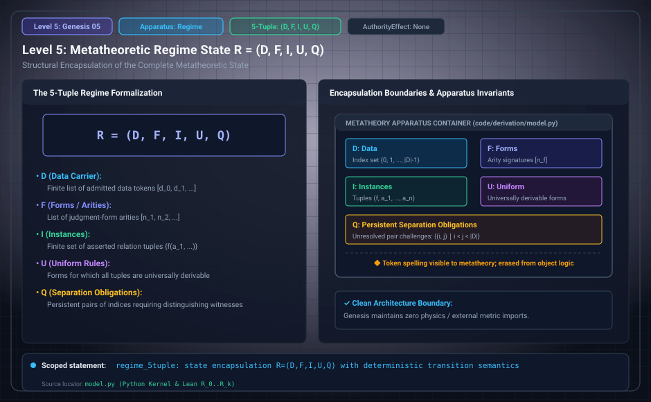

# Level 05: Regime and state

AuthorityEffect: None. Teaching milestone; no identity with an S(n) stage or MSS index.

**Carrier:** Admission R=(D,F,I,U,Q).

**Supplied assumptions:** D/F/I/U/Q and their update rules are metatheoretically declared.

**Statement:** D stores data, F form arities, I instances, U uniform rules, Q separation requirements. This regime is distinct from the later Passage state with observation, budget, license, refusal and halt fields. A physical interpretation is further data.

**Evidence:** SEALED DEFINITION. [Pinned source](https://github.com/dbccpage/19L57G1/blob/f1d56c010e6ba10a3b9418bd7cc5953c067250f2/lean4/Derivation/Basic.lean). Source statements and recorded compilation are distinguished from fresh companion tests.

**Implementation or open obligation:** Do not transport a theorem between Admission, Passage or a domain packet without its map and premises.

See the [current Genesis account](../genesis.md), [all-source crosswalk](../source_crosswalk.md), [selected families](../primitives/README.md) and [actual source adapters](../research_extension/docs/source_fidelity.md).

