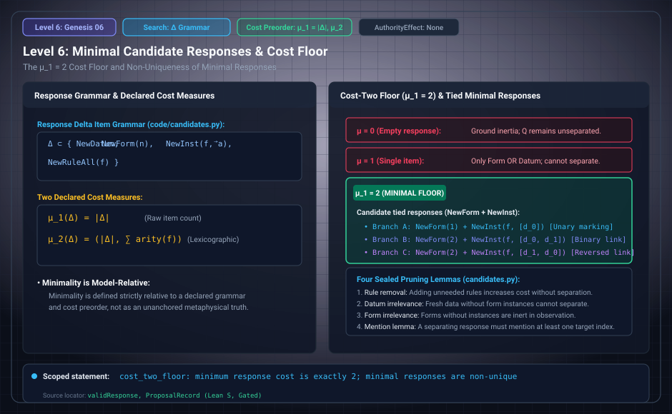

# Level 06: Cost of a separating response

AuthorityEffect: None. Teaching milestone; no identity with an S(n) stage or MSS index.

**Carrier:** Reading L or F with no forms/instances; declared candidate deltas.

**Supplied assumptions:** Use μ1=number of items or lexicographic μ2=(items,sum of new arities).

**Statement:** One item is insufficient under the declare-then-assert grammar; a unary form plus one instance costs two and separates. At item/arity bounds (2,2), μ1 has 6 valid deltas/3 classes for L and 10/5 for F; μ2 has 2/1 for each. Choosing μ2 is a declaration; uniqueness under μ2 is a result. A fresh-name collision in actual augmentation can break renaming equivariance: see the source-fidelity report.

**Evidence:** SEALED THEOREM AND BOUNDED ENUMERATION. [Pinned source](https://github.com/dbccpage/19L57G1/blob/f1d56c010e6ba10a3b9418bd7cc5953c067250f2/paper/paper.md). Source statements and recorded compilation are distinguished from fresh companion tests.

**Implementation or open obligation:** Full canonicalizer soundness and fresh augmentation equivariance are separate obligations.

See the [current Genesis account](../genesis.md), [all-source crosswalk](../source_crosswalk.md), [selected families](../primitives/README.md) and [actual source adapters](../research_extension/docs/source_fidelity.md).

