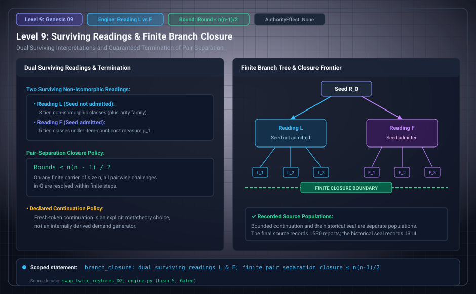

# Level 09: Readings and closure

AuthorityEffect: None. Teaching milestone; no identity with an S(n) stage or MSS index.

**Carrier:** The sealed L/F readings, bounded candidate search and later continuation runs.

**Supplied assumptions:** Retain the reading, grammar, cost, bounds and closure policy.

**Statement:** L and F retain different initial-admission choices. A bounded candidate class, a run stopped by the node guard, and a closed continuation are different objects. The final second run has 288 runs, including 116 not closed at its bound; its class-level census is nevertheless finalized.

**Evidence:** DECLARATIONS AND FINITE COMPUTATION. [Pinned source](https://github.com/dbccpage/19L57G1/blob/f1d56c010e6ba10a3b9418bd7cc5953c067250f2/research/second/paper.md). Source statements and recorded compilation are distinguished from fresh companion tests.

**Implementation or open obligation:** Use the final closeout account rather than treating every open run as unfinished research execution.

See the [current Genesis account](../genesis.md), [all-source crosswalk](../source_crosswalk.md), [selected families](../primitives/README.md) and [actual source adapters](../research_extension/docs/source_fidelity.md).

