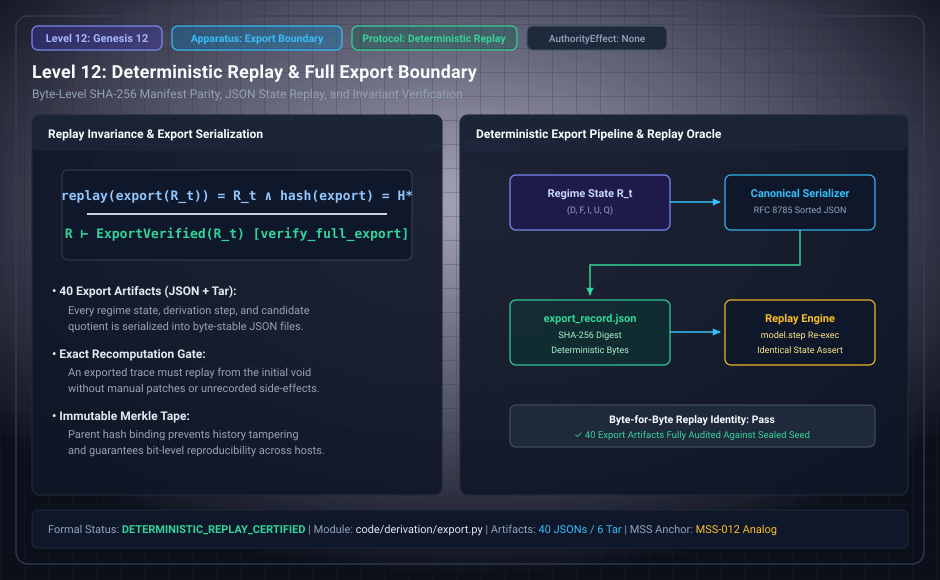

# Level 12: Replay and exported evidence

AuthorityEffect: None. Teaching milestone; no identity with an S(n) stage or MSS index.

**Carrier:** An initial state, ordered events, transition rule and serialized report.

**Supplied assumptions:** Declare the source revision, reading, duplicate convention, bounds and all report fields.

**Statement:** Replay recomputes the endpoint. Byte-identical serialization can detect a mismatch with its bound artifact; it does not prove that a supplied report is semantically correct. The companion now calls actual source certification, search and export verification in a pinned isolated process.

**Evidence:** EXECUTABLE ADAPTER AND HISTORICAL ARTIFACTS. [Pinned source](https://github.com/dbccpage/19L57G1/blob/f1d56c010e6ba10a3b9418bd7cc5953c067250f2/code/derivation/engine.py). Source statements and recorded compilation are distinguished from fresh companion tests.

**Implementation or open obligation:** Exporter/driver refinement to the Lean model is not implied by successful replay or matching hashes.

See the [current Genesis account](../genesis.md), [all-source crosswalk](../source_crosswalk.md), [selected families](../primitives/README.md) and [actual source adapters](../research_extension/docs/source_fidelity.md).

