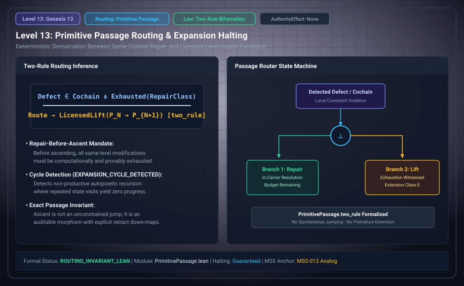

# Level 13: Active obstruction routing

AuthorityEffect: None. Teaching milestone; no identity with an S(n) stage or MSS index.

**Carrier:** The supplied Passage obstruction and two-rule response grammar.

**Supplied assumptions:** A protected requirement, observation and active obstruction are declared.

**Statement:** The remove/build menu is exhaustive for its specified grammar. Removing a protected demand and building a representing witness are different responses; neither label authorizes execution. The theorem is not a classification of every possible solver or model extension.

**Evidence:** SEALED CONDITIONAL THEOREMS. [Pinned source](https://github.com/dbccpage/19L57G1/blob/f1d56c010e6ba10a3b9418bd7cc5953c067250f2/lean4/Derivation/PrimitivePassage.lean). Source statements and recorded compilation are distinguished from fresh companion tests.

**Implementation or open obligation:** Check applicability of every guard before transporting the two-arm menu to an application.

See the [current Genesis account](../genesis.md), [all-source crosswalk](../source_crosswalk.md), [selected families](../primitives/README.md) and [actual source adapters](../research_extension/docs/source_fidelity.md).

