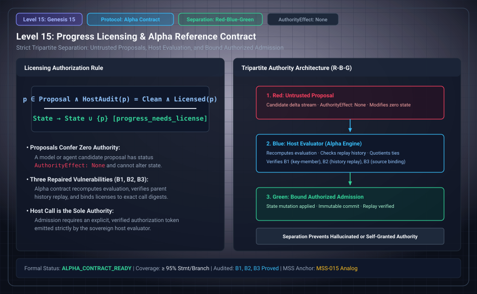

# Level 15: Evaluation and authorization

AuthorityEffect: None. Teaching milestone; no identity with an S(n) stage or MSS index.

**Carrier:** The Alpha reference parent history, evaluated candidate and execution license.

**Supplied assumptions:** Trusted local host; explicit source, target, measure and bounds; identity of the authority is a consumer obligation.

**Statement:** The final repairs bind licenses to those inputs, replay the parent, recompute evaluation, execute the computed member and prevent reuse. They repair substituted members, unreplayable parents and reused licenses. Uniqueness does not authorize execution, and a scope string is not cryptographic authentication.

**Evidence:** REFERENCE IMPLEMENTATION AND RECORDED ATTACK REPAIRS. [Pinned source](https://github.com/dbccpage/19L57G1/blob/f1d56c010e6ba10a3b9418bd7cc5953c067250f2/docs/GENESIS_CLOSEOUT.md). Source statements and recorded compilation are distinguished from fresh companion tests.

**Implementation or open obligation:** Python/Lean driver refinement and Driver B remain open. Preserve the consumer checklist in the current account.

See the [current Genesis account](../genesis.md), [all-source crosswalk](../source_crosswalk.md), [selected families](../primitives/README.md) and [actual source adapters](../research_extension/docs/source_fidelity.md).

