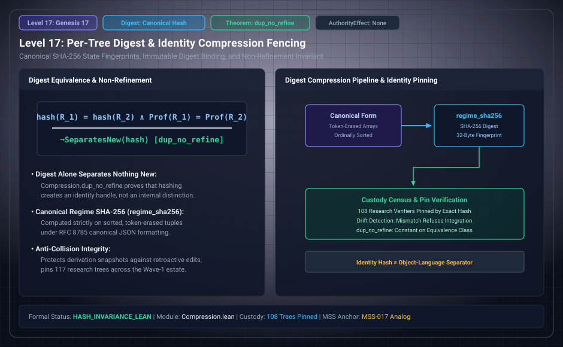

# Level 17: Bytes, digests and retained history

AuthorityEffect: None. Teaching milestone; no identity with an S(n) stage or MSS index.

**Carrier:** Serialized regime/history bytes and a named hash policy.

**Supplied assumptions:** Canonical serialization and its source population are fixed.

**Statement:** Different bytes are not a proof of different SHA-256 hashes, and equal digests are not a mathematical proof of semantic equality. Erasing repeated occurrences can preserve a state while losing history. Preserve those occurrences when replay or future permissions depend on them.

**Evidence:** IMPLEMENTATION CONTRACT. [Pinned source](https://github.com/dbccpage/19L57G1/blob/f1d56c010e6ba10a3b9418bd7cc5953c067250f2/code/derivation/engine.py). Source statements and recorded compilation are distinguished from fresh companion tests.

**Implementation or open obligation:** Bind digest checks to independently verified content; no identity theorem follows solely from a hash.

See the [current Genesis account](../genesis.md), [all-source crosswalk](../source_crosswalk.md), [selected families](../primitives/README.md) and [actual source adapters](../research_extension/docs/source_fidelity.md).

