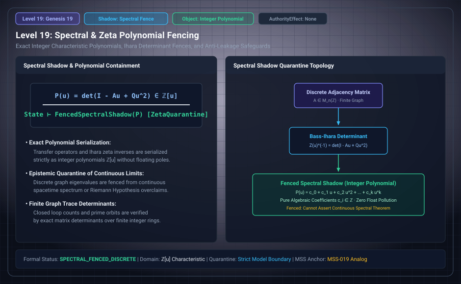

# Level 19: Finite spectral data

AuthorityEffect: None. Teaching milestone; no identity with an S(n) stage or MSS index.

**Carrier:** A supplied finite matrix or polynomial.

**Supplied assumptions:** Declare coefficient ring, operator and observation being computed.

**Statement:** Integer characteristic polynomials and finite spectral invariants have exact algebraic meanings. An analytic zeta function, continuum dynamics or physical spectrum requires further definitions and assumptions. Finite polynomial bookkeeping is not evidence for those extra identifications.

**Evidence:** OPTIONAL-DOMAIN CORRESPONDENCE. [Pinned source](https://github.com/dbccpage/19L57G1/blob/f1d56c010e6ba10a3b9418bd7cc5953c067250f2/docs/section3_claim_corrections.md). Source statements and recorded compilation are distinguished from fresh companion tests.

**Implementation or open obligation:** Validate the chosen matrix construction and retain the model premises.

See the [current Genesis account](../genesis.md), [all-source crosswalk](../source_crosswalk.md), [selected families](../primitives/README.md) and [actual source adapters](../research_extension/docs/source_fidelity.md).

