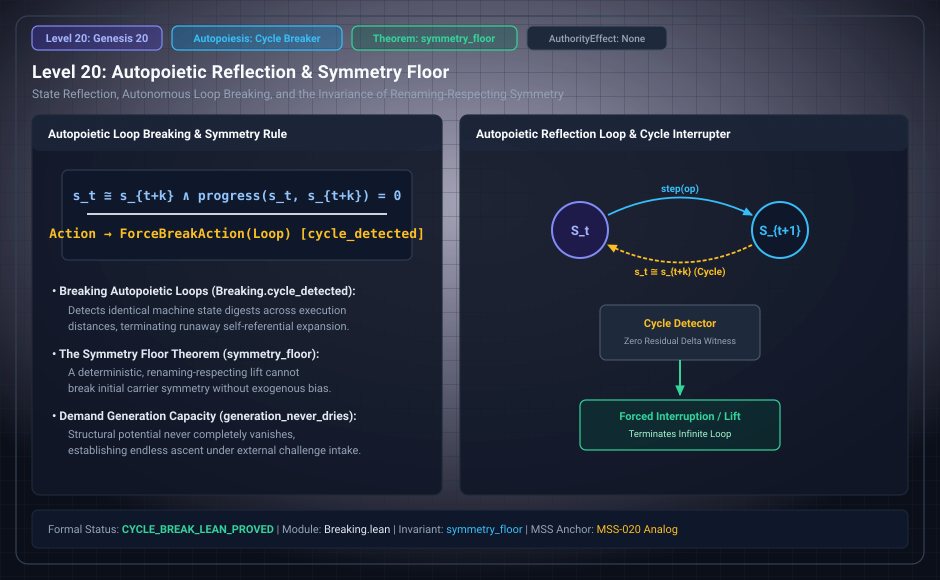

# Level 20: Demand, synthesis and symmetry

AuthorityEffect: None. Teaching milestone; no identity with an S(n) stage or MSS index.

**Carrier:** Supplied reflective and control systems.

**Supplied assumptions:** Declare demand generator, import discipline, action, cost and equivariance premises.

**Statement:** A synthesis routine chooses within a declared language and objective. A supplied policy is not thereby an endogenous demand theorem. The G1 fixed-radius finite-alphabet obstruction is class-relative; unrestricted channels and OB-1 remain open. Boolean negation results do not provide a universal self-predicting machine.

**Evidence:** POST-SEAL CONDITIONAL RESULTS AND OPEN BRIDGES. [Pinned source](https://github.com/dbccpage/19L57G1/blob/f1d56c010e6ba10a3b9418bd7cc5953c067250f2/docs/section3_claim_corrections.md). Source statements and recorded compilation are distinguished from fresh companion tests.

**Implementation or open obligation:** Read the source demand and ignition ledgers before attributing autonomy.

See the [current Genesis account](../genesis.md), [all-source crosswalk](../source_crosswalk.md), [selected families](../primitives/README.md) and [actual source adapters](../research_extension/docs/source_fidelity.md).

