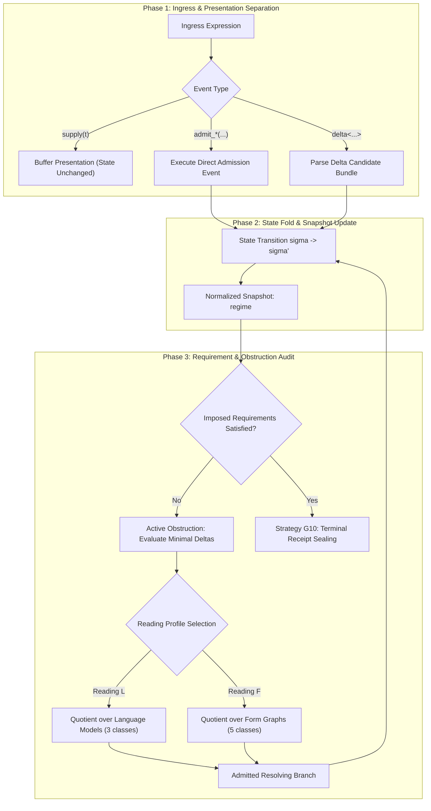

# Formal Rewriting Architecture, Diagrams, and Strategy Definitions over the Genesis / 19L57G1 Substrate (Γ_gen)

**AuthorityEffect:** None.  
**Framework:** Genesis / 19L57G1 Metatheoretic Admission & Proposal Rewriting Architecture.  
**Substrate Alphabet:** $\Gamma_{\text{gen}} = \Sigma_{36} \cup \{<, >, \to, (, ), ,, [, ], ;, :\}$.  
**Normative Status:** Active Architectural Specification and Formal Genesis Rewriting Engine Reference.  
**Companion Documents:**
- [`Genesis Grammar Specification`](../grammar/genesis.ebnf)
- [`001_genesis Strand Reference`](../README.md)
- [`Genesis Source Account & Reading Guide`](../reading_guide.md)
- [`Pre-Genesis Wire Rewriting Strategies`](../../000_pre_genesis/rewriting/rewriting_strategies_pregen_wire.md)
- [`S(n) Wire Rewriting Strategies`](../../002_s_n/rewriting/rewriting_strategies_sn_wire.md)
- [`MSS-N Wire Rewriting Strategies`](../../003_minimal_symbol_system_n_mssn/rewriting/rewriting_strategies_mssn_wire.md)

---

## 1. The Expressive Universe of the Genesis Grammar

The Genesis rewrite universe is governed by `genesis.ebnf`, structuring expressions into four mutually coherent syntactic categories:

1. **Object Language Presentation Tokens:**
   - Ground token: `<>` (uncarved baseline presentation)
   - Supplied mark token: `<a>` (single alphanumeric mark over $\Sigma_{36} = \{a..z, 0..9\}$)
   - Retained pair token: `<ab>` (ordered juxtaposition of two marks without interior delimiters)
   - Directed cut token: `<a->b>` (directed transition cut from source mark to target mark)

2. **Primitive Admission & Metatheoretic Events:**
   - External supply: `supply(t)` (presentation ingress; leaves internal regime state unchanged)
   - Datum admission: `admit_datum(t)` (admits an opaque datum token into the carrier)
   - Form admission: `admit_form(d)` (admits a relational arity form indexed by digit string $d$)
   - Instance admission: `admit_inst(d, [d1, d2, ...])` (admits an instantiated relation tuple)
   - Universal rule admission: `admit_rule_all(d)` (admits a universal rule closure over form $d$)
   - Requirement imposition: `impose(d1, d2)` (imposes an observational requirement constraint)

3. **Candidate Response Items ($\Delta$):**
   - Candidate bundle: `delta<c1; c2; ...>`
   - Primitive candidate items: `NewDatum`, `NewForm(d)`, `NewInst(d, [...])`, `NewRuleAll(d)`

4. **Regime State Snapshot:**
   - Canonical 4-coordinate register: `regime<data:d, forms:f, insts:i, rules:r>`

### 1.1 The Presentation versus Admission Duality

A cardinal principle of the Genesis architecture is the non-identity of presentation and admission:
- Presenting a string via `supply(t)` does **not** alter the admitted state register $\mathcal{S}$.
- An inscription becomes an active internal entity only through an explicit `admit_datum(t)` event or candidate response item `NewDatum`.
- Claims about what is forced must declare the governing regime state, admitted candidate items, cost measures, and quotient conventions.

### 1.2 Reading Profiles: Reading L versus Reading F

Genesis derivations distinguish two fundamental reading profiles:
- **Reading L (Language / Relational Quotient):** Evaluates minimal response candidates modulo language equivalence. Focuses on distinct relational models and observable distinctions.
- **Reading F (Form Structural Multiplicity):** Evaluates minimal response candidates with structural counting of form and instance entities.
Under tied minimal cost measures, the first nontrivial requirement admits multiple non-isomorphic candidate continuations: three under Reading L (plus an infinite family indexed by arity), and five under Reading F.

---

## 2. Formal Mathematical Definitions of Genesis Rewriting

### Definition 2.1 (The Genesis Regime State Monoid $\mathcal{S}_{\text{gen}}$)
A Genesis regime state $\sigma \in \mathcal{S}_{\text{gen}}$ is a 4-tuple:

$$\sigma = (D, F, I, R)$$

where:
- $D \subset \mathcal{D}$ is the set of admitted data tokens ($|D| = d$)
- $F \subset \mathcal{F}$ is the set of admitted relational forms ($|F| = f$)
- $I \subset \mathcal{I}$ is the set of admitted form instances ($|I| = i$)
- $R \subset \mathcal{R}$ is the set of admitted universal rules ($|R| = r$)

The wire encoding of $\sigma$ is the canonical snapshot:

$$\operatorname{wire}(\sigma) = \texttt{"regime<data:"} \mathbin{\Vert} d \mathbin{\Vert} \texttt{",forms:"} \mathbin{\Vert} f \mathbin{\Vert} \texttt{",insts:"} \mathbin{\Vert} i \mathbin{\Vert} \texttt{",rules:"} \mathbin{\Vert} r \mathbin{\Vert} \texttt{">"}$$

### Definition 2.2 (Elementary Event Transitions)
An elementary Genesis event $e$ induces a deterministic transition $\sigma \xrightarrow{e} \sigma'$:

1. $\sigma \xrightarrow{\text{supply}(t)} \sigma$ (Identity transition; presentation does not mutate state).
2. $(D, F, I, R) \xrightarrow{\text{admit\_datum}(t)} (D \cup \{t\}, F, I, R)$ if $t \notin D$ (deduplicated).
3. $(D, F, I, R) \xrightarrow{\text{admit\_form}(k)} (D, F \cup \{k\}, I, R)$.
4. $(D, F, I, R) \xrightarrow{\text{admit\_inst}(k, [v_1, \dots, v_m])} (D, F, I \cup \{(k, [v_1, \dots, v_m])\}, R)$.
5. $(D, F, I, R) \xrightarrow{\text{admit\_rule\_all}(k)} (D, F, I, R \cup \{k\})$.

### Definition 2.3 (Candidate Delta Response Rewriting)
A candidate delta response $\Delta = \langle c_1, \dots, c_m \rangle$ is an ordered sequence of candidate items. Rewriting under $\Delta$ executes the sequential fold:

$$\sigma \xrightarrow{\Delta} \sigma' = c_m( \dots (c_1(\sigma)) \dots )$$

where each $c_j$ applies the corresponding admission constructor (`NewDatum`, `NewForm`, `NewInst`, `NewRuleAll`).

### Definition 2.4 (Requirement Imposition & Obstruction Predicates)
An imposed requirement $\operatorname{impose}(d_1, d_2)$ asserts a behavioural constraint between form structures or observable profiles.
- Let $\operatorname{Sat}(\sigma, \operatorname{impose}(d_1, d_2)) \in \{\text{true}, \text{false}\}$ be the verification predicate.
- If $\operatorname{Sat}(\sigma, \operatorname{impose}(d_1, d_2)) = \text{false}$, the state exhibits an **active obstruction**.
- A candidate response $\Delta$ is admissible for the obstruction if and only if $\operatorname{Sat}(\Delta(\sigma), \operatorname{impose}(d_1, d_2)) = \text{true}$.

### Definition 2.5 (Reading Quotients $\mathcal{Q}_L$ and $\mathcal{Q}_F$)
Let $\mathcal{C}$ be the set of admissible candidate responses satisfying an obstruction.
1. Two candidates $\Delta_1, \Delta_2 \in \mathcal{C}$ are isomorphic under **Reading L** ($\Delta_1 \equiv_L \Delta_2$) if their resulting regimes induce isomorphic language theories over the admitted data.
2. Two candidates are isomorphic under **Reading F** ($\Delta_1 \equiv_F \Delta_2$) if their form and instance graphs admit a label-preserving graph isomorphism.
The quotient spaces satisfy $|\mathcal{C} / \equiv_L| \le |\mathcal{C} / \equiv_F|$.

### Definition 2.6 (Tied Minimal Response Branching)
Let $\mu: \mathcal{C} \to \mathbb{N}$ be a declared complexity or cost measure (e.g., total item count $|\Delta|$). The set of minimal candidates is:

$$\mathcal{C}_{\min} = \arg\min_{\Delta \in \mathcal{C}} \mu(\Delta)$$

If $|\mathcal{C}_{\min} / \equiv| > 1$, the minimal continuation is not uniquely forced. The rewrite system must either branch over all minimal equivalence classes or require a finer declared tie-breaking measure.

### Definition 2.7 (Universal Irreflexivity & The Rent Rule Invariant)
When universal irreflexivity is imposed on a binary relation form $R$, the diagonal instance $(a, a)$ is forbidden:

$$\forall a \in D, \quad (R, [a, a]) \notin I$$

Any rewrite candidate attempting to admit a diagonal self-loop under an irreflexive policy triggers an immediate fail-closed refusal `ERR_DIAGONAL_VIOLATION`.

---

## 3. Comprehensive Rewriting Diagrams

### Diagram 3.1: Macro Genesis Admission & Delta Rewriting Pipeline

```text
+---------------------------------------------------------------------------------------------------------+
|                                    GENESIS ADMISSION & DELTA PIPELINE                                   |
+---------------------------------------------------------------------------------------------------------+
|                                                                                                         |
|   +--------------------------+                                                                          |
|   | External Ingress Stream  |   supply(t), raw tokens, or task statements                              |
|   +-------------+------------+                                                                          |
|                 |                                                                                       |
|                 v  [Strategy G1: Presentation vs Admission Separation]                                  |
|   +--------------------------+   supply(t) leaves state unchanged                                       |
|   | Presentation Buffer      |   Requires explicit admission event or Delta item                        |
|   +-------------+------------+                                                                          |
|                 |                                                                                       |
|                 v  [Strategy G2: Candidate Delta Application]                                           |
|   +--------------------------+   Applies: NewDatum, NewForm, NewInst, NewRuleAll                        |
|   | Delta Transition Fold    |   sigma_{k+1} = Delta(sigma_k)                                           |
|   +-------------+------------+                                                                          |
|                 |                                                                                       |
|                 v  [Strategy G3: Regime Snapshot Normalization]                                         |
|   +--------------------------+                                                                          |
|   | Regime State Snapshot    |   regime<data:d, forms:f, insts:i, rules:r>                              |
|   +-------------+------------+                                                                          |
|                 |                                                                                       |
|                 v  [Strategy G8: Impose Requirement Audit]                                              |
|   +-------------------------------------------------------------------+                                 |
|   |                     REQUIREMENT SATISFACTION AUDIT                |                                 |
|   |                                                                   |                                 |
|   |   Are all impose(d1, d2) requirements satisfied by sigma_{k+1}?   |                                 |
|   +------------------+--------------------------------+---------------+                                 |
|                      |                                |                                                 |
|         [Satisfied / No Obstruction]                  | [Unsatisfied / Active Obstruction]              |
|                      |                                |                                                 |
|                      v                                v                                                 |
|   +------------------------------------+   +------------------------------------+                       |
|   | Minimal Candidate Branching Check  |   | Candidate Generation Loop          |                       |
|   | [Strategy G9: Reading L / F]       |   | Search for resolving Delta         |                       |
|   +------------------+-----------------+   +------------------------------------+                       |
|                      |                                                                                  |
|                      v  [Strategy G10: Terminal Receipt Sealing]                                        |
|   +------------------------------------+                                                                |
|   | Certified Genesis Regime Receipt:  |                                                                |
|   | <<cert><regime><receipt>>>         |                                                                |
|   +------------------------------------+                                                                |
|                                                                                                         |
+---------------------------------------------------------------------------------------------------------+
```



---

### Diagram 3.2: Reading L vs Reading F Quotient Branching

```text
                                  Imposed Requirement Obstruction
                                                 |
                                                 v
                                  Candidate Search Space (Delta)
                                                 |
                         +-----------------------+-----------------------+
                         |                                               |
                         v                                               v
                 Reading L Evaluation                            Reading F Evaluation
             (Language Relational Quotient)                  (Form Structural Multiplicity)
                         |                                               |
          +--------------+--------------+                 +--------------+--------------+
          |              |              |                 |    |    |    |    |         |
          v              v              v                 v    v    v    v    v         v
       Class L1       Class L2       Class L3            F1   F2   F3   F4   F5      (Higher
     (3 tied min)   (3 tied min)   (3 tied min)        (5 tied under item count)      Arities)
```

---

## 4. Comprehensive Strategy Inventory (G1 through G10)

```text
+----------------------------------------------------------------------------------------------------------+
|                                      GENESIS STRATEGY DISPATCH MATRIX                                    |
+-----+----------------------------+-----------------------+-----------------------+-----------------------+
| ID  | Name                       | Target Stratum        | Input Pattern         | Output Form           |
+-----+----------------------------+-----------------------+-----------------------+-----------------------+
| G1  | Presentation-Admission Br. | Stratum 1 (Event)     | `supply(t)`           | `admit_datum(t)` lift |
| G2  | Candidate Delta Fold       | Stratum 2 (Delta)     | `delta<items>`        | Transitioned state    |
| G3  | Snapshot Normalization     | Stratum 2 (Regime)    | Raw counter tuple     | Canonical snapshot    |
| G4  | Reading L Reduction        | Stratum 3 (Quotient)  | Candidate set         | L-isomorphism classes |
| G5  | Reading F Reduction        | Stratum 3 (Quotient)  | Candidate set         | F-isomorphism classes |
| G6  | Directed Cut Formation     | Stratum 1 (Token)     | `admit_inst(k,[a,b])` | Cut `<a->b>`          |
| G7  | Occurrence Deduplication   | Stratum 2 (Regime)    | Repeated token        | Dedup vs Occur split  |
| G8  | Impose Requirement Audit   | Stratum 3 (Contract)  | `impose(d1, d2)`      | Satisfied or Defect   |
| G9  | Minimal Branch Selection   | Stratum 3 (Decision)  | Tied minimal set      | Selected branch / fork|
| G10 | Terminal Receipt Sealing   | Stratum 4 (Protocol)  | Irreducible regime    | Certified receipt     |
+-----+----------------------------+-----------------------+-----------------------+-----------------------+
```

---

### Strategy G1: Presentation-Admission Bridge
- **Target Stratum:** Stratum 1 (Event Stream).
- **Trigger Precondition:** An external presentation `supply(t)` arrives and caller requests internal carrier participation.
- **Redex Pattern:** `supply(t)`.
- **Rewrite Rule:**
  $$\text{supply}(t) \quad \xrightarrow{\text{G1}} \quad \langle\langle\text{presentation}\rangle \langle t \rangle\rangle \mathbin{\Vert} \text{admit\_datum}(t)$$
- **Operational Invariant:** `supply(t)` alone does not increment the datum counter $d$. Increment occurs only upon successful evaluation of `admit_datum(t)`.

---

### Strategy G2: Candidate Delta Application
- **Target Stratum:** Stratum 2 (Delta State Fold).
- **Trigger Precondition:** A candidate response packet `delta<c1; c2; ...>` is admitted for execution against current regime state $\sigma$.
- **Redex Pattern:** $\operatorname{apply}(\sigma, \texttt{"delta<"} c_1 \mathbin{;} \dots \mathbin{;} c_m \texttt{>"})$.
- **Rewrite Rule:**
  $$\sigma \quad \xrightarrow{\text{G2}} \quad c_m( \dots (c_1(\sigma)) \dots )$$
- **Operational Invariant:** All items in the bundle must be valid candidate constructors (`NewDatum`, `NewForm`, `NewInst`, `NewRuleAll`). Execution is atomic and rolls back fail-closed on constraint violation.

---

### Strategy G3: Regime Snapshot Normalization
- **Target Stratum:** Stratum 2 (Regime Snapshot).
- **Trigger Precondition:** An updated regime state $\sigma = (D, F, I, R)$ requires serialization to wire.
- **Redex Pattern:** Internal state tuple $(|D|, |F|, |I|, |R|)$.
- **Rewrite Rule:**
  $$(d, f, i, r) \quad \xrightarrow{\text{G3}} \quad \texttt{"regime<data:"} \mathbin{\Vert} d \mathbin{\Vert} \texttt{",forms:"} \mathbin{\Vert} f \mathbin{\Vert} \texttt{",insts:"} \mathbin{\Vert} i \mathbin{\Vert} \texttt{",rules:"} \mathbin{\Vert} r \mathbin{\Vert} \texttt{">"}$$
- **Operational Invariant:** Counters are non-negative monotonically increasing integers formatted strictly without extraneous spaces.

---

### Strategy G4: Reading L Isomorphism Quotient Reduction
- **Target Stratum:** Stratum 3 (Language Quotient).
- **Trigger Precondition:** Multiple candidate delta bundles are evaluated under Reading L.
- **Redex Pattern:** Candidate set $\{\Delta_1, \dots, \Delta_k\}$.
- **Rewrite Rule:**
  $$\{\Delta_1, \dots, \Delta_k\} \quad \xrightarrow{\text{G4}} \quad \{ [\Delta]_L \mid \Delta \in \mathcal{C} / \equiv_L \}$$
- **Operational Invariant:** Partitions candidates by observable relational language models; collapses syntactically distinct representations that induce identical theories.

---

### Strategy G5: Reading F Multiplicity Normalization
- **Target Stratum:** Stratum 3 (Form Structure).
- **Trigger Precondition:** Candidates evaluated under Reading F for structural form counting.
- **Redex Pattern:** Candidate set $\{\Delta_1, \dots, \Delta_k\}$.
- **Rewrite Rule:**
  $$\{\Delta_1, \dots, \Delta_k\} \quad \xrightarrow{\text{G5}} \quad \{ [\Delta]_F \mid \Delta \in \mathcal{C} / \equiv_F \}$$
- **Operational Invariant:** Preserves form entity multiplicities; distinguishes relational structures with differing internal form allocations.

---

### Strategy G6: Directed Cut Formation
- **Target Stratum:** Stratum 1 (Token Inscription).
- **Trigger Precondition:** An instance of a binary relation form $k$ between data tokens $a$ and $b$ is admitted.
- **Redex Pattern:** $\text{admit\_inst}(k, [a, b])$.
- **Rewrite Rule:**
  $$\text{admit\_inst}(k, [a, b]) \quad \xrightarrow{\text{G6}} \quad \langle a \to b \rangle$$
- **Operational Invariant:** The cut token $\langle a \to b \rangle$ serves as the bridge between Genesis relational instances and the $S(n)$ Stage 3 directed cut presentation.

---

### Strategy G7: Deduplication and Occurrence Splitting
- **Target Stratum:** Stratum 2 (Regime State).
- **Trigger Precondition:** An admission event targets a token string that already exists in $D$.
- **Redex Pattern:** $\text{admit\_datum}(t)$ where $t \in D$.
- **Rewrite Rule:**
  - Under *deduplication policy:* $\sigma \to \sigma$ (no duplicate datum added; counter $d$ unchanged).
  - Under *occurrence policy:* $\sigma \to (D \cup \{t_{\text{fresh}}\}, F, I, R)$ (distinct occurrence admitted with fresh internal address).
- **Operational Invariant:** The active policy (dedup vs occurrence) must be declared in the regime header. Silent policy switching is prohibited.

---

### Strategy G8: Impose Requirement Satisfaction Audit
- **Target Stratum:** Stratum 3 (Contract Enforcement).
- **Trigger Precondition:** An impose directive `impose(d1, d2)` is evaluated against regime state $\sigma$.
- **Redex Pattern:** $\operatorname{check}(\sigma, \text{impose}(d_1, d_2))$.
- **Rewrite Rule:**
  $$\operatorname{check}(\sigma, \text{impose}(d_1, d_2)) \quad \xrightarrow{\text{G8}} \quad \begin{cases}
  \langle\langle\text{status}\rangle \langle\text{satisfied}\rangle\rangle & \text{if } \operatorname{Sat}(\sigma) \\
  \langle\langle\text{obstruction}\rangle \langle d_1 \rangle \langle d_2 \rangle\rangle & \text{otherwise}
  \end{cases}$$
- **Operational Invariant:** Evaluates fail-closed; active obstructions block terminal certification.

---

### Strategy G9: Minimal Response Branch Selection
- **Target Stratum:** Stratum 3 (Decision Protocol).
- **Trigger Precondition:** Multiple minimal candidate responses tie under the declared cost measure $\mu$.
- **Redex Pattern:** $\mathcal{C}_{\min} = \{\Delta_1, \dots, \Delta_m\}$ with $m > 1$.
- **Rewrite Rule:**
  $$\mathcal{C}_{\min} \quad \xrightarrow{\text{G9}} \quad \langle\langle\text{fork}\rangle \langle\Delta_1\rangle \dots \langle\Delta_m\rangle\rangle \quad \text{or} \quad \Delta^* \text{ under declared tie-breaker}$$
- **Operational Invariant:** Prevents claiming that one arbitrary minimal branch is uniquely forced by the seed. The existence of tied alternatives must be recorded.

---

### Strategy G10: Sealed Regime Terminal Receipt
- **Target Stratum:** Stratum 4 (Protocol Coordination).
- **Trigger Precondition:** All imposed requirements are satisfied, no active redexes remain, and regime state is quiescent.
- **Redex Pattern:** Quiescent regime state $\sigma_{\text{final}}$.
- **Rewrite Rule:**
  $$\sigma_{\text{final}} \quad \xrightarrow{\text{G10}} \quad \langle\langle\text{cert}\rangle \langle\operatorname{wire}(\sigma_{\text{final}})\rangle \langle\text{receipt}\rangle\rangle$$
- **Operational Invariant:** Seals the evaluated regime state into an immutable verification receipt carrying `AuthorityEffect: None`.

---

## 5. Concrete Worked Rewriting Traces

### Trace 1: From Ground Presentation to Admitted Mark and Pair
**Initial State:** Regime is unpopulated:
```text
regime<data:0,forms:0,insts:0,rules:0>
```
**Step 1:** External presentation arrives:
```text
supply(<>)
```
Apply Strategy G1: State remains unchanged:
```text
regime<data:0,forms:0,insts:0,rules:0>
```
**Step 2:** Caller issues datum admission for mark `a`:
```text
admit_datum(<a>)
```
Apply Strategy G2 / G3:
```text
regime<data:1,forms:0,insts:0,rules:0>
```
**Step 3:** Caller issues datum admission for mark `b`:
```text
admit_datum(<b>)
```
Apply Strategy G3:
```text
regime<data:2,forms:0,insts:0,rules:0>
```
**Step 4:** Caller admits binary form (arity 2):
```text
admit_form(2)
```
Apply Strategy G3:
```text
regime<data:2,forms:1,insts:0,rules:0>
```
**Step 5:** Caller instantiates relation between `a` and `b`:
```text
admit_inst(1,[1,2])
```
Apply Strategy G6: Generates directed cut `<a->b>`:
```text
regime<data:2,forms:1,insts:1,rules:0>
```
**Terminal State:**
```text
regime<data:2,forms:1,insts:1,rules:0>
```
*Receipt:* `<<cert><regime<data:2,forms:1,insts:1,rules:0>><<tokens><<a>><b>><<cut><a->b>>>>`

---

### Trace 2: Candidate Delta Execution Resolving Imposed Requirement
**Initial State:**
```text
regime<data:2,forms:1,insts:0,rules:0>
```
**Imposed Requirement:** Require connected instance between datum 1 and datum 2:
```text
impose(1,2)
```
Audit (Strategy G8): No instances exist ($i=0$). `Sat` fails $\implies$ Active Obstruction.
**Admitted Candidate Delta:**
```text
delta<NewInst(1,[1,2])>
```
Apply Strategy G2 (Candidate Delta Fold):
1. Execute `NewInst(1,[1,2])`: $i \leftarrow 0 + 1 = 1$.
2. State updates to:
   ```text
   regime<data:2,forms:1,insts:1,rules:0>
   ```
3. Re-audit `impose(1,2)`: Instance $(1,[1,2])$ is present $\implies$ `Sat` is true.
4. Obstruction discharged.
**Terminal State:**
```text
regime<data:2,forms:1,insts:1,rules:0>
```

---

### Trace 3: Reading L vs Reading F Divergence on Tied Minimal Response
**Context:** First nontrivial separability requirement on a binary relation.
**Candidate Search:** Under cost measure $\mu = \text{total items in } \Delta$:
- Minimal cost $\mu^* = 3$ items.
- Multiple candidate bundles achieve $\mu^* = 3$:
  - $\Delta_A$: `delta<NewDatum; NewInst(1,[1,2]); NewInst(1,[2,1])>`
  - $\Delta_B$: `delta<NewForm(2); NewInst(2,[1,1]); NewDatum>`
  - $\Delta_C$: `delta<NewRuleAll(1); NewDatum; NewInst(1,[1,2])>`
**Evaluation under Reading L (Strategy G4):**
- $\Delta_A$ and $\Delta_B$ evaluate to distinct language theories.
- Evaluator partitions minimal responses into **three non-isomorphic classes**.
**Evaluation under Reading F (Strategy G5):**
- Distinguishes internal form allocations.
- Evaluator partitions minimal responses into **five non-isomorphic classes**.
**Conclusion:**
Evaluator records that no single continuation is uniquely forced by the initial regime, documenting the fork explicitly via Strategy G9.

---

## 6. Anti-Patterns and Refusal Catalog

| Anti-Pattern ID | Name | Violation Description | Evaluator Error Code |
|---|---|---|---|
| **AP-GEN01** | Presentation-Admission Conflation | Mutating regime state upon `supply(t)` without explicit admission. | `ERR_SUPPLY_STATE_MUTATION` |
| **AP-GEN02** | Unlicensed Diagonal Loop | Admitting self-loop instance $(R, [a, a])$ under irreflexive policy. | `ERR_DIAGONAL_VIOLATION` |
| **AP-GEN03** | Counter Regression | Decrementing or irregularly formatting snapshot counters. | `ERR_REGIME_COUNTER_REGRESSION` |
| **AP-GEN04** | Unearned Emergence Claim | Asserting that a candidate continuation is uniquely forced when tied alternatives exist. | `ERR_UNEARNED_UNIQUENESS` |
| **AP-GEN05** | Silent Quotient Collapse | Evaluating candidates without declaring whether Reading L or Reading F governs. | `ERR_UNDECLARED_READING_PROFILE` |
| **AP-GEN06** | Smuggled Arity Form | Instantiating relation tuple without prior `admit_form` or `NewForm`. | `ERR_UNADMITTED_FORM_ARITY` |
| **AP-GEN07** | Opaque Token Decomposition | Attempting to parse interior elements of `<a>` or `<ab>` prior to formal relational admission. | `ERR_UNLICENSED_DECOMPOSITION` |
| **AP-GEN08** | Unchecked Obstruction Seal | Emitting terminal certificate while an imposed requirement remains unsatisfied. | `ERR_UNSATISFIED_OBSTRUCTION` |

---

## 7. Claim Hygiene Quadrant

In accordance with the workspace Claim Hygiene Rule, the claims supported by this document are explicitly bounded:

1. **What this document supports:**
   - Formalizes the rewriting rules, transitions, and state representation for the Genesis grammar (`genesis.ebnf`).
   - Defines ten explicit rewrite strategies (G1 through G10) governing admission events, candidate delta applications, snapshot normalization, reading profiles, and terminal sealing.
   - Formulates exact mathematical definitions for the regime state monoid $\mathcal{S}_{\text{gen}}$, delta folds, requirement satisfaction, and tied minimal response branching.
   - Preserves the separation of presentation from internal admission, and documents the divergence between Reading L and Reading F.

2. **What this document does not support:**
   - Does not claim that Genesis constitutes an emergence model of physical reality.
   - Does not claim that any single minimal continuation is uniquely forced without an external, declared selection measure.
   - Does not mint authority or self-certify correctness (`AuthorityEffect: None`).

3. **The narrowest defensible claim:**
   - Under the declared assumptions of `genesis.ebnf` and the pinned Genesis derivation records, strategies G1–G10 provide a deterministic, checkable rewrite specification for state transitions and candidate evaluations over $\Gamma_{\text{gen}}$.

4. **The next test needed:**
   - Run `py -3.12 omega_engine_education/documentation/001_genesis/code/check_genesis.py` to confirm grammar conformance across all Genesis starts.

---

## 8. Pilot Grounding & Ingress Rewrite Integration (Rewrite 08)

In the empirical benchmark harness [`omega_engine_pfp/tests/pilot_0000000`](../../../../omega_engine_pfp/tests/pilot_0000000), Genesis metatheoretic admission and candidate stream syntax is evaluated as Ingress Dialect `rewrite_08` (`seed_rewrite_08.yaml` and `p_star_rewrite_08.yaml`):

```text
delta<NewDatum;NewDatum;NewForm(1);NewForm(2);NewInst(1,[1,2]);NewInst(2,[3,1]);NewRuleAll(1)>
```

- **Governing Strategy:** Strategy G2 (Candidate Delta Application) and Strategy G8 (Impose Requirement Audit).
- **Dialect Tier:** Genesis Delta Wire (`genesis-delta-v1`).
- **Semantic Carrier:** `LinearSystem(dimension=2, field=Rational)` encoded via two datum tokens, two relational forms, two coefficient instances ($[1, 2]$ for $x + 2y = 5$ and $[3, 1]$ for $3x - y = 1$), and one closure rule.
- **Trace Diagnostic:** Without operator licensing or schema-level answer channels, raw scratchpads exhibit antiskill `antiskill_ghost_hypothesis_stack` (up to 105 conjecture markers in `rewrite_08_plain`). Under $P^*$ compilation, the prompt template binds the candidate stream within the SPK-001 policy envelope.

