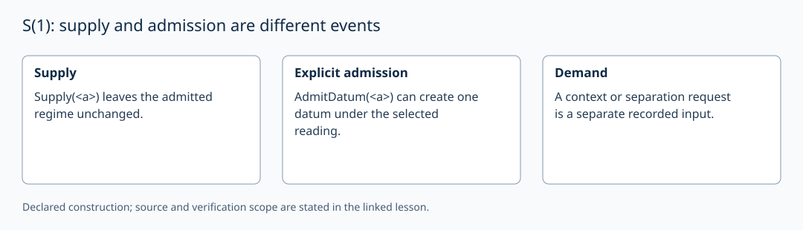

# S(1): supply and admission are different events

AuthorityEffect: None. [Source correspondence and proof scope](../source_correspondence.md).

The external inscription `<a>` is one opaque token. `Supply(<a>)` alone
leaves the admitted regime unchanged. An explicit `AdmitDatum(<a>)` may create
one admitted datum under the selected admission reading. Renaming its external
label preserves this example's admitted structure.

The source proves that no admitted instances implies collapse of all data
profiles, even when uniform rules are present (`collapsed_of_no_insts`).
This does not say that the mere arrival of a mark issues a demand for context.
Such a demand must be recorded separately.

In the local Python example `supply_mark` leaves the empty admitted carrier
empty; `admit_mark` explicitly returns a singleton. The field s₁=1 is a
chosen ledger value. It applies only to the exercise that issues the demand
`obs_unconsumed_mark`; it is not inferred from singleton cardinality.

A singleton can be represented by a vertex. In ordinary simplicial chains
∂₀[a]=0. An augmented complex may instead use ε([a])=1 in its degree −1
coefficient group. That augmentation is additional mathematical data.
