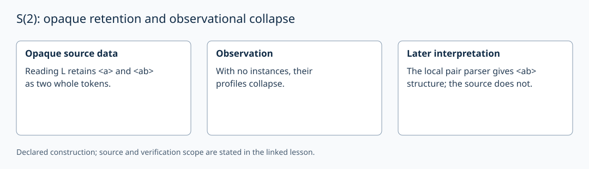

# S(2): opaque retention and observational collapse

AuthorityEffect: None. [Source correspondence and proof scope](../source_correspondence.md).

In reading L, the source admits the opaque wholes `<a>` and `<ab>`.
In reading F it also retains `<>`. `R2L_collapsed` and `R2F_collapsed` show
that the specified data remain observationally collapsed before distinguishing
instances are admitted. The source does not decompose `<ab>` into a and b.

Write x and y for two distinct admitted datum indices. Their metatheoretic
distinctness and their identical internal observation profiles are compatible.
A permutation of an instance-less, requirement-less pair preserves that
structure. This is not an admitted directed relation x→y.

The later flat grammar `sn.ebnf` parses `<ab>` as a pair of glyphs. This is a
new interpretation with a stated parser. It must be distinguished from the
opaque source token, even though the bytes agree.

A collapse becomes an obstruction when a supplied question or separation
requirement demands different answers. The ledger example sets W₂ to one
collapsed-pair demand and s₂=1. Retaining a second token by itself does not
prove that a prior context demand was discharged. With deduplicated admission,
adding one fresh datum to a singleton costs one new datum, not two; two is
the resulting carrier cardinality.

A graph with two vertices and no edges, or its permutation representation
on a two-dimensional rational vector space, is an explicit mathematical
representation of the pair. Its structure is declared by that representation.
