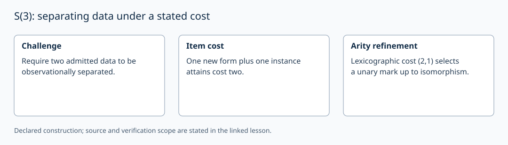

# S(3): separating data under a stated cost

AuthorityEffect: None. [Source correspondence and proof scope](../source_correspondence.md).

Fix the source challenge that requires the admitted opaque data `<a>` and
`<ab>` to have different positive-derivability profiles. Assume the initial
regime has no forms or instances. Count each admitted item once.

At most one item cannot separate the pair: a form alone creates no selective
instance, and an instance cannot be admitted without its form. The source's
`cost1_insufficient_general` covers its precise response grammar. One new
unary form plus its instance at one endpoint attains cost two.

Binary and higher-arity forms can also yield two-item separating responses.
Thus item-count minimality does not determine one form. With lexicographic
cost (item count, new-form arity sum), the unary response has `(2,1)`.
`mu2_unique` proves the reading-L uniqueness up to source isomorphism;
`mu2_unique_F` treats reading F under its own hypotheses. This result concerns
a unary distinguishing instance, not a uniquely forced binary edge.

The local Python `S3Separation.cost_floor` is a fixture parameter. Testing
that it equals two does not reprove the source minimality theorem.

After separating the only pair, no unresolved separation demand remains on
that pair. The example ledger's s₃=1 requires a separately issued closure
audit or another outstanding demand. It is not a consequence of separation.

If a directed irreflexive edge is chosen as an interpretation, its endpoints
are distinct. A single witness can certify it. In the simplicial interpretation
∂₁[x,y]=[y]−[x]; coefficients, orientation and boundary are supplied explicitly.
