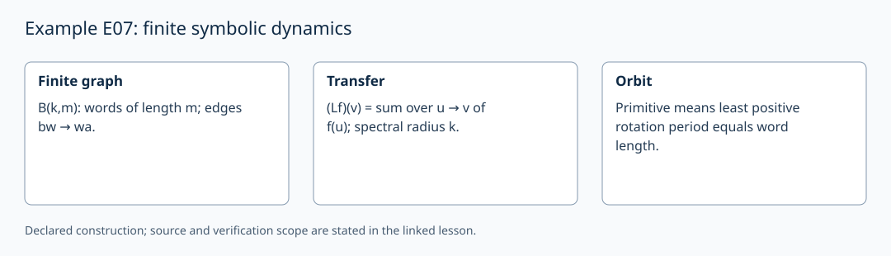

# Example E07: finite symbolic dynamics

AuthorityEffect: None. [Source correspondence and proof scope](../source_correspondence.md).

Choose an alphabet Σ of size k≥2 and a word length m≥1. The de Bruijn graph
B(k,m) has vertices Σ^m and edges bw→wa for each b,a∈Σ and w∈Σ^(m−1).
Its unweighted transfer operator on rational functions is

\[
(Lf)(v)=\sum_{u\to v} f(u).
\]

Every vertex has k incoming and k outgoing edges. Hence L1=k1 and the
spectral radius is k (the row-sum norm bounds it above). L/k is a Markov
operator in this chosen finite model. The transpose is a linear adjoint for
the standard inner product, not an inverse.

For a nonempty cyclic word w, its least rotation period is
min{j≥1:σ^j(w)=w}. It is primitive exactly when that period is |w|. Choose
the least cyclic rotation as a representative once an alphabet order is given.
Different primitive orbits may share every edge; requiring a new edge for
each orbit would discard valid orbits and is not a primitive-orbit criterion.

The local implementation `debruijn_shift` computes one word shift. The old
name `Evaluator::DeBruijnAuditor` and twelve-check list were proposed work,
not execution evidence. A full orbit verifier must check the actual graph,
closure, minimal period and representation convention. This model supplies
no new Genesis stage merely from its filename's number.
