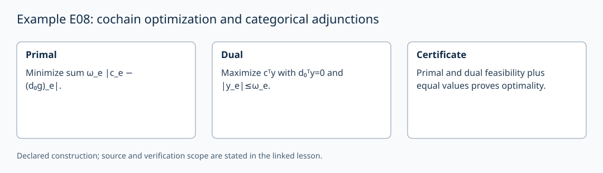

# Example E08: cochain optimization and categorical adjunctions

AuthorityEffect: None. [Source correspondence and proof scope](../source_correspondence.md).

These are two separately declared constructions. For finite rational
cochain spaces and d₀:C⁰→C¹, take positive rational weights ω_e. Then

\[
\min_g\sum_e\omega_e|c_e-(d_0g)_e|
=\max_{d_0^Ty=0,\ |y_e|\le\omega_e}c^Ty.
\]

This is finite linear-programming duality for the stated feasible bounded
problem. Matching primal and dual feasible values certify optimality. An ℓ¹
minimizer need not be unique and is not in general the ℓ² harmonic residual.
[Example E18](level_18_discrete_hodge_decomposition.md) displays both for one
triangle. Evaluation belongs in the existing mathematics and functional owners;
this page does not introduce an alternative evaluator.

A categorical adjunction instead consists of functors F:C→D and G:D→C,
a unit η:Id_C⇒GF and counit ε:FG⇒Id_D satisfying the triangle identities.
It induces the monad GF with multiplication GεF. These categorical maps are
not the matrix pair d₀,d₀ᵀ, nor are they obtained by checking G(F(x))=x on
some integers.

The local class `AdjunctionCochain` retains a historical name but implements
only x↦(x,0) and first-coordinate projection. The earlier Python solver path
and `Evaluator::ConcentricDispatcher` were not implementation evidence in this
strand. A categorical construction must supply actual objects, arrows,
functors, naturality and triangle-law proofs before an adjunction is claimed.
