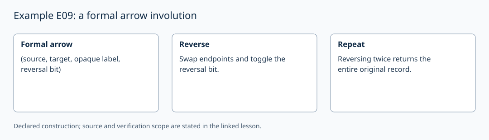

# Example E09: a formal arrow involution

AuthorityEffect: None. [Source correspondence and proof scope](../source_correspondence.md).

A dagger category has an identity-on-objects contravariant involution:

\[
f:A\to B\Rightarrow f^\dagger:B\to A,\qquad
(f^\dagger)^\dagger=f,\qquad
(g\circ f)^\dagger=f^\dagger\circ g^\dagger.
\]

The local `DaggerArrow` represents the first two operations on formal arrows.
It retains an opaque label and a separate reversal bit, swaps endpoints and
flips that bit. Applying it twice recovers the entire record, including labels
already ending in `^dagger`. Trimming suffixes would lose such labels.

There is no composition operation in this class, so its tests do not establish
a dagger category or the displayed composition law. `Evaluator::DaggerAuditor`
was a proposed name, not a tested implementation here. A free dagger-category
construction would add composable paths and the required quotient equations.

Generic dagger categories have self-adjoint arrows, including identities.
A fixed-point-free pairing can be imposed on selected generating symbols but
not on every morphism. No physical time reversal, unitarity or quantum model
is inferred from the formal involution.
