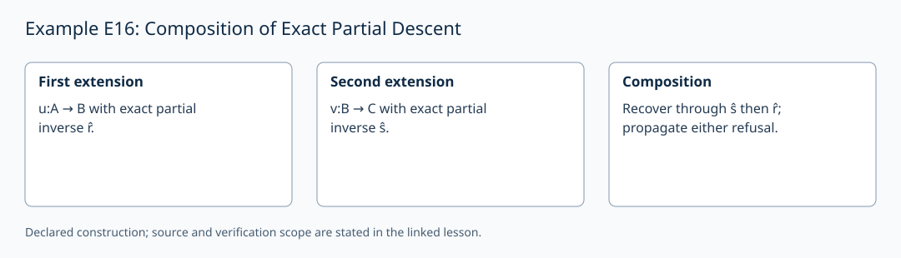

# Example E16: Composition of Exact Partial Descent

**AuthorityEffect:** None.
**GenesisEffect:** None (realization must never extend Genesis merely by being constructed).
**Layer:** Written finite example
**Realizes:** E16 Example Adapter
**LegacyRealizationId:** 16 (historical candidate locator; not a Genesis core stage)
**ReflectionBridge:** Unproved (shadow-local representation; zero generative authority over Genesis).
**Description:** Compose carrier inclusion lifts and refusal-valued partial retraction down-maps, preserving exact recovery on admitted elements.

---

## 1. Schematic & Conceptual Architecture

This example formalizes the compositional algebra of partial descent. Injective inclusions $u: A \to B$ and $v: B \to C$ pair with refusal-valued partial down-maps $r: B \to A + \{\bot\}$ and $s: C \to B + \{\bot\}$. The composite down-map $t = r \circ s$ recovers old carrier elements exactly while refusing genuinely new elements with $\bot$.

---

## 2. Mathematical Presentation & Transition Rules

> [!NOTE]
> **Epistemic Shadow Guardrail:** All mathematical structures and map composition rules in this document represent verification engine machinery. They do not define, alter, or extend the Genesis-native survivor register, and possess zero generative authority over Genesis.

1. **Carrier Inclusions & Refusal Maps:**
   - Carriers: $A=\{a,b\}$, $B=\{a,b,c\}$, $C=\{a,b,c,d\}$.
   - Inclusions: $u: A \hookrightarrow B$, $v: B \hookrightarrow C$. Refusal value $\bot$.
   - Partial down-map $r: B \to A + \{\bot\}$: $r(a)=\mathrm{inl}(a), r(b)=\mathrm{inl}(b), r(c)=\bot$.
   - Partial down-map $s: C \to B + \{\bot\}$: $s(y)=\mathrm{inl}(y)$ for $y \in B$, $s(d)=\bot$.

2. **Composite Down-Map & Exact Recovery:**
   - Composite map $t(z)$:
     $$t(z) = \begin{cases} \bot, & s(z) = \bot, \\ r(y), & s(z) = \mathrm{inl}(y). \end{cases}$$
   - Exact recovery: For $x \in A$, $t(v(u(x))) = \mathrm{inl}(x)$.
   - Refusal routes: Both new elements $c$ and $d$ map to $\bot$ ($t(d)=\bot, t(c)=\bot$).
   - Associativity: Partial map composition is associative over finite lift chains.

3. **Observation Transport Obligation:**
   - Let observation $q_A$ distinguish $a$ from $b$. Injective carrier lift $u$ can coexist with a constant $q_B$. Carrier injectivity alone does not preserve observed distinctions.
   - If observation transport $j$ satisfies $q_B \circ u = j \circ q_A$ and $j$ is injective on $q_A(A)$, then observation equality is both preserved and reflected.

4. **Adapter Cost Accounting:**
   - Composing already supplied maps requires 0 new map data.
   - Fresh composite name: 1 description unit.
   - Observation transport coordinate: 1 coordinate cost.

---

## 3. Implementation & Verification Evidence

The mathematical argument above is a written finite example. The local
`test_sn_grammar.py` cases check lift/retraction spelling and stage numerals;
they do not contain this example's semantic payload or verify its conclusions.
SN_001–SN_085 are the actual syntax-case identifiers. The older attribution
of semantic checks to these strings is withdrawn. The following verifier
obligations describe the semantic checks required for this example.

---

## 4. Verifier Obligation & Falsifier Boundary

- **Verifier Obligation:** Replay exact recovery, check both refusal routes, verify associativity, and confirm observation transport injectivity before admitting composite certificates.
- **Falsifier Boundary:** A partial retract that fails to return $\bot$ on non-carrier elements or fails exact recovery on $A$ is rejected.

---

## 5. Claim Hygiene Quadrant

1. **What this supports:**
   - Verification that partial descent maps compose associatively, preserving exact recovery on source elements and refusing new elements with $\bot$.
2. **What this does not support:**
   - Does not establish colimits for infinite diagrams or supply a total retract $B \to A$ without refusal values.
3. **The narrowest defensible claim:**
   - Injective lifts and refusal-valued partial down-maps form an associative compositional algebra preserving exact recovery on admitted domains.
4. **Next test needed:**
   - Add a semantic check on constant observation projections $q_B$ to confirm that carrier injectivity without an injective transport $j$ fails observation reflection.

