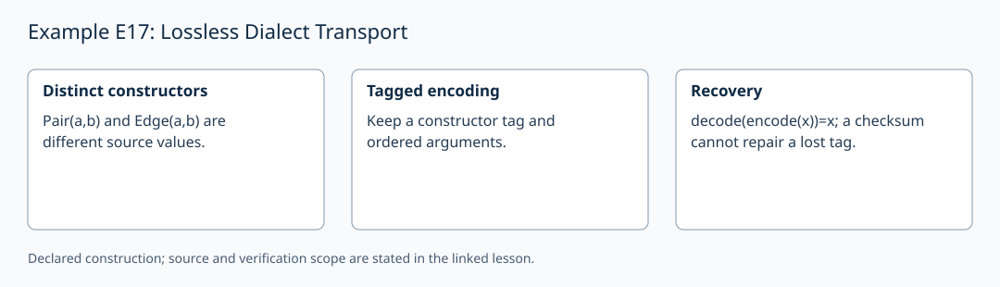

# Example E17: Lossless Dialect Transport

**AuthorityEffect:** None.
**GenesisEffect:** None (realization must never extend Genesis merely by being constructed).
**Layer:** Written finite example
**Realizes:** E17 Example Adapter
**LegacyRealizationId:** 17 (historical candidate locator; not a Genesis core stage)
**ReflectionBridge:** Unproved (shadow-local representation; zero generative authority over Genesis).
**Description:** Demonstrate that exact round-trip codec transport requires distinct encodings for distinct typed constructors.

---

## 1. Schematic & Conceptual Architecture

This example formalizes lossless codec round-trip transport across dialects. Structurally distinct typed constructors—such as retained pairs `Pair(a,b)` and oriented edges `Edge(a,b)`—require distinct tags in their binary/text encodings. A quotient codec mapping both to a shared syntax `<ab>` loses semantic distinction and fails the round-trip equation $\mathrm{decode}(\mathrm{encode}(x)) = x$.

---

## 2. Mathematical Presentation & Transition Rules

> [!NOTE]
> **Epistemic Shadow Guardrail:** All mathematical structures and codec specifications in this document represent verification engine machinery. They do not define, alter, or extend the Genesis-native survivor register, and possess zero generative authority over Genesis.

1. **Typed Constructors & Distinct Encodings:**
   - Constructor 1: `Pair(a,b)` (retained mark pair). Codec: `<<pair><a><b>>`.
   - Constructor 2: `Edge(a,b)` (oriented incidence edge). Codec: `<<edge><a><b>>`.

2. **Lossless Round-Trip Equation:**
   - Exact target: $\mathrm{decode}(\mathrm{encode}(x)) = x$ for all terms $x$.
   - Structural induction proves round-trip exactness when constructor tags are distinct, argument arities match, and atom codecs round-trip.

3. **Lossy Quotient Counterexample:**
   - If both `Pair(a,b)` and `Edge(a,b)` encode as `<ab>`, decoding `<ab>` is ambiguous:
     $$\mathrm{decode}(\text{"<ab>"}) \in \{\mathrm{Pair}(a,b), \mathrm{Edge}(a,b)\}.$$
   - No deterministic decoder can satisfy both $\mathrm{decode}(\mathrm{encode}(\mathrm{Pair})) = \mathrm{Pair}$ and $\mathrm{decode}(\mathrm{encode}(\mathrm{Edge})) = \mathrm{Edge}$.
   - A recomputed checksum over lossy bytes `<ab>` cannot restore erased constructor tags.

4. **Adapter Cost Accounting:**
   - Constructor tags: 2 distinct tag tokens.
   - Atom codec & version profile: 1 profile specification.

---

## 3. Implementation & Verification Evidence

The mathematical argument above is a written finite example. The local
`test_sn_grammar.py` cases check lift/retraction spelling and stage numerals;
they do not contain this example's semantic payload or verify its conclusions.
SN_001–SN_085 are the actual syntax-case identifiers. The older attribution
of semantic checks to these strings is withdrawn. The following verifier
obligations describe the semantic checks required for this example.

---

## 4. Verifier Obligation & Falsifier Boundary

- **Verifier Obligation:** Verify $\mathrm{decode}(\mathrm{encode}(x)) = x$ on both `Pair` and `Edge` terms and reject lossy un-tagged encodings.
- **Falsifier Boundary:** Recomputing a valid checksum over an ambiguous token representation without distinct constructor tags is rejected as a proof of lossless transport.

---

## 5. Claim Hygiene Quadrant

1. **What this supports:**
   - Verification that distinct constructor tags enable exact round-trip codec decoding, whereas lossy quotient encodings collide.
2. **What this does not support:**
   - Does not prove that every infinite term grammar admits a finite flat wire syntax.
3. **The narrowest defensible claim:**
   - Lossless dialect transport requires injective constructor tag encoding; checksums verify byte transmission but cannot repair quotient collision loss.
4. **Next test needed:**
   - Add a semantic check on lossy `<ab>` payloads to confirm deterministic rejection of ambiguous un-tagged constructor terms.

