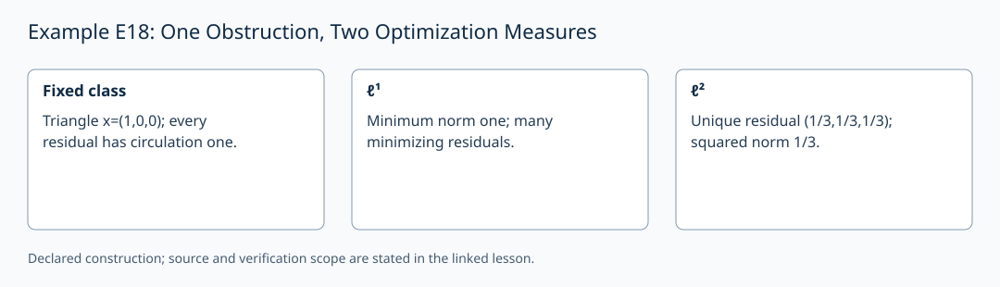

# Example E18: One Obstruction, Two Optimization Measures

**AuthorityEffect:** None.
**GenesisEffect:** None (realization must never extend Genesis merely by being constructed).
**Layer:** Written finite example
**Realizes:** E18 Example Adapter
**LegacyRealizationId:** 18 (historical candidate locator; not a Genesis core stage)
**ReflectionBridge:** Unproved (shadow-local representation; zero generative authority over Genesis).
**Description:** Exact ℓ¹ and ℓ² minimal representative calculations on the same obstructed triangle.

---

## 1. Schematic & Conceptual Architecture

This example formalizes exact optimization of representatives within an obstructed cochain class. On the unfilled 3-cycle triangle with edge data $x=(1,0,0)^T$ (circulation $I(x)=1$), the non-exact class remains obstructed ($I(r)=1$) under both $\ell^1$ and $\ell^2$ norms. The $\ell^1$ norm yields a non-unique minimal residual $\|r\|_1=1$, whereas the $\ell^2$ norm yields a unique rational harmonic residual $h=(1/3, 1/3, 1/3)^T$ with squared norm $1/3$.

---

## 2. Mathematical Presentation & Transition Rules

> [!NOTE]
> **Epistemic Shadow Guardrail:** All mathematical structures and norm calculations in this document represent verification engine machinery. They do not define, alter, or extend the Genesis-native survivor register, and possess zero generative authority over Genesis.

1. **Obstructed Class Context:**
   - Unfilled triangle edges $(ab, bc, ca)$, coboundary matrix $d_0$, edge data $x=(1,0,0)^T$, circulation $I(x)=1$.
   - All residuals $r = x - d_0 g$ satisfy $I(r) = r_1+r_2+r_3 = 1$.

2. **Exact $\ell^1$ Minimization & Dual Certificate:**
   - Problem: $\min_g \|x - d_0 g\|_1$. Lower bound: $\|r\|_1 \ge |I(r)| = 1$.
   - Attained by $r = x = (1,0,0)^T$ and non-unique ties such as $(1/2, 1/2, 0)^T$.
   - Dual certificate: $y = (1,1,1)^T$, satisfying $d_0^T y = 0$, $\|y\|_\infty \le 1$, and $x^T y = 1$.

3. **Exact $\ell^2$ Minimization & Harmonic Residual:**
   - Standard inner product over $\mathbb{Q}$: $\sum_{i} (r_i - 1/3)^2 = \|r\|_2^2 - 1/3 \ge 0$.
   - Unique minimizing residual: $h = (1/3, 1/3, 1/3)^T$, with squared norm $1/3$.
   - Potential witness: $g = (0, 2/3, 1/3)^T$, yielding $x = d_0 g + h$ and $d_0^T h = 0$.
   - Type-correct adjoint: $d_k^* = M_k^{-1} d_k^T M_{k+1}$ for Gram matrices $M_k$.

4. **Preserved Obstruction Invariant:**
   - Both $\ell^1$ and $\ell^2$ optimal representatives maintain $I(r) = 1$.
   - Optimization selects a minimal representative cochain; it does not erase the underlying topological obstruction.

---

## 3. Implementation & Verification Evidence

The mathematical argument above is a written finite example. The local
`test_sn_grammar.py` cases check lift/retraction spelling and stage numerals;
they do not contain this example's semantic payload or verify its conclusions.
SN_001–SN_085 are the actual syntax-case identifiers. The older attribution
of semantic checks to these strings is withdrawn. The following verifier
obligations describe the semantic checks required for this example.

---

## 4. Verifier Obligation & Falsifier Boundary

- **Verifier Obligation:** Verify primal/dual feasibility for $\ell^1$, check rational reconstruction $x = d_0 g + h$ and orthogonality $d_0^T h = 0$ for $\ell^2$, and confirm $I(h)=1$.
- **Falsifier Boundary:** Optimization preserves circulation. Adjoining a 2-face changes the complex and makes this cochain nonclosed under its new coboundary; it does not supply a potential $g$ with $d_0g=x$.

---

## 5. Claim Hygiene Quadrant

1. **What this supports:**
   - Verification of exact $\ell^1$ (non-unique, minimum 1) and $\ell^2$ (unique harmonic $(1/3,1/3,1/3)^T$, squared minimum $1/3$) representative cochains over $\mathbb{Q}$.
2. **What this does not support:**
   - Does not eliminate topological obstructions or prove unique optimizers under non-strictly convex norms.
3. **The narrowest defensible claim:**
   - Cochain optimization reduces representative norm within an equivalence class while preserving non-zero circulation invariants over rational complexes.
4. **Next test needed:**
   - Add a semantic check on modified Gram inner products $M_1 \neq I_3$ to ensure adjoint matrix calculations remain type-correct.

