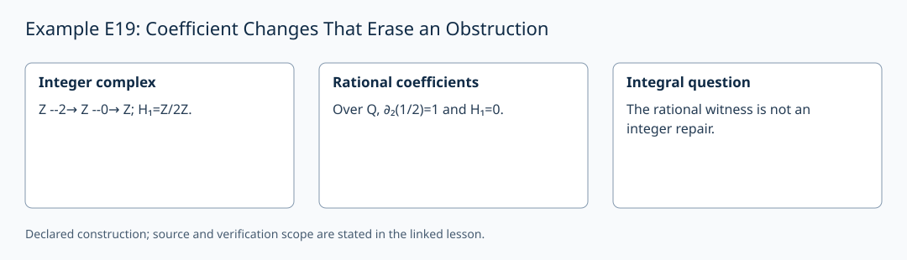

# Example E19: Coefficient Changes That Erase an Obstruction

**AuthorityEffect:** None.
**GenesisEffect:** None (realization must never extend Genesis merely by being constructed).
**Layer:** Written finite example
**Realizes:** E19 Example Adapter
**LegacyRealizationId:** 19 (historical candidate locator; not a Genesis core stage)
**ReflectionBridge:** Unproved (shadow-local representation; zero generative authority over Genesis).
**Description:** Demonstrate that tensoring with rational coefficients erases integral torsion obstructions without supplying an integral repair.

---

## 1. Schematic & Conceptual Architecture

This example formalizes the distinction between erased coefficient obstructions and source-ring integral repairs. Over $\mathbb{Z}$, the chain complex $C_2=\mathbb{Z} \xrightarrow{2} C_1=\mathbb{Z} \xrightarrow{0} C_0=\mathbb{Z}$ has torsion homology $H_1(C; \mathbb{Z}) = \mathbb{Z}/2\mathbb{Z}$. Tensoring with $\mathbb{Q}$ makes $\partial_2$ surjective, rendering rational homology $H_1(C; \mathbb{Q}) = 0$. Changing coefficient rings erases the obstruction in rational homology without providing an integral boundary witness.

---

## 2. Mathematical Presentation & Transition Rules

> [!NOTE]
> **Epistemic Shadow Guardrail:** All mathematical structures and homology calculations in this document represent verification engine machinery. They do not define, alter, or extend the Genesis-native survivor register, and possess zero generative authority over Genesis.

1. **Integral Torsion Certificate:**
   - Free chain complex: $C_2 = \mathbb{Z}$, $C_1 = \mathbb{Z}$, $C_0 = \mathbb{Z}$.
   - Boundary maps: $\partial_2(1) = 2$, $\partial_1 = 0$.
   - Cycle $z = 1 \in C_1$ is non-zero in integral homology $H_1 = \mathbb{Z}/2\mathbb{Z}$ (no integer $c$ satisfies $2c = 1$).
   - Parity reduction modulo 2 proves $z$ is an integral torsion generator of order 2.

2. **Rational Shadow Eradication:**
   - Scalar extension to $\mathbb{Q}$: $C_k \otimes_\mathbb{Z} \mathbb{Q}$.
   - Rational primitive: $\partial_2(1/2) = 1$, so $z \in \mathrm{im}(\partial_2 \otimes \mathbb{Q})$.
   - Rational homology $H_1(C; \mathbb{Q}) = 0$. The rational primitive $1/2$ is not an integral repair witness.

3. **Priced Integral Repair:**
   - Response class: Adjoin new integer boundary generator $f$ with $\partial_2 f = 1$.
   - Adjoining 1 new integer boundary generator eliminates the torsion class in $\mathbb{Z}$.
   - Cost: 1 new boundary generator vs 0 new generators for coefficient ring modification.

4. **General Torsion Family:**
   - Replacing boundary multiplier 2 by $m \ge 2$ yields integral $H_1 = \mathbb{Z}/m\mathbb{Z}$ and rational $H_1 = 0$.
   - Vector space dimensions over $\mathbb{Q}$ fail to detect integral torsion obstructions.

---

## 3. Implementation & Verification Evidence

The mathematical argument above is a written finite example. The local
`test_sn_grammar.py` cases check lift/retraction spelling and stage numerals;
they do not contain this example's semantic payload or verify its conclusions.
SN_001–SN_085 are the actual syntax-case identifiers. The older attribution
of semantic checks to these strings is withdrawn. The following verifier
obligations describe the semantic checks required for this example.

---

## 4. Verifier Obligation & Falsifier Boundary

- **Verifier Obligation:** Verify modulo $m$ reduction for integral non-exactness, verify rational primitives over $\mathbb{Q}$, and distinguish ring extension from source-ring boundary additions.
- **Falsifier Boundary:** Offering a rational fraction $1/m$ as an integral repair receipt without adding an integer boundary generator is rejected.

---

## 5. Claim Hygiene Quadrant

1. **What this supports:**
   - Verification that scalar extension to $\mathbb{Q}$ erases integral torsion $H_1 = \mathbb{Z}/m\mathbb{Z}$ without furnishing an integral boundary witness.
2. **What this does not support:**
   - Does not establish integral repair for arbitrary non-free chain complexes or non-abelian groups.
3. **The narrowest defensible claim:**
   - Rationalization eliminates torsion homology classes without providing source-ring integral repair certificates.
4. **Next test needed:**
   - Add a semantic check on general Smith Normal Form invariant factors to confirm exact integer reconstruction.

