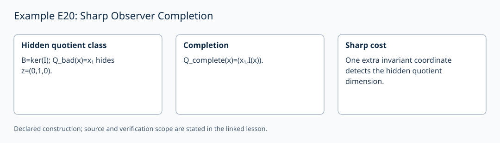

# Example E20: Sharp Observer Completion

**AuthorityEffect:** None.
**GenesisEffect:** None (realization must never extend Genesis merely by being constructed).
**Layer:** Written finite example
**Realizes:** E20 Example Adapter
**LegacyRealizationId:** 20 (historical candidate locator; not a Genesis core stage)
**ReflectionBridge:** Unproved (shadow-local representation; zero generative authority over Genesis).
**Description:** Recover a hidden non-zero quotient class by adding exactly one invariant measurement coordinate.

---

## 1. Schematic & Conceptual Architecture

This example formalizes observer adequacy and sharp completion. Over $V=\mathbb{Q}^3$ with boundary image $B = \mathrm{im}(d_0) = \ker(I)$, a defective observer $Q_{\mathrm{bad}}(x) = x_1$ maps the representative $z=(0,1,0)^T$ (where $I(z)=1$) to 0. The induced map into $\mathbb{Q}/Q_{\mathrm{bad}}(B)=0$ then collapses $V/B$. Adding the invariant coordinate $I(x)$ yields $Q_{\mathrm{complete}}(x) = (x_1, I(x))^T$, whose kernel is contained in $B$, restoring quotient observation fidelity with a sharp lower bound of $\ell=1$ new coordinate.

---

## 2. Mathematical Presentation & Transition Rules

> [!NOTE]
> **Epistemic Shadow Guardrail:** All mathematical structures and linear algebraic quotient maps in this document represent verification engine machinery. They do not define, alter, or extend the Genesis-native survivor register, and possess zero generative authority over Genesis.

1. **Defective Observer & Hidden Class:**
   - Vector space $V = \mathbb{Q}^3$, coboundary image $B = \mathrm{im}(d_0) = \ker(I)$. Target quotient: $V/B$.
   - Defective observer $Q_{\mathrm{bad}}(x) = x_1 \in \mathbb{Q}$.
   - Hidden element $z = (0,1,0)^T$: $Q_{\mathrm{bad}}(z) = 0$, but $I(z) = 1 \neq 0$, so $z \notin B$.
   - Induced map $\overline{Q}_{\mathrm{bad}}: V/B \to \mathbb{Q}/\mathbb{Q} = \{0\}$ collapses all quotient classes.

2. **General Induced Kernel Theorem:**
   - For linear $Q: V \to W$ with $K = \ker(Q)$, induced map $\overline{Q}: V/B \to W/Q(B)$ has kernel:
     $$\ker \overline{Q} = (B + K)/B \cong K / (K \cap B).$$
   - Quotient observation is injective if and only if $K \subseteq B$.

3. **Completed Observer & Sharp Lower Bound:**
   - Completed observer: $Q_{\mathrm{complete}}(x) = (x_1, I(x))^T$.
   - Kernel $\ker Q_{\mathrm{complete}} = \{(0,t,-t)^T \in \mathbb{Q}^3\} \subset B = \ker(I)$.
   - Kernel containment $K \subseteq B$ holds, so quotient classes are reflected faithfully.
   - Sharp cost: $\ell = \dim(K / (K \cap B)) = 1$. Adding 1 coordinate $I(x)$ attains the theoretical lower bound. First projection recovers old observation $x_1$.

4. **Adapter Cost Accounting:**
   - Hidden quotient dimension $\ell = \dim K/(K\cap B) = 1$ (the kernel of $Q_{\mathrm{bad}}$ itself has dimension 2).
   - Required scalar measurement addition: exactly 1 linear functional.

---

## 3. Implementation & Verification Evidence

The mathematical argument above is a written finite example. The local
`test_sn_grammar.py` cases check lift/retraction spelling and stage numerals;
they do not contain this example's semantic payload or verify its conclusions.
SN_001–SN_085 are the actual syntax-case identifiers. The older attribution
of semantic checks to these strings is withdrawn. The following verifier
obligations describe the semantic checks required for this example.

---

## 4. Verifier Obligation & Falsifier Boundary

- **Verifier Obligation:** Exhibit hidden quotient class $z$, verify $\ker \overline{Q} \cong K / (K \cap B)$, check $K_{\mathrm{complete}} \subseteq B$, and certify lower bound $\ell \ge 1$.
- **Falsifier Boundary:** Claiming an observer is adequate when its kernel $K$ is not contained in $B$ is rejected.

---

## 5. Claim Hygiene Quadrant

1. **What this supports:**
   - Verification that adding $\ell = \dim(K / (K \cap B))$ invariant scalar measurements restores quotient observation fidelity.
2. **What this does not support:**
   - Does not prove observer adequacy under non-linear measurement maps or unconstrained noise.
3. **The narrowest defensible claim:**
   - Linear observer completion requires at least $\dim(K / (K \cap B))$ new coordinate measurements, and adding invariant $I(x)$ satisfies this bound sharply for $V/B$.
4. **Next test needed:**
   - Verify observer completion on multi-dimensional quotient kernels $\ell > 1$ to confirm linear functional basis construction.

