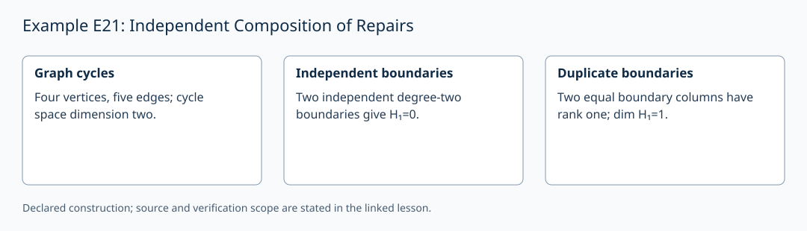

# Example E21: Independent Composition of Repairs

**AuthorityEffect:** None.
**GenesisEffect:** None (realization must never extend Genesis merely by being constructed).
**Application evidence:** The associated metric/curvature application is a specification; no physical verification is claimed. See the corrected `domains/physics/` notes.

**Layer:** Written finite example
**Realizes:** E21 Example Adapter
**LegacyRealizationId:** 21 (historical candidate locator; not a Genesis core stage)
**ReflectionBridge:** Unproved (shadow-local representation; zero generative authority over Genesis).
**Description:** Demonstrate that independent face boundary generators eliminate homology classes, while duplicate repair receipts do not.

---

## 1. Schematic & Conceptual Architecture

This example formalizes accountable repair composition in swarm environments. On a graph with vertices $a,b,c,d$ and 5 edges, the 1-cycle space has dimension 2. Adjoining two linearly independent 2-face boundary generators $z_1, z_2$ yields $\mathrm{rank}(\partial_2)=2$ and completely repairs the 1-homology ($H_1=0$). Adjoining duplicate repair receipts yields $\mathrm{rank}(\partial_2)=1$ and leaves $\dim(H_1)=1$; receipt count alone does not establish homological progress.

---

## 2. Mathematical Presentation & Transition Rules

> [!NOTE]
> **Epistemic Shadow Guardrail:** All mathematical structures and boundary operators in this document represent verification engine machinery. They do not define, alter, or extend the Genesis-native survivor register, and possess zero generative authority over Genesis.

1. **Graph Presentation & Cycle Space:**
   - Vertices: $a,b,c,d$. Edges ordered: $(ab, bc, ac, cd, da)$.
   - Boundary matrix over $\mathbb{Q}$:
     $$\partial_1 = \begin{pmatrix} -1 & 0 & -1 & 0 & 1 \\ 1 & -1 & 0 & 0 & 0 \\ 0 & 1 & 1 & -1 & 0 \\ 0 & 0 & 0 & 1 & -1 \end{pmatrix}.$$
   - Cycle space dimension: $5 - 3 = 2$.
   - Independent cycles: $z_1 = (1,1,-1,0,0)^T$ (triangle $abc$) and $z_2 = (0,0,1,1,1)^T$ (triangle $acd$).

2. **Independent Repairs vs Duplicates:**
   - **Independent Case:** Adjoin two faces with boundaries $z_1, z_2$.
     $$\partial_2 = \begin{pmatrix} z_1 & z_2 \end{pmatrix}, \quad \operatorname{rank}(\partial_2) = 2, \quad \partial_1 \partial_2 = 0.$$
     - Homology $H_1 = \ker(\partial_1)/\operatorname{im}(\partial_2) = 0$. Complete repair.
   - **Duplicate Case:** Adjoin two distinct free degree-two generators with identical boundary $z_1$. This is a chain-complex extension (or a cell attachment model), not two copies of one simplex in an abstract simplicial complex.
     $$\partial_2 = \begin{pmatrix} z_1 & z_1 \end{pmatrix}, \quad \operatorname{rank}(\partial_2) = 1, \quad \dim H_1 = 1.$$
     - Receipt count = 2, but repair rank = 1. Homological progress is measured by linear boundary rank, not proposal count.

3. **Basis Transport & Interface Obligation:**
   - If a contributor uses edge orientation $ca$, transport to common basis edge $ac$ requires $e_{ca} = -e_{ac}$.
   - Incorrect sign flips cause $\partial_1 z \neq 0$ and fail boundary verification.

4. **Adapter Cost Accounting:**
   - Target cycle space dimension: 2.
   - Minimal required independent 2-generator boundaries: 2.

---

## 3. Implementation & Verification Evidence

The mathematical argument above is a written finite example. The local
`test_sn_grammar.py` cases check lift/retraction spelling and stage numerals;
they do not contain this example's semantic payload or verify its conclusions.
SN_001–SN_085 are the actual syntax-case identifiers. The older attribution
of semantic checks to these strings is withdrawn. The following verifier
obligations describe the semantic checks required for this example.

---

## 4. Verifier Obligation & Falsifier Boundary

- **Verifier Obligation:** Verify basis transport signs, calculate $\operatorname{rank}(\partial_2)$, verify $\partial_1 \partial_2 = 0$, and verify remaining $H_1$ dimension.
- **Falsifier Boundary:** Counting duplicate repair receipts as independent boundary rank or omitting orientation sign transport is rejected.

---

## 5. Claim Hygiene Quadrant

1. **What this supports:**
   - Verification that homological repair progress requires linearly independent boundary generators, and duplicate proposals leave non-zero homology.
2. **What this does not support:**
   - Does not establish 4D continuous Regge gravity or derive Bianchi identities without an explicit dual complex construction.
3. **The narrowest defensible claim:**
   - Independent face boundaries reduce 1-homology dimension by their matrix rank, whereas duplicate repair proposals preserve non-zero cycle classes.
4. **Next test needed:**
   - Add a semantic check on non-oriented edge transports to ensure sign mismatch detection blocks invalid face additions.
