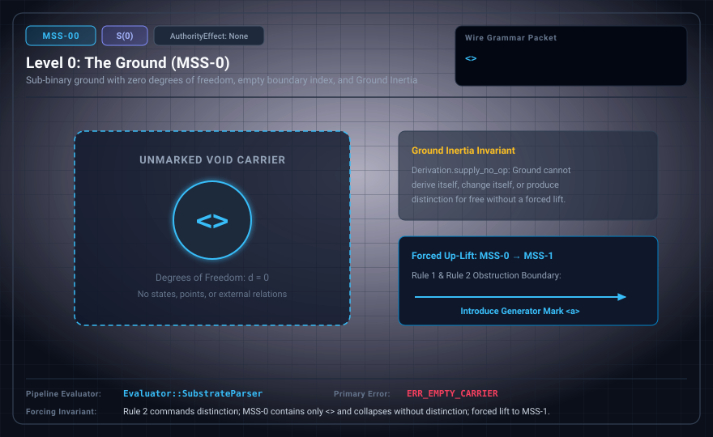

# MSS-N Level 00: The Ground and the Radical Void

**AuthorityEffect:** None.  
**Level:** Level 00 (Radical Void & Sub-Binary Ground / Zero Degrees of Freedom)  
**Carrier:** Void Wire Carrier `⟨⟩` | Radical Pre-Genesis Carrier $R_{-1} = \varnothing$  
**Runtime Pipeline:** `Evaluator::SubstrateParser` | Primary Error: `ERR_EMPTY_CARRIER`  
**Atlas Capabilities:** `primitive_mark`, `nonresolution`, `refusal_of_smuggled_containers`  

---

## 1. Schematic & Conceptual Architecture



MSS-0 represents the sub-binary ground of the Minimal Symbol System. In accordance with the foundational principles established in the Witnessed Difference Programme (WDP, Chapter 1) and Genesis metatheory ($S(0)$), we refuse to smuggle in an ambient container, clock, metric space, observer, or authority relation before a single mark or rule has been admitted.

### The Two Pre-Grammatical Regimes

We distinguish two separated conceptual layers at the baseline:

1. **Level -1: The Radical Void ($R_{-1} = \varnothing$):**
   - Not an empty string `""` (which presupposes an allocated memory buffer).
   - Not the empty set $\varnothing = \{\}$ inside an ambient ZFC universe.
   - Not the empty word $\varepsilon$ inside a pre-existing string monoid.
   - Level -1 denotes the complete absence of a game, a grammar, or an inscription. In topological terms, $\tilde{H}_0(\varnothing) = 0$ with zero path components.

2. **Level 0: The Admitted Ground Carrier ($R_0 = \langle\rangle$):**
   - The admission of an uncarved boundary token $\langle\rangle$.
   - Possesses strictly zero degrees of freedom ($|C| < 2$).
   - Contains zero states, glyphs, or internal relations.
   - **Ground Inertia (Genesis Crosswalk):** Under the post-hoc Genesis crosswalk analogue `Derivation.supply_no_op` (not an MSS-native operation), external presentations leave the ground state record completely unchanged.
   - **WDP Alignment:** An exhibited difference has a price. Because no cut has been made and no mark retained, duration, succession, and measurement cannot be defined at Level 00.

---

## 2. Wire Packet Grammar & Successor Rationale

- **Declared Successor Rationale:** MSS-0 contains only the uncarved boundary token $\langle\rangle$ with zero degrees of freedom; MSS-1 is declared as the successor stage adding a single-mark generator carrier. (Lift status to MSS-1 remains an unproved transition obligation until a valid admission record is attested.)
- **Meta-Grammar Form:**
  ```ebnf
  Grammar ::= ∅ | Ground
  Ground  ::= "<>"
  ```
- **Wire Packet(s):**
  ```text
  <>
  ```

---

## 3. Runtime Evaluator & Mathematical Core

### 3.1 Sub-Binary Ground & Zero Degrees of Freedom

The carrier cardinality $|C| < 2$ cannot host a binary distinction. Any demand for distinction within MSS-0 triggers an immediate typed refusal (`ERR_EMPTY_CARRIER`). The ground state provides an uncarved boundary index, not an ambient text container.

---

### 3.2 Formal Ground Inertia: Lean 4 Proof Kernel Extraction

The operational inertia of the ground state is formally established in the Lean 4 proof kernel (`19L57G1/lean4/Derivation/Inertia.lean` and `Basic.lean`). Rather than asserting ground stability informally, the Lean 4 kernel models the exact state vector and its transition semantics:

#### The Regime State Machine (`Derivation/Basic.lean`)

In the Lean 4 model, an admitted regime carries an exact record of admitted data, judgment-form arities, instances, uniform rules, and separation requirements:

```lean
structure Regime where
  data  : Nat
  forms : List Nat
  insts : List Inst
  rules : List Nat
  reqs  : List (Nat × Nat)
deriving Repr, DecidableEq

/-- The genesis regime: nothing admitted. -/
def genesis : Regime := ⟨0, [], [], [], []⟩
```

The transition function `stepE` processes external events:

```lean
inductive Event where
  | supply       (token : Nat)
  | admitDatum
  | admitForm    (arity : Nat)
  | admitInst    (form : Nat) (args : List Nat)
  | admitRuleAll (form : Nat)
  | impose       (i j : Nat)
deriving Repr, DecidableEq

/-- One admission step. A bare supply changes nothing. -/
def stepE (r : Regime) : Event → Option Regime
  | .supply _ => some r
  | .admitDatum => some { r with data := r.data + 1 }
  ...
```

#### Theorem 1: Definitional Invariance Under Presentation (`supply_no_op`)

External presentation (`supply`) does not modify the internal admitted state:

```lean
/-- A bare supply changes no admitted state (supply is not admission). -/
theorem supply_no_op (r : Regime) (t : Nat) :
    stepE r (.supply t) = some r := rfl
```

The proof is `rfl` (definitional equality). In the Genesis crosswalk, placing a token on an external table does not alter the ground state record. Presentation is strictly separate from admission.

#### Theorem 2: Underivability at Genesis (`genesis_underivable` & `underivable_of_empty`)

The ground state cannot generate internal inferences or derive successors spontaneously:

```lean
/-- Nothing is derivable at genesis. -/
theorem genesis_underivable (i : Inst) : ¬ derivable genesis i := by
  intro h
  cases h with
  | inl h => cases h
  | inr h => cases h

/-- Nothing is derivable in any regime with no instances and no rules;
in particular no successor is generated internally: the only state
changes in the model are indexed by external events (`stepE`). -/
theorem underivable_of_empty (r : Regime) (hi : r.insts = [])
    (hr : r.rules = []) (i : Inst) : ¬ derivable r i := by
  intro h
  cases h with
  | inl h => rw [hi] at h; cases h
  | inr h => rw [hr] at h; cases h
```

Internal derivability requires an admitted instance or a uniform rule. Because `genesis.insts = []` and `genesis.rules = []`, no judgment instance is derivable. All transitions require an explicit external admission event.

#### Theorem 3: Total Observational Collapse Before Distinctions (`collapsed_of_no_insts`)

Prior to the admission of instances, all data remain observationally indistinguishable:

```lean
/-- Key collapse lemma: with no admitted instances, derivability depends
only on the form, hence every pair of data is observationally collapsed
(uniform rules cannot separate). -/
theorem collapsed_of_no_insts (r : Regime) (hi : r.insts = [])
    (d d' : Nat) : collapsed r d d' := by
  intro c _
  constructor <;> intro h <;>
    cases h with
    | inl h => rw [hi] at h; cases h
    | inr h => exact Or.inr h
```

Without admitted instances, no well-formed observation context can separate any two points by positive derivability.

---

### 3.3 WDP Alignment: An Admitted Cut Is Declared Data

The Witnessed Difference Programme (WDP, Chapter 1, Definition WDP-CH01-D01) begins from an admitted cut, declared data $(X, E, \tau, \mathcal{K})$; it does not say that a difference has an energetic cost. (An earlier version of this page boxed "An exhibited difference has a price" as a WDP Chapter 1 principle; the phrase is not in the monograph. WDP Chapter 3 speaks of the price of retention relative to a declared implementation class.) A difference is registered only through an admitted cut and a retained record. At Level 00, no cut has been made and no mark has been retained. Consequently:

1. **Preclusion of Duration:**  
   Duration denotes an interval between distinct states or temporal marks ($t_0 \neq t_1$). Because Level 00 possesses strictly zero degrees of freedom ($|C| < 2$) and zero admitted transitions (${\longrightarrow}_0 = \varnothing$), there is no second tick against which passage can be calibrated. Duration cannot be defined at Level 00.

2. **Preclusion of Succession:**  
   Succession requires an ordered relation $(s_n, s_{n+1})$ where one state succeeds another. Because the ground carrier contains only the atomic boundary token $\langle\rangle$ without an admitted successor generator, no sequence of states exists. Succession cannot be defined at Level 00.

3. **Preclusion of Measurement:**  
   Measurement requires a comparison standard—a ratio, distance, or ruler calibrated between an origin and a secondary landmark. Without an initial cut and without the retention of a second mark, there is no reference point against which a quantity can be measured. Measurement cannot be defined at Level 00.

---

## 4. Verification Obligation & Falsifier Boundary

- **Verification Obligation:** The evaluator accepts precisely the two bytes `<>` (representing the atomic uncarved boundary token) and rejects all non-empty payloads.
- **Negative Counterexample:** Any interior glyph (e.g. `<a>`, `<0>`), nested packet (`<<>>`), or raw alphanumeric character is rejected with `ERR_EMPTY_CARRIER` or `ERR_UNPARSED_TAIL`.
- **Boundary Invariant:** `<>` is an uncarved boundary index, not an ambient text container.

---

## 5. Claim Hygiene Quadrant

1. **What this supports:**
   - Formal verification that the ground parser accepts only the atomic boundary token $\langle\rangle$ and rejects any interior structure.
   - Demonstrates via the Lean 4 proof kernel (`Inertia.lean`, `Basic.lean`) that external presentations leave the ground state record definitionally unchanged (`supply_no_op`), that no instances are derivable at genesis (`genesis_underivable`), and that all points are observationally collapsed prior to instance admission (`collapsed_of_no_insts`).
   - Grounding under WDP Chapter 1 showing that without an admitted cut, duration, succession, and measurement cannot be defined.
2. **What this does not support:**
   - Does not establish the existence of an external continuum, an ambient coordinate space, or physical spacetime.
   - Does not demonstrate that an empty packet spontaneously evolves into higher stages without an external admission step.
3. **The narrowest defensible claim:**
   - In this test setting, MSS-0 accepts exactly $\langle\rangle$ and rejects all non-void tokens with `ERR_EMPTY_CARRIER`, while the Lean 4 genesis model shows definitional state invariance under presentation events.
4. **Next test needed:**
   - Advance to MSS-1 via explicit single-mark admission ($\operatorname{AdmitDatum}(a)$).
