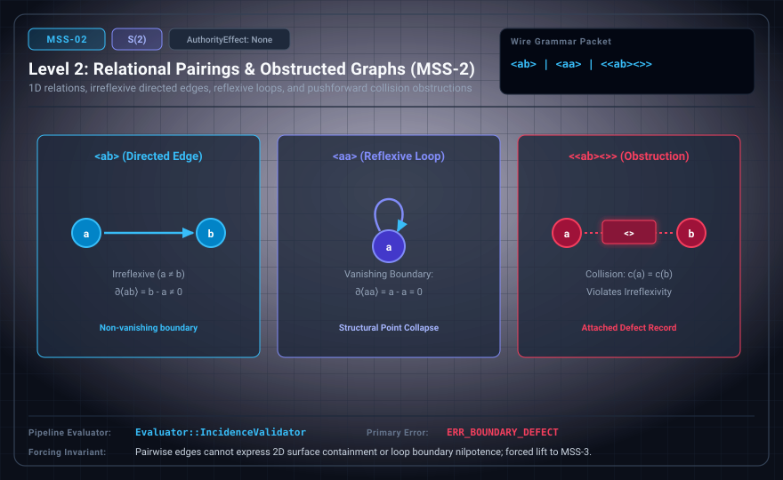

# MSS-N Level 02: Relational Pairings and Distinction Genesis

**AuthorityEffect:** None.\
**Level:** Level 02 (Two-Mark Admission / Distinction Genesis / Obstructed Cuts)\
**Carrier:** Pairwise Carrier ⟨ab⟩ | Disconnected Discrete Carrier $\{a, b\}$ | Obstructed Cut ⟨⟨ab⟩⟨⟩⟩\
**Runtime Pipeline:** `Evaluator::IncidenceValidator` | Primary Error: `ERR_BOUNDARY_DEFECT`\
**Atlas Capabilities:** `directed_edge`, `distinction_genesis`, `obstruction_attachment`

---

## 1. Schematic & Conceptual Architecture



MSS-2 establishes the foundational event of **distinction genesis**: the admission of a second distinct mark $b$ alongside $a$, expanding the carrier to cardinality $|C| = 2$. In the Witnessed Difference Programme (WDP, Chapters 1–2), this represents the emergence of an exhibited cut. Two entities now exist, but they remain separated by an unbridged gap.

### The Triad Lens Formulation of Level 02

1. **Genesis Metatheory ($S(2)$ / $S(3)$ Crosswalk):**
   - Distinction is formally imposed: $\operatorname{Impose}(a, b)$.
   - **Active Obstruction ($\operatorname{obstP}$):** Whenever an external sensor or observation profile fails to separate $a$ and $b$, an active obstruction alarm sounds.
   - **Forcing:** The system cannot silence the alarm by decree; it is forced to construct a bridge connecting them.
2. **Homotopy Type Theory (HoTT):**
   - A space with two disconnected points $\{a, b\}$.
   - The path type $\operatorname{Id}(a, b)$ is uninhabited ($\mathbf{0}$).
   - **Topological 0-Hole:** In algebraic topology, the two disconnected components yield non-trivial reduced homology:
     $$\tilde{H}_0(\{a, b\}) \cong \mathbb{Z} \cdot [b - a]$$
     This 0-dimensional hole represents the unbridged chasm between the two names.
3. **Category Theory:**
   - A discrete category with two objects and zero non-identity morphisms.
4. **The Rent Rule & Diagonal Avoidance:**
   - Self-pairings $\langle aa \rangle$ reside directly on the diagonal $\Delta = \{(x, x)\}$.
   - Under the Rent Rule, a new mark earns its keep only by participating in an irreflexive relation ($R \cap \Delta = \varnothing$, requiring $a \neq b$).

---

## 2. Wire Packet Grammar & Successor Rationale

- **Declared Successor Rationale:** While pairwise edges $\langle ab \rangle$ establish 1-dimensional cuts, they cannot enclose 2-dimensional surface area (triangles) or verify cycle boundaries ($d_1 b = 0$); MSS-3 is declared as the successor stage introducing simplicial 2-cell carriers. (Lift status to MSS-3 remains an unproved transition obligation until a 2-cell witness is attested.)
- **Grammar Forms:**
  - *Boundary Profile (`boundary.ebnf`):*
    ```ebnf
    packet ::= "<" "a" "b" ">" | "<" "<" "a" "b" ">" "<" ">" ">"
    ```
  - *Raw Glyph Profile (`mssn.ebnf`):*
    ```ebnf
    S ::= "a" | "b"
    ```
- **Wire Packet(s):**
  ```text
  <ab>       -- Directed pairing (1-simplex / edge from a to b)
  <<ab><>>   -- Obstructed directed cut (1-simplex awaiting 2-cell witness)
  ```

---

## 3. Runtime Evaluator & Mathematical Core

- **Incidence Validation:** The evaluator validates that the pairing contains two distinct endpoints ($a \neq b$).
- **Diagonal Rejection:** Reflexive tokens $\langle aa \rangle$ are flagged as diagonal self-loops; they fail the Rent Rule requiring non-trivial difference witnessing.
- **WDP Alignment:** An exhibited cut has been registered and retained. The pairing $\langle ab \rangle$ represents a comparison candidate. However, without higher simplices, transitivity and composition cannot be certified.
- **Error Trigger:** Emits `ERR_BOUNDARY_DEFECT` upon boundary mismatch, diagonal collapse ($a = b$), or invalid packet nesting.

---

## 4. Verification Obligation & Falsifier Boundary

- **Verification Obligation:** The evaluator accepts valid irreflexive pairings $\langle ab \rangle$ and obstructed forms $\langle\langle ab \rangle\langle\rangle\rangle$, verifying that $a \neq b$.
- **Negative Counterexample:** The input $\langle aa \rangle$ (reflexive collapse under strict irreflexivity), $\langle abc \rangle$ (arity overflow before Level 03), or malformed bracket nesting is rejected.
- **Permutation Invariant:** Swapping the labels ($a \leftrightarrow b$) exchanges source and target orientations but preserves the underlying 0-homology obstruction $\tilde{H}_0 \cong \mathbb{Z}$.

---

## 5. Claim Hygiene Quadrant

1. **What this supports:**
   - Formally verifies the emergence of difference and 0-homology obstruction ($\tilde{H}_0 \cong \mathbb{Z}$) between two admitted marks.
   - Demonstrates the enforcement of diagonal avoidance ($R \cap \Delta = \varnothing$) in irreflexive relational pairings.
2. **What this does not support:**
   - Does not establish the existence of 2D surfaces, triangles, or closed cycles.
   - Does not demonstrate that pairwise adjacency on the wire implies transitive reachability without an explicit relational calculus.
3. **The narrowest defensible claim:**
   - In this test setting, MSS-2 accepts irreflexive pairwise tokens $\langle ab \rangle$ and obstructed cuts $\langle\langle ab \rangle\langle\rangle\rangle$, rejecting diagonal loops and arity violations with `ERR_BOUNDARY_DEFECT`.
4. **Next test needed:**
   - Advance to MSS-3 by introducing 3-element simplicial complexes ($\langle abc \rangle$) to test 2-cell boundary operations.
