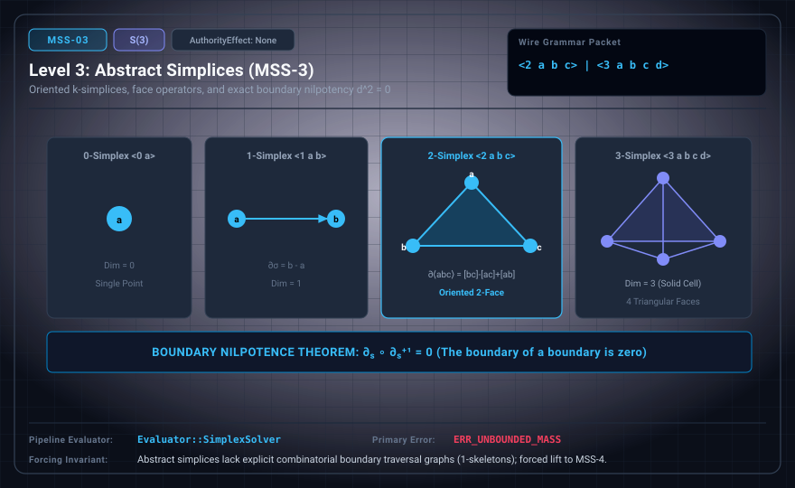

# MSS-N Level 03: Abstract Simplices

**AuthorityEffect:** None.\
**Level:** Level 03 (Simplicial Complexes 0 ≤ k ≤ 3 / Boundary Nilpotence)\
**Carrier:** Simplex Wire Packets ⟨0 a⟩ to ⟨3 a b c d⟩\
**Runtime Pipeline:** `Evaluator::SimplexSolver` | Primary Error: `ERR_UNBOUNDED_MASS`\
**Atlas Capabilities:** `dimension_index`, `vertex_closure`

---

## 1. Schematic & Conceptual Architecture



MSS-3 introduces unoriented and oriented k-simplices spanning dimensions 0 ≤ k ≤ 3 (vertices, segments, triangles, and tetrahedra). The boundary operator satisfies boundary nilpotence ∂_k ∘ ∂_{k+1} = 0. Cycles are chains ($z \in C_k$) with ∂z = 0; boundaries satisfy z = ∂w for w ∈ C_{k+1} (cochains utilize the coboundary d).

---

## 2. Wire Packet Grammar & Successor Rationale

- **Declared Successor Rationale:** Abstract simplices lack explicit combinatorial boundary traversal graphs (1-skeletons); MSS-4 is declared as the successor stage adding explicit 1-skeleton graph expansions. (Lift status to MSS-4 remains an unproved transition obligation.)
- **Wire Packet(s):**
```text
<0 a>          -- 0-simplex (vertex a)
<1 a b>        -- 1-simplex (segment from a to b)
<2 a b c>      -- 2-simplex (triangle with vertices a, b, c)
<3 a b c d>    -- 3-simplex (tetrahedron with vertices a, b, c, d)
```

---

## 3. Runtime Evaluator & Mathematical Core

- **Boundary Operator:** $\partial \langle a b c \rangle = \langle b c \rangle - \langle a c \rangle + \langle a b \rangle$.
- **Nilpotence:** $\partial^2 = 0$, establishing simplicial chain complexes.
- **Cycle Condition:** $z \in C_k$ is a chain cycle if $\partial z = 0$.
- **Boundary Condition:** $z \in C_k$ is a chain boundary if $z = \partial w$ for $w \in C_{k+1}$.
- **Solver Execution:** `Evaluator::SimplexSolver` solves an exact two-phase linear program over $\mathbb{Q}$ for quotient mass.

---

## 4. Verification Obligation & Falsifier Boundary

- **Verification Obligation:** Check $n+1$ distinct vertices and all implied subfaces.
- **Negative Counterexample:** A two-simplex with two vertices is rejected with `ERR_UNBOUNDED_MASS`.
- **Boundary Warning:** Abstract simplices contain face data but lack explicit 1-skeleton edge traversal graphs.

---

## 5. Claim Hygiene Quadrant

1. **What this supports:**
   - Verification of combinatorial boundary nilpotence and face incidence closure over abstract simplicial complexes.
2. **What this does not support:**
   - Does not establish metric geometry, lengths, or smooth manifold triangulations.
3. **The narrowest defensible claim:**
   - MSS-3 accepts valid k-simplices up to dimension 3, verifying distinct vertices and simplicial boundary nilpotence.
4. **Next test needed:**
   - Advance to MSS-4 by expanding simplices into explicit 1-skeleton graph traversals.
