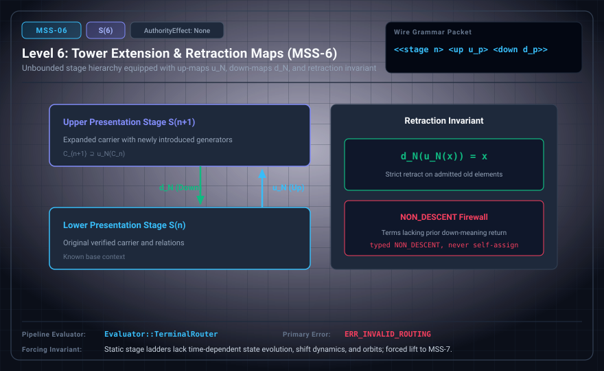

# MSS-N Level 06: General Tower Extension & Retraction Maps

**AuthorityEffect:** None.\
**Level:** Level 06 (Unbounded Stage Hierarchy / Retraction Down-Maps)\
**Carrier:** Stage Packets with Up/Down Morphisms ⟨⟨stage n⟩ ⟨up ...⟩ ⟨down ...⟩⟩\
**Runtime Pipeline:** `Evaluator::TerminalRouter` | Primary Error: `ERR_INVALID_ROUTING`\
**Atlas Capabilities:** `stage_embedding`, `higher_cell`

---

## 1. Schematic & Conceptual Architecture



MSS-6 formalizes an unbounded stage hierarchy equipped with lawful down-maps r_N and up-maps u_N satisfying the retraction invariant r_N(u_N(x)) = x. Novel terms return typed NON_DESCENT rather than default self-assignment. A proposed router would direct packets to four terminal states; these are not the canonical `RoutingTerminal` names.

---

## 2. Wire Packet Grammar & Successor Rationale

- **Declared Successor Rationale:** Static stage ladders lack time-dependent state evolution, symbolic shifts, and invariant dynamics; MSS-7 is declared as the successor stage to introduce this capability within the external research atlas. (Lift status to MSS-7 remains an unproved transition obligation.)
- **Wire Packet(s):**
```text
<<stage n> <up u_packet> <down d_packet>>
```

---

## 3. Runtime Evaluator & Mathematical Core

- **The Retraction Invariant:** $r_N(u_N(x)) = x$.
- **Typed Non-Descent:** Any newly introduced generator lacking prior meaning returns `NON_DESCENT`.
- **Proposed terminal router:** Certificate, Typed Refusal, Sparse Landing Repair, and OracleNeeded are design labels here, not the canonical `RoutingTerminal` enumeration or a tested router.

---

## 4. Verification Obligation & Falsifier Boundary

- **Verifier Obligation:** Check old presentations embed conservatively and boundary endpoints match.
- **Negative Counterexample:** A new relation collapsing old generators is rejected with `ERR_INVALID_ROUTING`.
- **Boundary Warning:** Retraction coherence does not establish that all candidate proposals reach valid terminal certificates.

---

## 5. Claim Hygiene Quadrant

1. **What this supports:**
   - A contract for conservative stage embeddings and exact retraction down-maps r_N(u_N(x)) = x.
2. **What this does not support:**
   - Does not establish termination of arbitrary dynamic algorithms or universal decidability.
3. **The narrowest defensible claim:**
   - MSS-6 specifies an old-image retraction and refusal on new syntax. A concrete checker must still establish these laws for its actual representation.
4. **Next test needed:**
   - Advance to MSS-7 by introducing discrete de Bruijn shift operators and periodic orbit transfer matrices.
