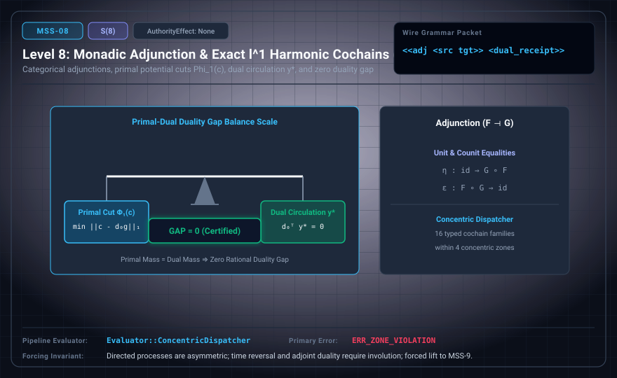

# MSS-N Level 08: Monadic Adjunction & Exact ℓ¹ Cochain Cuts

**AuthorityEffect:** None.\
**Level:** Level 08 (Categorical Adjunction / Exact Primal-Dual ℓ¹ Cochain Cuts)\
**Carrier:** Adjunction, Cochain, and Dual Receipt Packets\
**Runtime Pipeline:** `Evaluator::ConcentricDispatcher` | Primary Error: `ERR_ZONE_VIOLATION`\
**Atlas Capabilities:** `adjunction_unit`, `dual_lp_witness`

---

## 1. Schematic & Conceptual Architecture



MSS-8 formalizes categorical adjunctions and exact primal-dual $\ell^1$ cochain cut optimization over $\mathbb{Q}$, finding a minimal representative modulo exact cochains (distinct from $\ell^2$ Hodge harmonic constructions). The optimal potential cut $\Phi_1(c) = \min_g \|c - d_0 g\|_{1, \omega}$ is certified by a dual circulation witness $y^*$ with zero duality gap. The dispatcher enforces concentric zone boundaries across 16 typed families.

---

## 2. Wire Packet Grammar & Successor Rationale

- **Declared Successor Rationale:** Directed processes in MSS-8 are asymmetric; relational arrow reversal and involution require explicit dagger syntax; MSS-9 is declared as the successor stage to introduce this capability within the external research atlas. (Lift status to MSS-9 remains an unproved transition obligation.)
- **Wire Packet(s):**
```text
<<adj <src tgt> <unit> <counit>> <cochain id <e1 e2 ...>> <dual_receipt mass flow>>
```

---

## 3. Runtime Evaluator & Mathematical Core

- **Primal Problem:** $\Phi_1(c) = \min_g \|c - d_0 g\|_{1, \omega}$ (minimal representative modulo exact coboundaries).
- **Dual Problem:** $\max_y \langle c, y \rangle$ subject to $d_0^T y = 0$ and $|y_e| \le \omega_e$.
- **Zero Duality Gap:** Certified iff $\text{primal\_mass} = \text{dual\_mass}$.
- **Concentric Dispatcher:** `Evaluator::ConcentricDispatcher` dispatches across 4 concentric zones, emitting `ERR_ZONE_VIOLATION` on unauthorized boundary crossing.

---

## 4. Verification Obligation & Falsifier Boundary

- **Verifier Obligation:** Replay triangle identities and rational primal-dual feasibility.
- **Negative Counterexample:** A zero-gap string without dual feasibility is rejected.
- **Boundary Warning:** $\ell^1$ cochain cut optimization computes minimal representatives modulo exact cochains, not an $\ell^2$ Hodge harmonic decomposition.

---

## 5. Claim Hygiene Quadrant

1. **What this supports:**
   - Verification of exact rational duality gap certificates for minimal cochain representatives modulo coboundaries and categorical triangle identities on finite cochains.
2. **What this does not support:**
   - Does not establish an $\ell^2$ Hodge decomposition, continuous harmonic measures, or smooth potential functions.
3. **The narrowest defensible claim:**
   - MSS-8 verifies categorical adjunction identities and certifies exact primal-dual $\ell^1$ cochain cuts modulo exact cochains with zero duality gap.
4. **Next test needed:**
   - Advance to MSS-9 by defining dagger categories and relational profunctor arrow reversal.
