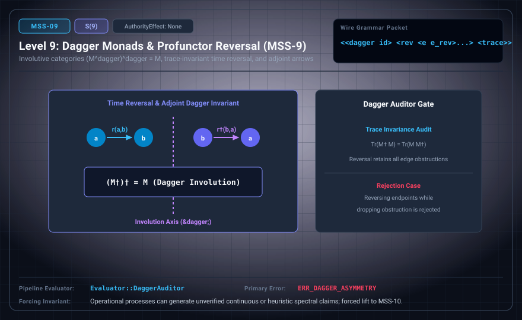

# MSS-N Level 09: Dagger Involution & Profunctor Reversal

**AuthorityEffect:** None.\
**Level:** Level 09 (Involutive Dagger Categories / Relational Arrow Reversal)\
**Carrier:** Dagger Packets with Involution Mappings and Profunctor Reversal Receipts\
**Runtime Pipeline:** `Evaluator::DaggerAuditor` | Primary Error: `ERR_DAGGER_ASYMMETRY`\
**Atlas Capabilities:** `dagger_involution`, `reversal_witness`

---

## 1. Schematic & Conceptual Architecture



MSS-9 introduces involutive dagger categories, providing contravariant endofunctors $(\cdot)^\dagger$ with $A^{\dagger\dagger} = A$, $(f^\dagger)^\dagger = f$, and $(g \circ f)^\dagger = f^\dagger \circ g^\dagger$. In relational settings, this formalizes profunctor arrow reversal $r^\dagger(y, x) \iff r(x, y)$. Crucially, generic dagger structure provides only categorical involution/reflection and does not supply a trace or physical time reversal.

---

## 2. Wire Packet Grammar & Successor Rationale

- **Declared Successor Rationale:** Operational processes can generate unverified continuous or heuristic spectral assertions; MSS-10 is declared as the successor stage to introduce this capability within the external research atlas. (Lift status to MSS-10 remains an unproved transition obligation.)
- **Wire Packet(s):**
```text
<<dagger id> <rev <e e_rev>...> <involution_receipt verified>>
```

---

## 3. Runtime Evaluator & Mathematical Core

- **Dagger Category Axioms:** Contravariant functor $(\cdot)^\dagger: \mathcal{C}^{\text{op}} \to \mathcal{C}$ satisfying $A^{\dagger\dagger} = A$, $\text{id}_A^\dagger = \text{id}_A$, $(f^\dagger)^\dagger = f$, and $(g \circ f)^\dagger = f^\dagger \circ g^\dagger$.
- **Relational Arrow Reversal:** Profunctor arrow reversal $r^\dagger(y, x) \iff r(x, y)$.
- **Involution Symmetry:** Computes and asserts $(M^\dagger)^\dagger = M$ over carrier relation matrices.
- **Dagger Auditor:** `Evaluator::DaggerAuditor` audits reflection/involution symmetry and emits `ERR_DAGGER_ASYMMETRY` on asymmetric failures.

---

## 4. Verification Obligation & Falsifier Boundary

- **Verifier Obligation:** Verify involution axioms $(f^\dagger)^\dagger = f$ and contravariant composition $(g \circ f)^\dagger = f^\dagger \circ g^\dagger$ on typed arrows.
- **Negative Counterexample:** Reversing endpoints while violating contravariant composition or dropping obstruction markers is rejected.
- **Boundary Warning:** Dagger category involution is purely algebraic and does not supply a categorical trace, unitary quantum evolution, or physical time reversal.

---

## 5. Claim Hygiene Quadrant

1. **What this supports:**
   - Verification of categorical dagger involution axioms and relational profunctor reversal on finite structures.
2. **What this does not support:**
   - Does not supply a categorical trace, nor does it establish physical time reversal, CPT symmetry, or microscopic unitarity.
3. **The narrowest defensible claim:**
   - MSS-9 verifies dagger category involution identities and relational profunctor arrow reversal.
4. **Next test needed:**
   - Advance to MSS-10 by establishing epistemic quarantine fences to isolate uncertified imported continuum and transcendental semantics.
