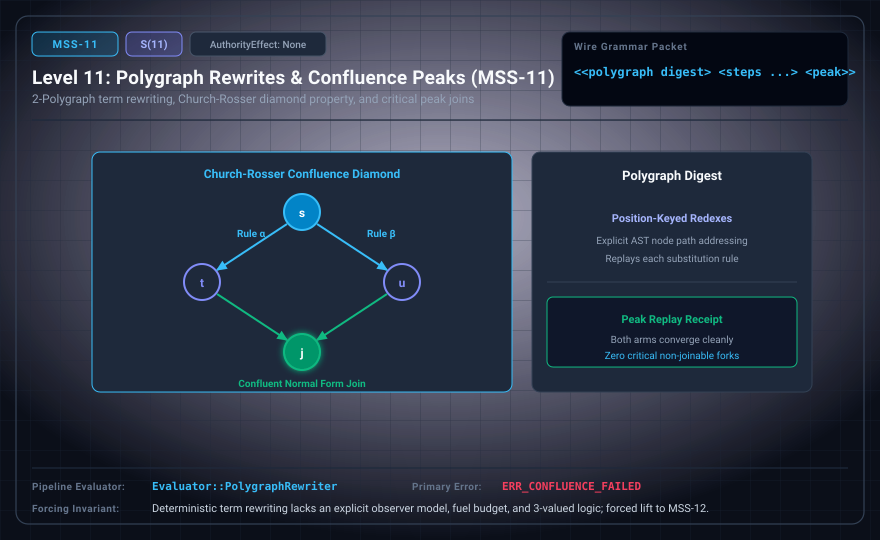

# MSS-N Level 11: Polygraph Rewrites & Confluence Peaks

**AuthorityEffect:** None.\
**Level:** Level 11 (2-Polygraphs / Church-Rosser Confluence Peak Joins)\
**Carrier:** Polygraph Presentation Packets with Rewrite Steps and Critical Peaks\
**Runtime Pipeline:** `Evaluator::PolygraphRewriter` | Primary Error: `ERR_CONFLUENCE_FAILED`\
**Atlas Capabilities:** `redex_position`, `peak_join`

---

## 1. Schematic & Conceptual Architecture



MSS-11 implements position-keyed term rewriting and critical peak join checks over 2-polygraphs. Embeds immutable ruleset digests and explicit AST redex paths. Critical peaks ($t \leftarrow s \to u$) are verified by demonstrating that both rewrite paths converge to a common join term $j$.

---

## 2. Wire Packet Grammar & Successor Rationale

- **Declared Successor Rationale:** Deterministic term rewriting lacks an explicit observer model, finite computational budget, and tri-valued truth logic; MSS-12 is declared as the successor stage to introduce this capability within the external research atlas. (Lift status to MSS-12 remains an unproved transition obligation.)
- **Wire Packet(s):**
```text
<<polygraph pres digest> <steps <rule loc src res>...> <peak apex left right join>>
```

---

## 3. Runtime Evaluator & Mathematical Core

- **Redex Path Keying:** Rewrites execute at explicit AST coordinates.
- **Critical Peak Joinability:** For an evaluated peak $t \leftarrow s \to u$, checks $\exists j, (t \to^* j \leftarrow^* u)$.
- **Local vs. Global Confluence:** Under Newman's Lemma, joinability of all critical pairs yields global confluence only for terminating (well-founded) rewrite relations.
- **Polygraph Rewriter:** `Evaluator::PolygraphRewriter` executes rules and emits `ERR_CONFLUENCE_FAILED` on unjoinable divergent peaks.

---

## 4. Verification Obligation & Falsifier Boundary

- **Verifier Obligation:** Replay each declared substitution step and verify convergence of both arms of tested critical peaks to identical terms.
- **Negative Counterexample:** An unjoined critical peak or divergence of branches is rejected with `ERR_CONFLUENCE_FAILED`.
- **Boundary Warning:** Tested local joinability of specific critical peaks alone does not establish global confluence or unique normal forms without certified termination bounds and exhaustive critical-pair completeness.

---

## 5. Claim Hygiene Quadrant

1. **What this supports:**
   - Verification of local joinability for tested critical peaks in 2-polygraph string rewrites.
2. **What this does not support:**
   - Does not establish global confluence or unique normal forms without complete critical-pair enumeration and verified termination; does not decide arbitrary rewrite systems.
3. **The narrowest defensible claim:**
   - MSS-11 verifies step-by-step substitution and joinability of declared critical peaks on finite 2-polygraph rewrites.
4. **Next test needed:**
   - Advance to MSS-12 by introducing the Discrete Deformation Analysis (DDA) 14-tuple event record and observer stack.
