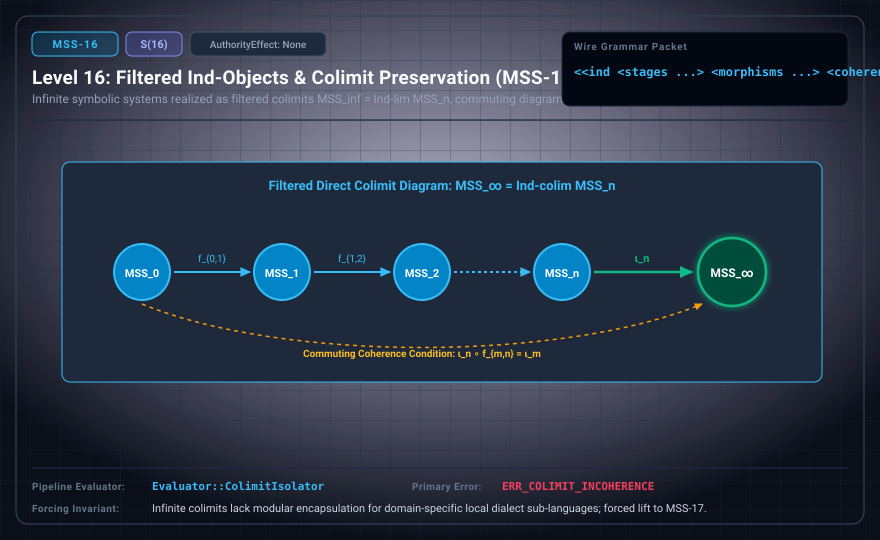

# MSS-N Level 16: Filtered Ind-Objects

**AuthorityEffect:** None.\
**Level:** Level 16 (Filtered Systems & Inductive Colimit Presentations / Coherence Protocols)\
**Carrier:** Ind-Object Packets for Declared Filtered Families $\langle P_i, \phi_{ij} \rangle$\
**Runtime Pipeline:** `Evaluator::ColimitIsolator` | Primary Error: `ERR_COLIMIT_INCOHERENCE`\
**Atlas Capabilities:** `stage_transition`, `coherence_check`

---

## 1. Schematic & Conceptual Architecture



MSS-16 formalizes the categorical apparatus for filtered colimits over a **declared filtered family of presentations** $(P_i, \phi_{ij})_{i \in I}$: $P_\infty = \operatorname{colim}_{i \in I} P_i$. Because successor lifts across the external MSS atlas rows are explicitly unlicensed research successors rather than proven canonical embeddings, MSS-16 does **not** assert that the actual atlas forms an established filtered system $\operatorname{colim} \mathrm{MSS}_n$. Instead, it evaluates declared presentation families $(P_i)$ equipped with explicitly supplied transition morphisms $\phi_{ij}: P_i \to P_j$ and coherence certificates verifying commutative cocones.

---

## 2. Wire Packet Grammar & Successor Rationale

- **Declared Successor Rationale:** Infinite colimits lack modular encapsulation for domain-specific local dialect sub-languages; MSS-17 is declared as the successor stage to introduce this capability within the external research atlas. (Lift status to MSS-17 remains an unproved transition obligation.)
- **Wire Packet(s):**
```text
<<ind <family P_i> <morphisms phi_ij ...> <coherence check> <quarantine>>>
```

---

## 3. Runtime Evaluator & Mathematical Core

- **Filtered Ind-Objects:** Directed colimit $\operatorname{colim}_{i \in I} P_i$ over a declared filtered diagram of finite presentation stages $(P_i, \phi_{ij})$. (Actual MSS rows form a colimit only conditionally upon establishing licensed transition lifts.)
- **Cocone Commutativity:** Explicit transition morphisms satisfy cocone coherence: $\phi_{jk} \circ \phi_{ij} = \phi_{ik}$ for all $i \le j \le k$.
- **Colimit Isolator:** `Evaluator::ColimitIsolator` maintains conservative inclusion diagrams, emitting `ERR_COLIMIT_INCOHERENCE` on non-commuting transition diagrams.

---

## 4. Verification Obligation & Falsifier Boundary

- **Verifier Obligation:** Verify composition of supplied transition morphisms $\phi_{ij}$ on generators and assert all source relations are preserved.
- **Negative Counterexample:** An alleged transition map that collapses a source equation or violates cocone commutativity is rejected with `ERR_COLIMIT_INCOHERENCE`.
- **Boundary Warning:** Colimit coherence over a declared family $(P_i)$ does not prove that the external MSS atlas rows form a licensed filtered colimit without explicitly certified inter-row lift maps.

---

## 5. Claim Hygiene Quadrant

1. **What this supports:**
   - Verification of cocone commutativity and conservative inclusions for declared filtered families of presentations $(P_i, \phi_{ij})$.
2. **What this does not support:**
   - Does not establish that the unproved external MSS atlas rows form a licensed filtered colimit $\varinjlim \mathrm{MSS}_n$, nor does it prove infinite compactness.
3. **The narrowest defensible claim:**
   - MSS-16 verifies cocone commutativity $\phi_{jk} \circ \phi_{ij} = \phi_{ik}$ for explicitly declared presentation diagrams $(P_i, \phi_{ij})$.
4. **Next test needed:**
   - Advance to MSS-17 by encapsulating specialized sub-dialect languages with isolated checksum namespaces.
