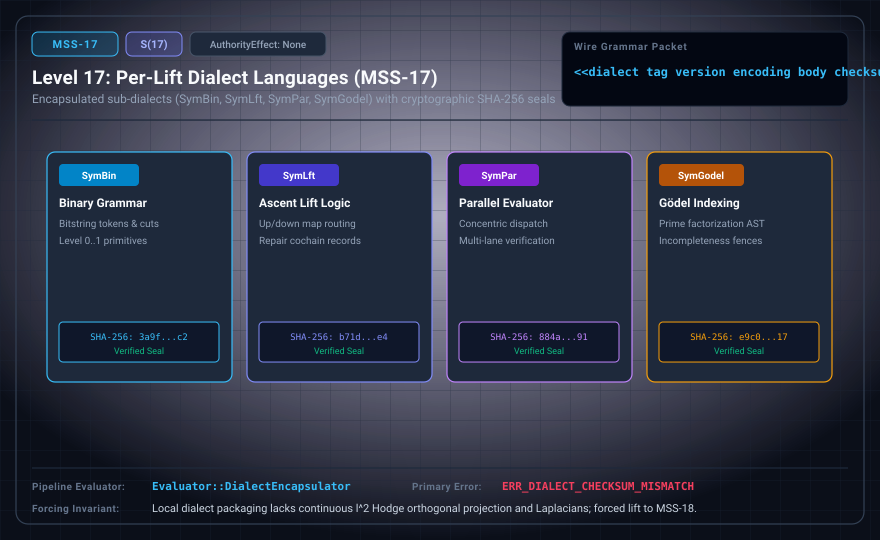

# MSS-N Level 17: Per-Lift Dialect Languages

**AuthorityEffect:** None.\
**Level:** Level 17 (Encapsulated Sub-Dialects / SHA-256 Checksum Fences)\
**Carrier:** Dialect Packets with Tag, Version, Body, and Checksum\
**Runtime Pipeline:** `Evaluator::DialectEncapsulator` | Primary Error: `ERR_DIALECT_CHECKSUM_MISMATCH`\
**Atlas Capabilities:** `dialect_tag`, `digest_proof`

---

## 1. Schematic & Conceptual Architecture



MSS-17 encapsulates specialized sub-dialects (SymBin, SymLft, SymPar, SymGodel) under isolated namespaces with SHA-256 checksums. Tag namespaces prevent inter-dialect grammar collisions and maintain modular verification boundaries.

---

## 2. Wire Packet Grammar & Successor Rationale

- **Declared Successor Rationale:** Local dialect packaging lacks discrete ℓ² Hodge orthogonal projection and combinatorial Laplacian harmonic spaces; MSS-18 is declared as the successor stage to introduce this capability within the external research atlas. (Lift status to MSS-18 remains an unproved transition obligation.)
- **Wire Packet(s):**
```text
<<dialect tag version encoding body checksum>>
```

---

## 3. Runtime Evaluator & Mathematical Core

- **Sub-Dialect Tags:** `SymBin` (binary cuts), `SymLft` (tower lifts), `SymPar` (simplices), `SymGodel` (arithmetic).
- **Cryptographic Checksum:** SHA-256 computed over canonical bytes.
- **Dialect Encapsulator:** `Evaluator::DialectEncapsulator` verifies local tag dispatch, emitting `ERR_DIALECT_CHECKSUM_MISMATCH` on payload alterations.

---

## 4. Verification Obligation & Falsifier Boundary

- **Verifier Obligation:** Decode with local tag dispatch and hash exact canonical bytes.
- **Negative Counterexample:** A changed body with unchanged digest is rejected with `ERR_DIALECT_CHECKSUM_MISMATCH`.
- **Boundary Warning:** Checksum integrity verifies byte fidelity; it does not verify semantic truth of the enclosed dialect body.

---

## 5. Claim Hygiene Quadrant

1. **What this supports:**
   - Verification of namespace isolation and byte-level SHA-256 checksum integrity across specialized sub-dialects.
2. **What this does not support:**
   - Does not establish that every sub-dialect is semantically consistent or complete.
3. **The narrowest defensible claim:**
   - MSS-17 encapsulates specialized sub-dialects, verifying byte fidelity via canonical SHA-256 checksums.
4. **Next test needed:**
   - Advance to MSS-18 by computing discrete ℓ² Hodge decompositions and simplicial combinatorial Laplacians.
