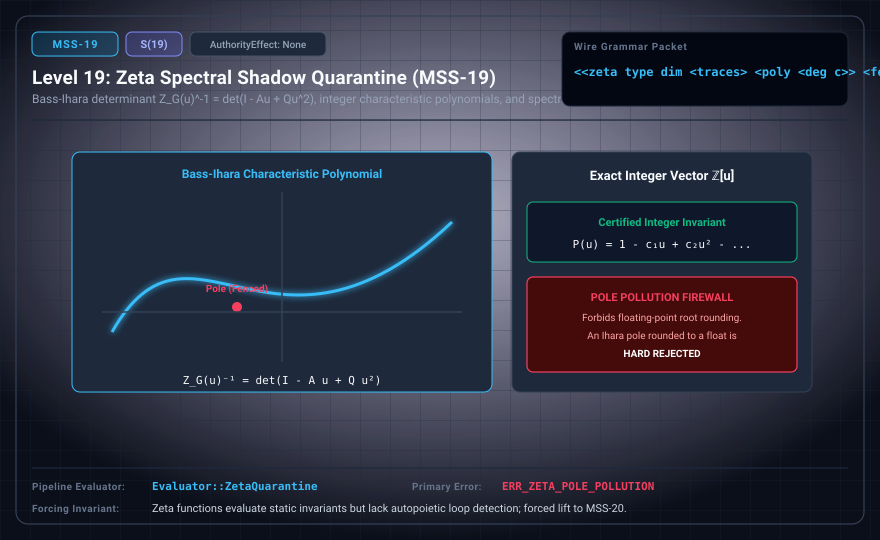

# MSS-N Level 19: Zeta Spectral Shadow Quarantine

**AuthorityEffect:** None.\
**Level:** Level 19 (Ihara Zeta Functions / Exact Integer Characteristic Polynomials)\
**Carrier:** Zeta Packets with Traces, Integer Polynomials, and Model Fences\
**Runtime Pipeline:** `Evaluator::ZetaQuarantine` | Primary Error: `ERR_ZETA_POLE_POLLUTION`\
**Atlas Capabilities:** `transfer_polynomial`, `zeta_fence`

---

## 1. Schematic & Conceptual Architecture



MSS-19 encodes Ihara and dynamical zeta functions strictly as exact integer characteristic polynomials via the Bass-Ihara determinant formula: $Z_G(u)^{-1} = (1 - u^2)^{r - 1} \det(I - A u + Q u^2)$ (where $r = |E| - |V| + 1$ is the cycle rank, $A$ is the adjacency matrix, and $Q = D - I$). Floating-point pole approximations are strictly forbidden to prevent unverified spectral leakage.

---

## 2. Wire Packet Grammar & Successor Rationale

- **Declared Successor Rationale:** Zeta functions evaluate static graph invariants but lack self-referential autopoietic loop detection; MSS-20 is declared as the successor stage to introduce this capability within the external research atlas. (Lift status to MSS-20 remains an unlicensed candidate lift obligation.)
- **Wire Packet(s):**
```text
<<zeta type dim <traces ...> <poly <deg coeff>...> <fence>>>
```

---

## 3. Runtime Evaluator & Mathematical Core

- **Bass-Ihara Determinant:** $Z_G(u)^{-1} = (1 - u^2)^{r-1} \det(I - A u + Q u^2)$.
- **Integer Characteristic Polynomials:** Coefficients must be exact integers $\mathbb{Z}$.
- **Zeta Quarantine:** `Evaluator::ZetaQuarantine` computes prime orbit polynomials, emitting `ERR_ZETA_POLE_POLLUTION` if floating-point pole approximations are submitted.

---

## 4. Verification Obligation & Falsifier Boundary

- **Verifier Obligation:** Compute exact polynomial from finite matrix and retain scope.
- **Negative Counterexample:** An irrational pole rounded to a rational is rejected with `ERR_ZETA_POLE_POLLUTION`.
- **Boundary Warning:** The graph Riemann Hypothesis is a finite combinatorial property of Ramanujan graphs and is not a proof of the continuous Riemann Hypothesis.

---

## 5. Claim Hygiene Quadrant

1. **What this supports:**
   - Verification of Bass-Ihara determinant identities and exact integer characteristic polynomial computation on finite graphs.
2. **What this does not support:**
   - Does not prove the continuous Riemann Hypothesis, the generalized RH, or critical zeros of continuous L-functions.
3. **The narrowest defensible claim:**
   - MSS-19 serializes Ihara zeta functions as exact integer polynomials, enforcing strict quarantine against continuous claims.
4. **Next test needed:**
   - Advance to MSS-20 by implementing autopoietic reflection and automated expansion cycle breaking.
