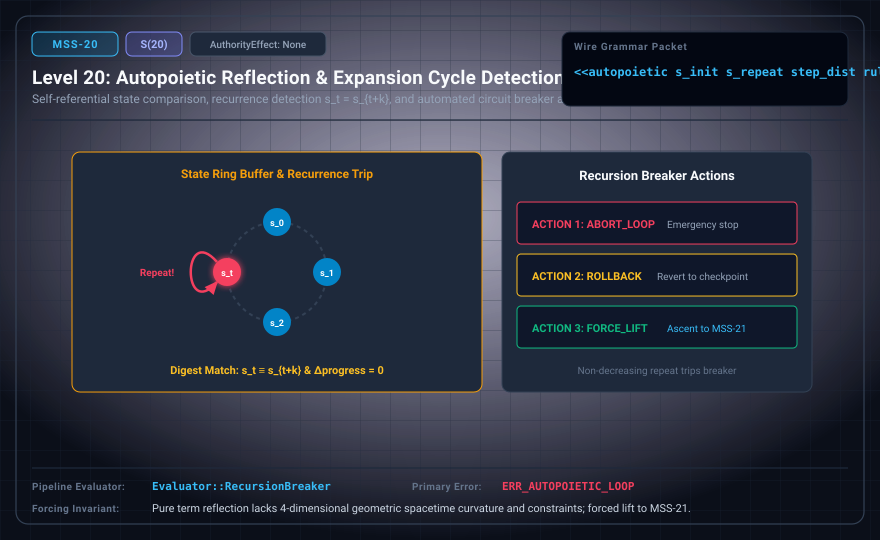

# MSS-N Level 20: Autopoietic Reflection & Expansion Cycle Detection

**AuthorityEffect:** None.\
**Level:** Level 20 (Self-Referential State Comparison / Automated Recursion Breaking)\
**Carrier:** Autopoietic Packets with State Digests, Step Distance, and Action Codes\
**Runtime Pipeline:** `Evaluator::RecursionBreaker` | Primary Error: `ERR_AUTOPOIETIC_LOOP`\
**Atlas Capabilities:** `repeated_state`, `progress_measure`

---

## 1. Schematic & Conceptual Architecture



MSS-20 implements self-referential state comparison and automated recursion breaking. By tracking identical machine state digests across step distances (s_t = s_{t+p}), the recursion breaker applies typed break actions (abort, rollback, or request lift) to break infinite autopoietic generation loops.

---

## 2. Wire Packet Grammar & Successor Rationale

- **Declared Successor Rationale:** Pure term reflection lacks 4-dimensional geometric spacetime curvature and discrete gravitational constraints; MSS-21 is declared as the successor stage to introduce this capability within the external research atlas. (Lift status to MSS-21 remains an unlicensed candidate lift obligation.)
- **Wire Packet(s):**
```text
<<autopoietic s_init s_repeat step_dist rule delta action>>
```

---

## 3. Runtime Evaluator & Mathematical Core

- **Canonical State Digest:** SHA-256 over canonical presentation states.
- **Cycle Detection:** Identifies $s_t = s_{t+p}$ with non-increasing progress measures.
- **Action Codes:** Deterministic break actions (`ACTION_ABORT`, `ACTION_ROLLBACK`, `ACTION_REQUEST_LIFT`). *(AuthorityEffect: None. The recursion breaker detects unproductive cycles and requests a lift; it cannot self-authorize an extension without an independently verified licensed-lift receipt.)*
- **Recursion Breaker:** `Evaluator::RecursionBreaker` monitors state histories, emitting `ERR_AUTOPOIETIC_LOOP` upon detecting unproductive cycles.

---

## 4. Verification Obligation & Falsifier Boundary

- **Verifier Obligation:** Compare full canonical states and detect nondecreasing repeated cycles.
- **Negative Counterexample:** A decreasing recursive call is not declared an expansion cycle.
- **Boundary Warning:** Breaking a cycle does not guarantee the existence of an escaping lift; it may result in `UNKNOWN`.

---

## 5. Claim Hygiene Quadrant

1. **What this supports:**
   - Verification of state hash equality detection and deterministic execution of recursion-breaking actions.
2. **What this does not support:**
   - Does not solve the general halting problem for arbitrary non-repeating divergent computations.
3. **The narrowest defensible claim:**
   - MSS-20 detects identical state digests across execution distances, halting unproductive autopoietic expansion loops.
4. **Next test needed:**
   - Advance to MSS-21 by evaluating discrete 4-dimensional Regge simplicial curvature deficits and Bianchi holonomies.
